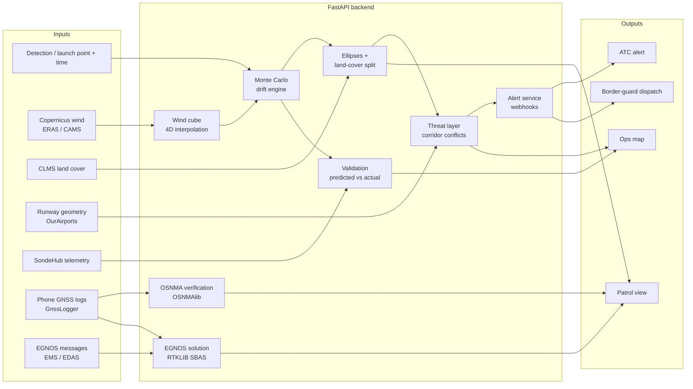

# Balloon Radar

**12th CASSINI Hackathon — EU Space for Peace and Resilience, Warsaw, 27–29 November 2026**
**Track: Challenge 3 — Countering transnational crime and terrorism with space data**

> Copernicus tells you where the balloon will fly. Galileo tells the patrol its GPS isn't lying. EGNOS makes sure the seizure location holds up in court.

This document follows the 6-section format from `12th_cassini_hackathon_idea_research_prompt_for_llms.md`, then adds the technical design, a 48-hour build plan, the demo script and a checklist. Items marked **[VERIFY]** are assumptions we have not confirmed yet.

---

## Table of contents

1. [One-line pitch and challenge track](#1-one-line-pitch-and-challenge-track)
2. [EU Space data and signal pipeline](#2-eu-space-data-and-signal-pipeline)
3. [Why it's not a duplicate](#3-why-its-not-a-duplicate)
4. [Target buyer and business model](#4-target-buyer-and-business-model)
5. [48-hour prototype scope](#5-48-hour-prototype-scope)
6. [Biggest risks and likely jury pushback](#6-biggest-risks-and-likely-jury-pushback)
7. [Technical design](#7-technical-design)
8. [Build plan for two people](#8-build-plan-for-two-people)
9. [Demo and pitch script](#9-demo-and-pitch-script)
10. [Friday-night checklist](#10-friday-night-checklist)
11. [Sources](#11-sources)

---

## 1. One-line pitch and challenge track

**Pitch:** We forecast where smuggling balloons launched from Belarus will fly. Air traffic control gets a targeted closure window instead of hours of airport shutdown, and border guards get a landing ellipse plus a patrol app whose position is authenticated against GNSS spoofing.

**Track:** Challenge 3. Cross-border cigarette smuggling by balloon, which Lithuanian authorities describe as a hybrid attack on civil aviation.

### The problem

- Vilnius airport has repeatedly closed because of smuggling balloons from Belarus. One closure lasted about **11 hours**; another night of closures affected **more than 1,700 passengers**.
- Lithuania calls these incidents a **hybrid attack** by Belarus.
- **Poland is affected too.** The Podlasie Border Guard has confirmed that balloons from Belarus have recently crossed into Poland several times.
- It is still happening: restrictions were imposed over Vilnius airport again in **September 2026**.
- Today the response is reactive. The airport learns about a balloon once it is already on radar, and closes conservatively for a long time because nobody knows where the balloon is going next.

### What we deliver

| User | Output | Value |
|---|---|---|
| Air navigation service provider / airport | "Balloon cluster will cross the RWY 01 approach corridor in 35–55 min, P(conflict) = 0.72. Recommended closure window 20:10–20:55." | Short, targeted closures instead of open-ended shutdowns |
| Border guard command | Landing ellipse (50% / 90%) with time window and land-cover breakdown, pushed as a dispatch ticket | Patrols wait where the cargo lands instead of searching blind |
| Patrol in the field | Navigation to the ellipse, **Galileo OSNMA** authentication status, **EGNOS** position with an error bound for evidence | Trustworthy positioning in a zone where GNSS is jammed and spoofed |

---

## 2. EU Space data and signal pipeline

All three EU systems named by the organizers are used, each for a real job.

### 2.1 Copernicus: the forecast engine and the terrain

| Dataset | Access | Purpose |
|---|---|---|
| **ERA5 hourly data on pressure levels** (`reanalysis-era5-pressure-levels`): `u_component_of_wind`, `v_component_of_wind`, `geopotential`, `temperature` | Copernicus Climate Data Store, `cdsapi` Python client | Replay of real Vilnius incidents; calibration and validation. ERA5 is published with a delay of several days, so it is **not** usable for live forecasting. |
| **Live wind forecast**: CAMS global forecast | Copernicus Atmosphere Data Store, `cdsapi` | Live trajectory forecast during the demo. **[VERIFY]** whether CAMS global forecasts expose wind components on pressure levels. If not, fall back to ECMWF open data (`ecmwf-opendata` package). That fallback is not formally Copernicus, and we say so openly. |
| **Land cover**: CORINE Land Cover and the High Resolution Layer Tree Cover Density | Copernicus Land Monitoring Service (download) | Split the landing ellipse into forest / open land / water / built-up. Forest changes how and where a patrol searches. |

**What the pipeline computes:**

1. **Input:** detection point and time (in production from the operator's radar; in the demo from incident reports or a radiosonde launch).
2. **Monte Carlo ensemble:** ~500 trajectories with sampled float altitude, ascent rate, descent behavior and launch-time uncertainty, each advected through a 4D wind field.
3. **Output:** a **probability cone** for the path and **50% / 90% landing ellipses**, not a single line.
4. **Threat layer:** intersection of the ensemble with airport approach/departure corridors over time.
5. **Decisions:** ATC alert with probability and closure window; dispatch ticket for the border guard.

### 2.2 Galileo: OSNMA for the patrol

Balloons land near the Belarusian border, which is exactly where GNSS jamming and spoofing are a problem. A patrol searching for cargo is working where its own navigation can't be trusted.

- **Path A (preferred):** Android phones log raw measurements and Galileo I/NAV navigation messages (Google's **GnssLogger** app, `GnssNavigationMessage`). The backend verifies the OSNMA signatures with **OSNMAlib** (open source).
- **Path B (fallback):** if our phones don't expose Galileo navigation messages, we verify OSNMA on real recorded reference data and say so explicitly to the jury.
- **Note:** OSNMA verification needs the Galileo OSNMA public key and Merkle tree root from the European GNSS Service Centre. **[VERIFY]** how long access takes.
- **Patrol output:** `AUTHENTICATED` / `NOT AUTHENTICATED — do not trust the map`.

### 2.3 EGNOS: position with an error bound

- Phones don't apply EGNOS corrections themselves, so we compute the EGNOS solution **server-side**: raw phone measurements plus EGNOS messages from ESA's **EGNOS Message Server** archive or **EDAS** (registration required), processed with **RTKLIB** in SBAS mode.
- **MVP:** EGNOS-corrected position vs. uncorrected position, with an accuracy estimate.
- **Stretch:** a horizontal protection level computed from the SBAS integrity parameters.
- **Why it matters:**
  - the seizure location is recorded with a stated accuracy, which is useful as evidence;
  - the search ellipse grows when position quality drops.
- **Narrative bonus:** EGNOS is an aviation system (LPV approaches), which ties into the airport story.

### 2.4 Live validation (not EU Space data, but real)

Weather radiosondes are launched every 12 hours from IMGW stations, including **Legionowo** near Warsaw **[VERIFY launch times: expected 00 and 12 UTC]**. Their live positions are public on the open **SondeHub** network. We use them to prove that our wind forecast and drift model work: our predicted path next to the real one.

---

## 3. Why it's not a duplicate

- **It avoids every saturated category in the brief:** it is not a GNSS jamming heatmap, not a Sentinel-2 change-detection dashboard, not a dark-vessel tracker and not a vague "AI crisis platform".
- **The output is a decision, not a map:** a closure window for ATC and a dispatch ticket for the border guard, pushed automatically (webhook, Telegram or email).
- **It fuses unexpected layers:** Copernicus winds and land cover, airport runway geometry, open radiosonde telemetry, Galileo OSNMA and EGNOS.
- **Honest about prior art:** balloon trajectory predictors already exist (SondeHub's predictor, NOAA HYSPLIT). We don't compete on the trajectory calculator. Our value is the **threat layer**:
  - uncertainty modeling for a balloon whose altitude and lift are unknown;
  - conflict detection against approach corridors with a recommended closure window;
  - a landing ellipse for interception;
  - a patrol workflow with OSNMA and EGNOS in a spoofing-affected zone.

---

## 4. Target buyer and business model

### Buyers

| Buyer | Pays for | Why now |
|---|---|---|
| **Air navigation service providers** (Oro Navigacija in Lithuania, LGS in Latvia, PAŻP in Poland) | Short, targeted closures instead of hours-long shutdowns | Repeated Vilnius closures; the problem is spreading regionally |
| **Airports** (Vilnius, Kaunas, Riga; eastern Poland) | Fewer diversions and passenger compensation claims | Every hour of closure costs real money |
| **Border guards** (Polish Border Guard, Lithuanian VSAT) | Landing ellipse, patrol positioning resistant to spoofing, more seizures | Hybrid pressure on the EU's eastern flank |

### Revenue model (hypothesis)

- SaaS subscription per airport or airspace sector.
- Regional licence for border guard units.

### Go-to-market

1. **Pilot financed by non-dilutive funding,** not a tender: EU defence-innovation programmes for dual-use startups, ESA business incubation in Poland, CASSINI mentoring.
2. **First reference customer:** one ANSP or airport in the Baltics where the pain is highest.
3. **Expand along the eastern flank,** then generalize the engine.

### Scaling the engine

The same engine works for anything the wind carries: chemical plumes from industrial fires, smoke, drifting objects. We pitch it as **airspace protection against hybrid threats**, with smuggling balloons as the first use case.

### Framing for a Polish jury

This is an EU eastern-flank problem, not just a Vilnius one. We open with the Polish Border Guard's confirmation that balloons have reached Poland.

---

## 5. 48-hour prototype scope

### Components

| # | Component | Status at demo |
|---|---|---|
| 1 | **Forecast engine** (Python): wind download, 4D interpolation, Monte Carlo, ellipses | Working on real data |
| 2 | **Threat layer:** approach corridors, intersections, alert logic, webhook | Working, real alert sent |
| 3 | **Radiosonde validation:** SondeHub telemetry vs. our prediction, landing error in km | Live during the pitch |
| 4 | **Vilnius incident replay:** ERA5 for the incident date, "this is when the alert would have fired" | Working on real data |
| 5 | **Patrol view:** web view with ellipse, land cover and OSNMA/EGNOS status | Working |
| 6 | **GNSS backend:** GnssLogger ingest, OSNMAlib, RTKLIB with EGNOS | Working on real logs (Path A or B) |
| 7 | **Frontend:** map plus alert panel | Working |

### Fresh Code Rule

We use open libraries (`xarray`, `cdsapi`, OSNMAlib, RTKLIB, mapping libraries), but we **do not fork an existing trajectory predictor**. The drift engine, Monte Carlo, threat layer and patrol workflow are written during the weekend.

### Explicitly out of scope

- Real radar feeds (we don't have access; production input).
- Real-time OSNMA verification on the phone itself (we verify on the backend).
- A full DO-229 integrity implementation (stretch goal only).

---

## 6. Biggest risks and likely jury pushback

### Jury questions and our answers

| Attack | Defense |
|---|---|
| "How do you know what altitude a smuggling balloon flies at?" | We don't, and we don't pretend to. That's why we run a Monte Carlo over altitude and lift and show a probability cone, not a line. Every recovered balloon calibrates the priors. |
| "A radiosonde is not a smuggling balloon." | Correct. A radiosonde bursts at ~30 km, and smuggling balloons fly lower. The radiosonde validates the wind forecast and drift model, not the smuggling flight profile. We say this ourselves in the pitch. |
| "Where do your radar detections come from?" | We don't have them. In production the input is the operator's radar. In the demo we use incident reports and the radiosonde launch. |
| "Balloon predictors already exist." | Yes: SondeHub, HYSPLIT. Our value is the threat layer: approach-corridor conflicts, closure windows, interception ellipses, and a patrol workflow with OSNMA and EGNOS. |
| "Galileo is just navigation here." (GNSS hardware engineers on the jury) | No. OSNMA works in a zone where GNSS is actively spoofed, and EGNOS gives an error bound usable as evidence. We show real verification, not a logo. |
| "A CAMS/ECMWF forecast isn't Sentinel data." | Copernicus is more than Sentinels: wind comes from Copernicus services (C3S, CAMS) and land cover from CLMS. If the live forecast uses ECMWF open data, we say so openly. |
| "The market is too small." | Small, but a very expensive problem with a specific budget owner, and the engine generalizes to any wind-borne hybrid threat. |

### Technical risks

1. **Phones may not expose Galileo navigation messages.** Fallback: OSNMA Path B.
2. **EGNOS data access:** EDAS requires registration; the EMS archive needs to be checked.
3. **No GNSS signal indoors.** Collect logs by a window or outside the building.
4. **The radiosonde may not launch or may drop out of SondeHub.** Fallback: Saturday's recorded flight plus the Vilnius replay.
5. **Live wind source** (see 2.1): decide on the fallback on Friday night.

---

## 7. Technical design

### 7.1 Architecture



### 7.2 Wind cube

- Download a bounding box covering the region of interest (e.g. Lithuania, Belarus border and north-eastern Poland for the replay; central Poland for the Legionowo radiosonde).
- Pressure levels from 1000 hPa up to ~10 hPa for the radiosonde and up to ~400 hPa for low-flying balloons.
- Convert geopotential to geometric altitude so we can look up winds by altitude.
- **Interpolation:** linear in time, bilinear in lat/lon, linear in log-pressure (altitude).

### 7.3 Drift engine

- **State:** `(t, lat, lon, alt)`. Horizontal motion follows the interpolated wind; vertical motion follows the flight profile.
- **Integration:** fixed step (e.g. 30–60 s), second-order (midpoint) scheme; convert wind m/s to degrees with the local Earth radius.
- **Flight profiles:**

| Profile | Ascent | Cruise | Descent |
|---|---|---|---|
| Radiosonde (validation) | ~5 m/s **[VERIFY]** | burst at ~30–35 km | parachute, faster aloft, ~5 m/s near the ground |
| Smuggling balloon | sampled | float at sampled altitude **[ASSUMPTION: prior range to be set from reported incidents]** | gradual loss of lift or release; sampled |

### 7.4 Monte Carlo and ellipses

- **N ≈ 500** members, with parameters sampled from priors: float altitude, ascent rate, descent rate, float duration, launch-time jitter, plus a small wind perturbation for forecast error.
- **Landing points:** mean and covariance give a confidence ellipse, scaled by the chi-square quantile for 2 degrees of freedom (50% → 1.386, 90% → 4.605).
- **Land-cover split:** intersect the ellipse with CLMS rasters and report percentages per class.

### 7.5 Threat layer

- **Corridors per runway end:** a polygon along the extended centreline (~10 NM out, ±1 NM wide), altitude band from the surface up to a configurable ceiling.
- **Per member:** first entry time into any corridor.
- **Outputs:**
  - `P(conflict)` = share of members that intersect;
  - entry window = 5th–95th percentile of entry times, plus a safety buffer;
  - recommended closure window.

### 7.6 Alert payload

```json
{
  "alert_id": "BR-2026-11-29-0007",
  "type": "AIRSPACE_CONFLICT",
  "airport": "EYVI",
  "runway": "01",
  "p_conflict": 0.72,
  "entry_window_utc": ["2026-11-29T19:10:00Z", "2026-11-29T19:55:00Z"],
  "recommended_closure_utc": ["2026-11-29T19:05:00Z", "2026-11-29T20:00:00Z"],
  "landing_ellipse_90": {"center": [54.62, 25.41], "semi_major_km": 9.8, "semi_minor_km": 4.1, "bearing_deg": 63},
  "land_cover_pct": {"forest": 58, "agricultural": 31, "water": 4, "urban": 7},
  "issued_utc": "2026-11-29T18:31:00Z"
}
```

### 7.7 GNSS backend

1. **Ingest:** GnssLogger text logs (raw measurements and navigation messages).
2. **OSNMA:** extract Galileo I/NAV pages, feed them to OSNMAlib, and report per-satellite authentication status plus a summary for the patrol.
3. **EGNOS:** convert logs to RINEX, then run RTKLIB in SBAS mode with the EGNOS message file. Report the EGNOS position, the uncorrected position and the difference.

### 7.8 Stack and repo layout

- **Backend:** Python 3.11, FastAPI, `xarray`, `numpy`, `shapely`, `pyproj`, `rasterio`, `cdsapi`.
- **Frontend:** a single page with MapLibre GL JS (or Leaflet).
- **Webhooks:** Telegram bot or a Discord webhook.

```
balloon-radar/
├── backend/
│   ├── wind/          # download + 4D interpolation
│   ├── engine/        # drift model, Monte Carlo, ellipses
│   ├── threat/        # corridors, conflicts, alerts
│   ├── landcover/     # CLMS intersection
│   ├── gnss/          # OSNMA + EGNOS processing
│   ├── validation/    # SondeHub ingest, error metrics
│   └── api.py         # FastAPI endpoints
├── frontend/          # map, alert panel, patrol view
├── data/              # downloaded datasets (gitignored)
└── docs/
```

### 7.9 API sketch

| Endpoint | Purpose |
|---|---|
| `POST /forecast` | Detection point + time + profile → ensemble, ellipses, conflicts |
| `GET /alerts` | Active alerts |
| `POST /gnss/upload` | Patrol log → OSNMA + EGNOS results |
| `GET /validation/{sonde_id}` | Predicted vs. actual track and landing error |
| `GET /replay/{incident_id}` | Vilnius incident replay timeline |

### 7.10 Validation metrics

- **Landing error (km):** our predicted landing point vs. the actual radiosonde landing.
- **Baseline:** compare with SondeHub's own prediction for the same flight. Being in the same range proves the engine is credible.
- **Calibration:** was the actual landing point inside our 50% / 90% ellipse?

---

## 8. Build plan for two people

| Person A: forecast and threat | Person B: GNSS, patrol and pitch |
|---|---|
| Copernicus data (ERA5, CAMS, CLMS) | Phone tests and GnssLogger logs |
| Drift engine and Monte Carlo | OSNMAlib, i.e. OSNMA verification |
| Airport corridors and alerts | RTKLIB with EGNOS |
| SondeHub validation | Patrol view and webhook |
| Vilnius incident replay | Slides, demo script, backup recording |

### Timeline

- **Friday evening and night:** checklist from section 10, data downloads, drift-engine skeleton, first phone logs by a window.
- **Saturday until 13:00:** Monte Carlo and ellipses, OSNMA on real data, first map.
- **Saturday 13:00 CET:** **full dress rehearsal on the Legionowo radiosonde** (12 UTC launch): predict, then compare once it lands.
- **Saturday afternoon and night:** corridors, alert and webhook, EGNOS in RTKLIB, Vilnius replay, land cover.
- **Sunday until 12:00:** frontend polish and a backup demo recording (in case the internet or the radiosonde fails).
- **Sunday 13:00 CET:** radiosonde launch; start the live forecast.
- **Sunday 15:00:** submission deadline. **15:05:** pitch with the real radiosonde on screen.

---

## 9. Demo and pitch script

**3 minutes:**

1. **Hook (15 s):** "Vilnius airport, closed for 11 hours. Because of balloons full of cigarettes." Show a headline.
2. **Problem (30 s):** hybrid attack, Poland is affected too, and today the response only starts once the balloon is on radar.
3. **Live demo (75 s):**
   - map: a radiosonde launched from Legionowo at 13:00 today, our forecast next to its real live position;
   - Vilnius incident replay: "here the alert would have fired; closure of about 40 minutes instead of 11 hours" **[VERIFY with the replay result before claiming a number]**;
   - patrol view: ellipse with forest/open-land split, OSNMA status, EGNOS position with an error bound;
   - a real alert arrives on a phone via webhook.
4. **Three EU systems in one sentence (15 s):** the line at the top of this document.
5. **Business (30 s):** ANSPs, airports, border guards; subscription; scales to every wind-borne hybrid threat.
6. **Close (15 s):** "The balloons are already flying. We tell you where."

---

## 10. Friday-night checklist

- [ ] **SondeHub:** can we see today's Legionowo radiosonde flights, and at what times do they launch?
- [ ] **CAMS:** do the global forecasts include wind on pressure levels? If not, decide on the fallback and how we communicate it.
- [ ] **Copernicus CDS/ADS accounts** and API keys (`cdsapi`), licences accepted for ERA5 and CAMS.
- [ ] **GnssLogger:** do our phones log raw measurements **and** Galileo navigation messages? Test by a window.
- [ ] **OSNMA:** OSNMAlib installed; Galileo OSNMA public key and Merkle tree root obtained.
- [ ] **EGNOS:** access to the message archive (EMS) or EDAS, including registration.
- [ ] **RTKLIB:** builds and runs on sample data.
- [ ] **Vilnius incidents:** exact dates and times (e.g. the 30 November 2025 closure and the night with three closures) for the ERA5 replay.
- [ ] **Runway data:** OurAirports runway CSV for EYVI, EYKA, EVRA and EPWA.

---

## 11. Sources

- CASSINI Hackathon Poland: https://www.cassini.eu/hackathons/poland
- Polish Border Guard on balloons reaching Poland (Rzeczpospolita): https://www.rp.pl/przestepczosc/art43218011-balony-z-papierosami-nad-litwa-przemytnicy-czy-sluzby-putina-i-lukaszenki
- Vilnius airport closed for 11 hours (XYZ/PAP): https://xyz.pl/?p=143149
- More than 1,700 passengers affected in one night (LRT): https://www.lrt.lt/pl/wiadomosci/1261/2820064/vitkauskas-o-balonach-najbardziej-intensywna-noc-w-tym-roku-odkryto-8-balonow
- Lithuania calls it a hybrid attack (Eska): https://www.eska.pl/wiadomosci/przez-balony-z-bialorusi-lotnisko-w-wilnie-zostalo-zamkniete-litwa-mowi-o-ataku-hybrydowym-aa-skru-6D5d-FJtt.html
- Restrictions over Vilnius airport, September 2026 (LRT): https://www.lrt.lt/pl/wiadomosci/1261/3060042/balony-przemytnicze-nad-wilnem-wprowadzono-ograniczenia-nad-wilenskim-lotniskiem
- Copernicus Climate Data Store (ERA5): https://cds.climate.copernicus.eu
- Copernicus Atmosphere Data Store (CAMS): https://ads.atmosphere.copernicus.eu
- Copernicus Land Monitoring Service: https://land.copernicus.eu
- SondeHub: https://sondehub.org
- OurAirports data: https://ourairports.com/data/
- European GNSS Service Centre (OSNMA, Galileo notices): https://www.gsc-europa.eu
