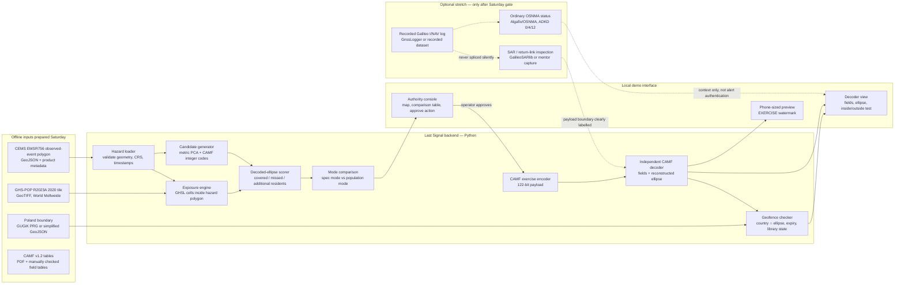

# Last Signal: Galileo EWSS Alert Targeting + Reference Receiver — Project Dossier

## 1. Summary card

| Item | Summary |
|---|---|
| **One-line pitch** | Last Signal helps an authorised emergency operator choose who a Galileo satellite warning should cover, shows exactly who would be missed or warned unnecessarily, and exports that decision in Galileo's official 122-bit alert format for local checking. |
| **Challenge track** | **Challenge 2 — Space-enabled crisis response and civil resilience.** Secondary, carefully limited link to Challenge 1 through alert-authentication status and auditability. |
| **EU space assets used** | **Copernicus Emergency Management Service (CEMS)** observed flood geometry from activation EMSR756; **JRC Global Human Settlement Layer population data (GHSL/GHS-POP)**; **Galileo Emergency Warning Satellite Service (EWSS)** and its Common Alert Message Format (CAMF); recorded Galileo E1-B I/NAV data only if the Saturday receiver gate succeeds; ordinary OSNMA status only as contextual evidence, not as proof that an alert is authentic. |
| **Target buyer** | Primary paying customer hypothesis: a **public-warning-system vendor or national systems integrator** that must add EWSS targeting to an existing Common Alerting Protocol (CAP) warning chain. Pilot user: a civil-protection operator, preferably from a Lower Silesian voivodeship crisis-management environment. Secondary later customer: chipset or device companies needing decoder test cases. |
| **Target user** | A duty officer or warning-system operator working for, or supplying, an authorised civil-protection authority. Citizens are beneficiaries, not the direct users of the hackathon prototype. |
| **Ranking context** | The idea ranked **first among the team's 29 ideas, scoring 7.4/10**, with no originality penalty. The ranking described it as having the best originality-to-feasibility ratio in the pool, while identifying commercial—not primarily technical—risk. |
| **Hackathon deliverable** | An offline **alert-targeting workbench**: real Copernicus flood geometry → population exposure calculation → comparison of encodable Galileo alert ellipses → CAMF exercise export → independent local decode and inside/outside test. A radio receiver is an optional stretch item, not a promised deliverable. |
| **Bottom line** | **Pick this project only in its narrowed form.** The winning product is not “we send an alert to a phone” and not “we built the Galileo receiver.” It is an auditable decision tool that answers the question an operator must face before any EWSS alert is issued: *“If this coarse satellite ellipse is used, which estimated residents inside the observed danger area would be missed, and how many people outside it would also be warned?”* That question is real, measurable, demonstrable from real Copernicus data in 48 hours, and much less saturated than a generic flood map. The project becomes weak if the team restores the original claims about live phone reception, guaranteed delivery, invented coverage numbers, Ukrainian CAMF instructions, or OSNMA proving the alert authentic. |

---

## 2. Plain-language description

### The problem

When a flood damages mobile-phone towers or cuts their power, people may still have a phone in their hand but no mobile signal. A normal warning sent through the phone network may therefore never arrive.

This happened during the September 2024 floods in Poland's Kłodzko Valley. Operators reported that nearly half of the base stations in the valley were not working. Reporters in Lądek-Zdrój found areas without mobile coverage. A parliamentary interpellation later said that telecommunications failures in Stronie Śląskie, Bystrzyca Kłodzka and Lądek-Zdrój prevented effective crisis management.

Poland's Alert RCB is an SMS warning system. SMS is useful, but it still depends on the mobile network. If the local tower is flooded, damaged, or without power, the message may not reach the person who needs it.

### The new satellite possibility

Europe's Galileo satellite-navigation system is adding an Emergency Warning Satellite Service, usually shortened to **EWSS**. EWSS means that an authorised warning can be carried by a Galileo satellite signal rather than by a mobile-phone tower.

That could eventually help when local mobile networks fail.

But there is a catch. A Galileo EWSS warning is extremely short: only **122 bits**. A bit is a single yes/no piece of digital information. A normal phone message can contain thousands of characters; an EWSS message has room only for a small set of coded choices.

One of those choices is the warning area. The authority cannot send the exact wiggly outline of a flooded river valley. It must choose an **ellipse**, which is an oval. Galileo allows only a limited set of ellipse sizes, centre positions, and rotations.

A river valley is often long and thin. One big oval may cover the valley but also warn many safe hillside towns. A smaller oval may avoid warning those towns but miss a village at the end of the valley. Choosing badly can either:

- miss people who are in danger; or
- warn so many people unnecessarily that they start ignoring future warnings.

### What we build

Last Signal is a computer tool for the person who must make that choice.

It does four things:

1. **It starts with a real flood outline.**  
   For the hackathon, we use a flood area observed and published through the Copernicus Emergency Management Service after the 2024 Polish floods.

2. **It estimates how many residents are inside that flood outline.**  
   We use a European population map produced by the European Commission's Joint Research Centre. It does not count individual people or phones. It estimates how many residents normally live in each small area.

3. **It tests possible Galileo warning ovals.**  
   The tool compares:
   - the smallest allowed oval that contains the whole mapped flood area; and
   - alternatives that may reduce unnecessary warnings but could miss some residents.

   It shows the trade-off in plain numbers:
   - estimated residents in the mapped danger area who would be covered;
   - estimated residents in the danger area who would be missed;
   - estimated residents outside the mapped danger area who would also receive the warning.

4. **It turns the chosen warning into Galileo's official short format.**  
   The tool produces a test version of the 122-bit Galileo alert and then decodes it again locally. A test point can be placed inside or outside the ellipse to show who the message is intended to reach.

The operator—not the software—must approve the final choice. If an option would miss people, that number is shown prominently. The software must not silently hide it.

### What a user actually sees and does

The main user is a warning-system operator. The operator:

1. Opens a saved flood case.
2. Sees the observed flood area on a map.
3. Sees the standard “cover everything” ellipse.
4. Sees a population-focused alternative.
5. Compares how many estimated residents each option covers, misses, and additionally warns.
6. Chooses an option and presses **Approve exercise draft**.
7. Exports:
   - the coded 122-bit alert;
   - a human-readable report; and
   - if time allows, a standard CAP warning file for testing with other warning software.
8. Opens the local decoder view and checks that the exported alert decodes to the same ellipse and instructions.
9. Moves a test location inside and outside the ellipse to see “would receive” or “would not receive.”

The operator does **not** press a real “send to Galileo” button. The prototype has no authority and no connection that could transmit a real public warning.

### What the phone view means—and does not mean

A phone-sized screen can show what a decoded test alert would look like. That is useful for judging whether the warning is understandable.

It does **not** prove that today's phones can receive EWSS alerts. Current phones generally do not display these warnings. Support needs suitable satellite-navigation chips, device software, and final receiver rules.

For the hackathon demo, the phone view must be labelled:

> **EXERCISE — LOCAL TEST PAYLOAD — NOT BROADCAST**

Airplane mode on a stage phone would not prove that a satellite alert arrived. It would only show that a locally stored or locally loaded page can be displayed without the mobile network.

### Why it needs space data

The project uses space in two different ways:

- **Copernicus satellites and Copernicus services tell us where the danger was observed and where people live in relation to it.**
- **Galileo provides the future warning format and, eventually, the satellite channel being prepared for phones and other receivers.**

Without Copernicus, there is no observed flood area to test. Without Galileo's restricted ellipse format, there is no targeting problem to solve.

### Why now

Galileo has been carrying out sporadic test transmissions of real emergency-warning messages from **23 July to 30 November 2026**. The hackathon takes place on the final weekend of that announced test window. EWSS Initial Service is planned for **2027**.

That timing creates a narrow opportunity: warning-system suppliers and civil-protection authorities need to prepare, test their software, and understand the targeting trade-offs before the service becomes operational.

It also creates a warning for the team: a test transmission window is not the same thing as a live public service, and the team cannot assume that a test alert will be broadcast during the pitch.

### What this project is not

Last Signal is not:

- a replacement for Alert RCB;
- a guarantee that anyone will receive a warning;
- a system that can send messages through Galileo;
- a certified phone receiver;
- proof that a satellite warning is authentic;
- a real-time flood forecast;
- a claim that the 2024 Copernicus flood maps were available early enough to provide the first warning.

It is a preparation and decision-support tool for authorised operators and the companies that build their warning systems.

---

## 3. Technical description

### 3.1 Corrected product definition

The executable hackathon product is:

> **An offline EWSS alert-targeting workbench that takes a reviewed hazard polygon, estimates resident exposure with GHSL, searches only the ellipse values actually encodable in CAMF, compares a spec-compliant full-containment baseline with explicitly approved population trade-offs, exports a CAMF exercise payload, and independently decodes that payload for visual and geographic verification.**

The following are **not** core deliverables:

- real Galileo uplink;
- live reception of an EWSS alert;
- a production Android EWSS receiver;
- ADKD=2 authentication verification;
- real-time EFAS ingestion;
- real-time flood forecasting;
- Sentinel-3 fire targeting;
- a base-station outage map;
- a production RCB integration;
- a citizen-facing warning application.

### 3.2 Architecture



### 3.3 Exact data pipeline

#### Stage 1 — CEMS observed flood geometry

**Primary dataset**

- Activation: **EMSR756 — Flood in South West Poland, 2024**
- Access route:
  - Public API specification/endpoint identified by research-sol:  
    `https://rapidmapping.emergency.copernicus.eu/backend/dashboard-api/public-activations/?code=EMSR756`
  - Or the activation viewer's **Details & Download** route.
- Follow the product metadata to the vector download ZIP.
- Use the **observed-event flood polygon layer**, not:
  - the area-of-interest rectangle;
  - permanent water;
  - damage-assessment points;
  - a screenshot or PDF map.
- Preferred initial AOI:
  - **AOI19 Stronie Śląskie**, if usable observed geometry and non-trivial population exposure exist.
- Fallback AOI:
  - **AOI03 Nysa**, explicitly distinguished from AOI16 Nysa city.
- Other AOIs mentioned in the bulletin, including Lądek-Zdrój and Kłodzko, must not be assumed to contain complete or timely geometry.

**Metadata that must be stored with the geometry**

```json
{
  "activation": "EMSR756",
  "aoi_id": "[VERIFY FROM PRODUCT]",
  "aoi_name": "[VERIFY FROM PRODUCT]",
  "product_id": "[VERIFY FROM PRODUCT]",
  "layer_name": "[VERIFY FROM PRODUCT]",
  "sensor": "[VERIFY FROM PRODUCT]",
  "acquisition_utc": "[VERIFY FROM PRODUCT]",
  "product_release_utc": "[VERIFY FROM PRODUCT]",
  "geometry_type": "observed_event_polygon",
  "source_url": "[RECORD EXACT URL]",
  "downloaded_at": "[RECORD TIME]",
  "file_hash_sha256": "[COMPUTE LOCALLY]"
}
```

**Chronology rule**

Activation, image acquisition, product release, flood peak, and street-level inundation are different events. The demo must call the polygon a **retrospective observed footprint** or **reference observation**, not:

- ground truth for every flooded street;
- the peak extent, unless the selected product specifically establishes that;
- information available before the Stronie Śląskie dam failure;
- a forecast.

Product versions, acquisition times, and release times must be shown in the console's data panel.

**Format conversion**

- Vector ingestion: `pyogrio==0.12.1` with GeoPandas-compatible workflows, QGIS, or `ogr2ogr`.
- Runtime format: local GeoJSON in WGS84 longitude/latitude for display.
- Analysis geometry: transform explicitly with `pyproj`; do not perform area or population logic in unprojected degrees.

#### Stage 2 — Population exposure

**Dataset**

- **GHS-POP R2023A**
- Epoch: **2020**, selected as a reproducible historical proxy for the 2024 case.
- Resolution: **100 m**
- Native CRS: World Mollweide, commonly represented as EPSG:54009/ESRI:54009; verify the exact CRS from the downloaded GeoTIFF metadata.
- Access: JRC GHSL download tiles; no API key identified.
- Licence/attribution: record the exact licence and attribution from the downloaded product page. The reviews identify it as an open attributed JRC product; do not republish the raster as if it were the team's data.

**Processing rules**

1. Download the tile or tiles covering the selected AOI before building the UI.
2. Crop locally to a bounding box around the hazard plus candidate-ellipse search area.
3. Keep GHSL values as estimated residents per cell.
4. Do not bilinearly interpolate population counts.
5. Do not resample people-per-cell values casually.
6. Mask NoData explicitly.
7. For the primary result, use a documented cell-inclusion rule.
8. Provide one sensitivity result, for example:
   - cell-centre inclusion; and
   - partial-area allocation or a clearly labelled 100 m hazard-polygon buffer.
9. Report rounded estimated residents, never individual people.
10. If a candidate ellipse extends beyond the population crop or beyond the observed EO coverage, mark that region as **unknown**, not zero population and not safe.

**Core counts**

Let:

- `H` = GHSL cells classified as inside the observed hazard polygon;
- `E` = GHSL cells classified as inside a decoded candidate ellipse;
- `P(cell)` = estimated residents in a cell.

Then:

- **Mapped exposed population**  
  `sum(P(cell) for cell in H)`

- **Covered mapped-exposed population**  
  `sum(P(cell) for cell in H ∩ E)`

- **Missed mapped-exposed population**  
  `sum(P(cell) for cell in H − E)`

- **Additional population inside ellipse**  
  `sum(P(cell) for cell in E − H)`

- **Additional-population ratio**  
  `additional / mapped exposed population`, shown alongside the raw counts.

“Additional” must not automatically be described as “safe” or “needlessly warned.” It means outside the selected mapped footprint. The footprint may be incomplete, later than the peak, or missing flooded areas.

#### Stage 3 — CAMF model

**Specification status**

- CAMF v1.2, March 2026, is listed by the Galileo Service Centre as in force.
- The team design was based mainly on v1.1.
- **The v1.1-to-v1.2 difference has not yet been verified from the full v1.2 document in the supplied material. [UNVERIFIED]**
- The design's broad structure is supported by v1.1:
  - 122-bit CAMF payload;
  - 105 mandatory bits plus 17 additional bits in the design/review account;
  - 49-bit primary target ellipse;
  - 17-bit settings field that can select one of several mutually exclusive uses.

**Ellipse fields to implement**

- centre latitude: 16 bits;
- centre longitude: 17 bits;
- semi-major axis: 5 bits;
- semi-minor axis: 5 bits;
- azimuth/orientation: 6 bits.

**Quantisation facts to encode from the specification**

- Latitude/longitude base step identified in the reviews: approximately **0.0027466°**.
- Near the Polish case area, this is approximately 306 m north–south and 200 m east–west; compute locally rather than hard-coding a conversion.
- Semi-axis values are logarithmically spaced; the reviewed range is approximately **0.216 km to 2,500 km**.
- Azimuth has 64 values with **2.8125°** steps.
- CAMF azimuth is measured from East toward North, not as a normal compass bearing from North clockwise.
- Required conversion, subject to final verification against v1.2:

```text
azimuth_camf = (90° - bearing_from_north_clockwise) modulo 180°
```

The inverse conversion must also be unit-tested.

**Do not confuse the layers**

- **122 bits** = CAMF payload.
- **160 bits** = long return-link message described in the CNES material.
- **22 bits per nominal E1-B page** = SAR data field framing described in the Galileo OS SIS ICD material reviewed by research-sol.
- **228 bits in 29 bytes** = Android's representation of a Galileo I/NAV navigation message, not a CAMF message.

A CAMF payload is therefore not “one Android callback,” and receiving ordinary navigation pages does not prove that EWSS content has been received.

**Initial CAMF subset**

Implement only:

- one flood hazard profile;
- one primary ellipse;
- one verified additional-bits setting, or no optional setting if the v1.2 tables cannot be verified;
- test message type;
- placeholder provider code;
- one verified instruction/library entry;
- explicit onset and duration values appropriate to the replay clock.

Do not initially implement:

- all B1/B2/B3/B4 settings combinations;
- secondary ellipse as a second corridor segment;
- all hazard types;
- all languages;
- CAP-to-CAMF production conversion;
- multi-message corridor alerts as an operational claim.

**Provider identity**

No published Polish provider-code assignment was verified. Therefore:

- encode `A1 = Test` if that is the correct v1.2 test designation after checking;
- use provider code `00000` only as a placeholder if consistent with the checked tables;
- display: **“Test message type; placeholder provider — production provider codes are assigned nationally.”**

Do not encode the payload as if RCB had issued it.

**Instruction language**

- Polish and English may be shown only after the exact library entries have been transcribed and checked from CAMF v1.2.
- The reviewed international library list does **not** include Ukrainian.
- Ukrainian may appear only as a clearly labelled proposed national-library or local user-interface translation. It must not be presented as decoded from the CAMF international library.
- A safer demo pair is Polish plus Czech or German, after verifying those exact entries.

**Alert identity and multi-ellipse restriction**

The Alert ID is derived from fields including country, provider, hazard, and onset. Two supposedly separate corridor messages with the same provider, hazard, and onset can therefore collide and be interpreted as versions of the same alert.

Hackathon rule:

- demo uses **one ellipse per alert**;
- a two-ellipse union may be shown only as an analytical sensitivity case;
- do not claim that operational multi-message corridor targeting works until EUSPA's operational rules resolve alert identity, update, replacement, and expiry behaviour.

### 3.4 Ellipse candidate generation and scoring

#### Inputs

- repaired hazard polygon;
- GHSL population grid;
- CAMF integer coding tables;
- Poland boundary for geofence tests;
- operator-selected mode.

#### Candidate generation

Do not search only around the polygon centroid. A bent river corridor can have a centroid outside the hazard.

Procedure:

1. Repair the hazard geometry with Shapely.
2. Transform the polygon to a local metric projection centred on the hazard.
3. Compute an initial oriented fit using principal-component analysis.
4. Generate seed centres from:
   - polygon centroid;
   - representative points from corridor segments;
   - a coarse grid over the hazard bounding area;
   - points along the polygon's medial or longest-axis approximation if simple to compute.
5. For each seed, generate nearby CAMF centre codes rather than continuous coordinates.
6. Enumerate plausible semi-major and semi-minor codes.
7. Enumerate nearby azimuth codes.
8. Encode each candidate to CAMF integer fields.
9. Decode those fields back to an ellipse.
10. Score **the decoded ellipse**, never the pre-quantisation continuous ellipse.

#### Modes

**Mode S — Spec/full-containment mode**

Objective:

1. Require the decoded ellipse to contain the entire hazard polygon, subject to a documented numerical tolerance.
2. Among containing candidates, minimise ellipse area or additional population.
3. This is the baseline and the default operational mode.

This mode reflects the CAMF/STELLAR behaviour identified by research-wonder: the system computes an ellipse that fits the target polygon, with the smallest containing ellipse as the reference behaviour.

**Mode P — Population trade-off mode**

Objective:

- maximise covered mapped-exposed population for a given additional-population cost; or
- maximise a transparent weighted score.

Example objective:

```text
score = covered_mapped_exposed
        - λ × additional_population
        - μ × ellipse_area_km2
```

Where:

- `λ` and `μ` are visible operator parameters;
- missed mapped-exposed population is always reported separately;
- the UI does not hide candidates that miss settlements;
- a human must explicitly approve Mode P.

Mode P is a decision-support experiment, not the specified automatic behaviour and not a recommendation to leave people unwarned.

**Fair comparison**

The baseline and alternative must be compared:

- at the same message count;
- after CAMF quantisation;
- using the same population denominator;
- using the same hazard polygon;
- with missed population displayed first.

The design's “96% coverage, 18% over-warning, 11,400 people” figures are **not results**. They must not appear in slides unless reproduced by the final data run.

#### Geometry and membership

- Population scoring should be performed in the GHSL native grid by transforming the candidate ellipse polygon into that CRS.
- Receiver membership tests should use:
  - a local azimuthal-equidistant projection centred on the ellipse; or
  - a geodesic method.
- Do not test ellipse membership in raw degrees.
- Do not use Web Mercator distances without correction.
- Console display must render the decoded quantised ellipse, not an idealised continuous ellipse.

#### Performance approach

- Precompute the hazard-cell mask once.
- Convert GHSL cells in the search region to arrays of coordinates and population values.
- Vectorise candidate scoring with NumPy.
- Cache candidate results by `(centre_lat_code, centre_lon_code, major_code, minor_code, azimuth_code)`.
- Use coarse-to-fine candidate generation.
- Report measured runtime on the demo laptop.
- Do not claim a global optimum unless the search actually proves it. Use **“best candidate found.”**

### 3.5 CAMF encoder and decoder

#### Encoder responsibilities

- Validate every field against the checked CAMF v1.2 ranges.
- Reject reserved or unknown values unless an explicit test mode is enabled.
- Pack fields in the documented order.
- Record:
  - total bit length;
  - padding convention;
  - hexadecimal representation;
  - field-by-field breakdown;
  - specification version used;
  - test-vector identifier.

#### Decoder responsibilities

The decoder should be written as a separate code path from the encoder. If the same helper generates and parses the expected result, a shared bug can produce a false round-trip pass.

Decoder outputs:

- message type;
- country/region code;
- provider code;
- hazard category/type;
- severity;
- onset;
- duration;
- instruction/library identifiers;
- primary ellipse fields;
- decoded ellipse geometry;
- additional-settings interpretation;
- warnings for reserved, malformed, expired, or unknown-library states.

#### Required tests

At minimum:

1. Encode → decode → field equality.
2. Independent hand-calculated field breakdown for one payload.
3. Bit-length test equals 122 before transport padding.
4. Padding convention documented separately from CAMF payload length.
5. North–south ellipse test.
6. East–west ellipse test.
7. Azimuth conversion test in both directions.
8. Semi-axis minimum and maximum tests.
9. Centre-grid edge test.
10. Inside-ellipse point.
11. Outside-ellipse point.
12. Inside ellipse but wrong country.
13. Expired alert.
14. Unknown library version.
15. Malformed/reserved field.
16. Week-boundary onset case.
17. Independent decode by a mentor, another team, or a second team member using only the field table.

If CAMF v1.2 cannot be obtained and checked by Saturday midday, the UI and submission must say:

> **CAMF geometry and experimental codec — not yet validated against CAMF v1.2.**

### 3.6 Optional CAP export

CAP is an interchange format, not proof of integration with RCB or a national gateway.

If implemented:

- Generate CAP 1.2 XML with Python's `xml.etree.ElementTree`.
- Validate against a locally stored OASIS CAP 1.2 XSD.
- Use `status=Test` for the exercise fixture.
- Keep the original hazard polygon and proposed target area as separate information elements.
- If an ellipse is approximated as a CAP polygon:
  - close the polygon;
  - verify coordinate order;
  - remember CAP uses latitude,longitude pairs while GeoJSON uses longitude,latitude;
  - label it as an approximation.
- Do not claim that the proposed ellipse survives a gateway's CAP-to-EWM reconversion.

If CAP validation is not complete by Saturday evening, cut CAP and export:

- human-readable JSON report;
- CAMF field breakdown;
- CAMF hexadecimal payload;
- comparison table.

### 3.7 Receiver pipeline — optional and gated

#### Payload-boundary decoder — mandatory

This component accepts CAMF bits produced by the team's encoder or supplied as a test fixture. It proves:

- field decoding;
- ellipse reconstruction;
- country-and-ellipse geofence logic;
- expiry behaviour;
- instruction lookup;
- unknown-library behaviour.

It does not prove radio reception.

#### Recorded Galileo navigation — stretch only

Android facts to respect:

- `android.location.GnssNavigationMessage` is available from API 24+.
- Its Galileo I/NAV representation is 228 bits in 29 bytes, MSB first, with four trailing padding bits.
- Fine-location permission, enabled GNSS, and a foreground client are required.
- A normal position fix or a `Raw` record does not prove navigation-page availability.
- Device and chipset support vary.
- GnssLogger may produce no usable Galileo `Nav` records on a given phone.
- The E1-B/E5b ambiguity documented for some logger workflows must be checked before claiming signal identity.

**Saturday capture protocol — maximum 20–30 minutes**

For each available phone, record:

- handset model;
- Android build;
- GnssLogger version;
- start and end time;
- indoor/outdoor conditions;
- constellations observed;
- number of Galileo records;
- SVIDs;
- `Nav` record count;
- page/message lengths;
- continuity and gaps;
- whether the raw log is complete and unmodified.

Save the unmodified log. Do not edit it to insert a successful result.

**Go condition for any radio claim**

Proceed only if the team can identify, from a genuine capture or a mentor-supplied capture:

- the relevant E1-B pages;
- the SAR/return-link framing;
- a long return-link message;
- the CAMF payload boundary;
- the expected decoded fields.

Otherwise, the demo starts explicitly at the CAMF payload boundary.

**Prohibited presentation**

Do not splice generated CAMF bits into a recorded navigation log and describe the result as “received from Galileo.” If an injection exercise is shown, label every stage:

> Real recorded navigation log; synthetic CAMF payload inserted locally for decoder testing; no EWSS reception claimed.

A cleaner approach is to keep the two demonstrations separate:

1. real recorded Galileo navigation pages exist and can be inspected;
2. the CAMF payload decoder works on a local exercise payload.

#### GalileoSARlib

Research-wonder identifies GalileoSARlib as an existing open-source tool for parsing the SAR field from Septentrio Binary Format data. It may be used as a library or reference for recorded-data inspection.

Do not write a new SDR receiver this weekend. Do not buy or integrate new radio hardware unless a mentor supplies a complete capture and its expected decoded output.

#### OSNMA and ADKD=2

Fact-checked position:

- Galileo Service Notice #28 confirms sporadic real EWSS test transmissions from 23 July to 30 November 2026.
- EWSS test messages are authenticated using a new OSNMA ADKD value, **ADKD=2**.
- Initial Service is planned for 2027.

Technical limitation:

- ADKD=2 is treated as reserved in the published OSNMA SIS ICD material reviewed by the reviewers.
- Existing receivers may discard tags associated with reserved ADKDs.
- The inspected public OSNMA implementation's active ADKD set is `{0, 4, 12}`.
- Observing an ADKD=2 tag, authenticating ordinary navigation data, or displaying “OSNMA OK” does **not** prove that the EWSS alert was authenticated.
- Ordinary OSNMA authenticates relevant navigation data; it does not prove:
  - the receiver's position;
  - that the hazard exists;
  - that jamming is absent;
  - that the alert content is correct;
  - that a locally generated payload came from Galileo.

Integrity UI states must therefore be separate:

| State | Meaning |
|---|---|
| `LOCAL_EXERCISE` | Payload created locally by the team. |
| `RECORDED_NAV_ONLY` | Real navigation data recorded; no EWSS payload identified. |
| `RECORDED_TEST_EWM_UNVERIFIED` | A genuine test EWM is believed to have been captured, but ADKD=2 authentication was not verified. |
| `EWM_AUTH_VERIFIED` | Use only if ADKD=2 verification is actually implemented and demonstrated with suitable trust material and time reference. This is not expected during the hackathon. |

No green “authenticated alert” badge is allowed in the first three states.

Also note the delayed-authentication issue: OSNMA's TESLA-style mechanism can mean that authentication material becomes available after the message. A receiver may therefore be unable to authenticate an urgent alert at first reception. The prototype should name this limitation rather than claim real-time authentication.

### 3.8 Datasets and access summary

| Dataset/source | Access | Account/key | Latency/status | Hackathon use |
|---|---|---:|---|---|
| CEMS EMSR756 | Public activation API or viewer download | No key identified | Retrospective products; acquisition/release vary by AOI | Primary hazard polygon |
| GHS-POP R2023A 2020 | JRC tile download | No API key identified | Static modelled residential population | Exposure denominator |
| Poland boundary | GUGiK PRG preferred; Natural Earth/GADM fallback | Verify download terms | Static | Country geofence test |
| CAMF v1.2 | Galileo Service Centre electronic library | **[UNVERIFIED: account/download behaviour]** | In force March 2026; body still to be checked | Codec tables |
| Galileo Service Notice #28 | GSC PDF | No key identified | Test window 23 Jul–30 Nov 2026 | Service/authentication status |
| EFAS archived forecast | EWDS/ECMWF; `cdsapi`; dataset `efas-forecast` for as-issued replay | ECMWF account and licence acceptance likely/required per review | Real-time restricted to partners; archive after embargo | Optional context only |
| CEMS GFM | Portal, STAC at `https://stac.eodc.eu/api/v1`, or authenticated API `https://api.gfm.eodc.eu/v2/` | Portal/API conditions to verify | Target roughly within 8 hours of Sentinel-1 acquisition; not onset detection | Backup only |
| Sentinel-3 SLSTR FRP | CDSE OData catalogue | Authenticated download/quota | Active-fire product, not an evacuation perimeter | Cut from prototype |
| GnssLogger logs | Team phones | Android permissions | Device-dependent | Optional capture |
| Local basemap | Pre-rendered SVG/PNG or local tiles | None at runtime | Fully offline | Demo reliability |

### 3.9 Tech stack

#### Backend

Use Python 3.11 with a pinned, smoke-tested environment.

Candidate pins identified by research-sol:

```text
numpy==2.2.6
shapely==2.2.0
pyproj==3.7.2
rasterio==1.4.3
pyogrio==0.12.1
fastapi==0.115.12
uvicorn==0.34.3
```

These are available releases identified during review, not a guaranteed tested combination on the team's laptops. Install from binary wheels, run the smoke tests, then freeze the resolved environment.

Important environment note:

- The design says Python 3.11.
- Current Rasterio metadata may require Python 3.12.
- Therefore the pinned Rasterio 1.4.3 route is safer for Python 3.11 than an unpinned install.
- Test an actual GeoTIFF and the World Mollweide transform on both demo machines.

#### Frontend

- `maplibre-gl` version 5.6.0 was identified by research-sol as an available option.
- Do not depend on CDN files, online fonts, sprites, or tile servers.
- Preferred demo rendering:
  1. local MapLibre with inline style and local GeoJSON; or
  2. static SVG/PNG map fallback.
- A single-page interface is sufficient.
- The phone preview can be a responsive view of the same local application, but it must have been loaded and cached before any airplane-mode demonstration.

#### Optional libraries

- `Algafix/OSNMA` — ordinary OSNMA research and recorded-log experiments.
- GalileoSARlib — SAR-field parsing from suitable recorded data.
- Do not make either library a dependency of the core targeting demo.

#### Repository layout

```text
last-signal/
├── README.md
├── LICENSES.md
├── requirements.txt
├── backend/
│   ├── camf/
│   │   ├── tables.py
│   │   ├── encoder.py
│   │   ├── decoder.py
│   │   ├── geometry.py
│   │   └── tests/
│   │       ├── test_roundtrip.py
│   │       ├── test_golden_vectors.py
│   │       ├── test_azimuth.py
│   │       └── test_geofence.py
│   ├── hazard/
│   │   ├── load_emsr756.py
│   │   ├── validate_polygon.py
│   │   └── metadata.py
│   ├── population/
│   │   ├── load_ghsl.py
│   │   ├── exposure.py
│   │   └── sensitivity.py
│   ├── optimiser/
│   │   ├── candidates.py
│   │   ├── scoring.py
│   │   └── compare_modes.py
│   ├── receiver/
│   │   ├── payload_decoder.py
│   │   ├── geofence.py
│   │   └── provenance.py
│   └── api.py
├── frontend/
│   ├── index.html
│   ├── app.js
│   ├── styles.css
│   └── assets/
├── data/
│   ├── README.md
│   ├── demo_bundle/
│   └── .gitignore
├── scripts/
│   ├── prepare_demo_bundle.py
│   ├── run_offline_demo.py
│   └── record_fallback.py
├── submission/
│   ├── slides.pdf
│   ├── demo-recording.mp4
│   └── description.md
└── docs/
    ├── data-manifest.md
    ├── camf-verification.md
    ├── demo-script.md
    └── limitations.md
```

Large source datasets should not be committed if repository rules or size limits prevent it. The repository must nevertheless contain:

- exact source identifiers;
- download URLs;
- product and layer names;
- acquisition and release metadata;
- file hashes;
- processing scripts;
- a small reproducible demo bundle or clear instructions for reconstructing it.

### 3.10 Local API

A full backend API is optional. A command-line pipeline that generates a checked demo bundle is better than four unfinished endpoints.

If FastAPI is used, keep these routes:

| Endpoint | Purpose | Required behaviour |
|---|---|---|
| `POST /alerts/propose` | Load a prepared hazard case and return decoded candidate ellipses with counts | Local only; no external calls; returns metadata and unknowns |
| `POST /alerts/encode` | Encode an operator-approved exercise alert | Rejects unapproved Mode P payloads unless approval flag and operator name/initials are supplied |
| `POST /receiver/decode` | Decode a CAMF payload and run geofence tests | Accepts payload bytes/hex, not a claim of radio reception |
| `GET /cases/emsr756` | Return the static retrospective case | Includes product metadata, not a fabricated warning timeline |

Drop the earlier proposed GNSS-log upload route unless the receiver gate succeeds.

### 3.11 Validation metrics

The final slide may report only measured values:

| Metric | Definition |
|---|---|
| Mapped exposed residents | GHSL-estimated residents inside the selected observed footprint |
| Covered | Mapped exposed residents inside the decoded ellipse |
| Missed | Mapped exposed residents outside the decoded ellipse |
| Additional | Estimated residents inside the ellipse but outside the mapped footprint |
| Additional ratio | Additional divided by mapped exposed residents |
| Runtime | Measured candidate-search time on the demo laptop |
| Codec result | Number of golden and property tests passed |
| Sensitivity | Difference between cell-centre and sensitivity exposure treatment |

Do not report:

- lead time from EMSR756;
- percentage of “people warned” as if population equals phone owners;
- mobile-outage population unless independently sourced;
- delivery success;
- lives saved;
- a global optimum unless the search method proves it.

---

## 4. Problems and solutions

### 4.1 Consolidated problem register

Severity definitions:

- **BLOCKER** — the original claim or deliverable must be removed, replaced, or gated before submission.
- **MAJOR** — can invalidate the result, business case, or demo if not fixed.
- **MINOR** — should be fixed if time allows, but must not displace the blockers.

Attribution note: the supplied project packet contains complete reviews from research-sol and research-wonder, the project ranking, fact-check, design document, guidelines, and past-winner notes. A separate complete research-kimi review was not present in the material available for this dossier; no finding below is attributed to Kimi.

| ID | Problem | Severity | Raised by | Solution | Residual risk |
|---|---|---:|---|---|---|
| P-01 | The design implies Galileo EWSS can now deliver an alert to a phone. In reality, test transmissions run 23 Jul–30 Nov 2026 and Initial Service is planned for 2027. There is no public uplink for the team. | BLOCKER | Sol, Wonder, Ranking, Fact-check | Rename “Send” to “Export exercise draft.” Remove live-delivery claims. Say “preparing for the 2027 service.” | Judges may still consider the impact future-dated. Mitigate with preparation/test use case. |
| P-02 | “Reference receiver on an Android phone” is unproven. Device support for Galileo I/NAV `Nav` records varies; a fix does not prove navigation-page access; indoor reception is unlikely. | BLOCKER | Sol, Wonder, Ranking | Run one 20–30 minute outdoor phone gate. If it fails, ship payload decoder only and label phone UI as preview. | Even if pages exist, EWSS payload identification may remain impossible. |
| P-03 | The 2026 EWSS radio encapsulation is not established from public material. CAMF 122 bits, long RLM 160 bits, SAR field 22 bits/page, and Android's 228-bit I/NAV representation are different layers. | BLOCKER | Sol, Wonder | Ask ChipCraft/mentors for a shareable capture plus expected decoded fields. Otherwise start demo at CAMF payload boundary. Never splice synthetic bits into a log and call it reception. | A GNSS judge may still see Galileo as under-used if only payload decoding is shown. Show real EMS geometry and, if available, unrelated real I/NAV inspection separately. |
| P-04 | Original integrity claim overstates OSNMA. Authenticating navigation data on a satellite does not authenticate the return-link alert. | BLOCKER | Ranking, Sol, Wonder | Remove green badge and broad Challenge 1 claim. Use provenance states and fail-closed handling. | Cyber judges may ask why integrity remains in the pitch at all. Answer with ADKD=2 roadmap and audit states. |
| P-05 | Updated fact: Service Notice #28 does assign OSNMA ADKD=2 to EWSS authentication, but ADKD=2 is reserved in the current SIS ICD material and public tooling may discard it. | MAJOR | Sol, Wonder, Fact-check | State both halves: “EWSS authentication is specified for the tests through ADKD=2; our public toolchain cannot yet verify it.” Display tag-slot readiness only if actually implemented. | Jurors may challenge whether MACLT 34 details have been checked in v-current documents. Mark exact implementation status honestly. |
| P-06 | CAMF v1.2 is in force, but the team designed from v1.1 and has not verified the v1.2 body, field changes, language tables, or worked examples. | BLOCKER | Sol, Wonder, Design | Download v1.2 Saturday morning, hash it, compare relevant sections and Annex C. Implement one verified flood profile. If not verified by midday, label codec experimental. | Transcription errors remain possible; independent decode required. |
| P-07 | A self-round-trip encoder/decoder can share the same bug and falsely appear conformant. Annex C field tables are not a complete conformance suite. | MAJOR | Sol, Wonder | Build hand-checked golden vectors, independent field breakdown, malformed-field tests, and an independent decode by another person. | Cross-checking against QZSS material helps only if the relevant CAMF tables are identical in the implemented subset. **[UNVERIFIED]** |
| P-08 | The official/CAMF system behaviour described in the reviews computes a smallest ellipse containing the target polygon. The design instead celebrates partial coverage such as “96% covered.” | BLOCKER | Wonder; supported by Sol's matched-coverage warning | Ship Spec Mode as baseline/default and Population Mode as explicit operator-approved trade-off. Show missed residents in red. | Civil-protection users may reject any partial-coverage mode. That reaction is itself useful validation. |
| P-09 | Multi-ellipse corridor alerts can collide on Alert ID when provider, hazard, and onset are the same. The second alert may replace the first. | BLOCKER | Wonder; Sol also warns messages may conflict | Demo one ellipse per alert. Show two-ellipse union only as offline sensitivity analysis. Flag operational rule as an EUSPA question. | Corridor advantage becomes less dramatic. Honest constraint is preferable to a non-working alert model. |
| P-10 | The B1–B4 17-bit settings are mutually exclusive. B3 secondary ellipse is not a second freely fitted corridor ellipse. | MAJOR | Sol, Wonder | Implement only one verified setting or none. Describe B3 accurately as constrained secondary geometry/guidance, subject to v1.2 confirmation. | Reduced feature list; no material demo loss. |
| P-11 | No verified Polish provider code exists in the material. Encoding “RCB” would be a bluff. | MAJOR | Wonder | Use Test message type and placeholder provider, clearly displayed. | Judge may ask who will assign codes; answer: national implementation, not the team. **[UNVERIFIED: assignment process]** |
| P-12 | The scripted Polish-then-Ukrainian alert is not supported by the reviewed CAMF international library: Ukrainian is not listed among the 25 languages. | BLOCKER | Wonder, Sol | Remove Ukrainian as a decoded-library claim. Use verified Polish plus Czech/German, or label Ukrainian as a future national-library/UI translation. | Polish/Ukrainian local relevance is reduced, but factual credibility is preserved. |
| P-13 | CAMF azimuth is measured from East toward North. GIS code often assumes bearing from North clockwise. A sign/convention error rotates the ellipse incorrectly. | MAJOR | Wonder, Sol | Single conversion function, inverse unit tests, north–south/east–west golden cases, and render only decoded ellipses. | If v1.2 changes the convention, tests must be updated after document check. |
| P-14 | Ellipse membership in degrees or Web Mercator can misclassify locations by hundreds of metres. Population scoring in the wrong CRS compounds the error. | MAJOR | Wonder, Sol | Use local azimuthal-equidistant/geodesic membership and GHSL native-grid population scoring. Document methods. | Edge sensitivity remains; show the sensitivity result. |
| P-15 | EMSR756 is retrospective. AOI products were released at different times and some were still in progress days later. It cannot support “we could have warned before the dam broke.” | BLOCKER | Sol, Wonder | Label as retrospective targeting. Show acquisition/release dates. Remove lead-time claims. | Story becomes less dramatic but technically defensible. |
| P-16 | The wrong EMSR756 layer could be used: AOI rectangle, permanent water, damage points, or map image instead of observed flood geometry. AOI03 and AOI16 Nysa must not be confused. | MAJOR | Sol | Inspect ZIP contents and layer metadata. Record product, layer, sensor, acquisition, and release. Switch from Stronie to Nysa if geometry/exposure is inadequate. | Public API/ZIP behaviour may differ at download time; verify Saturday. |
| P-17 | EFAS real-time forecasts are restricted to partners. Archived access needs EWDS/ECMWF processes and EFAS outputs are discharge forecasts, not street-level inundation polygons. | BLOCKER for live claim | Sol, Wonder, Ranking | Remove EFAS from executable path. Optional slide context only. Future production input would be an authority/partner-supplied reviewed polygon. | Some judges may ask what triggers the first warning; answer honestly: partner forecast/national hydrology outside prototype. |
| P-18 | GFM is observed surface flooding with a target of roughly eight hours after Sentinel-1 acquisition, not real-time onset detection. It has radar shadow, vegetation, urban, and no-observation limitations. | MAJOR | Sol, Wonder | Use only as backup or update context. Cache one scene and advisory masks. Never render no-observation as dry. | A suitable scene may not exist for the chosen case. EMSR756 remains primary. |
| P-19 | GHSL measures modelled residential population, not people present, phone owners, evacuees, tourists, or people who lost mobile service. Its 100 m cells are sensitive in narrow valleys. | MAJOR | Sol, Wonder, Ranking | Call counts “estimated residents.” Use 2020 epoch, native grid, transparent cell rule, and one sensitivity check. If denominator is tiny, switch AOI. | Results remain estimates; relative comparison is more defensible than absolute impact. |
| P-20 | The design's 96% coverage, 18% over-warning, and 11,400 outage population figures are not computed results. | BLOCKER | Sol, Wonder, Design | Delete until produced by the final pipeline. Lead with missed residents and show raw counts. | Real numbers may be less impressive. Use the honest trade-off as the story. |
| P-21 | An optimiser can improve its over-warning ratio by sacrificing a small settlement. “Outside mapped flood” also does not mean safe. | MAJOR | Sol, Wonder | Put missed mapped-exposed residents first; show missed-area map; compare at matched coverage or display the full trade-off. | Population mode may look unattractive once misses are visible; that is the point of decision support. |
| P-22 | The official ground segment/service concept already includes CAP submission and conversion to a target ellipse/EWM. STELLAR and ERAS-related work weaken the claim that “the missing piece” does not exist. | BLOCKER commercially | Sol, Wonder | Reposition as operator-side comparison, QA, audit, and what-if module for vendors/authorities. Ask whether the gateway exposes/retains an operator-reviewed ellipse. | If the gateway already does population-aware optimisation with audit and override, the standalone product thesis may fail. |
| P-23 | Direct sale to RCB or a voivodeship is unproven. EWSS is free to authorities; public procurement is slow; F24/Everbridge-type vendors may be partners or substitutes. | MAJOR | Sol, Wonder, Ranking | Make the first offer a fixed-scope paid tabletop benchmark for a warning-platform integrator, reviewed by an operator. Treat direct authority licence and device SDK as later hypotheses. | No buyer commitment exists. Practitioner and vendor discovery are essential. |
| P-24 | A second fire hazard is not a quick clone. Sentinel-3 FRP detects active fire at coarse scale; it is not a perimeter or evacuation model. EFFIS active-fire detections are not all Sentinel-3 measurements. | MAJOR | Sol, Wonder | Cut fire from the prototype. Mention polygon-input generalisation only as roadmap. | Some judges may see flood-only scope as narrow; narrowness is preferable to false breadth. |
| P-25 | There is no geospatial tower-outage dataset in the evidence. Press reports do not locate towers, establish all-operator coverage holes, or identify affected residents. | MAJOR | Sol, Wonder, Ranking | Delete outage layer and population weighting. Use the dated Orange/PAP report as narrative context only. | The “only channel” claim becomes weaker and must be removed. |
| P-26 | Alert RCB should be described accurately as SMS-based, not assumed to be cell broadcast in 2026. | MINOR | Sol, Wonder, Fact-check context | Say “Alert RCB is described as an SMS system forwarded through mobile operators.” Do not claim it is Poland's only warning channel. | Future Polish cell-broadcast plans do not change the 2024 premise but should not be overstated. **[UNVERIFIED: exact current implementation timetable]** |
| P-27 | CAP does not natively preserve a CAMF ellipse, and a locally generated CAP file does not prove RCB/gateway acceptance. The gateway may regenerate geometry. | MAJOR | Sol, Wonder | Generate CAP only as a validated Test fixture, or cut it. Label original hazard and proposed target separately. | CAP may be dropped for time; JSON report is sufficient. |
| P-28 | Venue Wi-Fi, CDSE, tile servers, CDN assets, or a phone loading a web UI after enabling airplane mode can break the demo. | MAJOR | Sol, Wonder | Pre-download all data and basemap. Test with networking off. Cache/preload phone view. Record a 60–90 second fallback. | Local laptop failure remains; duplicate bundle on two machines. |
| P-29 | Python/GIS installation can fail because of version and binary-wheel issues, especially Rasterio/Python compatibility. | MAJOR | Sol | Pin versions, install Saturday morning, smoke-test GeoTIFF/CRS on both laptops, freeze environment and cache wheels. | A second laptop may still differ; use precomputed demo bundle as fallback. |
| P-30 | Fresh Code risk if Balloon Radar ingestion, OSNMA, receiver, or UI code is copied. Related-team pre-existing captures may also raise provenance questions. | BLOCKER | Wonder, Sol | Create a clean weekend repository, rewrite project code, use only public libraries/data, document dependencies, and ask organisers about pre-existing team captures. | Organiser interpretation may still restrict some reuse; obtain the ruling early. |
| P-31 | Kłodzko 2024 may be used by other flood teams, even though EWSS itself is unsaturated. “No AI idea used EWSS” is not evidence about the actual Warsaw field. | MAJOR | Sol, Wonder, Ranking | Differentiate through encoded-target benchmark and operator trade-off, not another generic Kłodzko map. Do not add an artificial second hazard unless it is genuinely cheap. | Another team could still choose EWSS; **[UNVERIFIED: rival census]**. Execution and practitioner input become differentiators. |
| P-32 | No civil-protection practitioner has validated the workflow. Past-winner analysis identifies practitioner involvement as especially valuable. | MAJOR | Wonder, Guidelines/past-winner notes | Use Saturday mentor slots to obtain one operator/vendor conversation and one quotable sentence. Label it feedback, not partnership. | A single quote does not prove demand. Do not inflate it into an LOI. |
| P-33 | Safety, liability, privacy, and accessibility requirements are absent from a production version. A tool that trades coverage against over-warning could create serious accountability questions. | MAJOR | Sol, Wonder | Explicit human approval, audit log, exercise mode, fail-closed unknown states, local-only mock location, no publication of raw logs with identifiers. Production requires authority acceptance testing. | Prototype remains unsuitable for operational use; state this plainly. |
| P-34 | QZSS sharing the CAMF payload does not mean the same radio interface, authority process, procurement, or receiver firmware. Dam/Seveso sales hooks are also unverified. | MINOR | Sol | Say only that parts of the payload codec may be reusable. Remove Japan/dam/Seveso from near-term revenue. | International expansion remains speculative. |
| P-35 | CAMF country filtering needs an actual country polygon. A country code alone does not let the demo test “inside ellipse but wrong country.” | MINOR | Sol, Wonder | Load a local Poland boundary from GUGiK PRG or a simplified fallback. Test inside/outside/wrong-country cases. | Boundary simplification can create border edge errors; keep test points away from the border unless testing that explicitly. |
| P-36 | Duration and library behaviours can be mishandled: unknown duration may require an all-clear; unknown library version must not produce invented instructions. | MINOR | Wonder, Sol | Implement expiry and unknown-library states exactly after checking v1.2. Do not claim full update/all-clear behaviour unless implemented. | Operational update semantics remain outside prototype scope. |
| P-37 | Exact submission artefacts and local rule interpretation are not established by the supplied general material. | BLOCKER operationally | Sol | Ask Blue Dot Solutions/organisers at kick-off for controlling checklist, Fresh Code interpretation, project visibility, location tag, and deadline mechanics. Publish and verify by 14:15 Sunday. | Late discovery can force reformatting; prepare repo, slides, video, and description regardless. |
| P-38 | Sentinel constellation statements can become outdated. Fact-check confirms Sentinel-1C+1D restored nominal six-day same-track repeat on 24 Jun 2026 and Sentinel-1A was retired 29 Jun 2026. | MINOR | Sol, Fact-check | Do not describe the 2024 case using the 2026 constellation. If GFM is mentioned, separate historical acquisition from current repeat capability. | Repeat time is not a valley-specific delivery guarantee. |

### 4.2 Discussion of the blockers

#### Blocker cluster A — The original product promises delivery it cannot demonstrate

The original design moves too easily between four different propositions:

1. Galileo is testing EWSS.
2. EWSS will become an operational service.
3. A phone can receive the alert.
4. The team's phone demonstrates that reception.

Only the first is established for the hackathon weekend, and even that is sporadic. The second is a plan for 2027. The third requires future device support. The fourth depends on undocumented encapsulation, handset behaviour, outdoor reception, and broadcast timing.

The corrected demo therefore starts with something the team controls completely: a real Copernicus polygon and a CAMF payload. That is not a retreat into simulation for its own sake. The payload's geometry changes because the real Copernicus input changes. The judge can inspect the encoded and decoded ellipse. That satisfies the need for a working system without pretending that a public warning was transmitted.

#### Blocker cluster B — “Optimal” originally meant the wrong thing

The design initially treats “96% coverage with lower over-warning” as obviously better. The specification behaviour identified by research-wonder points the other way: compute an ellipse that contains the target polygon. A civil-protection operator may legitimately ask who authorised a system to leave 4% of the mapped at-risk population outside.

The solution is not to delete population optimisation. It is to make the conflict visible:

- Spec Mode answers: “What is the smallest encodable ellipse that covers the whole mapped area?”
- Population Mode answers: “What would change if population distribution were prioritised, and exactly who would be missed?”

That turns a spec violation into the product's intellectual contribution. The human approval action is essential. It is both an accountability feature and a legal-risk reduction measure.

#### Blocker cluster C — CAMF conformance is not yet proven

CAMF v1.2 is the controlling document, but the team has not yet verified its full text against the implementation. A codec written from v1.1 and tested only against itself could be internally consistent and externally wrong.

The minimum credible standard by Sunday is:

- v1.2 document obtained and hashed;
- relevant field tables checked by two people;
- one payload broken down independently by hand;
- one independent decode by someone who did not write the encoder;
- test message type and placeholder provider;
- no claim of certification or full conformance.

If those conditions fail, the honest label is “experimental CAMF geometry codec,” not “official encoder.”

#### Blocker cluster D — The gateway may already solve the wrong version of the problem

The commercial design assumed that authorities receive EWSS but no tool to choose the ellipse. The reviews show that the service concept already includes ground-side CAP conversion and ellipse computation, and that STELLAR/ERAS-related work exists.

This does not automatically kill the business. It changes what must be sold:

- not “we invent ellipse conversion”;
- but “we let an operator or vendor inspect, compare, audit, and improve the conversion before it is committed.”

The critical unknown is whether the production gateway:

1. exposes the final ellipse;
2. permits operator override;
3. uses population-aware criteria;
4. retains an approved target through CAP conversion;
5. provides an audit trail;
6. can be benchmarked against an alternative.

If the answer is that it already does all six, the standalone product thesis fails. If it does only mechanical smallest-area conversion, Last Signal has a credible component opportunity.

#### Blocker cluster E — Retrospective data cannot be turned into a false warning timeline

EMSR756 is valuable precisely because it is a real observed Copernicus product. It becomes a liability if the team claims it was available before it was produced.

The honest claim is:

> “Using a later Copernicus observation of the 2024 flood, we test how that footprint would fit Galileo's future warning format.”

The dishonest claim is:

> “We would have warned Stronie Śląskie before the dam broke.”

The first survives an IGiK or Blue Dot judge. The second may collapse the whole presentation.

### 4.3 Reviewer disagreements and adjudication

#### Disagreement 1 — Does OSNMA authenticate EWSS?

- **Ranking position:** ordinary OSNMA authenticates navigation words, not the return-link field, so “OSNMA OK” does not authenticate the alert.
- **Research-sol position:** Service Notice #28 explicitly assigns ADKD=2 to EWSS authentication during the tests, but public tooling and the reserved-ADKD treatment prevent the team from claiming verification.
- **Research-wonder position:** essentially the same as Sol, with additional detail about MACLT 34 and delayed TESLA authentication.

**Adjudication: Sol and Wonder are right on the current service fact; the ranking is right on what ordinary navigation authentication proves.**

The reconciled statement is:

> EWSS test messages are intended to be authenticated through OSNMA ADKD=2, but ADKD=2 is reserved in the current public SIS ICD material and public tooling cannot be assumed to verify it. Authenticating ordinary navigation data is not the same as verifying the alert.

This is also consistent with fact-check.md, which confirms ADKD=2 test transmissions.

#### Disagreement 2 — Should the Android receiver be dropped or retained as a recorded-data decoder?

- **Research-sol:** Do not make the Android reference receiver a deliverable.
- **Research-wonder:** Cut it to an honest recorded-data reference decoder and phone display if the phone gate fails.

**Adjudication: Sol is right about the deliverable; Wonder is right about the optional stretch.**

The team should promise only the payload decoder. A recorded-data receiver may be demonstrated only if the capture and EWSS payload boundary are genuinely identified. The phone screen remains a preview, not evidence of reception. This preserves scope control without forbidding a lucky capture from becoming appendix evidence.

#### Disagreement 3 — Outage layer: delete it or keep a labelled regional shading?

- **Research-sol:** Delete the outage layer and weighting.
- **Research-wonder:** A gmina/powiat-level press-reported shading could be used to weight population if clearly labelled.

**Adjudication: Sol is right for the 48-hour prototype.**

The evidence supports a dated operator statement about major base-station problems, not a geospatial outage surface. Using it to alter population weights would manufacture analytical precision. Keep the story in the opening, but keep outage data out of the computation.

#### Disagreement 4 — Should the optimiser maximise population coverage or obey full containment?

- **Design position:** Optimise coverage versus over-warning.
- **Research-wonder:** The specified system behaviour is the smallest ellipse containing the whole polygon.
- **Research-sol:** Compare fairly, score decoded candidates, and lead with missed residents.

**Adjudication: Wonder is right about the baseline; the design's population idea remains valuable as an explicitly governed alternative.**

The product should not present partial coverage as automatically “optimal.” It should show both modes and force a human to accept any missed-population trade-off.

#### Disagreement 5 — Who is the buyer?

- **Design position:** Civil-protection authorities buy the authoring tool; chipset firms buy the receiver SDK.
- **Research-sol:** The plausible first customer is a warning-platform integrator's product organisation; an authority operator is the pilot user. Device SDK revenue should be removed from the base case.
- **Research-wonder:** Public-warning-system vendors and national integrators are primary; chipset test-vector work is a credible secondary revenue line.

**Adjudication: Sol and Wonder converge more than they disagree. The corrected buyer is the vendor/integrator; the authority is the user and validation partner.**

Research-sol is more conservative on SDK revenue and should prevail for the base-case forecast. Chipset work can be a later upside, especially with ChipCraft-type companies preparing for EUSPA testing, but it is not yet a proven first revenue line.

#### Disagreement 6 — Is the existing gateway an inconvenience or an existential threat?

- **Research-wonder:** ERAS/STELLAR create the existential jury question.
- **Research-sol:** The gateway owns conversion; pivot to comparison/QA unless the gateway already exposes equivalent optimisation and audit.

**Adjudication: Both are right. This is the project's largest commercial unknown.**

The design's “missing piece” language must be abandoned. The surviving thesis is narrower: population-aware preflight comparison, audit, training, and vendor integration. The Saturday mentor question—“Can an operator inspect or override the final ellipse, and can we benchmark against your converter?”—is a genuine go/no-go business test.

#### Disagreement 7 — Should a second hazard be added to escape Kłodzko saturation?

- **Research-wonder:** A dam-break or Seveso point-source case could differentiate the replay cheaply.
- **Research-sol:** Cut the second hazard; use a second flood AOI only as a robustness check after the main case works. Differentiate through the encoded-target benchmark.
- **Ranking:** Suggested a second hazard because Kłodzko is likely to be reused.

**Adjudication: Sol is right for build scope; the ranking is right about the presentation risk.**

Do not build a second hazard pipeline. If, and only if, the main case is complete, a static point-source polygon can be used as a five-minute input-swap robustness check. The primary differentiator should be the measurable encoded-ellipse comparison, not another dataset.

#### Disagreement 8 — How strong is the “zero convergence” advantage?

- **Ranking/design position:** No AI-generated team idea used EWSS, so rivals are unlikely to land there.
- **Research-sol:** The internal idea pool is not evidence about the Warsaw field.
- **Research-wonder:** EWSS itself is unsaturated, but Kłodzko replay is not.

**Adjudication: Sol and Wonder are right.**

EWSS is a genuine differentiator, but “no convergence” must not be presented as a researched market fact. The defensible claim is: “EWSS is a newly published service with a live test window; we are not aware of a comparable Warsaw entry.” Even that should be softened unless the team checks the public project list Saturday.

---

## 5. 48-hour build plan

### 5.1 Operating principles

1. **Offline first.** No live API, tile server, CDSE request, or Galileo broadcast may sit on the demo path.
2. **One AOI, one hazard, one ellipse per alert.**
3. **Spec Mode before Population Mode.**
4. **Missed residents before favourable ratios.**
5. **Radio is a stretch item, never a dependency.**
6. **No number enters the slides until generated by the frozen demo bundle.**
7. **The submission is prepared before the final feature is finished.**

### 5.2 Team roles

#### Three-person minimum

| Person | Owns | Must deliver |
|---|---|---|
| **A — CAMF and decoder** | CAMF v1.2 check, encoder, independent decoder, golden vectors, geofence states | Verified flood profile, payload breakdown, inside/outside/expiry tests |
| **B — Copernicus and optimiser** | EMSR756, GHSL, exposure, candidates, mode comparison | One real case with covered/missed/additional counts and sensitivity |
| **C — Console, product, pitch** | Local UI, practitioner/vendor discovery, slides, submission, recording | Offline console, buyer narrative, demo script, submitted artefacts |

#### Four to six people

| Additional role | Owns | Constraint |
|---|---|---|
| **D — QA and provenance** | Independent decode, test log, data manifest, offline rehearsal | Does not write the encoder being tested |
| **E — Capture scout** | One time-boxed phone/recorded-data attempt | Stops at the gate; no SDR project |
| **F — Buyer/practitioner scout** | Mentor questions, vendor/gateway discovery, quote capture | Does not invent an LOI or partnership |

With six people, do not create a second product. Extra capacity goes to verification, rehearsal, and submission quality.

### 5.3 Saturday 28 November — hour-by-hour

#### 08:00–09:00 — Kick-off and rule lock

**All team**

- Confirm:
  - team roster and Fresh Code interpretation;
  - whether any pre-existing team data/capture may be used;
  - exact submission artefacts;
  - upload location and project visibility;
  - deadline mechanics;
  - location tag requirements;
  - whether slides, video, repository, and description are all required.
- Create the clean repository.
- Add README skeleton and licence/dependency log.
- Assign A/B/C owners publicly in the repo.

**Go/no-go output**

- Written submission checklist saved in `submission/checklist.md`.

#### 09:00–10:00 — Three parallel verification sprints

**A — CAMF**

- Download CAMF v1.2 from GSC.
- Save PDF and compute SHA-256 hash.
- Identify:
  - payload length;
  - field order;
  - ellipse table;
  - azimuth convention;
  - instruction tables;
  - provider/test values;
  - B1–B4 semantics;
  - language list;
  - duration/all-clear rules.

**B — Data**

- Fetch EMSR756 metadata.
- Inspect AOI19 Stronie Śląskie download.
- If unsuitable, immediately inspect AOI03 Nysa.
- Download GHSL 2020 tile.
- Smoke-test GeoTIFF CRS and values.

**C/E — Phone and product**

- Take available phones outdoors for a maximum 20–30 minute GnssLogger capture.
- Record device metadata and whether Galileo `Nav` records exist.
- Simultaneously prepare mentor questions:
  - Is there a public 2026 EWSS encapsulation/receiver guideline?
  - Can anyone share a test capture and expected decoded fields?
  - Can the gateway operator inspect/override the final ellipse?

**Decision at 10:00**

- If no CAMF v1.2: proceed with v1.1-derived experimental codec but plan the downgrade label.
- If no EMSR756 vector: switch AOI once; do not spend the morning on UI.
- If no Galileo `Nav` records: radio stretch is closed unless a mentor supplies a capture.

#### 10:00–11:30 — Core skeletons

**A**

- Implement CAMF field tables and encoder for one flood profile.
- Write decoder as a separate path.
- Add bit-length and field-range tests.

**B**

- Load and repair hazard polygon.
- Transform GHSL correctly.
- Compute mapped exposed population.
- Produce a first population count; if zero/tiny, trigger AOI switch.

**C**

- Build static console layout with placeholder panels.
- Prepare data-manifest template.
- Draft pitch using no invented results.

**Checkpoint at 11:30**

Required evidence:

- CAMF document status known;
- one hazard polygon opens;
- one GHSL count is non-trivial;
- encoder produces exactly 122 payload bits before padding.

#### 11:30–12:30 — Mentor slot and first candidate

**All**

- Use the first mentoring opportunity for product validation, not general encouragement.
- Ask ChipCraft/GNSS mentors the encapsulation question.
- Ask EO mentors whether the selected EMSR756 layer and chronology are being interpreted correctly.
- Ask warning-system mentors whether gateway ellipse inspection/override exists.
- Seek one civil-protection practitioner contact.

**B continues**

- Generate first decoded Spec Mode ellipse.
- Verify it contains the hazard polygon.
- Produce baseline counts.

**Gate at 12:30**

- If Spec Mode cannot contain the polygon after quantisation, debug geometry before Population Mode.
- If Stronie produces a trivial denominator, switch to Nysa now.

#### 12:30–13:30 — Lunch and AOI freeze

**Decisions frozen**

- Primary AOI.
- Hazard product/version.
- GHSL tile/epoch.
- Demo device path: payload-only or payload plus recorded navigation evidence.
- CAMF claim level: v1.2-checked or experimental.

**No new datasets after this point unless the primary case is unusable.**

#### 13:30–15:30 — Optimiser comparison

**B**

- Generate candidate centres from the full footprint and corridor segments.
- Enumerate CAMF integer codes.
- Decode and score each candidate.
- Implement:
  - Spec Mode;
  - Population Mode;
  - fair baseline;
  - missed/additional counts;
  - sensitivity run.

**A**

- Connect encoder output to independent decoder.
- Implement ellipse reconstruction.
- Add azimuth and membership tests.

**C**

- Display decoded ellipses and comparison table.
- Put missed residents first.
- Add provenance panel with acquisition/release dates.

**Checkpoint at 15:30**

The console must show, for at least one real AOI:

- mapped exposed residents;
- baseline covered/missed/additional;
- population-mode covered/missed/additional;
- the actual decoded ellipse.

#### 15:30–16:30 — Payload and geofence integration

**A**

- Encode the operator-selected exercise alert.
- Decode it independently.
- Implement:
  - inside ellipse;
  - outside ellipse;
  - wrong country;
  - expired;
  - unknown library;
  - malformed payload.

**C**

- Add explicit approval action.
- Add watermark: `EXERCISE · LOCAL PAYLOAD · NOT BROADCAST`.
- Add phone-sized preview using verified Polish and one other verified language.

**Optional D/E**

- Inspect one recorded log.
- Do not integrate OSNMA unless it works within a strict 45-minute timebox.

#### 16:30–17:30 — Second mentor/practitioner push

**C/F**

- Seek one practitioner or vendor reaction to the exact trade-off screen.
- Ask:
  - “Would you ever approve an ellipse that misses mapped residents to reduce over-warning?”
  - “What information would you need before approving it?”
  - “Does your current gateway show you this?”
  - “Who would pay for a benchmark?”
- Record one quotable sentence only with permission.

**A/B**

- Fix only defects found in the core path.
- Do not add fire, EFAS, outage layers, or multi-ellipse operations.

#### 17:30–19:00 — CAP decision and robustness

**CAP go/no-go at 17:30**

Implement CAP only if:

- core codec passes;
- comparison numbers are stable;
- one person can validate XML against the local XSD;
- it does not delay the recording.

Otherwise export JSON and stop.

**B**

- Run sensitivity analysis.
- Verify candidate ellipse does not silently count unobserved/out-of-tile areas as zero.

**A**

- Add malformed/reserved and week-boundary tests.

**C**

- Draft slides with measured numbers only.
- Prepare gateway-competition slide.

#### 19:00–20:30 — Offline integration

- Copy the complete demo bundle to two laptops.
- Disable networking.
- Run:
  - hazard load;
  - candidate comparison;
  - encode;
  - decode;
  - geofence tests;
  - phone preview.
- Fix environment or path failures.
- Save console screenshots.

#### 20:30–22:00 — First full rehearsal and fallback recording

- Run the three-to-five-minute demo end to end.
- Time each section.
- Record a 60–90 second fallback video.
- Save a PDF version of the result slide.
- Put the recording and PDF on both laptops and a USB drive if available.

**Saturday-night gate**

Proceed to Sunday polish only if:

1. real CEMS geometry drives the result;
2. GHSL counts are reproducible;
3. decoded baseline and alternative are visible;
4. CAMF payload decodes independently;
5. offline run succeeds;
6. no slide contains an unverified number.

If any item fails, Sunday morning is repair time, not feature time.

#### 22:00 onwards — Stop rule

- No new architecture after 22:00.
- Only:
  - bug fixes;
  - slide corrections;
  - rehearsal;
  - submission drafting.
- At least one team member should stop and sleep. A tired presenter is a bigger risk than a missing optional feature.

### 5.4 Sunday 29 November

#### 08:00–09:00 — Freeze and verify

- Re-run the offline bundle from a cold start.
- Verify CAMF claim label matches actual v1.2 checking.
- Verify all numbers in slides match the final run.
- Confirm repository history shows weekend work.
- Confirm data attribution and provenance.

**Feature freeze at 09:00.**

#### 09:00–10:00 — Independent decode and adversarial test

- Person D or a mentor independently decodes one payload.
- Test:
  - wrong-country point;
  - expired alert;
  - unknown library;
  - malformed payload;
  - population-mode payload without approval.
- Confirm the UI refuses or clearly flags invalid states.

#### 10:00–11:00 — Business and jury hardening

- Rehearse answers to:
  - gateway already does this;
  - EWSS is not live;
  - who pays;
  - OSNMA does not prove this payload;
  - EMSR756 is retrospective;
  - why GHSL is the denominator.
- Confirm practitioner feedback is described accurately.
- Remove any sentence implying partnership, procurement, certification, or live reception that was not earned.

#### 11:00–12:00 — Submission package

Prepare:

- repository;
- project description;
- slides PDF;
- demo recording;
- screenshots;
- data manifest;
- limitations page;
- dependency and licence list.

**Feature and content freeze at 12:00**, except corrections.

#### 12:00–13:00 — Pitch training

- Attend pitch training if available.
- Run the pitch twice.
- Test the laptop with networking off.
- Confirm the fallback recording starts without searching through folders.

#### 13:00–14:15 — Final rehearsal and upload

- Upload all artefacts.
- Open the published project from a browser/session not used for editing.
- Verify:
  - links work;
  - PDF opens;
  - video plays;
  - repository is visible;
  - location/team information is correct.

#### 14:15 — Submission safety point

The project should already be publishable by **14:15 CET**. Do not plan to use the final 45 minutes for essential uploads.

#### 14:15–15:00 — Buffer

Use only for:

- upload problems;
- broken links;
- last-minute organiser instructions;
- presenter preparation.

#### 15:00 — Submission deadline

#### 15:05 — Pitches begin

### 5.5 Cut order

Cut in this order:

1. Live Galileo capture.
2. OSNMA integration.
3. Phone-native receiver.
4. CAP export.
5. Two-ellipse sensitivity view.
6. Second AOI robustness check.
7. Population Mode, if Spec Mode and codec are not yet reliable.
8. Interactive candidate search, replaced by precomputed candidates.
9. MapLibre interactivity, replaced by static SVG/PNG plus local decode interaction.

Never cut:

1. Real CEMS geometry.
2. GHSL exposure count.
3. Decoded quantised ellipse.
4. Missed-resident number.
5. Independent payload decode.
6. Offline fallback.
7. Honest service-status language.

---

## 6. Demo script

Total target: **4 minutes**. The script assumes the narrowed workbench. Square brackets indicate values that must be inserted only after the final run.

### Before the pitch

The presenter opens:

- the offline console;
- the selected EMSR756 case;
- the fallback recording in a separate, clearly named player window;
- the slides PDF.

Networking is off. No live Galileo reception is promised.

---

### Step 1 — Hook: the tower problem

**Time:** 0:00–0:25

**Presenter says:**

> “Lądek-Zdrój, evening, 15 September 2024. Reporters found districts without water, power problems, and no mobile coverage. The next day, Orange reported that nearly half of its base stations in the Kłodzko Valley were not working.  
>   
> Poland's Alert RCB uses SMS. SMS still needs a mobile network. So the question is: when the tower is down, how does an authority prepare a warning that can eventually travel by satellite instead?”

**On screen**

- Headline: **When the towers go down**
- Three short facts:
  - mobile coverage lost in parts of Lądek-Zdrój;
  - Orange reported major base-station failures the following day;
  - Alert RCB is SMS-based.

**Live step**

None. This is a slide.

**Offline fallback**

The slide is in the local PDF. No source page is opened live.

---

### Step 2 — Introduce EWSS honestly

**Time:** 0:25–0:50

**Presenter says:**

> “Galileo's Emergency Warning Satellite Service is designed to carry a coded warning through the satellite signal. Galileo has been running sporadic real test transmissions until 30 November 2026—this weekend—with Initial Service planned for 2027.  
>   
> But the message has only 122 bits. The authority cannot send the real flood outline. It must choose one coarse ellipse. Our question is: who does that ellipse cover, who does it miss, and who else does it warn?”

**On screen**

- `122 bits`
- A real irregular flood polygon beside a coarse ellipse.
- Status label: **Test transmissions in 2026 · Initial Service planned 2027**

**Live step**

None.

**Offline fallback**

Static diagram in the slide PDF.

**Do not say**

- “Galileo can now reach your phone.”
- “This alert will be delivered.”
- “Our phone receives EWSS.”

---

### Step 3 — Show the real Copernicus case

**Time:** 0:50–1:25

**Presenter action**

1. Open the authority console.
2. Select the prepared EMSR756 case.
3. Point to the product metadata panel.

**Presenter says:**

> “This is not a synthetic flood. It is an observed-event polygon from Copernicus Emergency Management Service activation EMSR756 for [AOI/product]. The satellite acquisition was [time] and the product was released at [time]. That means this is a retrospective targeting test—not a claim that this map could have produced the first warning before the flood.”

**On screen**

- Observed flood polygon.
- Product ID and layer name.
- Acquisition and release times.
- Label: **Reference observation, not a forecast**

**Live step**

The local console loads the pre-downloaded GeoJSON.

**Offline fallback**

If the console fails, show the pre-rendered SVG/PNG map with the same metadata. Continue verbally; do not troubleshoot for more than ten seconds.

---

### Step 4 — Show the population denominator

**Time:** 1:25–1:50

**Presenter action**

1. Toggle the GHSL population layer or exposure summary.
2. Point to the mapped exposed estimate.

**Presenter says:**

> “We overlay the European Commission's GHSL residential population grid. This estimates residents, not phones and not people present at a particular hour. Inside this observed footprint, it estimates [N] residents. Every option uses the same denominator, so the comparison is fair.”

**On screen**

- Mapped exposed estimated residents: `[N]`
- Method note: GHS-POP R2023A, 2020 epoch, 100 m
- Sensitivity note if available.

**Live step**

Counts are precomputed and also recalculated locally if the bundle permits.

**Offline fallback**

Use the frozen result table in the slide PDF. State that the values came from the final Saturday/Sunday run.

---

### Step 5 — Compare the mandated baseline with the trade-off

**Time:** 1:50–2:45

**Presenter action**

1. Show **Spec Mode**.
2. Show **Population Mode**.
3. Keep the missed-resident number visible.
4. Show the missed area on the map.

**Presenter says:**

> “The grey ellipse is the disciplined baseline: the smallest Galileo-encodable ellipse we found that contains the whole mapped footprint. It covers all [N] mapped exposed residents, but it also includes [A] residents outside the mapped footprint.
>
> The coloured ellipse is a population-focused alternative. It reduces the additional population to [B], but it misses [M] mapped exposed residents. We show those people first, in red. Our software does not silently decide that this is acceptable. A duty officer would have to approve it explicitly.”

**On screen**

| Mode | Covered | Missed | Additional outside footprint |
|---|---:|---:|---:|
| Spec Mode | `[N]` | `0` or measured value | `[A]` |
| Population Mode | `[N-M]` | `[M]` | `[B]` |

**Important wording rules**

- Say “best candidate found,” not “global optimum,” unless proven.
- Say “additional residents outside the mapped footprint,” not “people definitely safe.”
- If Population Mode performs badly, say so. The honest result remains useful.

**Live step**

Switch between two precomputed decoded candidates.

**Offline fallback**

Use the comparison screenshot. Do not rerun a long search on stage unless it was rehearsed and timed.

---

### Step 6 — Approve and encode

**Time:** 2:45–3:20

**Presenter action**

1. Select Spec Mode, or select Population Mode and use the explicit approval control.
2. Press **Export exercise draft**.
3. Show the field breakdown and hexadecimal payload.

**Presenter says:**

> “When the operator approves the exercise draft, we encode it into the 122-bit CAMF structure: hazard, severity, onset, duration, instruction code, and the quantised ellipse. This uses a test message type and placeholder provider—production codes are assigned nationally. And this button does not transmit anything to Galileo.”

**On screen**

- `EXERCISE · LOCAL PAYLOAD · NOT BROADCAST`
- 122-bit length indicator
- Field-by-field breakdown
- Ellipse centre, axes, and azimuth codes

**Live step**

Local encoder runs.

**Offline fallback**

Open the pre-generated payload JSON and field breakdown. State that it was produced by the same frozen bundle.

---

### Step 7 — Decode and test who is inside

**Time:** 3:20–3:50

**Presenter action**

1. Paste or load the exported payload into the decoder.
2. Show the reconstructed ellipse.
3. Move a test point inside the ellipse: **would receive**.
4. Move it outside: **would not receive**.
5. If rehearsed, switch the point to the wrong country or expired state.

**Presenter says:**

> “Our separate decoder reconstructs the ellipse from the bits—not from the optimiser's internal geometry. This point inside both Poland and the ellipse would be in the target. This point outside would not. That is the reference behaviour a device or warning-system supplier needs to test.”

**On screen**

- Phone-sized preview.
- Verified Polish instruction.
- One other verified language if available.
- Provenance: `LOCAL_EXERCISE`

**Live step**

Local decoder and phone-sized preview.

**Offline fallback**

Show the pre-recorded decoder sequence or static screenshots. Do not claim the phone received a radio signal.

**Do not do**

- Do not switch the phone to airplane mode and imply that this proves satellite reception.
- Do not show Ukrainian text as though it came from the CAMF library.
- Do not display a green “authenticated” badge.

---

### Step 8 — Integrity, without overclaiming

**Time:** 3:50–4:10

**Presenter says:**

> “On integrity: Galileo's test notice says EWSS messages are authenticated with a new OSNMA code, ADKD=2. But that code is still reserved in the public interface material, and today's public tools may discard it. So our prototype does not pretend that this local payload is authenticated. It separates exercise payloads from recorded navigation data and fails closed on expired or unknown messages.”

**On screen**

- `EWSS test authentication: OSNMA ADKD=2`
- `This local exercise payload: NOT AUTHENTICATED`
- `Ordinary navigation OSNMA ≠ alert verification`

**Live step**

None.

**Offline fallback**

Static slide.

---

### Step 9 — Business close

**Time:** 4:10–4:35

**Presenter says:**

> “We are not selling the Galileo channel; that is operated by the Galileo programme and is free for authorised authorities. The product is the preflight tool around it: population-aware targeting comparison, audit, and test payloads for public-warning vendors and authorities preparing for 2027. Our first sale would be a fixed-scope historical and tabletop benchmark for a warning-platform integrator, reviewed by an operator.”

**On screen**

- Buyer: public-warning-system vendor/integrator
- User: authorised civil-protection operator
- First offer: paid tabletop benchmark
- Later: integration licence, support, chipset test packages

**Live step**

None.

**Offline fallback**

Static slide.

---

### Step 10 — Final line

**Time:** 4:35–4:45

**Presenter says:**

> “Copernicus shows where the danger was observed. Galileo will provide another way to carry the warning. Last Signal helps the operator decide exactly who that warning should target—and makes the cost of that decision visible before anyone presses send.”

**On screen**

> **Last Signal**  
> Prepare the warning before the network fails.

---

## 7. Jury Q&A

### 7.1 GNSS chip engineers — ChipCraft archetype

#### Q1. “Show me the unmodified E1-B pages containing your emergency warning. What exactly did Android give you?”

**Honest answer**

> “We are not claiming that this prototype received an EWSS message. Our mandatory demo starts at the CAMF payload boundary. Android can expose Galileo I/NAV messages on some devices as 228-bit records, but navigation-page availability is device-specific, and ordinary I/NAV pages do not prove that the return-link EWSS payload was exposed. We ran a capture gate; unless we can identify the complete recorded pages and expected decoded fields, we do not present the phone as a receiver.”

If a genuine capture was obtained:

> “Here is the unmodified log, device/build/logger metadata, timestamps, and the mentor-supplied expected decode. We classify it as a recorded test EWM with authentication not verified unless ADKD=2 verification was actually completed.”

#### Q2. “Which word or page carries the 122 bits?”

**Honest answer**

> “CAMF is the 122-bit payload format. The historical Galileo path uses the E1-B I/NAV SAR/return-link field, with 22 bits in a nominal page and long return-link framing. But the exact 2026 test encapsulation and receiver guideline were not available to us as a public production ICD. That is why we did not build the product on an assumed page layout.”

#### Q3. “Your ellipse looks rotated. Did you confuse compass bearing with CAMF azimuth?”

**Honest answer**

> “That was one of our unit tests. CAMF azimuth is measured from East toward North. We convert from GIS bearing using `azimuth_camf = 90° − bearing_from_north modulo 180°`, test the inverse, and render only the ellipse reconstructed by the decoder from integer codes.”

#### Q4. “How do you test whether a receiver is inside the ellipse?”

**Honest answer**

> “Not in raw degrees. We use a local azimuthal-equidistant projection centred on the ellipse, with geodesic checks for edge cases. The population calculation is separate and is done by projecting the ellipse into the GHSL native grid.”

#### Q5. “Can this run in the background on a locked phone?”

**Honest answer**

> “Not in this prototype, and we do not claim production handset behaviour. Android navigation callbacks in our test context require a suitable device, permissions, GNSS enabled, and a foreground client. Production EWSS display is a chipset and operating-system responsibility.”

---

### 7.2 Remote-sensing academics — IGiK archetype

#### Q1. “Is your flood polygon the peak flood, a forecast, or a later observation?”

**Honest answer**

> “It is a later observed-event product from EMSR756. We show the sensor, acquisition time, product version, and release time. It is a reference observation for retrospective targeting, not a peak-extent guarantee and not a forecast.”

#### Q2. “What did you know on 14 September?”

**Honest answer**

> “Not this polygon. EMSR756 was activated on 13 September and products arrived at different times, with some AOI work still in progress days later. A real first warning would need forecast or national hydrology inputs available to an authorised partner. Our prototype tests the targeting step after a reviewed polygon exists.”

#### Q3. “Why is EMSR756 called ground truth in some hackathon projects?”

**Honest answer**

> “We avoid that term. It is the best available reference observation for this exercise, but observed extent can miss areas, include product uncertainty, and represent a particular acquisition/product state rather than every flooded street.”

#### Q4. “Why use a 100 m residential population grid in a narrow valley?”

**Honest answer**

> “Because it is an open, reproducible European exposure layer. It is not a perfect measure of people present. We keep the grid native, avoid interpolation, report a sensitivity check, and use the same denominator for every candidate. That makes the comparison more defensible than the absolute count.”

#### Q5. “Your ‘additional population’ may still be flooded but unmapped. Why call it over-warning?”

**Honest answer**

> “We do not call those residents safe. We call them additional residents outside the selected mapped footprint. The footprint may be incomplete. That is also why missed residents are shown first and why Spec Mode remains the baseline.”

---

### 7.3 Space optics and sensor experts — Scanway archetype

#### Q1. “What did the sensor actually measure?”

**Honest answer**

> “For the selected EMSR756 product, we identify the actual sensor and product layer in the metadata. We do not make a generic Sentinel claim. The layer is an observed flood extent product, not a direct street-level water-depth measurement.”

#### Q2. “What can the observation miss?”

**Honest answer**

> “Depending on the source and product, flooding under vegetation or in complex urban/radar-shadow areas can be difficult, and areas outside the acquisition or product coverage must not be treated as dry. That uncertainty is why we label the counts as mapped-exposed rather than all people at risk.”

#### Q3. “Why not use Sentinel-3 fire data and claim a second hazard?”

**Honest answer**

> “Sentinel-3 FRP provides active-fire detections and fire radiative power, not a reliable evacuation perimeter. Turning detections into a warning ellipse would require a spread and exposure model we cannot validate this weekend. We cut it.”

#### Q4. “Sentinel-1 now has a six-day repeat. Does that make this near-real-time?”

**Honest answer**

> “No. Fact-checked current status is that Sentinel-1C and 1D restored nominal six-day same-track repeat in June 2026, but repeat is not a guaranteed acquisition and delivery time for a specific valley. GFM's target is roughly within eight hours of acquisition, and the 2024 case used the constellation and products available then.”

---

### 7.4 EO integration experts — Blue Dot Solutions archetype

#### Q1. “What does an operator do when there is no current flood footprint?”

**Honest answer**

> “The tool does not invent one. In production, the input must be a reviewed polygon from an authorised forecast, hydrological, or emergency-mapping workflow. In the hackathon prototype, the input is a dated retrospective CEMS product. If no reviewed polygon exists, there is no automatic proposal.”

#### Q2. “EFAS real-time data is restricted. Who operates this in production?”

**Honest answer**

> “An EFAS-partner authority or a vendor working with one. We are not proposing to bypass EFAS access controls. Our component begins after an authorised user supplies or approves the hazard polygon.”

#### Q3. “Does the official Galileo gateway preserve your chosen ellipse?”

**Honest answer**

> “That is one of the key pilot questions. The published service concept includes ground-side CAP-to-EWM conversion. If the gateway regenerates the ellipse and does not expose or retain an operator-reviewed target, our product becomes a preflight comparison and training module rather than part of the sending path. We would benchmark that before claiming integration.”

#### Q4. “Why is this not just another flood dashboard?”

**Honest answer**

> “Because the output is not a map for browsing. It is an auditable targeting decision: encoded ellipse candidates, covered/missed/additional resident counts, an approval action, and a testable CAMF payload. The map is only the interface to that decision.”

#### Q5. “Can the judge change the input and see the output change?”

**Honest answer**

> “Yes, within the prepared case. Changing the hazard geometry or selecting a different decoded candidate changes the counts and exported ellipse. We also show the sensitivity treatment. We do not depend on a live external API during the pitch.”

---

### 7.5 Cyber-defence specialists — Cyber Defence Forces / Military University of Technology archetype

#### Q1. “I spoof an EWSS warning with an SDR. What stops me?”

**Honest answer**

> “In the operational design, EWSS test messages are authenticated using OSNMA ADKD=2. But ADKD=2 is reserved in the current public SIS ICD material, and public receiver tooling may discard those tags. We therefore do not claim that our hackathon receiver verifies an alert in real time. We can discuss anomaly checks, audit logging, and fail-closed handling, but they are not a substitute for deployed ADKD=2 verification.”

#### Q2. “Your slide says OSNMA. Are you claiming this local payload is authenticated?”

**Honest answer**

> “No. The payload is explicitly labelled `LOCAL_EXERCISE`. Ordinary OSNMA status for navigation data would not authenticate this payload anyway. We separate local exercise data, recorded navigation data, and any recorded test EWM whose authentication has not been verified.”

#### Q3. “OSNMA authentication can be delayed. How can a receiver trust an urgent alert immediately?”

**Honest answer**

> “That is a real design tension. TESLA-style delayed disclosure can mean authentication is retrospective rather than available at first reception. A production receiver and operational doctrine must decide how to display pending, verified, and failed states. We do not solve that policy problem this weekend; we expose the state honestly.”

#### Q4. “What prevents your demo payload from being mistaken for a real alert?”

**Honest answer**

> “There is no transmission endpoint. The UI watermarks it as an exercise, the CAP fixture—if present—uses Test status, and unknown, expired, or malformed states fail closed. Raw logs and personal location data are not published.”

#### Q5. “What about jamming?”

**Honest answer**

> “Authentication does not prevent jamming. EWSS is a complementary channel, not a guarantee of reception. We do not claim anti-jamming capability.”

---

### 7.6 Business and incubation judges — ESA BIC Poland archetype

#### Q1. “EUSPA is procuring the operational system. STELLAR already computes an ellipse. What is left to sell?”

**Honest answer**

> “Not another turnkey gateway. The remaining hypothesis is a population-aware preflight and QA component: it compares the mechanical full-containment ellipse with alternatives, exposes missed residents, records the operator's decision, and produces test payloads for vendors and authorities. If the procured gateway already exposes equivalent population optimisation, override, and audit, our standalone thesis fails. That is why the first commercial step is a benchmark, not a platform build.”

#### Q2. “Who signs the first purchase order?”

**Honest answer**

> “Our first target is a product or integration team at a public-warning-system vendor, not a direct RCB purchase. The authority operator is the pilot user and validator. We do not have a letter of intent. **[UNVERIFIED: buyer commitment]**”

#### Q3. “Why would a vendor not build this in a week?”

**Honest answer**

> “A competent vendor could build a basic ellipse converter. The defensible work is the validated combination of CAMF quantisation, population exposure, uncertainty display, conformance tests, audit behaviour, and repeated benchmarking across national setups. That moat is not yet proven. The paid benchmark tests whether vendors value it or prefer to build internally.”

#### Q4. “EWSS is free. Why would anyone pay?”

**Honest answer**

> “The satellite channel is free in the same way a navigation signal can be free while software, integration, testing, and support are paid. We would charge for the targeting module, integration, test vectors, and support—not for access to Galileo.”

#### Q5. “What is the price?”

**Honest answer**

> “Only a hypothesis at this stage. The first offer should be priced from integration and analyst effort: a fixed-scope benchmark in the range of **[UNVERIFIED: €15,000–€40,000]** for a vendor pilot, followed by an annual integration/support licence if it enters a product. We would validate the range through buyer interviews before treating it as a forecast.”

#### Q6. “Why not sell directly to every voivodeship?”

**Honest answer**

> “Because warning procurement is authority-led, slow, and often delivered through incumbent suppliers. A vendor-first route is more realistic. Direct regional sales may follow if a national programme creates a standard requirement.”

#### Q7. “What is your post-hackathon milestone?”

**Honest answer**

> “Within 90 days: one gateway benchmark, one operator tabletop exercise, and a decision on whether the gateway exposes or retains an operator-reviewed ellipse. If vendors already match the result and expose the audit trail, we pivot to test-vector/QA tooling or stop.”

---

## 8. Business model and buyer

### 8.1 Corrected market position

Last Signal should not be positioned as:

- the EWSS ground segment;
- a replacement national warning system;
- a consumer alert application;
- a certified receiver;
- the only company able to convert CAP into an ellipse.

The defensible position is:

> **A population-aware EWSS targeting, benchmarking, and conformance module that sits before or beside an existing public-warning gateway and makes the final Galileo ellipse decision inspectable and auditable.**

### 8.2 Buyer and user separation

| Role | Organisation type | What they care about |
|---|---|---|
| **Economic buyer** | Public-warning-system vendor, CAP platform supplier, national systems integrator | Faster EWSS product readiness, fewer national reimplementations, conformance evidence, differentiated authority offering |
| **Pilot user** | Civil-protection duty officer or crisis-centre operator | Clear trade-off, defensible approval, training, audit record |
| **Technical evaluator** | GNSS/receiver/chipset team | CAMF test payloads, decoder behaviour, ellipse/geofence edge cases |
| **Gatekeeper** | EUSPA/national EWSS implementation authority | Specification compliance, operational rules, provider codes, gateway behaviour |
| **Beneficiary** | Residents in a future warning area | Clearer, better-targeted warnings once EWSS devices exist |

No buyer commitment has been established. Any practitioner quote obtained at the hackathon is feedback, not procurement evidence.

### 8.3 The commercial unknown that decides the company

The first post-hackathon research task is to determine whether the production EWSS chain:

1. accepts a CAP polygon and mechanically converts it;
2. exposes the resulting ellipse to an operator;
3. permits operator adjustment;
4. uses population exposure in the choice;
5. preserves an approved ellipse;
6. logs who approved it;
7. supports exercises and historical replay;
8. provides test payloads to receiver and platform developers.

Possible outcomes:

| Gateway finding | Product consequence |
|---|---|
| No exposure, no population logic, no audit | Strongest opportunity: sell preflight targeting and QA module. |
| Ellipse exposed but not adjustable | Sell comparison, training, and benchmark reporting. |
| Ellipse adjustable but no population analysis | Sell optimiser component to vendor. |
| Population optimisation and audit already present | Standalone targeting product likely fails; pivot to independent conformance/test tooling or stop. |
| Gateway interface closed and target cannot be retained | Sell offline exercise and procurement-evaluation tooling only. |

### 8.4 First offer

**Offer:** Fixed-scope EWSS targeting benchmark and tabletop package.

**Deliverables**

- One historical flood case supplied or approved by the customer.
- Spec Mode and population-aware candidate comparison.
- Missed/additional resident report.
- CAMF exercise payloads.
- Independent decode report.
- Gateway comparison workshop.
- Operator tabletop session.
- Written integration requirements:
  - ellipse exposure;
  - override;
  - retention;
  - audit;
  - provider codes;
  - update/all-clear behaviour.

**Purpose**

The benchmark answers whether Last Signal improves on the customer's converter and whether operators trust the interface.

**Pricing hypothesis**

- Paid benchmark: **[UNVERIFIED: €15,000–€40,000]**, priced from integration and analyst effort.
- Follow-on annual module/support licence: **[UNVERIFIED: €25,000–€100,000 per national/product deployment]**, depending on integration scope.
- Chipset/device test package: later, priced per test campaign or support contract. **[UNVERIFIED]**

These numbers must not be presented as observed willingness to pay. They are interview hypotheses.

### 8.5 Revenue model after validation

Possible revenue lines, in order:

1. **Paid benchmark/tabletop** — first cash and validation.
2. **Integration fee** — connecting the module to a vendor's CAP chain.
3. **Annual licence/support** — CAMF updates, test suites, national configurations.
4. **Conformance and regression testing** — payload vectors for platform and receiver releases.
5. **Training/exercise packages** — historical replay and operator decision exercises.
6. **Chipset test support** — later, if EUSPA testing campaigns create demand.

Per-device consumer pricing is not credible. Direct citizen subscriptions should be removed.

### 8.6 Why now

- Galileo EWSS test transmissions end on 30 November 2026.
- Initial Service is planned for 2027.
- Authorities and vendors must prepare before operational use.
- The 2024 Polish floods provide a concrete national case in which mobile infrastructure failed.
- Public-warning vendors need to add a new channel without rebuilding their whole CAP workflow.
- CAMF v1.2 is public and in force, making preparation possible now.

The timing argument is preparation, not immediate citizen coverage.

### 8.7 Procurement path

Realistic path:

1. **Vendor discovery** — identify the product owner responsible for EWSS readiness.
2. **Technical benchmark** — compare against the existing converter.
3. **Operator tabletop** — civil-protection user reviews the trade-off interface.
4. **Gateway sandbox** — test whether the approved ellipse is exposed and retained.
5. **Security and accessibility review** — access control, audit, incident handling, data protection.
6. **Procurement or subcontract** — direct public procurement where required, or supply through an incumbent integrator.
7. **Authority approval** — operational use only after national rules and acceptance tests.

ESA BIC support is a possible incubation route, not an awarded pilot budget.

### 8.8 Legal and safety positioning

The prototype must state:

- not for operational emergency use;
- no transmission capability;
- human authority approval required;
- population values are estimates;
- observed hazard products may be incomplete;
- CAMF implementation is not certified;
- provider codes and operational rules must be assigned/confirmed nationally;
- raw GNSS logs may contain sensitive location or device information and must not be published without review.

Production liability cannot be transferred entirely to the operator through a button. The approval action helps create an audit trail, but a real product would need a formal safety case, procurement acceptance, accessibility work, cybersecurity review, and operational governance.

---

## 9. Saturday-morning checklist

Complete these in order. Do not start with the pitch deck or phone UI.

### 1. Confirm the controlling hackathon rules

- [ ] Ask the organiser for the exact submission checklist.
- [ ] Confirm team-size and Fresh Code interpretation.
- [ ] Ask whether pre-existing team data, captures, or fixtures may be used.
- [ ] Confirm repository, slides, video, description, and project-page requirements.
- [ ] Confirm project visibility and location-tag requirements.
- [ ] Save the answers in the repository.

### 2. Create the clean project repository

- [ ] Create a new weekend repository.
- [ ] Add README, dependency list, and licence notes.
- [ ] Confirm no Balloon Radar code will be copied.
- [ ] Record permitted public libraries separately from project code.

### 3. Get CAMF v1.2

- [ ] Download the official CAMF v1.2 PDF from the Galileo Service Centre.
- [ ] Record the URL, download time, and SHA-256 hash.
- [ ] Confirm payload length and field order.
- [ ] Confirm ellipse axis table and centre grid.
- [ ] Confirm azimuth convention.
- [ ] Confirm B1–B4 mutual exclusivity.
- [ ] Confirm Test message/provider values.
- [ ] Confirm flood hazard and instruction entries.
- [ ] Confirm the language list.
- [ ] Confirm duration, expiry, and all-clear rules.
- [ ] List every difference from v1.1 that affects the implemented subset.

**Fallback:** If v1.2 cannot be obtained by midday, label the codec “experimental — not v1.2 validated.”

### 4. Test the Python/GIS environment on both laptops

- [ ] Install the pinned environment.
- [ ] Open a real GeoTIFF.
- [ ] Read its CRS and NoData value.
- [ ] Reproject a test ellipse into the GHSL CRS.
- [ ] Run a Shapely polygon repair and intersection.
- [ ] Freeze the resolved package list.
- [ ] Cache wheels or installers if possible.

### 5. Fetch one real EMSR756 case

- [ ] Query or open EMSR756.
- [ ] Inspect AOI19 Stronie Śląskie first.
- [ ] Confirm the download contains an observed-event polygon layer.
- [ ] Record product ID, layer name, sensor, acquisition time, and release time.
- [ ] If Stronie is unusable, switch once to AOI03 Nysa.
- [ ] Do not confuse AOI03 Nysa with AOI16 Nysa city.
- [ ] Save the raw ZIP and extracted GeoJSON.
- [ ] Hash the files.

**Stop condition:** If neither AOI produces usable geometry by late morning, reassess the project before building the UI.

### 6. Download and validate GHSL

- [ ] Download the GHS-POP R2023A 2020 tile covering the AOI.
- [ ] Confirm CRS, cell size, units, and NoData.
- [ ] Crop locally.
- [ ] Compute mapped exposed residents.
- [ ] Confirm the result is non-trivial.
- [ ] Record the download URL and attribution.

**Stop condition:** If the population denominator is zero or extremely small, switch AOI once.

### 7. Run the phone gate in parallel

Maximum 30 minutes.

- [ ] Take phones outdoors.
- [ ] Start GnssLogger.
- [ ] Record handset, Android build, and logger version.
- [ ] Save the unmodified log.
- [ ] Count Galileo `Nav` records.
- [ ] Record SVIDs, message lengths, and continuity.
- [ ] Determine whether E1-B identity is actually established.

**Decision:** If no usable navigation records exist, close the Android receiver path immediately.

### 8. Ask the encapsulation question

Ask ChipCraft or GNSS mentors:

- [ ] “Is there a published Galileo EWSS SIS ICD or receiver guideline for the 2026 tests?”
- [ ] “Can you share a recorded capture and its expected decoded fields?”
- [ ] “Which long return-link code/repetition pattern should we expect?”
- [ ] “Does GnssLogger preserve the relevant SAR field on any device you know?”

**Decision:** Without a capture and expected decode, the demo starts at the CAMF payload boundary.

### 9. Ask the gateway question

Ask warning-system or EUSPA-connected mentors:

- [ ] “Can an operator inspect the final ellipse produced by the gateway?”
- [ ] “Can the operator override it?”
- [ ] “Does the converter use population data?”
- [ ] “Is an approved ellipse retained through CAP conversion?”
- [ ] “Can we benchmark against the converter?”
- [ ] “Who assigns Polish provider codes?”

Record answers as mentor feedback, not established product facts, unless the respondent is directly responsible for the system.

### 10. Prove the first Spec Mode ellipse

- [ ] Generate a CAMF-quantised candidate.
- [ ] Decode it independently.
- [ ] Confirm it contains the hazard polygon.
- [ ] Compute covered/missed/additional residents.
- [ ] Display the decoded ellipse.
- [ ] Record runtime.

**Gate:** This must work before Population Mode is polished.

### 11. Freeze the demo claims

Write and pin to the wall:

Allowed:

- “Test transmissions until 30 November 2026.”
- “Initial Service planned for 2027.”
- “Retrospective Copernicus targeting test.”
- “Estimated residents.”
- “Best candidate found.”
- “Local exercise payload.”

Forbidden:

- “We sent an alert.”
- “The phone received Galileo EWSS.”
- “OSNMA proves this alert.”
- “96% coverage” before computation.
- “Ukrainian CAMF instruction” without library evidence.
- “Real-time flood warning.”
- “EWSS is the only channel.”
- “Ground truth” for EMSR756.

### 12. Prepare the offline bundle

- [ ] Copy CEMS GeoJSON, GHSL crop, boundary, CAMF tables, and candidate results locally.
- [ ] Remove CDN and online-tile dependencies.
- [ ] Test with Wi-Fi disabled.
- [ ] Save screenshots.
- [ ] Record the first fallback video as soon as the core path works.

### 13. Book practitioner discovery

- [ ] Identify one civil-protection operator, fire-service contact, crisis-centre user, or warning-system vendor.
- [ ] Prepare the three trade-off questions.
- [ ] Ask permission before quoting.
- [ ] Treat the result as feedback, not partnership.

---

## 10. Final assessment

### 10.1 Strengths

#### Exceptional timing

The team would be pitching EWSS on the final weekend of Galileo's announced 2026 test-transmission window, immediately before the planned 2027 Initial Service. Few hackathon topics have such a precise “why this weekend” story.

#### Real technical constraint

The 122-bit limit and coarse quantised ellipse create a genuine engineering problem. This is not an invented AI layer placed on top of a map. The constraint can be shown, encoded, decoded, and measured.

#### Strong EU-space combination

The project uses Copernicus for observed danger and Galileo for the warning format/future channel. The mandatory EU-space requirement is satisfied by real CEMS geometry driving the optimiser, not by decorative logos.

#### Measurable result

The demo can produce judge-inspectable numbers:

- mapped exposed residents;
- missed residents;
- additional residents;
- quantisation effects;
- codec test results;
- runtime.

Those numbers are more persuasive than a claim that an algorithm is “AI-powered.”

#### Workflow output, not just visualisation

The corrected output is:

- an approved targeting decision;
- an audit table;
- a CAMF exercise payload;
- decoder test behaviour.

That fits the hackathon preference for solving a workflow bottleneck.

#### Credible technical jury hooks

Each jury archetype has something substantive to examine:

- GNSS engineers: CAMF quantisation, azimuth, geofence, ADKD=2 limits.
- Remote-sensing academics: EMSR756 chronology and GHSL uncertainty.
- EO integrators: gateway and operator workflow.
- Cyber specialists: provenance, fail-closed states, delayed authentication.
- Business judges: vendor benchmark and 2027 preparation market.

#### Weekend feasibility

The core is realistically small:

- one polygon;
- one raster;
- integer candidate search;
- one bit-packing codec;
- one local UI.

The project fails only if the team insists on the receiver, live data, multiple hazards, and a national gateway integration at the same time.

### 10.2 Weaknesses

#### Impact is future-dated

EWSS Initial Service is planned for 2027, and mass-market device support will take longer. The team cannot honestly claim that citizens would receive this alert on ordinary phones today.

#### The official system may already contain the core conversion

This is the largest business risk. If ERAS or the national gateway already performs population-aware ellipse selection, exposes it to operators, and logs approval, Last Signal's standalone product may be unnecessary.

#### The direct buyer is weak

RCB and regional authorities are plausible users but slow and difficult first customers. The vendor route is more realistic but introduces a powerful gatekeeper that could build the feature internally.

#### Retrospective data limits the story

EMSR756 proves that the targeting calculation works on a real flood footprint. It does not prove that the team can produce the first warning in a future flood. A forecast trigger remains outside the prototype.

#### Population results may be underwhelming

The population-aware ellipse may:

- barely improve on Spec Mode;
- miss a politically unacceptable settlement;
- produce a small denominator;
- be sensitive to the GHSL cell rule.

The team must be prepared to present the trade-off itself, rather than a dramatic improvement, as the result.

#### CAMF conformance risk remains

Until v1.2 is checked and a payload is independently decoded, the codec is an informed implementation, not a validated official encoder.

#### Receiver story can damage credibility

One exaggerated sentence about phone reception could cause the GNSS judges to discount the otherwise solid targeting work. The receiver must remain subordinate and precisely labelled.

#### No practitioner validation yet

Past-winner evidence suggests that a named operating practitioner can materially strengthen a CASSINI entry. Last Signal currently has a plausible user but no validated user. A mentor quote is not a substitute for a real operator relationship, but it is better than none.

### 10.3 Probability-of-winning reasoning

No defensible numerical probability can be calculated without knowing the final Warsaw field, the team's execution, and the other finalists. **[UNVERIFIED: numerical win probability]**

Qualitatively:

- **Relevance:** Strong. Challenge 2 fit is clear, and the project uses both Copernicus and Galileo substantively.
- **Innovation:** Strong on service timing and targeting problem; weaker if the jury views ellipse conversion as already solved by the gateway.
- **Business viability:** Moderate to weak until a vendor confirms that population-aware preflight comparison is valuable and not already available.
- **Execution:** Potentially strong because the narrowed prototype is small, offline, and measurable. Potentially poor if the team pursues live reception or broad data integration.
- **Jury risk:** High variance. The same specificity that impresses technical judges gives them precise places to attack. Honest limitations are therefore not optional decoration; they are the survival strategy.

The project's winning version is not the most ambitious version. It is the version that survives the first ChipCraft question, the first IGiK chronology question, and the first ESA BIC gateway question.

### 10.4 Should the team pick this project?

**Yes—conditionally.**

Pick Last Signal if the team is willing to build the narrowed workbench and accept these conditions by Saturday midday:

1. Real EMSR756 geometry and GHSL produce a non-trivial comparison.
2. CAMF v1.2 is obtained and checked, or the codec is honestly downgraded.
3. Spec Mode is the baseline and missed residents are never hidden.
4. The demo contains no live-delivery or phone-reception claim.
5. ADKD=2 is described as specified for EWSS tests but not verified by the prototype.
6. Ukrainian is removed as a CAMF-library demo claim.
7. The buyer story targets a warning-platform vendor/integrator, with an authority operator as pilot user.
8. One practitioner or vendor conversation is actively pursued.
9. The full demo works offline and is recorded by Saturday night.

Do **not** pick the original version of the project. A pitch built around a live Android EWSS receiver, invented 96%/18% results, a coverage-trading optimiser presented as obviously correct, Ukrainian CAMF output, and “OSNMA OK means the alert is authentic” would be exposed quickly by this jury.

### Final recommendation

**Choose Last Signal as the team's high-originality, high-risk entry—but only as “the EWSS targeting workbench,” not as “the phone that receives the last signal.”**

Its best winning claim is narrow and strong:

> **Before a Galileo warning is sent, Last Signal shows the operator exactly which estimated residents the encodable ellipse would cover, which it would miss, and how many others it would include—using a real Copernicus flood footprint and a locally verified CAMF payload.**

That claim is buildable by Sunday, technically interesting, commercially testable, and honest about the fact that Galileo's service is being prepared rather than already in every citizen's pocket.
