Writing your Balloon Radar dossier — adjudicating the three reviews, verifying live-wind, OSNMA and radiosonde claims, and building the 48-hour plan.## 1. Summary card

| Item | Dossier position |
|---|---|
| **One-line pitch** | Balloon Radar turns a reported smuggling-balloon detection and Copernicus winds into a time-stamped drift-scenario, airport-conflict and likely-landing-area briefing for an incident supervisor and border-guard dispatcher — decision support, not an automatic closure order. |
| **Challenge track** | **Challenge 3 — Countering transnational crime and terrorism with space data** |
| **EU space assets used** | **Copernicus:** ERA5 pressure-level winds for replay, CAMS global forecast winds for the live/forecast case if the Saturday test passes, CORINE Land Cover from CLMS for landing-area composition. **Galileo:** OSNMA navigation-message authentication via OSNMAlib, only on a recorded compatible log or reference capture. **EGNOS:** optional, pre-computed GPS-L1 SBAS comparison via RTKLIB only if a matched observation/navigation/EMS fixture already works; otherwise cut. |
| **Target buyer** | First design partner / pilot sponsor: an ANSP operations/safety function — Oro Navigacija in Lithuania as proof case, PAŻP/PANSA as Polish discovery contact — jointly with the affected airport and, for the landing workflow, a border-guard unit such as Podlaski Border Guard. The airport alone is not the buyer. |
| **Ranking score context** | **7.0 / 10, base 7.0, no penalty** in the team's 29-idea ranking: the most memorable demo in the pool, but penalised in narrative for missing detection input, safety-case wall, thin perceived EU-space content, tiny market and unknown flight profile. |
| **Bottom line** | **CONDITIONAL GO.** Build only the narrowed version: cached Copernicus wind cube → own Monte-Carlo drift engine → scenario/conflict/landing outputs → recorded Legionowo validation → synthetic incident workflow → optional recorded OSNMA result. The original seven-component version — live phone OSNMA, phone EGNOS/protection level, “40 minutes instead of 11 hours”, “GPS isn't lying”, “holds up in court” — is a NO-GO and must be deleted before coding starts. |

The verified problem scale is strong: in 2025 the balloons caused roughly 60 hours of suspensions, 300+ affected flights and about 47,000 affected passengers, with about 10 further disruptions in 2026 and the latest on 10–11 November 2026, per fact-check.md; independent reporting repeats the ~60 hours / 300+ flights / ~47,000 passengers totals.

---

## 2. Plain-language description

### The problem, in plain words

Smugglers in Belarus fill large weather balloons with cigarettes and let the wind carry them across the border into Lithuania and Poland. The balloons have no pilot and no engine. They simply drift.

That sounds almost comic — until one drifts near an airport.

An airport cannot let passenger planes take off or land while an unknown object may be in the way. So the airport stops flights. It often does not know when the object will leave the area, so the stop can last for hours. Planes are diverted, passengers miss connections, airlines and airports lose money, and border guards later have to search fields and forests for the cigarette crates, often not knowing where the balloon came down.

Lithuania describes this repeated balloon activity as a hybrid attack — meaning pressure applied below the level of open war, using disruption rather than weapons. Poland is affected too: balloons have crossed into the Podlasie region of north-eastern Poland.

**Who suffers:**

- **Passengers and airlines**, when flights are cancelled or diverted.
- **Airports and air-traffic services**, who must make a safety decision with very little information about where the object goes next.
- **Border guards**, who must find a small crate in a large rural area, possibly in forest, possibly in the dark.
- **Local residents**, whose air travel and border region are repeatedly disrupted.

### What we build

Balloon Radar answers three practical questions after a balloon is spotted:

1. **“Where could it go next?”**  
   We run 500 imaginary versions of the flight. Why 500? Because nobody knows exactly how high this balloon is flying or when it will come down, and the wind is different at different heights. Each imaginary balloon flies at a slightly different height and comes down at a slightly different time. Together they form a cloud of possible paths. Where many paths overlap, the real balloon is most likely to be.

2. **“Could it get in the way of planes, and when?”**  
   The system knows the area planes use when approaching the airport. It checks how many of the 500 paths enter that area and at what times. The supervisor sees something like: *“In our low-altitude scenario, most paths cross the exercise approach zone between 19:40 and 20:05. In the high-altitude scenario, they do not. Treat this as a warning to watch, not as an order to close.”*

3. **“Where should the patrol wait?”**  
   The same 500 flights produce a shaded landing area on the map, with a note such as *“mostly forest, some farmland, one road crossing the area”*. A patrol can drive to a sensible waiting point instead of searching the whole border strip blind.

There is one more check for the patrol. Near a border, satellite navigation can be interfered with — deliberately faked in the worst case. Europe's Galileo satellites send navigation messages with a kind of cryptographic signature. Our system can check, afterwards, whether the Galileo messages in a recorded phone or receiver log were genuine. It **cannot** prove the phone's position was correct, and we will say exactly that. It is one useful check, not magic armour.

### What a user actually sees and does

**The incident supervisor** opens one screen. At the top: when the balloon was reported, where, and how old that report is. In the middle: a map with the cloud of possible paths, coloured by scenario, and a warning panel. The panel does not say “close the airport”. It says, for example:

> **Exercise zone overlap:** 212 of 500 members in the low scenario crossed zone EYVI-EX-01 between 19:40 and 20:05 UTC. High scenario: no crossing. Data confidence: limited — altitude unknown.

The supervisor compares that with real radar information, which only the operator has, and makes the human decision.

**The border-guard dispatcher** sees the likely landing area, the earliest and latest likely landing times from the scenarios, and what the ground is like inside the area — forest, farmland, water, built-up land. The dispatcher sends a patrol to a road or clearing near the most likely part of the area before the balloon lands, instead of starting the search after a farmer phones in a strange crate.

**The patrol** gets a simple ticket on a phone: map, landing area, time window, and “drive to this waiting point”. After the event, if a suitable recorded satellite-navigation log exists, the team can attach a note saying whether the Galileo navigation messages in that log passed the authenticity check.

### Why it needs space data

A balloon goes where the wind takes it. The wind high above the ground is not the wind you feel on your face. We need wind speed and direction at many heights, over the whole border region, for the next few hours. That comes from Copernicus weather and atmosphere services — Europe's Earth-observation programme. Copernicus is more than satellite photographs; it also runs atmosphere and climate data services and land-cover maps.

We also need to know what the ground looks like where the balloon may land — forest or open field — and that land-cover information also comes from Copernicus.

Europe's Galileo satellite-navigation system provides the signed navigation messages used for the patrol's authenticity check.

Without the space data there is no forecast, no landing area, and no authenticity check. There is only a dot on a radar screen and a guess.

### Why now

Three things have come together:

- The balloon incidents are happening now, repeatedly, on the EU's eastern border, including in Poland — this is not a historical curiosity.
- The verified 2025 totals — roughly 60 hours of suspensions, more than 300 flights and about 47,000 passengers affected — show the disruption is large enough for institutions to care about.
- Europe's Galileo message-authentication service is now operational, so the patrol check uses a real, current European capability rather than a research promise. OSNMA “authenticates the navigation data in Galileo's free E1-B open-service signal” and its initial service was declared on 24 July 2025.

---

## 3. Technical description

### 3.1 Scope that this dossier commits to

**In scope for Sunday 15:00:**

1. Cached Copernicus wind cube (ERA5 replay; CAMS forecast if the Saturday 30-minute test passes; otherwise labelled ECMWF IFS Open Data for the forecast case).
2. Own Monte-Carlo drift engine written this weekend.
3. Scenario outputs: path cloud, endpoint clusters, empirical containment areas, exercise-zone overlap windows, “insufficient data” state.
4. Recorded Legionowo radiosonde validation with a frozen forecast and held-out track comparison.
5. One synthetic Vilnius-style incident using real archived winds, conspicuously labelled synthetic.
6. Landing-area land-cover composition from one clipped CORINE raster, if the core works.
7. Recorded OSNMA verification result (Path B reference capture by default; Path A phone log only if the Saturday test passes).
8. Local, offline-capable demo page plus recording and stills.

**Out of scope / deleted claims:**

- No real radar feed; no detection claim.
- No recommended closure, reopening timer, all-clear, NOTAM or ATC integration.
- No `P(conflict) = 0.72` as an operational probability. The field is `scenario_conflict_fraction` = members crossing ÷ members evaluated.
- No live on-stage GNSS acquisition.
- No phone EGNOS protection level, no “holds up in court”, no “GPS isn't lying”.
- No Sentinel imagery as decoration. Sentinel-2 cannot track a balloon and must not be implied to do so.

### 3.2 Architecture

```mermaid
flowchart LR
    subgraph Inputs["Inputs (all cached before demo)"]
        A["Reported observation<br/>time, lat, lon, source, uncertainty<br/>SYNTHETIC in demo"]
        B["Copernicus ERA5<br/>reanalysis-era5-pressure-levels<br/>replay / hindcast"]
        C["Copernicus CAMS forecast<br/>cams-global-atmospheric-composition-forecasts<br/>only if Sat test passes"]
        C2["ECMWF IFS Open Data<br/>labelled fallback, NOT Copernicus"]
        D["CLMS CORINE Land Cover 2018<br/>one clipped raster"]
        E["SondeHub Legionowo track<br/>api.v2.sondehub.org, cached"]
        F["OurAirports runways.csv<br/>+ EYVI eAIP check"]
        G["Recorded GNSS log<br/>GnssLogger or SBF/UBX reference"]
    end

    subgraph Core["Balloon Radar backend (FastAPI or CLI + static page)"]
        H["Wind cube builder<br/>decode, crop, valid-time, units, masking"]
        I["Drift engine<br/>midpoint advection in log-pressure"]
        J["Scenario ensemble<br/>low / mid / high / commanded-descent"]
        K["Outputs<br/>endpoint clusters, containment areas,<br/>land-cover composition"]
        L["Exercise-zone overlap<br/>segment + altitude-band check,<br/>insufficient-data state"]
        M["Validation<br/>frozen forecast vs held-out sonde track"]
        N["OSNMA post-processing<br/>OSNMAlib on recorded log"]
    end

    subgraph Outputs["Outputs"]
        O["Supervisor scenario panel"]
        P["Dispatcher landing ticket"]
        Q["Patrol view (map + ticket)"]
        R["Validation slide: error + baseline"]
        S["Local exercise event / optional chat ping"]
    end

    A --> I
    B --> H
    C --> H
    C2 --> H
    H --> I --> J
    J --> K --> P
    J --> L --> O
    D --> K
    F --> L
    E --> M
    J --> M --> R
    K --> Q
    G --> N --> Q
    L --> S
```



### 3.3 Exact data / signal pipeline

| Stage | Dataset / source | Access, endpoint, account | Format & key fields | Latency / resolution reality | Weekend rule |
|---|---|---|---|---|---|
| Replay wind | Copernicus C3S **ERA5 hourly data on pressure levels**, dataset `reanalysis-era5-pressure-levels`; variables `u_component_of_wind`, `v_component_of_wind`, `geopotential`; `temperature` only if used | CDS `https://cds.climate.copernicus.eu/api` via `cdsapi`; personal access token in `~/.cdsapirc`; dataset licence must be accepted manually in the web UI first | NetCDF preferred (`data_format=netcdf`) to avoid GRIB tooling; GRIB only with `cfgrib` + `eccodes` | Hourly, 0.25°, 37 pressure levels; reanalysis, roughly days behind real time — replay only, never “live” | One small bbox/time request Saturday morning; cache file + request JSON + checksum on two machines |
| Forecast wind (Copernicus candidate) | Copernicus CAMS **global atmospheric composition forecasts**, dataset `cams-global-atmospheric-composition-forecasts` | ADS `https://ads.atmosphere.copernicus.eu/api` via `cdsapi`; separate ADS token/config; licence accepted in UI | Request `type=forecast`, `time=00:00`/`12:00`, 3-hourly `leadtime_hour`, `data_format=netcdf_zip` if offered; inspect actual variables/vertical coordinate in the returned file | Global forecast at about 0.4° with 3-hourly upper-air steps per reviews; **not** hourly local data | **30-minute gate Saturday:** open the file and verify `u/v` plus height information, cycle and valid times. Pass → primary forecast source. Fail → do not build a model-level adapter; switch to IFS fallback |
| Forecast wind (fallback) | **ECMWF IFS Open Data** — explicitly **not Copernicus** | `ecmwf-opendata` Python package, `from ecmwf.opendata import Client`; public portal, no key for ordinary open downloads; `model="ifs"`, `resol="0p25"`, `stream="oper"`, `type="fc"`, `levtype="pl"`, `param=["u","v","gh"]`, explicit levels/steps | GRIB messages; crop locally after download; note `gh` vs `z` units | Forecast cycles are not on-demand; use an already-available cycle and state its run/valid times | Label every slide/output “ECMWF IFS Open Data (supplementary, not Copernicus)”. Never silently substitute |
| Land cover | CLMS **CORINE Land Cover 2018**, 44 classes, 100 m raster, EPSG:3035 | CLMS download (EU Login may be required); one pre-clipped GeoTIFF for PL/LT demo area | Raster class codes + published legend; `rasterio` sampling | Reference year 2018, 25 ha minimum mapping unit per reviews — indicative, not current ground truth; coverage is European, do not assume Belarus-side coverage | Sample class at each simulated endpoint and report empirical class fractions; show `nodata` explicitly. Tree Cover Density only if time remains |
| Validation telemetry | **SondeHub** Legionowo, site 12374 **[VERIFY site ID on the day via API]** | `https://api.v2.sondehub.org/sites`; `GET /sondes/site/{site_id}` to find serial; `GET /sonde/{serial}` for history; live via documented MQTT/websocket only if already working | JSON telemetry: UTC time, lat, lon, altitude, vertical velocity; CC BY-SA 2.0 attribution required | Community receivers: gaps possible; last packet may be hundreds of metres above ground; nominal 12 UTC sounding is physically released around 11:15–11:20 UTC — recent Legionowo flights show first frames 11:16–11:21 UTC and last frames about 13:14–13:20 UTC | Fetch once, cache, deduplicate. Report “last received fix (altitude X m)”, never “landing”, unless a recovery record exists |
| Runway / exercise zone | OurAirports `runways.csv` / `airports.csv` (public, no account) cross-checked against Oro Navigacija EYVI eAIP | Direct CSV download; eAIP web | Runway-end lat/lon, heading, length | Runway data are **not** published approach procedures and do not state the active traffic configuration | Draw **one** visibly labelled **exercise zone** for EYVI. Store zone name, version, ceiling, source in output JSON |
| Galileo OSNMA | Galileo I/NAV E1B navigation messages from a recorded log; OSNMAlib (`Algafix/OSNMA`, EUPL-1.2) | GnssLogger Android app (`Raw`, `Nav`, RINEX logging where the handset supports it) or a recorded SBF/UBX reference capture; GSC registration for official public-key / Merkle-root material matched to recording epoch | GnssLogger text log containing Galileo nav messages (Android type 1537 in log lines per reviews), or SBF/UBX; OSNMAlib JSON/text verification output | Verification is post-processing. First authentication needs continuous subframes and trusted time; cold start can take minutes; indoor reception assumed zero | Default **Path B**: run OSNMAlib bundled/reference capture Saturday, record output. Path A only if a 20-minute outdoor phone test yields continuous Galileo I/NAV |
| EGNOS (optional) | EGNOS EMS messages + matched GPS RINEX observation/navigation from EDAS archive | EDAS requires approved registration; support/provisioning is not a weekend guarantee. Legacy ESA EMS endpoint is **[UNVERIFIED]** as a usable current source and must not be Plan A | EMS file + RINEX obs/nav; RTKLIB `rnx2rtkp` single mode with SBAS corrections applied and verified | Current EGNOS augments GPS L1 C/A; Galileo augmentation is a future EGNOS V3 capability | Only a pre-computed fixture. If no matched fixture works by Saturday 12:00, EGNOS is cut and not mentioned as implemented |
| Alerts | Local exercise event in UI; optional Telegram bot / Discord webhook | Telegram Bot API `sendMessage` (bot token + chat ID) or Discord webhook URL — secrets never in repo | JSON event with timestamp | Venue network dependent; a chat ping is not operational integration | Local event first; chat ping is a bonus on mobile data; record one successful arrival as fallback |

### 3.4 Algorithms and decision logic

**State and integration**

- State per member: `(t, lat, lon, pressure_altitude)`.
- Horizontal motion = interpolated wind at the member's current pressure level and valid time. Interpolate bilinearly in lat/lon, linearly in time, linearly in log-pressure. Do not round-trip through geometric height for the dynamics; convert geopotential `z` ÷ 9.80665 only where a height display is needed, and label it geopotential height.
- Integrator: midpoint (RK2), fixed 30–60 s step. This is adequate; error is dominated by wind resolution, altitude uncertainty and profile uncertainty, not integrator order.
- Mask pressure levels below local surface pressure; terminate descent at ground. Minimum viable terrain handling: surface geopotential from the wind dataset; if a member reaches the lowest valid level, mark it “lowest-valid-height endpoint” unless a real ground-crossing model with a cached DEM is implemented. Never advect underground and never silently extrapolate outside the cube — out-of-domain members are counted as `unresolved`, not dropped.

**Scenario ensemble (replaces invented single priors)**

Public reporting is inconsistent, so the ensemble is scenario-based, not a claimed probability distribution. Reporting indicates balloons crossing at about 3–4 km with remote altitude control, tracking and commanded landing, while other reporting mentions flight up to about 11 km and loads of 500–1,500 packs with GPS trackers.

| Scenario family | Float / cruise band | Descent model | Purpose |
|---|---|---|---|
| Low | 3–4 km | Gradual leak/descent | Reuters-style border-crossing case; most relevant to approach-altitude conflict |
| Medium | 5–8 km | Gradual descent | Sensitivity between reported bands |
| High | ~11–13 km | Burst/leak descent | Upper sensitivity case; mostly an en-route/FIR case, not a runway case |
| Commanded descent | Any of the above until a sampled trigger point | Faster commanded descent after trigger | Reflects reported remote control; landing can be intentionally placed |

- N ≈ 500 members total across families; report per-family results separately. Do **not** pool families into one probability.
- Sample within family: float altitude, ascent rate (weather-balloon class, roughly 3–6 m/s **[UNVERIFIED as a smuggling-balloon measurement; presented as assumption]**), descent rate, float duration, launch-time jitter.
- Wind uncertainty: per-member constant wind bias (e.g. ±1–2 m/s, random direction) so trajectories actually separate. Per-step white noise under-disperses and is prohibited. If time allows, add a few real ECMWF ENS members instead of synthetic bias — **[UNVERIFIED for weekend feasibility]**.
- Radiosonde profile: read Legionowo parameters from SondeHub site metadata at runtime (reviews cite about 5.8 m/s ascent, ~32.2 km burst, ~11.3 m/s descent near ground) — do not hardcode the design doc's generic 5 m/s values. **[VERIFY values from the live sites API Saturday.]**

**Outputs and decision logic**

- **Endpoint distribution:** plot all endpoints / 2-D histogram. Empirical 50% and 90% containment regions from the point cloud. A Gaussian covariance ellipse may be drawn only if labelled “Gaussian approximation”; the chi-square factors 1.386 (50%) and 4.605 (90%) are correct for a bivariate-normal contour but the real distribution can be multimodal.
- **Land-cover composition:** sample the CORINE raster at each endpoint; report empirical percentages. Do not compute composition from ellipse area and call it landing probability.
- **Exercise-zone overlap:** build **one** EYVI exercise zone from runway-end geometry, with an altitude band. Recommended weekend geometry: extended centreline with a 3° glidepath band ± tolerance, capped near 1,200 m, so a balloon floating at 8 km overhead is not counted as a runway conflict. Check segment-by-segment crossings with altitude overlap using `shapely` in projected metres (`pyproj`, explicit axis order, UTC everywhere). Output occupied time bins (5th–95th percentile entry times plus buffer shown as *scenario window*, not closure recommendation).
- **Cluster logic:** for multi-balloon incidents, run all tracks against the same wind cube and report the joint earliest/latest overlap window. Do not multiply independent non-hit rates; shared winds correlate the tracks. On dense nights the honest output may be “overlap likely for hours” — that result is shown, not hidden.
- **Insufficient-data state (first-class):** triggered by stale/missing observation, observation without altitude regime, wind cube not covering the track in space/time/altitude, or >30% unresolved members **[team-set threshold; state it in UI]**. Output text: “Insufficient data to distinguish scenarios.” No all-clear is ever emitted.

**Alert / ticket payload (revised)**

```json
{
  "alert_id": "BR-EXERCISE-0007",
  "exercise": true,
  "detection_source": "synthetic_operator_report",
  "airport": "EYVI",
  "zone": {"id": "EYVI-EX-01", "type": "exercise_screening_zone", "source": "OurAirports runway geometry + eAIP check", "ceiling_m": 1200},
  "scenario_results": [
    {"scenario": "low_3_4km", "members_evaluated": 180, "members_crossing": 96,
     "scenario_conflict_fraction": 0.53, "occupied_window_utc": ["19:40", "20:05"]},
    {"scenario": "high_11km", "members_evaluated": 140, "members_crossing": 0,
     "scenario_conflict_fraction": 0.0, "occupied_window_utc": null}
  ],
  "unresolved_members": 12,
  "landing_area": {"containment_90": "geojson-or-ellipse-approx", "land_cover_pct_endpoints": {"forest": 58, "agricultural": 31, "water": 4, "urban": 7, "nodata": 0}},
  "wind_source": {"dataset": "reanalysis-era5-pressure-levels", "cycle_or_valid_range": "...", "retrieved_utc": "..."},
  "issued_utc": "...",
  "disclaimer": "Research decision-support demonstrator. Not for operational air-traffic use."
}
```

Note: `[lon, lat]` GeoJSON order everywhere; no ambiguous `center: [lat, lon]` arrays.

**Validation protocol**

1. Freeze forecast: before viewing held-out telemetry, save forecast JSON + screenshot + file hash + timestamp.
2. Compare at matched timestamps/altitudes: horizontal error per time point, not only endpoint error.
3. Endpoint metric only against last received fix, with its altitude printed; true landing error only if a recovery record exists.
4. Baseline: constant-velocity extrapolation from the same prefix, and optionally SondeHub/Tawhiri prediction as context. Report if the baseline wins.
5. If time allows Saturday night: replay 5–10 archived Legionowo flights and report median error + empirical containment coverage. One flight is an anecdote; the pitch must say which it has.

**GNSS decision logic**

- OSNMA output wording is fixed: **“Galileo navigation data verified for N satellites at epoch T — position not authenticated”** / “pending or unavailable” / “verification failed”. OSNMA “does not prevent jamming and does not automatically authenticate the entire position solution”, and it authenticates data, not signal timing, so replay/meaconing is not detected by OSNMA alone.
- EGNOS output, if it exists at all: “GPS-L1 standalone vs EGNOS-corrected solution differed by X m on this recorded fixture; no surveyed truth / residuals vs surveyed point: …”. No protection level, no integrity claim.

### 3.5 Components and tech stack

| Component | Implementation | Packages / tools (pin what actually installs on the pitch laptop) |
|---|---|---|
| Wind download | `cdsapi` scripts for CDS + ADS; `ecmwf-opendata` fallback | `cdsapi==0.7.7` (per reviews), `ecmwf-opendata==0.3.35` (per reviews) **[VERIFY installed versions Saturday]** |
| Wind cube | Decode NetCDF; if GRIB unavoidable, `cfgrib` + `eccodes`, run `python -m cfgrib selfcheck`; crop, normalise longitude, sort axes, valid-time computation, below-ground mask; cache cropped cube as NetCDF/Zarr | `xarray`, `netCDF4` or `h5netcdf`, `numpy`, `scipy` (for `xarray.interp`) |
| Drift engine + ensemble | Pure Python/NumPy midpoint advection, log-pressure interpolation | `numpy`, `pyproj` (`Geod` for distances) |
| Geometry / zones | Projected-metre polygons, segment crossing, altitude-band check | `shapely`, `pyproj` |
| Land cover | Endpoint sampling on clipped raster | `rasterio` |
| Backend | FastAPI app **or** CLI generating JSON + static page (choose one by Saturday noon; CLI+static is the lower-risk default) | `fastapi`, `uvicorn`, `pydantic` if API route chosen |
| Frontend | Single local page; **Leaflet vendored locally** preferred over MapLibre (fewer GPU/style dependencies); local GeoJSON, pre-rendered PNG/SVG fallback views; no CDN, no remote tiles on stage | Leaflet JS/CSS committed to repo |
| SondeHub ingest | One-shot REST fetch + cache; MQTT only if already working | `requests`; optional `paho-mqtt==2.2.0` |
| OSNMA | OSNMAlib post-processing on recorded log; pin commit; preserve EUPL-1.2 licence notice | OSNMAlib from GitHub `Algafix/OSNMA`; Python 3.10–3.12 per library support |
| EGNOS (optional) | RTKLIB `rnx2rtkp`, single + SBAS, on matched EDAS fixture; verify corrections applied in output | RTKLIB / RTKLIB-EX prebuilt binary preferred over building C on Sunday |
| Alerts | Local UI event; optional Telegram/Discord | Bot token/webhook in environment variable only |

Python version adjudication: the design says 3.11; Kimi notes newest `numpy`/`pyproj`/`rasterio` require 3.12; Sol says lock the set that runs on the pitch laptop. **Ruling: Sol is right operationally.** Use Python 3.11 with conservative pins (e.g. `shapely` 2.x, `pyproj` 3.x, `rasterio` 1.4.x) **or** 3.12 with newest pins — but decide Saturday morning, create the lock/requirements file from the working environment, and never resolve dependencies again after Saturday noon.

### 3.6 Suggested repo layout

```
balloon-radar/
├── README.md                  # Fresh Code statement, licences, data provenance, how to run offline
├── requirements.txt           # pinned from the working pitch-laptop environment
├── backend/
│   ├── wind/                  # CDS/ADS download scripts, cube builder, inspection report
│   ├── engine/                # advection, scenario ensemble, containment areas
│   ├── threat/                # exercise zone, overlap logic, insufficient-data state
│   ├── landcover/             # CORINE clipping + endpoint sampling
│   ├── validation/            # SondeHub ingest, freeze/compare, metrics
│   ├── gnss/                  # OSNMAlib runner, optional RTKLIB fixture scripts
│   └── api.py                 # FastAPI endpoints (or cli.py generating fixtures)
├── frontend/                  # vendored Leaflet, local GeoJSON, patrol view
├── fixtures/                  # frozen forecasts, cached telemetry, synthetic incident, GNSS outputs
├── data/                      # cached wind cubes + raster clips (gitignored if large; checksums in repo)
├── recordings/                # Saturday rehearsal video, alert-arrival video, stills
└── docs/
    ├── assumptions.md         # flight-profile scenarios with sources
    ├── submission-checklist.md
    └── demo-script.md
```

API sketch if the FastAPI route is chosen: `POST /forecast` (observation + scenario set → ensemble summary), `GET /alerts`, `GET /validation/{sonde_id}`, `GET /replay/{incident_id}`, `GET /health`. Every response carries dataset provenance and a build/version identifier. The demo must also run from pre-generated fixture JSON with the server stopped.

---

## 4. Problems and solutions

Reviewer key: **K** = research-kimi.md, **S** = research-sol.md, **W** = research-wonder.md, **R** = ranking-section.md, **D** = design doc / past-winners gap list. Severity uses the dossier's narrowed scope: a problem that kills a deleted claim is marked against that claim, with the cut as the solution.

| ID | Problem | Severity | Raised by | Solution (executable before Sun 15:00) | Residual risk |
|---|---|---|---|---|---|
| P-01 | Sunday radiosonde timing is wrong in the design: nominal 12 UTC Legionowo sounding is released ~11:15–11:20 UTC (12:15–12:20 CET) and ends ~13:15 UTC; at the 15:05 CET pitch the flight is finished, not live. Recent tracks show first frames 11:16–11:21 UTC and last frames ~13:14–13:20 UTC | **BLOCKER** (for the “live balloon” script) | K, S, W | Start/forecast at first telemetry Sunday ~12:20 CET, freeze forecast + hash, pitch the **completed** flight: forecast vs actual, error computed before the pitch. Saturday flight recording is the primary fallback | Sunday flight may be scrubbed or poorly received; Saturday recording carries the demo |
| P-02 | “40 minutes instead of 11 hours” / lead-time saving is unsupported: public records give closure windows, not a detection track, altitude series or landing truth; an airport suspension is not a balloon track | **BLOCKER** (for that claim) | K, S, W, R | Delete the number everywhere. Replay is a **hindcast sensitivity study**: “under these declared assumptions, the alert logic produces this window”. No savings number unless a real detection track is obtained — it will not be this weekend | Pitch loses its most quotable number; honesty is the differentiator instead |
| P-03 | `P(conflict)=0.72` is not a calibrated probability: 500 draws from invented priors + deterministic wind + arbitrary noise ≠ operational probability; undetected objects are outside the denominator | **BLOCKER** (for probability/closure language) | K, S, W | Rename to `scenario_conflict_fraction` per scenario family; show members crossing / evaluated, unresolved members, and an explicit insufficient-data state. No recommended closure, no all-clear | Jurors may still ask “so what's the real probability?” — answer: unknown until calibrated with operator data |
| P-04 | OSNMA does not authenticate position: it authenticates Galileo navigation-message data, not pseudoranges, PVT, handset or upload; it does not stop jamming or meaconing | **BLOCKER** (for “GPS isn't lying” pitch line) | K, S, W | Fixed wording: “Galileo navigation data verified — position not authenticated.” Delete the tagline's middle clause or reword it (see Demo script). Galileo-only PVT + residual checks are explicitly future work | Patrol-authentication story becomes modest; ChipCraft jurors become allies instead of correctors |
| P-05 | EGNOS “holds up in court” / phone protection level is unsupported: current EGNOS augments GPS L1 only, phone + RTKLIB is not a certified DO-229 receiver, no chain of custody | **BLOCKER** (for court/integrity claim) | K, S, W, R | Delete court/HPL claims. EGNOS survives only as a pre-computed recorded fixture: standalone vs SBAS-corrected difference, with surveyed-truth residuals if available. Otherwise cut entirely | Relevance pillar becomes Copernicus + Galileo only — acceptable; two real pillars beat three fake ones |
| P-06 | Phone OSNMA Path A may be impossible: Galileo nav-message emission is chipset-dependent (Broadcom/MediaTek handling differs; E1B vs E5b ambiguity); only E1B carries OSNMA bits; indoor reception ~zero; cold-start authentication takes minutes | **BLOCKER** for Path A | K, S, W | Saturday 09:00 outdoor 20-min GnssLogger test on every phone; inspect for continuous Galileo I/NAV. Fail → Path B reference capture immediately, hard stop 12:00. Never acquire GNSS on stage | Path B is less glamorous; label it “verification pipeline on recorded data” |
| P-07 | GNSSLogger→RINEX→RTKLIB phone-EGNOS chain is a third unbuilt tool: RTKLIB does not consume GnssLogger text; converters are inconsistent | **BLOCKER** for phone-based EGNOS | K, S | Do not build it. EGNOS, if shown, uses matched EDAS RIMS RINEX + EMS on a reference dataset. Phone converter only if validated against a surveyed point — **[UNVERIFIED that this is achievable this weekend; assume no]** | None if cut early; severe time sink if attempted |
| P-08 | CAMS live-wind assumption disputed (see discussion below): variables exist per K/W, but S warns geopotential is in a slow-access/model-level table and restricted fields can be omitted from API responses; ADS is ~0.4°, 3-hourly upper-air, 00/12 UTC cycles with delayed availability | **MAJOR** | K, S, W | 30-minute Saturday gate: form-generated ADS request for one fresh cycle, few levels/steps; inspect returned messages (variables, vertical coordinate, cycle, valid times). Pass → CAMS primary. Fail → ERA5 primary demo + labelled IFS fallback; no model-level adapter built this weekend | Even on pass, CAMS resolution is coarse — outputs must be framed as regional scenario screening |
| P-09 | Wind resolution vs corridor geometry: ERA5 0.25° (~28 km) hourly and CAMS ~0.4° cannot resolve a ±1 NM (3.7 km) corridor; interpolation creates no street-scale wind | **MAJOR** | K, S, W, R | Present outputs as scenario screening against an **exercise zone**, with zone width/ceiling stated and sensitivity shown. Never print corridor precision the grid cannot support | A determined IGiK juror can still attack usefulness; mitigation is supervisor-in-the-loop framing |
| P-10 | No detection input: radar tracks belong to ANSP/military; balloons have no generally readable transponder; the product starts after the hard part | **MAJOR** (production), acceptable if disclosed | K, S, W, R | Bold label: “Detection feed supplied by operator; synthetic here.” Define the input contract (time, lat/lon, optional altitude, uncertainty, source, track ID). Architecture slide shows operator feed as external | “Who gives you data?” remains the hardest business question |
| P-11 | Smuggling-balloon priors are inconsistent in public sources: 3–4 km crossings with remote control vs up to ~11 km reports; single invented prior is unsafe | **MAJOR** | K, W, R | Three scenario families + commanded-descent family (Section 3.4); assumptions slide with sources; calibration loop stated as future work with recovered-balloon data | Ellipses/areas will be large; that honesty may look weak next to overconfident rivals — it is still correct |
| P-12 | Design's pressure ceiling (~400 hPa ≈ 7 km) is too low for the high scenario; underground levels unmasked; no terrain/ground-crossing model | **MAJOR** | K | Download 1000–150 hPa for smuggling scenarios, 1000–10 hPa for radiosonde; mask below-surface levels; terminate at ground/lowest-valid level and label endpoints accordingly | Endpoint semantics remain approximate without a DEM |
| P-13 | Gaussian ellipse hides multimodal endpoints; land-cover-by-ellipse-area misstates probability | **MAJOR** | K, S | Plot point cloud / empirical containment; sample CORINE at endpoints for class fractions; ellipse only as labelled approximation; `pyproj.Geod` for distances | More complex frontend rendering; keep a static pre-rendered view as fallback |
| P-14 | Corridor model conflates regimes: surface-to-ceiling centreline box over-alerts; a balloon at 8 km over the airport is an FIR problem, not a runway problem; OurAirports is not procedure data | **MAJOR** | K, S, W | One EYVI **exercise zone** with glidepath altitude band (~3° ± tolerance, cap ~1,200 m); segment + altitude-overlap checks; zone source/version stored. Remove other airports | Zone is still illustrative; say so before the ANSP question arrives |
| P-15 | Cluster nights erase the saving: with dozens of correlated balloons, overlap can be near-certain for hours; independent multiplication is wrong due to shared winds | **MAJOR** | K, W, R | Joint cluster run on the same cube; report joint window. If no saving survives, pivot value to earlier decision, diversion planning and dispatch — and show that honestly | Core “shorter closures” story may collapse to “better decisions”; acceptable, pre-scripted |
| P-16 | Radiosonde validates winds only, not the smuggling profile; ERA5 assimilates soundings so independence cannot be presumed; one flight cannot calibrate a 90% region | **MAJOR** | K, S, W, R | State “wind/advection sanity check” on the slide; matched-time error by altitude band; constant-velocity baseline; 5–10 archived flights if time allows | Validation remains thin; framed as preliminary evidence |
| P-17 | Last SondeHub packet ≠ landing: receivers lose signal aloft; example tracks end hundreds of metres up | **MAJOR** | K, S, W | “Last received fix (altitude X m)” metric; true landing error only with recovery record; cache every packet | Pitch cannot promise a landing-error number until telemetry is inspected |
| P-18 | CDS/ADS access risk: separate accounts/tokens, manual licence acceptance, asynchronous queues with no deadline guarantee | **MAJOR** | K, S, W | Accounts + licences + one tiny request per service **Saturday morning**; NetCDF to avoid ecCodes; cache on two machines with checksums; replay runs 100% offline | Queue delay can still bite; IFS/older ERA5 fixture is the escape |
| P-19 | Competition/prior art: AirVeto already publishes a balloon tracker, incident reconstructions and wind views (“Real-time wind map and smuggling balloon trajectory prediction along the EU's eastern border”); NoBalloons forecasts favourable winds from Grodno/Lida; Tawhiri/HYSPLIT predict trajectories; Lithuania's €3m pre-commercial procurement (deadline already passed, per S) named suppliers including trajectory prediction | **MAJOR** | K, S, W | One competition slide + one-sentence differentiation: timed scenario ensemble + exercise-zone overlap + landing distribution + dispatch ticket + recorded OSNMA check, as an auditable module for existing surveillance — not another wind map. Do not claim “first” or “no duplicate” | If threat/dispatch layers are unfinished, the project is a weaker AirVeto clone — execution gate |
| P-20 | Safety-case wall: operational use to shorten closures requires safety assessment for functional-system changes under Regulation (EU) 2017/373 — ATS providers must ensure a safety assessment covering equipment, procedural and human elements | **BLOCKER** for operational sale; **MAJOR** for pitch if unaddressed | S, W, R | Pitch a disconnected, retrospective/shadow-mode evaluation; human supervisor decides; roadmap names safety-case owner and competent-authority path. Never sell “shorten closures now” | Business timeline becomes years, not months; pricing must reflect pilot/evaluation, not SaaS |
| P-21 | Buyer/payer/data-owner are different parties; airport alone cannot buy; PAŻP is a discovery contact, not a customer; no practitioner validation yet — the gap past-winners analysis flags as CRITICAL (Viadrus pattern) | **MAJOR** | K, S, W, D | Saturday mentoring 11:30 + 16:30: one ATC/ANSP/airport/Border Guard conversation, one quotable sentence, output-format validation. Fallback: cited public authority statements, labelled as such | Without a quote, business score depends on a well-argued pilot hypothesis alone |
| P-22 | Business numbers misuse: EU261 compensation is generally not owed for extraordinary security circumstances; multiplying passengers × compensation is wrong. Verified anchor is disruption scale (~60 h / 300+ flights / ~47,000 passengers); K also cites a ~€2m 2025 ecosystem revenue-loss estimate attributed to Vilnius Airport's CEO **[treat as reported estimate, not audited figure]** | **MAJOR** | K, S, W | Use disruption scale + attributed estimate only. Pricing as explicit hypothesis: K suggests €25k–€50k paid shadow-mode pilot then €30k–€75k/yr site support; W suggests €30–€60k/yr licence logic. **[UNVERIFIED — no buyer has validated any price]** Present one hypothesis and the validation plan | ESA BIC juror will probe; an honest hypothesis with a named validator beats a confident guess |
| P-23 | Sensitive-data / demo hygiene: real radar tracks, patrol positions and chat-webhook delivery are inappropriate for a public hackathon stack; Telegram/Discord secrets and venue network are failure points | **MAJOR** (product), MINOR (demo) | K, S | Synthetic data only; local exercise event first; secrets in env vars; production roadmap: on-premise, authenticated, TLS, signed alerts, role-based access, audit | Cyber jurors will still test the threat model — pre-answer in Q&A |
| P-24 | Offline/stage fragility: CDN map assets, remote tiles, live API calls, ADS queues, SondeHub lag, indoor GNSS, venue Wi-Fi | **MAJOR** | K, S, W | Offline-first build order: local Leaflet + GeoJSON, cached cubes, fixture JSON, Saturday recording, PNG/SVG stills, airplane-mode rehearsal Sunday 12:00. Live elements are bonuses only | A fully offline demo is less flashy; reliability wins execution points |
| P-25 | Team-size / scope mismatch: design plans for 2 people and 7 components; prompt team is 3–6. Two-person roster may also breach eligibility **[UNVERIFIED — obtain the organiser's written checklist Saturday]** | **MAJOR** | S, W, D | Confirm roster + TAIKAI/Warsaw submission requirements at check-in Saturday; assign owners (Section 5); cut to the Section 3.1 scope | If a third member cannot be registered, escalate to organisers immediately |
| P-26 | Fresh Code / licence traps: forking Tawhiri or calling its hosted predictor as the engine; pre-weekend code; unrecorded licences (OSNMAlib EUPL-1.2, RTKLIB BSD-2 + notices, Tawhiri GPL-3.0, SondeHub CC BY-SA 2.0, ERA5/CAMS CC BY attribution) | **MAJOR** | K, S, W | Own engine written this weekend; Tawhiri only as labelled baseline; git history from Friday/Saturday; README with pinned versions, licences, dataset provenance and attribution | Organiser's exact Fresh Code wording is **[UNVERIFIED]** — get it in writing Saturday |
| P-27 | “All three EU systems are mandatory” is a misreading: the brief requires active EU Space data/signals (Copernicus, Galileo and/or EGNOS); a real Copernicus cube + real OSNMA verification is stronger than a decorative third pillar | MINOR | S | Data-flow slide naming dataset IDs; EGNOS included only if genuinely processed | Perception risk (no satellite imagery) remains; mitigate with dataset-ID slide, not fake Sentinel layers |
| P-28 | Radiosonde profile constants in the design (5 m/s ascent/descent) do not match Legionowo site metadata cited by K (~5.8 m/s ascent, ~32.2 km burst, ~11.3 m/s descent) | MINOR | K | Read site parameters dynamically from SondeHub; **[VERIFY on the live API Saturday]** | Small numeric effect on validation credibility if ignored |
| P-29 | CORINE 2018 vintage and coverage: 2018 reference year, European coverage — landing areas on the Belarus side may be nodata; TCD measures canopy fraction, not access | MINOR | K, S, W | Show reference year; clip to covered PL/LT areas; `nodata` visible; TCD only as tree-cover indicator or cut | Dispatcher value is indicative, stated as such |
| P-30 | Alert payload ambiguity in the original design (`center: [lat, lon]`), UTC discipline, coordinate axis order | MINOR | S | GeoJSON `[lon, lat]` everywhere, UTC only, unit tests: zero wind, constant wind, longitude conversion at 52–55°N, valid-time selection, below-ground masking | Cheap to fix; embarrassing if not |

### Discussion of the blockers

Five blockers (P-01–P-07, P-20) share one pattern: **the original script claims operational truth that the available evidence cannot carry.** The radiosonde will not be live at 15:05 (P-01); the closure-saving number has no detection track behind it (P-02); the “probability” has no calibration behind it (P-03); OSNMA and EGNOS do not prove what the tagline says (P-04, P-05); and EU aviation law does not permit an ANSP to shorten closures on an unassessed tool (P-20). None of these is fixed by more code. Each is fixed by **deleting a sentence and replacing it with a weaker, true sentence** — and each replacement is already written in Sections 3 and 6 of this dossier. The team's single most valuable Saturday activity is the claim purge, before any feature work.

P-06/P-07 are the only blockers that are genuinely technical, and both are solved by a decision, not by effort: Path B by default, EGNOS cut unless a fixture already works. The forecast core — cached winds, own advection, scenario outputs — has no blocker. That asymmetry is why the verdict is CONDITIONAL GO rather than NO-GO.

### Reviewer disagreements, adjudicated

1. **CAMS pressure-level winds (K/W vs S).** Kimi and Wonder are right that the CAMS catalogue exposes multilevel `u`/`v` (and Wonder cites a worked retrieval); Sol is right that this does not guarantee a usable pressure-level `u/v/z` bundle from the API on Saturday — geopotential access, vertical-coordinate type and field omission are real failure modes, and ADS availability is cycle-bound and coarse regardless. **Ruling: K/W on existence, S on operations.** The 30-minute inspect-the-file gate (P-08) is the only acceptable resolution; nobody's slide claim survives an unopened file.

2. **Incident numbers (fact-check vs S).** Sol reports stronger Lithuanian government totals (350+ flights, ~51,000 passengers) and could not verify the 2026 counts. The dossier's governing instruction is consistency with fact-check.md, which confirms ~60 h / 300+ flights / ~47,000 passengers and ~10 disruptions in 2026, latest 10–11 Nov 2026. **Ruling: use fact-check numbers on every slide.** Sol's higher figures may be mentioned in Q&A only if the primary Lithuanian source is in hand; otherwise they are **[UNVERIFIED for this dossier]**.

3. **“11 hours” single closure (design vs R).** The ranking notes the design's 11-hour figure was not confirmed and instructs using verified totals; Sol's timeline reconstruction supports “roughly 11 hours” for the 30 Nov–1 Dec 2025 night. **Ruling: R governs the pitch.** Say “one night of restrictions ran roughly 11 hours” only with Sol's timeline cited in speaker notes; the headline numbers are the verified totals. Never derive a saving from the 11-hour figure.

4. **Flight-profile priors (K's 3–4 km remote-control vs W's 3–11 km bracket vs RFE/RL-style ~13 km high case in K).** These are not contradictions to resolve but genuinely inconsistent public reporting. **Ruling: K's scenario-family approach wins.** A single prior (W's 2–8 km included) would hide the disagreement that most affects the landing area. Present low/mid/high/commanded-descent families separately.

5. **EGNOS disposition (K conditional-fixture vs S remove vs W precomputed screenshot).** **Ruling: S is right as the default, K/W describe the only permitted exception.** EGNOS enters the demo only as a pre-computed matched-fixture result that already works by Saturday 12:00; there is no “build EGNOS Saturday afternoon” branch.

6. **Live wind for the demo trajectory (W: run on ECMWF IFS via Open-Meteo; K: CAMS primary, IFS supplementary; S: ERA5 primary, test IFS separately).** **Ruling: K's labelling discipline + S's caution win over W's convenience.** Open-Meteo is a fine engineering shortcut but weakens the Copernicus story if it silently becomes the engine. Order of preference: CAMS (if gate passes) → ERA5 for all replay/validation → IFS Open Data, labelled, only for a forecast-valid-time case ERA5 cannot cover. Whichever source drives a shown trajectory is named on that slide.

7. **Python version (design/K vs S).** Covered in Section 3.5: **S wins** — pin the working laptop set; version purity is not scored.

8. **Buyer entry point (design/W: border guards & airport ops first, ANSP as analytics; S: Oro Navigacija operations/safety as sponsor; K: joint design partners).** **Ruling: K/S win for Lithuania** (ANSP-led, airport as partner, VSAT separate), **W wins for the Warsaw room** (PAŻP + Podlaski Border Guard are the named Polish discovery contacts). The pitch names both without claiming either as a customer.

9. **Verdicts.** All three reviewers independently land on **CONDITIONAL GO** with near-identical conditions (narrow the promise, offline-first, gate GNSS, delete overclaims). The dossier adopts that consensus; the conditions are converted into the gates in Section 5.

---

## 5. 48-hour build plan

Times are CET. Submission Sunday 15:00; internal upload deadline **14:00**; code/slide freeze **13:30 Sunday**. It is already Saturday 28 Nov morning when this dossier is read, so Saturday 08:00–10:00 items are “start now”, not history.

### Roles (scale to actual headcount)

| Role | Owner profile | Owns |
|---|---|---|
| **A — Forecast engine** | Strongest Python | Wind cube, drift engine, ensemble, validation metrics, tests |
| **B — Data & incidents** | Research + Python support | CDS/ADS requests, ERA5 replay, incident timeline, assumptions slide, competition slide |
| **C — Frontend & demo** | JS/CSS | Local Leaflet page, patrol view, fixtures, recordings, stills |
| **D — GNSS (time-boxed)** | GNSS-curious member | Outdoor GnssLogger test, OSNMAlib Path B run, optional RTKLIB fixture. **This role is deleted at Saturday 12:00 if gates fail, and D moves to frontend/pitch support** |
| **E — Buyer, pitch & submission** | Best presenter | Practitioner hunt, business slide, TAIKAI page, deck, rehearsals |
| **F — Integrator/QA** (if 6th person) | Detail-oriented | Offline rehearsal, checklist, backup laptop, file hygiene |

For 3 people: A = forecast+validation, B/C merged = data+frontend, E = GNSS-time-boxed then pitch/submission. For 4–5, use A–E as above.

### Saturday

| Time | Checkpoint | Owner | Done means |
|---|---|---|---|
| 08:00–08:30 | Organiser checklist + roster confirmed (P-25); repo created; claim purge applied to draft slides (delete P-02/P-04/P-05 language) | E + all | Written submission checklist in `docs/`; banned-phrases list on wall |
| 08:30–09:30 | CDS + ADS accounts, licences accepted, one tiny ERA5 + one tiny CAMS request submitted; OurAirports CSV downloaded; SondeHub site/serial lookup tested | B (A assists) | Both requests accepted by the APIs; dataset IDs recorded |
| 09:00–09:30 | Outdoor GnssLogger test, all phones, open sky (parallel) | D | Logs saved; Galileo nav-message presence checked |
| 09:30–10:00 | **GO/NO-GO GATE 1 — CAMS:** inspect returned CAMS file (variables, vertical coordinate, valid times) | A + B | PASS → CAMS forecast path. FAIL → ERA5 primary + labelled IFS fallback; no adapter work |
| 10:00–11:00 | Wind cube builder v1 on ERA5 incident window; zero-wind + constant-wind unit tests pass; drift engine integrates one trajectory | A | One plotted trajectory from cached data, offline |
| 10:00–11:00 | Incident timeline + assumptions research (P-11, P-02): closure windows, balloon counts, profile sources | B | `docs/assumptions.md` with sources; no savings number present |
| 11:00–12:00 | Scenario ensemble v1 (low/mid/high/commanded), endpoint cloud plot; OSNMAlib reference run (Path B) executed and screen-recorded | A; D | Endpoint plot exists; OSNMA output JSON/video stored |
| 11:30 | Mentoring slot 1: practitioner hunt (P-21) — “who do you know in ATC/ANSP/airport/Border Guard?” | E | At least 3 mentor asks logged |
| 12:00 | **GO/NO-GO GATE 2 — GNSS:** Path A only if phone log shows continuous Galileo I/NAV; EGNOS only if matched RTKLIB fixture already runs | D + A | Otherwise: Path B locked, EGNOS cut, D reassigned. **No appeals after 12:00** |
| 12:15–14:30 | **Saturday radiosonde rehearsal** (launch ~12:15–12:20 CET, not 13:00): freeze forecast at first telemetry, run validation as telemetry arrives, record everything | A + C | Frozen forecast file + hash; matched-time error computed; full screen recording |
| 14:30–16:00 | Exercise-zone overlap v1 (EYVI only, glidepath band); insufficient-data state; synthetic incident fixture built from archived winds | A + B | Scenario panel shows crossing fractions + unresolved case |
| 16:00 | Pitching workshop (per local agenda **[VERIFY on site]**) | E + presenter | Script feedback logged |
| 16:30 | Mentoring slot 2: practitioner quote + output-format validation; competition slide check (AirVeto/NoBalloons/Tawhiri) | E + B | One quote **or** documented fallback to public statements |
| 17:00 | **GO/NO-GO GATE 3 — Practitioner:** quote obtained? | E | NO → pitch uses cited authority statements; no invented validation |
| 17:00–19:00 | Frontend v1 fully local: supervisor panel, landing ticket, patrol view; land-cover endpoint sampling if core is green | C (+D if reassigned) | Page runs in airplane mode from fixtures |
| 19:00–21:00 | Vilnius hindcast study (declared assumptions, cluster case included); multi-flight sonde replay if time (5–10 archived flights) | A + B | Hindcast slide with assumptions box; coverage/median-error table or honest single-flight label |
| 21:00–22:00 | Full offline run-through #1; backup recording of the complete demo; deck v1 | All | Recording plays with Wi-Fi off; gaps list written |
| 22:00 | **Saturday STOP rule:** no new components after 22:00. Only fixes to what ran in the run-through | All | Scope frozen |

### Sunday

| Time | Checkpoint | Owner |
|---|---|---|
| 09:00–10:00 | Polish pass: panel wording, provenance labels, assumptions visibility; TAIKAI project page drafted (description, Challenge 3, EU-space usage, libraries/APIs, roles) | C + E |
| 10:00–11:00 | Deck final; Q&A cards rehearsed (Section 7); demo script timed ≤ 4 minutes | E + presenter |
| 11:00–12:00 | **Offline rehearsal #2 in airplane mode** on the pitch laptop + backup laptop; MP4 + PDF stills verified | All |
| ~12:15–12:20 | Sunday Legionowo launch window: fetch first telemetry, **freeze Sunday forecast + hash + screenshot** | A |
| 12:00–13:30 | Pitch training slot **[VERIFY on site]**; Sunday telemetry monitored in background; validation updated as the flight completes (~14:15–14:20 last telemetry expected) | E; A on telemetry |
| 13:30 | **FREEZE:** code, slides, fixtures. Only the final error metric may be inserted after this point | All |
| 14:00 | **Internal deadline:** TAIKAI page published and verified from a second account (Warsaw tag, Challenge 3, visibility, roster, repo access) | E + F |
| 14:15–14:45 | Final Sunday validation numbers inserted; fallback decision: if Sunday telemetry is unusable, Saturday recording leads | A + presenter |
| 15:00 | Submission deadline | — |
| 15:05 | Pitch (Section 6) | Presenter |

### What to cut first (in order)

1. EGNOS (already gated; cut without discussion).
2. Phone OSNMA Path A (Path B remains).
3. Land-cover split (keep endpoint map; land cover becomes a speaker-note sentence).
4. Chat-webhook alert (local exercise event remains).
5. Multi-flight validation (keep Saturday + Sunday flights, labelled as two cases).
6. Cluster hindcast (keep single-track hindcast with assumptions box).
7. FastAPI (CLI + fixture JSON + static page remains).

**Never cut:** claim purge, frozen-forecast validation, offline recording, practitioner attempt, submission checklist, assumptions slide.

---

## 6. Demo script

Total target: **3:30–4:00**. Every live element has an offline fallback; the presenter announces provenance (“recorded Saturday”, “frozen at 12:20 today”) before the jury has to ask.

**Slide rule:** the phrases “40 minutes instead of 11 hours”, “P(conflict)”, “GPS isn't lying” and “holds up in court” do not appear. Replacement tagline, if one is used: *“Copernicus winds show where it can drift. Galileo message authentication shows whether the navigation data was genuine. A human supervisor decides.”*

| # | Time | Step (spoken + shown) | Offline fallback |
|---|---|---|---|
| 1 | 0:00–0:20 | **Hook.** “In 2025, cigarette balloons from Belarus caused roughly 60 hours of airport suspensions in Lithuania, hit more than 300 flights and about 47,000 passengers. It is still happening — the latest disruption was 10–11 November 2026. Poland is affected too.” Show one headline + the verified totals | Static slide; no network needed |
| 2 | 0:20–0:50 | **Problem.** “Today the airport learns about the balloon from radar and waits, because nobody can say where it drifts next or when it clears the approach. Border guards search after it lands. We answer three questions: where could it go, could it overlap the approach area and when, and where should a patrol wait?” | Static workflow diagram (Section 3.2 simplified) |
| 3 | 0:50–1:40 | **Validation (the credibility core).** “This is not a mock-up. Today at about 12:20 a weather radiosonde launched from Legionowo near Warsaw. At 12:2x we froze this forecast — here is the timestamp and file hash — before seeing where it would end up. Here is the real track. Our matched-time error was X km; the last received signal was at Y metres altitude, so we do not call it a landing. A simple straight-line guess scored Z km. The radiosonde checks our wind maths; it does not prove how a smuggling balloon behaves, and we say that on the slide.” | Saturday's recorded flight, identical script with “yesterday”. If both fail **[should not happen after Saturday]**: archived Legionowo replay, labelled hindcast |
| 4 | 1:40–2:30 | **Synthetic incident.** “Now a labelled exercise: a reported balloon near the border at 19:00, synthetic detection, real archived Copernicus winds. Low-altitude scenario: 96 of 180 members cross our exercise approach zone between 19:40 and 20:05. High-altitude scenario: none cross — altitude is the unknown that matters. Here is the case where we answer ‘insufficient data’. We do not tell air traffic control to close anything; we give the supervisor a time-stamped scenario briefing earlier than radar alone allows.” Show landing area + land-cover fractions + dispatcher ticket | Pre-generated fixture JSON + pre-rendered map PNG; the page runs from localhost with Wi-Fi off |
| 5 | 2:30–2:55 | **Galileo check (recorded).** “Near the border, navigation can be interfered with. This recorded log — [phone model / reference receiver] — contains Galileo messages. Our verification confirms the navigation data was genuine for N satellites. It does not prove the position was correct, and it does not stop jamming. That limit is printed on the screen.” Show OSNMAlib output + raw log lines | This step is *always* the recording; there is no live version to fall back from. If OSNMA failed entirely Saturday: replace with the honest slide “Galileo authentication: tested, not demonstrable on our handsets — roadmap” and spend the 25 s on validation |
| 6 | 2:55–3:25 | **Business.** “The buyer is not ‘an airport’ in general. We propose a paid, disconnected shadow-mode evaluation with one air-navigation provider and its airport partner: they keep their radar and their decision; we are scored on whether our scenario briefing would have helped. Border-guard dispatch is the second workflow. Pricing is a hypothesis we state as such — [state the Section 8 hypothesis] — and our next step is validating it with the practitioners we spoke to this weekend.” Practitioner quote here if obtained | Slide only |
| 7 | 3:25–3:40 | **Close.** “The balloons are already flying. We cannot stop them. We can say — honestly, with the uncertainty on screen — where they can drift, when they might matter, and where to wait for them.” | — |

**Stage discipline:** pitch laptop in airplane mode; backup laptop mirrors fixtures; phone alert, if shown, is sent over mobile data *before* the pitch as a recorded arrival, with one live attempt permitted only after the local event has been shown. The presenter never waits for a network spinner on stage.

---

## 7. Jury Q&A

Answers are written to be said out loud. Each begins with the concession the juror is fishing for.

### GNSS chip engineers (ChipCraft type)

**Q: “Which exact phone and chipset produced continuous Galileo I/NAV, and which bits did you actually verify?”**  
A: “[Phone model / chipset] — or, on Path B: ‘None of our handsets exposed continuous Galileo I/NAV pages, so we did not pretend otherwise. This result is OSNMAlib running on a recorded [SBF/reference] capture; here are the raw navigation-message lines and the per-satellite verification output, with the key epoch matched to the recording.’ OSNMA authenticates the navigation data in the E1-B signal; we claim nothing about the receiver's position.”

**Q: “So your ‘authenticated patrol’ is post-processed, offline, and doesn't authenticate the fix. What operational use is it?”**  
A: “Correct on all three points, and the screen says ‘position not authenticated’. The use we claim is narrow: after an incident, a recorded log can show whether the Galileo navigation data in it was genuine — one spoofing class excluded — which matters when a patrol's track is later questioned. Real-time on-device authentication with cached key material is roadmap, not demo.”

**Q: “Cold start? Time-to-first-authenticated-fix indoors, in a jammed area, with no trusted time?”**  
A: “We never acquire on stage. Authentication needs continuous 30-second subframes and trusted timing; cold start can take minutes, which is why every GNSS artefact in this demo was recorded outdoors in advance. Under jamming, OSNMA gives no reception at all — it detects forged data, it does not restore signal.”

### Remote-sensing academics (IGiK type)

**Q: “ERA5 is a reanalysis that assimilates the very soundings you validate against. Where is your independent ground truth, and how are the 50/90% areas calibrated?”**  
A: “They are not calibrated, and we label them empirical containment areas from scenario ensembles, not calibrated prediction regions. The sonde comparison is a wind/advection sanity check with the altitude-profile caveat stated; ERA5's assimilation of soundings is exactly why we also show a constant-velocity baseline and report matched-time error rather than a single heroic landing number. Calibration requires operator detection/recovery data we do not have — that is the pilot's first deliverable.”

**Q: “Your grid is 0.25–0.4°. What does that resolve near the ground, and what is your vertical datum?”**  
A: “A 0.25° cell is roughly 28 km; it resolves regional drift, not street-scale wind, which is why the output is scenario screening against an exercise zone, not a certified closure window. Heights are geopotential-derived (`z` ÷ 9.80665) and labelled as such; dynamics run in log-pressure; below-surface levels are masked and out-of-domain members are counted as unresolved, not silently dropped.”

**Q: “One radiosonde is an anecdote.”**  
A: “Agreed. We show [the Saturday + Sunday flights / N archived replays] with median error and containment coverage, and we report it if the baseline beats us. If only two flights were achievable, the slide says ‘two cases, preliminary’.”

### EO experts (Blue Dot Solutions type) and space-optics (Scanway type)

**Q: “There is no Sentinel anywhere. Why is this a Copernicus project and not a weather app?”**  
A: “Because the moving output is computed from Copernicus data with dataset IDs on screen: ERA5 `reanalysis-era5-pressure-levels` for replay [and CAMS `cams-global-atmospheric-composition-forecasts` for the forecast case, if shown], plus CLMS CORINE for landing-area composition. Copernicus includes the climate, atmosphere and land services, not only Sentinel imagery. If we remove the Copernicus cube, the product produces nothing — that is the test, and it passes.”

**Q: “What detects the balloon at night? Why no optical/EO confirmation layer?”**  
A: “Nothing in our system detects it, and we claim no sensor. Detection belongs to the operator's radar; a 10 m optical pixel will not confirm a balloon and we will not pretend otherwise. We are the downstream layer: given a reported detection, what happens next, when, and where does it come down.”

**Q: “Tawhiri and HYSPLIT already predict trajectories. AirVeto already maps this exact problem. What is new?”**  
A: “Trajectory prediction is prior art and we use Tawhiri only as a labelled baseline. AirVeto publishes wind/incident visualisation — its own description is a real-time wind map and trajectory prediction along the border. Our claimed difference is the operational layer on top: per-scenario timed overlap against an airport exercise zone with an explicit insufficient-data state, an endpoint-distribution landing ticket with land-cover composition, cluster handling, and a recorded Galileo message-authentication check — packaged as an auditable evaluation module for an operator's existing surveillance, not as another public map. If the jury judges those layers thin, that is a fair execution critique, not a novelty one.”

### Cyber-defence (Cyber Defence Forces / WAT type)

**Q: “Your patrol positions and alerts go through Telegram and an unauthenticated web backend. What is your threat model?”**  
A: “For the demo: none of that is real. All incident data on stage is synthetic or public weather/sonde data; the chat ping, if shown, carries synthetic data only and the token is not in the repo. For production the concept is on-premise or sovereign hosting, authenticated and signed alert feeds, role-based access, audit logging and no public patrol history. We also separate two things the original draft conflated: OSNMA authenticates Galileo navigation *data*; it is not system cybersecurity, and it does not authenticate our backend, the upload, or the user.”

**Q: “A stale, false or spoofed input report — why should a supervisor see anything actionable?”**  
A: “They shouldn't, and the system is built to say so: input age and provenance are printed on the panel, stale or out-of-coverage inputs trigger the insufficient-data state, and no output is phrased as an instruction. In production the feed must be authenticated at the operator boundary; a weekend prototype cannot and does not demonstrate that.”

**Q: “Isn't this dual-use — predicting drift of objects launched by a hostile actor?”**  
A: “The system is defensive civil protection: it consumes detections of objects already over EU territory and supports airport safety and law-enforcement interception. It contains no launch optimisation, no Belarus-side targeting data, and the demo uses synthetic detections and public winds. We keep it that way in the repository.”

### Business / ESA BIC type

**Q: “Who signs the first cheque, how much, and why won't the incumbent or the ANSP build this in a month?”**  
A: “Nobody has signed anything — we state that first. The proposed sponsor is an ANSP operations/safety function with its airport partner, because they own the decision our output informs; border-guard dispatch is a second, separate workflow. The first sale is a fixed-scope, disconnected shadow-mode evaluation scored against their historical incidents — priced as a hypothesis at [Section 8 figures], explicitly unvalidated. An incumbent *could* build the advection in a month; the evaluation data, calibrated flight profiles from recoveries, and the safety-assessed integration are the actual asset, and those accrue to whoever runs the pilot.”

**Q: “The market is a handful of airports on one border. Why is this a company?”**  
A: “As a standalone airport SaaS, it may not be — we don't claim otherwise. The wedge is the affected eastern-flank corridor; the credible paths are (a) a module licensed to existing surveillance/airspace-security integrators, including suppliers already named in Lithuanian counter-balloon procurement processes, and (b) grant-funded dual-use development (ESA BIC / CASSINI mentoring, EU defence-innovation instruments) toward a multi-country civil-protection tool. Generalisation to other wind-borne hazards is one sentence of roadmap, not the pitch.”

**Q: “How many minutes of closure have you actually saved, and where is the safety assessment?”**  
A: “Zero demonstrated, and there is no safety assessment — this is a research demonstrator. Operational use would require the provider's safety assessment of the functional-system change under Regulation (EU) 2017/373, where the air-traffic-services provider must ensure a safety assessment covering equipment, procedural and human elements. Our roadmap is shadow mode → supervisor-in-the-loop evaluation → competent-authority involvement. Any team claiming closure savings today is inventing them.”

### ANSP / aviation specialist (if present)

**Q: “Your exercise zone is not our approach procedure, your wind grid is 28 km, and on the worst nights dozens of balloons make overlap certain for hours. What exactly do I gain?”**  
A: “On the worst nights, possibly nothing on closure duration — our cluster run shows that honestly, and the value shifts to earlier first decisions, diversion planning and border-guard interception. On sparse nights, the gain is a time-stamped scenario briefing: which altitude regime threatens the approach area, in which window, and where the object likely lands. The zone is labelled illustrative because your published procedures and active configuration are yours; a pilot replaces it with your geometry under your safety process.”

---

## 8. Business model and buyer

### Who pays, and for what

| Party | Role | Pays for | Status |
|---|---|---|---|
| ANSP operations/safety (Oro Navigacija LT; PAŻP/PANSA as Polish discovery contact) | Proposed pilot sponsor; owns the operational decision and any safety case | A disconnected shadow-mode evaluation: our scenario briefings scored against their historical incidents (false-overlap / missed-overlap / decision lead time), then — only after assessment — supervisor decision support | **[UNVERIFIED]** No contact yet; practitioner hunt is Saturday's task |
| Airport operator (Vilnius/Kaunas; eastern Polish airports as later candidates) | Affected partner, not sole buyer | Disruption-planning value inside the ANSP-led evaluation; not a standalone subscription | **[UNVERIFIED]** |
| Border guard (VSAT LT; Podlaski Border Guard PL) | Separate buyer for the second workflow | Landing-area dispatch tickets, patrol workflow, post-incident Galileo message-authentication check on recorded logs | **[UNVERIFIED]** Poland angle is the Warsaw-room opener |
| Surveillance / counter-UAS integrators (incl. suppliers active in Lithuanian counter-balloon programmes) | Channel / acquirer of the module | Licensed forecast-evaluation and dispatch module inside their sensor stack | **[UNVERIFIED]** Differentiation must survive their scrutiny (P-19) |

### Why now

- Verified disruption scale in 2025 (~60 h suspensions, 300+ flights, ~47,000 passengers) and continuation into November 2026 (fact-check.md) create a named, budgeted pain; Lithuania has already run funded counter-balloon innovation procurement (per Sol: a €3m pre-commercial procurement whose September 2026 deadline has passed — evidence of spending, **not** an open application route **[verify current status before citing]**).
- Galileo OSNMA is operational (initial service declared 24 July 2025), making the authentication component a current EU capability rather than a roadmap item.
- Copernicus atmosphere/climate services provide the wind data without new infrastructure.

### Pricing hypothesis

Stated on the slide as a hypothesis, with its source:

- **Paid shadow-mode pilot:** €25,000–€50,000 fixed scope (Kimi's hypothesis) — historical-incident evaluation, operator geometry, scored briefing report, security review support.
- **Follow-on:** €30,000–€75,000 per site per year for support/integration (Kimi) — Wonder's independent €30,000–€60,000/yr licence logic is in the same range, which is noted as convergence of guesses, not validation.
- **[UNVERIFIED]:** No buyer, mentor or practitioner has validated any figure. The Saturday task is to put one figure in front of one practitioner/mentor and record the reaction verbatim. EU261-style per-passenger compensation multiplication is prohibited as a justification (extraordinary-circumstance closures); the only cost anchor permitted is disruption scale plus attributed estimates (e.g. the ~€2m 2025 ecosystem revenue-loss estimate attributed to Vilnius Airport's CEO via Kimi's review — label as a reported estimate).

### Path after the hackathon

1. **Months 0–3:** ESA BIC Poland / CASSINI mentoring application; one ANSP or integrator design-partner conversation converted into a scoped, funded shadow-mode evaluation; practitioner-in-the-loop output redesign.
2. **Months 3–9:** Retrospective evaluation on operator-supplied historical tracks; flight-profile calibration from recovered balloons; safety-case pre-work with the provider (hazard analysis, false/missed-overlap metrics).
3. **Months 9–18:** Supervisor-in-the-loop shadow deployment under the provider's Regulation 2017/373 process; border-guard dispatch pilot in parallel (lower certification bar); on-premise, authenticated, audited deployment replaces every public-stack component.
4. **Expansion:** Eastern-flank ANSPs/border units facing the same threat; licensing to integrators rather than direct multi-country SaaS. Adjacent wind-borne hazards remain a roadmap sentence, not a second product.

**Procurement reality (state it before the jury does):** grants and incubation are channels, not customers; operational procurement is slow, integration-heavy and safety-gated. The business is therefore “funded evaluation → assessed deployment”, never “self-service subscription next quarter”.

---

## 9. Saturday-morning checklist

In this order. Each item ends in a binary artefact; “we looked at it” does not count.

1. **Organiser's written checklist + roster.** Exact TAIKAI/Warsaw submission fields, Fresh Code wording, roster minimum, pitch length. Register/confirm every team member. → `docs/submission-checklist.md` (P-25, P-26).
2. **Claim purge.** Delete from every draft: closure-saving numbers, `P(conflict)`, “recommended closure”, “GPS isn't lying”, “holds up in court”, “live radiosonde at 15:05”. → banned-phrases list; revised tagline in place (P-02–P-05).
3. **CDS account live.** Token in `~/.cdsapirc` (`https://cds.climate.copernicus.eu/api`), ERA5 licence accepted in web UI, one tiny `reanalysis-era5-pressure-levels` NetCDF request submitted and downloaded. → file opens in `xarray`; variables/units/valid times printed (P-18).
4. **ADS account live + CAMS gate.** Separate ADS token, licence accepted, one small `cams-global-atmospheric-composition-forecasts` request; **inspect the returned file's variables and vertical coordinate**. → GATE 1 decision recorded: CAMS primary, or ERA5 + labelled IFS fallback (P-08).
5. **ERA5 replay window cached.** Incident bbox (approx. 53–57°N, 22–28°E), 1000–150 hPa (smuggling) — plus the radiosonde profile levels for validation; file + request JSON + checksum on **two** machines. → offline open test passed (P-18).
6. **Phones outdoors.** 20-minute GnssLogger run on every candidate phone in open sky; grep logs for Galileo navigation messages. → GATE 2 pre-decision noted; OSNMAlib reference (Path B) run started regardless (P-06).
7. **OSNMAlib smoke test.** Pinned install runs on its bundled/reference capture; output recorded to video + JSON. GSC registration submitted for official key/Merkle material (not a blocker). → verification artefact stored (P-06).
8. **SondeHub reality check.** Resolve Legionowo site ID via `https://api.v2.sondehub.org/sites`; fetch yesterday's serial and track; confirm today's expected release ~12:15–12:20 CET; read site ascent/burst/descent parameters dynamically. → cached track + freeze/compare code path tested (P-01, P-17, P-28).
9. **Drift engine smoke test.** Zero-wind and constant-wind unit tests; one ERA5 trajectory plotted. → first trajectory image by 11:00 (Section 5).
10. **Incident pack.** One Vilnius incident with dated closure window and balloon count from public sources; assumptions sources (3–4 km remote-control reporting; higher-altitude reporting; 500–1,500 packs) written down. → `docs/assumptions.md`; **no savings number anywhere** (P-02, P-11).
11. **Runway/exercise-zone data.** OurAirports `runways.csv` downloaded; EYVI runway checked against the eAIP; one exercise zone defined with ceiling and source. → zone GeoJSON committed (P-14).
12. **EGNOS kill check.** Matched EDAS RINEX + EMS fixture + working `rnx2rtkp` SBAS run — all three already true? If not, EGNOS is cut at 12:00 without further work. → binary note in repo (P-07).
13. **Offline skeleton.** Local Leaflet page rendering a fixture GeoJSON in airplane mode; pre-rendered PNG fallback exported. → airplane-mode screenshot (P-24).
14. **Practitioner target list.** Names/roles for the 11:30 and 16:30 mentoring slots (ANSP, airport, Border Guard, military, organisers). → three prepared questions: who owns the feed, who reviews the output, what triggers “insufficient data” (P-21).

---

## 10. Final assessment

### Strengths

- **The most memorable and current problem in the pool.** Balloons closing a European capital's airport is unforgettable, verified at scale (~60 h, 300+ flights, ~47,000 passengers in 2025; continuing in 2026), Polish-relevant, and squarely Challenge 3 with a hybrid-threat framing that fits the Warsaw jury.
- **A falsifiable demo almost no rival will risk:** a forecast frozen before a real radiosonde flight completes, scored in public against a baseline. Executed honestly, this is the strongest Execution evidence available to any team this weekend.
- **Decision outputs, not a map:** scenario briefing, occupied-window, landing ticket, insufficient-data state — matching the pattern the guidelines reward and the “nobody is waiting for your map” warning punishes.
- **Genuinely active EU-space use on two pillars** (Copernicus winds/land cover driving every output; Galileo OSNMA actually verified on recorded data), with a dataset-ID data-flow slide — and an honest optional third pillar instead of a decorative one.
- **Differentiation that survives contact:** not a jamming heatmap, not Sentinel-2 change detection, not a dark-vessel tracker, not an “AI crisis platform”; and against the real prior art (AirVeto, NoBalloons, Tawhiri) the claimed delta — timed scenario ensemble + exercise-zone overlap + dispatch + authentication check — is specific enough to defend.

### Weaknesses

- **The product starts after the hard part.** Detection belongs to the operator; without authorised tracks there is no production system, only an evaluation module. Every business answer routes through a partner the team has not yet met.
- **The headline benefit may be zero on the nights that matter.** Dense correlated clusters can make approach overlap near-certain for hours; the honest product may mostly improve decision timing and interception, not closure duration. The pitch must survive its own cluster run.
- **Thin calibration everywhere:** inconsistent public flight-profile reporting, uncalibrated containment areas, coarse winds against fine geometry, radiosonde validation that tests winds rather than smuggling behaviour. IGiK scrutiny will be sustained.
- **Regulatory and procurement gravity:** Regulation 2017/373 safety assessment, sensitive-data handling and slow B2G cycles make revenue a multi-year prospect; the market is a corridor, not a continent.
- **Perceived EU-space thinness** with no Sentinel imagery, plus a GNSS component whose honest claim (“navigation data verified; position not authenticated”) is much smaller than the original tagline. Both are manageable, neither is eliminable.
- **Execution risk is concentrated in integration,** exactly as Wonder warns: three subsystems, each weekend-sized. The narrowed scope exists because the full design does not fit in 48 hours for 3–6 people.

### Probability-of-winning reasoning

All three independent reviewers — given the same evidence and instructed to be blunt — returned **CONDITIONAL GO** with materially identical conditions, and the ranking scored the concept **7.0**, the pool's most memorable demo. That convergence supports the following judgement **[subjective team assessment, not a measured probability]**:

- **If the team ships the narrowed scope** — frozen sonde validation with a reported baseline comparison, honest scenario/hindcast outputs, recorded OSNMA, offline-proof demo, one practitioner conversation attempted and cited either way — this is a credible **podium contender (top-3 locally)**, winning primarily on Relevance and Execution, with Business carried by an unusually honest pilot framing.
- **If the team ships the original script** — live 15:05 balloon, closure-saving number, `P(conflict)`, live phone GNSS, court-grade EGNOS — it likely loses to the first ChipCraft and ANSP questions, and the same demo becomes evidence of overclaiming. That version is a NO-GO.
- The swing factors, in order: (1) validation artefact quality, (2) practitioner quote, (3) claim discipline under Q&A, (4) offline reliability. Novelty and problem selection are already won; they cannot be improved further this weekend, only protected.

### Recommendation

**Pick this project if** the team contains at least one strong Python builder, one person willing to own the frontend/demo ruthlessly, and a presenter who prefers being believed to sounding impressive — and if the team accepts, before writing code, that roughly half of the original design's claims will be deleted and its GNSS scope cut to a recorded artefact.

**Do not pick it if** the team's motivation is the “GPS isn't lying / court-proof seizure” story, if nobody will run the Saturday data gates before building features, or if the team needs a large obvious market to stay motivated — this is a narrow, regulated, partner-dependent wedge.

On the evidence of the design, the ranking and all three reviews: **CONDITIONAL GO — build the narrowed version, starting with the checklist in Section 9, in order, now.**
