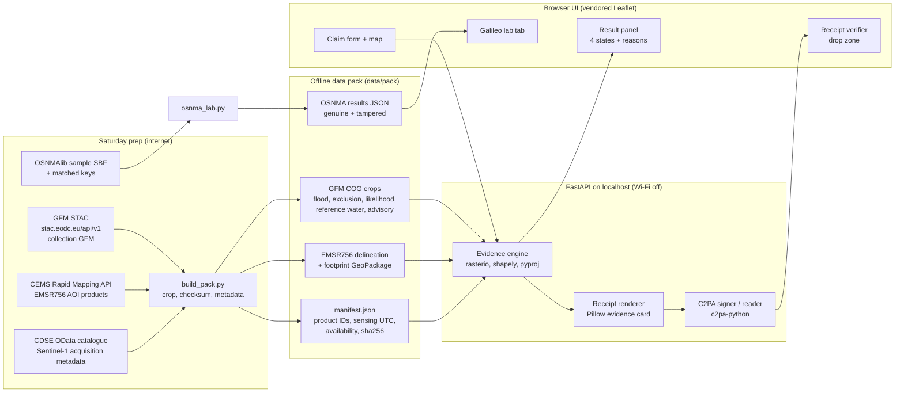

# Proof of Place: Dossier

*Galileo/EGNOS/Copernicus seal for crisis media. Prepared Saturday 28 Nov 2026 for the go/no-go decision. Submission deadline: Sunday 29 Nov, 15:00 CET. Pitches start at 15:05.*

---

## 1. Summary card

| Item | Content |
|---|---|
| **Original pitch** | "Galileo signs where the photo was taken. EGNOS says how sure we are. Copernicus checks the scene really happened there." |
| **Pitch we can defend** (recommended) | "Give us a claimed place and time for a flood photo. We show what Copernicus actually observed nearby, when it observed it, and where the evidence runs out. The newsroom saves a signed receipt of that check." |
| **Challenge track** | **Challenge 2: Space-enabled crisis response and civil resilience.** Secondary link to Challenge 1 ("validate signals, identify anomalies"). Do not claim both tracks in the submission. |
| **EU space assets: original design** | Galileo OSNMA (authenticated position and time), EGNOS through RTKLIB (an error bound), Copernicus (CEMS GFM flood extent, Sentinel-1 GRD, CEMS Rapid Mapping EMSR756, Sentinel-3 SLSTR FRP fire, Sentinel-2 L2A). |
| **EU space assets: recommended build** | **Core:** Copernicus CEMS Global Flood Monitoring (GFM), a Sentinel-1-derived flood extent with its exclusion masks, plus CEMS Rapid Mapping EMSR756 (Poland, September 2024) and Sentinel-1 acquisition metadata from the CDSE catalogue. **Separate, clearly labelled lab module:** Galileo OSNMA navigation-data authentication on a recorded file. **Cut:** EGNOS, Sentinel-3 fire, the custom Sentinel-1 water mask, and probably Sentinel-2. |
| **Target buyer** | Verification desks at newsrooms and fact-checkers, e.g. PAP FakeHunter, TVN24 Konkret24, Demagog. Treat them as **design-partner prospects, not customers**. Later: insurer claims teams, crisis-communication analysts (RCB, State Fire Service), and platforms. |
| **Ranking context** | Entry #3 in the team's 29-idea ranking. Score **6.5**: base 6.8, minus 0.3 because "OSNMA-sealed photo" is a template idea that other teams and an ESA project already use. The ranking called it "the strongest all-three-systems story" and recommended winning with a live claim-check of the "Poland footage sold as Valencia" clip. **Both reviews undermine both premises.** The three-system story overclaims what OSNMA and EGNOS prove. The Valencia check asks the wrong question, because Valencia really flooded too. The 6.5 was given to a version of the project we should not pitch. |
| **Reviewer verdicts** | GPT Sol 6.2: **NO-GO as written; CONDITIONAL GO** as a flood claim-triage tool with a signed analyst receipt. Muse Wonder: **CONDITIONAL GO**, if overclaims are cut, the phone/OSNMA test is decided early with a recorded-data fallback, and the demo leads with claim-check. Kimi K3.1: no review available. |

**Bottom line.** The problem is real, Polish and well documented. Recycled and re-captioned flood footage was used in a hostile information campaign during the September 2024 floods. The organisers' mentor pool includes the people who fought that campaign. What we **cannot** honestly build or sell this weekend is the headline: a seal proving where a photo was taken. Galileo OSNMA authenticates the navigation messages, not the phone's position, the camera or the shutter time. EGNOS Open Service augments GPS, not a Galileo-only fix, and gives no per-phone error bound. A C2PA signature proves who signed a file, not that its contents are true.

What we **can** build in ~30 hours, with real data and an offline demo, is narrower: a coverage-aware Copernicus flood claim-check that refuses to overclaim, plus a C2PA-signed evidence receipt. A separate tab shows OSNMA verifying recorded navigation data and rejecting tampered bits. That version is honest, the demo is low-risk, and it survives the GNSS and remote-sensing experts. Its weakness is novelty: it is closer to "a careful flood lookup" than to "three EU systems sealing the truth". An ESA-funded project (XFACTorizer) and commercial products (Truepic) already cover the capture-sealing idea.

**Pick it if** the team has one solid Python/geospatial person and values a reliable, defensible demo over a spectacular one. **Do not pick it** if the team will be tempted to pitch the original tagline anyway; that loses with this jury.

---

## 2. Plain-language description

### The problem, and who suffers from it

In September 2024, south-west Poland had severe floods: Kłodzko, Nysa, Głuchołazy, Stronie Śląskie. While people were being evacuated, social media filled with false and misleading posts. Poland's digital affairs minister said flood disinformation rose by about 300% in the first days and blamed Russian and Belarusian services (as reported by Reuters). Polish state research estimates counted about 23,000 such posts in under two weeks, with a reach of millions.

One common trick needs no AI at all: **take a real video and give it a false caption.** Old footage gets presented as new, or footage from one place as another. It also works in reverse. Six weeks after the Polish floods, Spain flooded around Valencia. A viral "Spain floods" compilation then circulated, and the UK fact-checker Full Fact found that four of its five clips had been posted before the Spanish floods, with links to Poland.

The people who suffer:
- **Residents and emergency services.** A fake "the dam broke" video causes panic, or pulls attention and resources to the wrong place.
- **Journalists and fact-checkers.** Each viral clip costs hours: reverse image searches, comparing street views, finding the first upload. While they work, the clip keeps spreading.
- **Public trust.** Once people learn some videos are fake, they start doubting real ones too.

### What we build

A web tool for a fact-checker or newsroom verification editor. It answers one question, honestly:

> "This video claims to show flooding **here**, around **this time**. Did European satellites observe flooding near this spot around this time, and how good is that evidence?"

The tool never answers "true" or "fake". It answers with one of four plain statements:

| What the tool says | What it means in plain words |
|---|---|
| **Flood mapped near the claim** | Copernicus satellites mapped floodwater within X metres of this spot, Y hours before or after the claimed time. The claim is physically plausible. |
| **No flood mapped where the satellite could see** | The satellite passed, the area was visible to radar, and no flood was mapped nearby. That is a reason for a closer look, **not** proof the video is fake. |
| **No usable satellite observation** | The satellite didn't pass in the time window, or this spot is one radar can't see well (dense buildings, forest, steep valley sides). We say so instead of guessing. |
| **Data unavailable** | We don't have data for this place or date. We say so. |

The editor can then save a **signed receipt**: an image card listing what was checked, which satellite products were used, their timestamps, and the result. A digital signature (C2PA, the "Content Credentials" standard that newer phones and Adobe tools use) makes any later change to the receipt detectable. The editor can attach it to an internal note or to a published fact-check.

A separate "lab" screen shows a second building block. Galileo, Europe's satellite navigation system, now broadcasts a cryptographic signature on its navigation messages, a service called **OSNMA**. We show our software checking that signature on a real recording and rejecting a tampered copy. This is the first step towards a future camera app that records trustworthy satellite data at the moment a photo is taken. We say clearly that this step does not yet prove where a photo was taken.

### What a user actually sees and does

1. The editor opens the tool in a browser.
2. They type or click the place the video claims to show (e.g. a street in Kłodzko) and the claimed date and time (e.g. 15 September 2024, midday).
3. Within a second or two they see a map. The spot is marked, satellite-mapped floodwater is shaded blue, and areas the satellite cannot judge are hatched grey.
4. Beside the map are the result statement, the distance to the nearest mapped water, when the satellite took its picture, and the exact product name. Everything needed to cite it.
5. They click **"Save signed receipt"** and download a JPEG card with a digital signature.
6. Anyone can later drop that receipt back into the tool. It shows "intact, signed by Proof of Place demo key", or "this file was changed after signing", or "no signature found". A missing signature means "we can't say". It never means "fake".

### Why it needs space data

Nobody else looks at every square kilometre of Europe, impartially, on a schedule, and keeps an archive. Copernicus Sentinel-1 is a radar satellite that sees through clouds and at night, which matters because floods come with storms. The EU's Copernicus Emergency Management Service automatically turns every Sentinel-1 image into a flood map (the "Global Flood Monitoring" product) and keeps it. It also produces detailed emergency maps on request; for the 2024 Polish floods that request was "EMSR756". This is independent evidence. It comes from the EU, not from whoever posted the video.

### Why now

- **Disinformation in disasters is now a security issue in Poland.** The Polish military's cyber command publicly described the 2024 flood disinformation as a hostile information operation. *(Use this only if the original statement is shown on screen; see Section 4, row P37.)*
- **Content Credentials (C2PA) are going mainstream.** Google's Pixel 10 signs every photo from its camera app. Newsrooms are starting to expect signed provenance.
- **The EU AI Act's transparency rules (Article 50) have applied since 2 August 2026.** AI-generated content must be labelled. That raises the general demand for traceable verification, though the law does not require anyone to buy our tool.
- **Galileo OSNMA reached Initial Service on 24 July 2025.** Authenticated satellite navigation data is now an official service, which makes the "future capture app" roadmap credible.
- **Sentinel-1 is back to full strength.** Since 24 June 2026, Sentinel-1C and 1D give the nominal 6-day repeat cycle (Sentinel-1A retired on 29 June 2026).

---

## 3. Technical description

### 3.1 Scope decision (what the build actually is)

| Module | Status | Why |
|---|---|---|
| **M1 Evidence engine**: Copernicus flood claim-check with coverage-aware states | **Core, must ship** | This is the product, and the only part both reviewers rate as defensible and demoable. |
| **M2 Signed receipt**: C2PA sign and verify of a JPEG evidence card | **Core, must ship** (unsigned fallback if the tooling fails) | Turns a map lookup into a portable, auditable artifact: a workflow output, not a map. |
| **M3 Verifier UI**: claim form, map, result panel, receipt drop zone | **Core, must ship** | Needed for the demo. |
| **M4 Galileo OSNMA lab**: recorded data, genuine versus tampered | **Should ship** if a 4th person exists; a cheap fixture run otherwise | Real, active Galileo use. Shows what OSNMA does and doesn't prove. |
| **M4b Phone capture**: GnssLogger Galileo I/NAV pages fed to OSNMAlib | **Stretch**; decision at gate G1 | Depends on the chipset; parsing work is hidden; it is not linked to the claim-check result anyway. |
| EGNOS / RTKLIB SBAS | **Cut.** At most one slide of "GPS with versus without EGNOS corrections" if matched files already exist | EGNOS Open Service augments GPS L1 C/A, not a Galileo-only fix. No per-phone bound. Pipeline work is too heavy for the weekend. |
| Sentinel-3 SLSTR FRP fire check | **Cut** | 1 km grid, NetCDF parsing, needs a fixture hunt; adds scope without adding credibility. |
| Custom Sentinel-1 VV threshold water mask | **Cut** | Prone to false positives; it is the same satellite pass as GFM, so it is not independent. |
| Sentinel-2 L2A before/after | **Cut**, unless a clear, attributed cached export is already in hand | Clouds during Storm Boris; context, not evidence. |
| `/intake` crisis-centre trust ranking | **Cut** | An unvalidated "trust rank" could deprioritise real calls for help. Ethical and liability exposure. |
| Video sealing | **Cut**; JPEG only | C2PA video and HEIC support is patchy. |

### 3.2 Architecture



Design principle: **no network call in the demo path.** Everything the stage demo touches is local: data pack, Python venv, JS/CSS, the signing key. Live API calls happen only in `build_pack.py`, which runs Saturday while the venue Wi-Fi works.

### 3.3 Data and signal pipeline (exact)

| # | Source | Access / endpoint | Account? | Format | What we take | Latency / caveat |
|---|---|---|---|---|---|---|
| D1 | **CEMS GFM** (Sentinel-1 IW GRD-derived flood products, 20 m sampling) | STAC API `https://stac.eodc.eu/api/v1`, collection `GFM`, via `pystac-client` | **Public STAC: no account** (per Sol; check the asset `href`s from venue Wi-Fi) | Cloud-optimised GeoTIFF + STAC item JSON | Assets `ensemble_flood_extent`, `exclusion_mask`, `ensemble_likelihood`, `reference_water_mask`, `advisory_flags`; item `datetime`, `id`, projection metadata | GFM availability ~8 h **after Sentinel-1 acquisition**. Archive advertised from 2015. Class values and nodata codes: **read from the item/PDD; do not assume** **[UNVERIFIED exact codes]** |
| D1b | GFM WMS-T | `https://geoserver.gfm.eodc.eu/geoserver/gfm/wms` | — | PNG tiles | **Display only**, never for analysis | Rendered colours are not the analytical raster |
| D1c | GFM REST API | `https://api.gfm.eodc.eu/v2/` | Portal token (Sol); Wonder says anonymous. **Not needed: skip** | JSON | — | — |
| D2 | **CEMS Rapid Mapping EMSR756** ("Flood in South West Poland", activated 13 Sep 2024) | `https://rapidmapping.emergency.copernicus.eu/backend/dashboard-api/public-activations/?code=EMSR756`, then use each AOI product's `downloadPath` | No | ZIP with vector layers (shapefile/GeoPackage); the AOI footprint is the coverage | One AOI flood delineation + its footprint, version, source sensor, sensing time, delivery time. Candidates: Kłodzko **AOI13**, Stronie Śląskie **AOI19**, Głuchołazy **AOI20** | Some delineations used **COSMO-SkyMed**, not Sentinel-1. Maps show water **at acquisition**, not maximum extent (POLSA caution). Bulletin dates are not sensing times |
| D2b | Fallback for D2 | CEMS activation viewer; POLSA NSIS GeoPackage export | — | GeoPackage | Same | — |
| D3 | **CDSE OData catalogue** (Sentinel-1 metadata) | `https://catalogue.dataspace.copernicus.eu/odata/v1/Products?$filter=...` | **Search is public**; download (`https://download.dataspace.copernicus.eu/odata/v1/Products(<uuid>)/$value`) needs a CDSE bearer token | JSON | Acquisition ID, sensing start/stop, orbit direction, to cross-reference the GFM item | We do **not** download GRD scenes |
| D4 | **Galileo OSNMA** test data | `github.com/Algafix/OSNMA` (EUPL-1.2, Python 3.11). Sample config in `custom_run/` (e.g. `current_config.sbf`), run with `python run.py` | Sample: no. Current/historical public key + Merkle material: **GSC login** (`gsc-europa.eu`) | SBF (Septentrio `GALRawINAV`) in; JSON/log out | Per-satellite, per-ADKD authentication status, key ID, epoch | Pin the tested commit. Cold start from the Merkle root is slow; use the matched fixture |
| D4b | Phone I/NAV (stretch) | Google **GnssLogger** `.txt` export, `Nav,Svid,Type,Status,MessageId,Sub-messageId,Data(Bytes)` rows with Galileo `TYPE_GAL_I` | No | CSV-like text | Galileo I/NAV pages + `Raw`/`Agc` rows for timing | Chipset-dependent. See P03/P04 |
| ~~D5~~ | ~~EGNOS EMS / EDAS~~ | Cut | ~~EDAS registration~~ | — | — | — |

**Known 2024 context** (for the replay narrative): in September 2024 Sentinel-1A was the only operational Sentinel-1 satellite. Sentinel-1B had failed in December 2021 and Sentinel-1C launched in December 2024, so observation gaps in the 2024 replay are larger than today's 6-day 1C+1D repeat **[UNVERIFIED: confirm the dates before putting them on a slide]**. A Sentinel-1A image of the Polish floods on 15 Sep 2024 is documented (per Wonder).

### 3.4 Evidence-engine algorithm

**Inputs:** `lat`, `lon`, `claimed_time_utc`, optional `asset_sha256` (hash of the media being checked), analyst parameters `radius_m` (default **250 m**, "neighbourhood scale") and `window` (default **−72 h / +72 h**). Both parameters are **declared before the demo and displayed**; they are analyst choices, not statistical confidence values.

**Per product** *p* in the data pack whose sensing time falls inside the window:

1. Transform the point into the product's projected CRS with `pyproj` (GFM uses its own equal-area grid **[UNVERIFIED: read `proj:wkt2`/`proj:epsg` from the item]**; EMSR756 vectors go into EPSG:2180 or UTM 33N). Distances are always in metres in a projected CRS, never in degrees.
2. If the point is outside the product footprint or tile, mark the product `OUTSIDE_FOOTPRINT`.
3. Window-read a square of side `2·radius_m + margin` with `rasterio` and build a disc mask of `radius_m`.
4. `usable = disc & (data != nodata) & (exclusion == 0)`. Treat advisory-flagged pixels as not usable for a negative but allowed for a positive **[decision; document it]**. Exclude `reference_water` (permanent rivers and lakes) from "flood" pixels.
5. `coverage = usable.sum() / disc.sum()`.
6. `flood = disc & (flood_extent == FLOOD) & (reference_water == 0)`, then `n_flood = flood.sum()` and `d_min` = distance from the point to the nearest flood pixel. Search a wider ring (e.g. 2 km) for display only.
7. `dt = sensing_time − claimed_time` (signed hours). `availability = published_time` if known, else `sensing_time + 8 h` labelled "estimated".

**Per-product state:**
- `n_flood > 0`: **FLOOD_MAPPED_NEAR_CLAIM**
- `n_flood == 0` and `coverage ≥ 0.6`: **NO_FLOOD_MAPPED_IN_USABLE_COVERAGE**
- otherwise: **NO_USABLE_OBSERVATION**, with reason `MASKED_EXCLUSION` / `OUTSIDE_FOOTPRINT` / `LOW_COVERAGE`

**Top-level state** (shown with the full per-product timeline):
1. Any product is FLOOD_MAPPED → **FLOOD MAPPED NEAR CLAIM**. Report the closest one in time, with `d_min`, `dt`, product ID and sensor.
2. Else any product is NO_FLOOD_MAPPED_IN_USABLE_COVERAGE → **NO FLOOD MAPPED IN USABLE COVERAGE**, with the fixed caption: *"Not evidence that the scene is false. Water may have receded, be under trees or buildings, or be out of frame."*
3. Else at least one product exists in the window → **NO USABLE OBSERVATION** + reason.
4. Else, if no product in the pack covers this place and window → **DATA UNAVAILABLE**, with reason `NO_PASS_IN_WINDOW` or `NOT_IN_PACK`.

**Time labels:** each product row shows claimed time, sensing time and availability time. A product made available after the receipt's `as_of` time is tagged **RETROSPECTIVE CONTEXT**. Stretch: an "as-of" toggle that hides products not yet available at a chosen cutoff.

**Independent second source:** if an EMSR756 delineation covers the point, show "inside / outside the mapped flood polygon, inside / outside the AOI footprint" as a separate line with its sensor (Sentinel-1 or COSMO-SkyMed). Never merge it into the GFM state. Outside a polygon means "not mapped", not "dry".

**Never output** "true", "fake", "verified" or "inconsistent".

### 3.5 Receipt (C2PA) design

- **Evidence card:** a JPEG rendered by `Pillow`, about 1200×800. It contains a map crop (pre-rendered locally from the raster: flood pixels in blue, excluded pixels hatched, the radius circle), the state, and every field below in text, so it stays human-readable even if the signature is stripped.
- **Signing:** `c2pa-python` (`pip install c2pa-python`, `import c2pa`). Sol reports v0.39.0, released 12 Nov 2026, Python ≥3.10 **[pin whatever version passes the smoke test]**. Use the maintained `Builder` / `Builder.sign_file(...)` and `Reader` interfaces; older free-function examples are stale. Sign with a development certificate and key (PEM), and keep the key out of Git. Fallback: the `c2patool` CLI. If neither works, ship an **unsigned** receipt labelled as unsigned. Never simulate a signature.
- **Custom assertion label:** reverse-domain notation under a domain the team actually controls, e.g. `io.github.<team-handle>.proofofplace.claimcheck.v1`. Not `eu.space...`, which we don't own (both reviewers).
- **Assertion payload:**

```json
{
  "label": "io.github.<team-handle>.proofofplace.claimcheck.v1",
  "data": {
    "claim": {
      "lat": 50.43, "lon": 16.66,
      "public_precision_m": 500,
      "claimed_time_utc": "2024-09-15T12:00:00Z",
      "asset_sha256": "<hash of submitted media, or null>",
      "capture_binding": "not_established"
    },
    "query": { "radius_m": 250, "window_h": [-72, 72], "engine_version": "git:<sha>" },
    "result": {
      "state": "FLOOD_MAPPED_NEAR_CLAIM",
      "nearest_mapped_flood_m": 140,
      "usable_coverage": 0.83
    },
    "evidence": [
      {
        "source": "CEMS-GFM", "product_id": "<STAC item id>",
        "sensor": "Sentinel-1", "sensing_utc": "<...>",
        "available_utc": "<... or estimated>", "retrospective": true
      },
      {
        "source": "CEMS-RM EMSR756 AOI13", "product_version": "<...>",
        "sensor": "<from metadata>", "inside_polygon": true, "inside_footprint": true
      }
    ],
    "galileo_osnma": "not_evaluated",
    "issued_utc": "2026-11-29T13:20:00Z"
  }
}
```

*(All values above are placeholders. The real numbers come from the data pack.)*

- **Verifier logic** (each check shown separately): manifest present → signature valid → hard binding (content hash) valid → signer matches the expected demo certificate → our assertion parses. Labels shown: "Valid asset binding, demo signer (not on a public trust list)", "Content changed after signing", "No credential available: we can't say anything about this file".
- **Privacy:** the public card shows coordinates rounded to `public_precision_m`, e.g. 500 m. Precise coordinates go only into the assertion, or stay local. No raw GNSS logs and no EXIF from the source media.

### 3.6 Galileo OSNMA lab (M4)

- Run OSNMAlib on its bundled, matched sample (SBF + keys) and save the JSON/log output, recording: input type, recording epoch, key ID, which satellites and ADKDs authenticated, and the OSNMAlib commit.
- **Tamper test:** flip bits in the I/NAV navigation data words of one satellite in a copy of the SBF file and re-run. Expected result: tag verification fails for that satellite's data **[UNVERIFIED: confirm the OSNMAlib output on the tampered file on Saturday]**.
- **Stretch, phone:** a GnssLogger recording outdoors. If Galileo `Nav` rows exist, feed them through OSNMAlib's Android/GnssLogger input path (Sol says it exists for post-processing; Wonder says a converter must be written; check first, see P04).
- UI labels, verbatim: **"Navigation data authenticated (n satellites, key ID …). Ranging not authenticated. Not linked to any claim-check result."** States: `NAV DATA AUTHENTICATED` / `INSUFFICIENT DATA` / `NOT EVALUATED` / `TAG VERIFICATION FAILED`.
- **Time:** Galileo System Time is continuous; it currently differs from UTC by 18 leap seconds. Add a unit test against a known epoch. OSNMA needs loose time sync with GST (default tolerance ~30 s per Wonder), so never flag sub-30 s offsets.

### 3.7 API

| Endpoint | Purpose |
|---|---|
| `POST /api/claim-check` | `{lat, lon, claimed_time_utc, radius_m?, window_h?}` → state, reasons, per-product timeline, GeoJSON overlay URL |
| `POST /api/receipt` | `claim-check` result ID (+ optional media hash) → signed JPEG card (download) |
| `POST /api/verify` | Multipart JPEG (≤10 MB, JPEG only) → manifest checks + decoded assertion |
| `GET /api/lab/osnma` | Pre-computed OSNMA results (genuine, tampered, phone if any) |
| `GET /api/health` | Data-pack manifest, versions, checksums |

Bind to `127.0.0.1`. Cap uploads. No public signing endpoint.

### 3.8 Tech stack

- **Python 3.11** in one venv on one designated demo laptop. Packages: `fastapi`, `uvicorn`, `python-multipart`, `pystac-client`, `rasterio`, `numpy`, `shapely`, `pyproj`, `geopandas` (or `fiona`) for the EMSR756 vectors, `Pillow`, `c2pa-python`, `httpx`, `pytest`. OSNMAlib from a git clone at a pinned commit. Freeze with `pip freeze > requirements.lock` after a clean smoke test.
- **Frontend:** plain HTML/JS, with **Leaflet 1.9.4 vendored** (no CDN). No online basemap: either a pre-rendered local PNG basemap of the AOI as an `imageOverlay`, or a vector-only display (EMSR756 footprint, roads from the delineation package if present). Overlays are pre-rendered PNGs with bounds.
- **Tooling:** `c2patool` as fallback/integration check; `ffmpeg`/OBS for the backup video.

### 3.9 Repo layout

```
proof-of-place/
├── README.md                # what it does, what it does NOT prove, data sources, licences
├── LICENSES.md              # OSNMAlib EUPL-1.2, c2pa-python MIT/Apache-2.0, Leaflet BSD-2, data attributions
├── requirements.lock
├── scripts/
│   ├── build_pack.py        # STAC + CEMS + OData → data/pack (run with internet)
│   ├── render_overlays.py   # raster crops → PNG overlays + bounds
│   └── osnma_lab.py         # runs OSNMAlib on genuine + tampered fixtures → JSON
├── app/
│   ├── main.py              # FastAPI, static mounting
│   ├── evidence/
│   │   ├── pack.py          # manifest loading, checksums
│   │   ├── gfm.py           # raster window reads, masks
│   │   ├── emsr.py          # polygon / footprint tests
│   │   └── states.py        # state machine (Section 3.4)
│   ├── receipt/
│   │   ├── card.py          # Pillow evidence card
│   │   └── c2pa_io.py       # sign / read / verify
│   └── lab/osnma.py         # serve lab results
├── web/                     # index.html, app.js, vendor/leaflet/, overlays/
├── data/pack/               # gitignored; checksummed manifest committed
├── fixtures/
│   ├── claims.json          # F1–F5 (Section 3.10)
│   └── receipts/            # untouched / modified / stripped
├── tests/                   # test_states.py, test_receipt.py, test_time.py
└── docs/                    # submission text, slides PDF, demo.mp4 (not committed if large)
```

### 3.10 Fixtures and validation (honest metrics)

| Fixture | Purpose | Expected state |
|---|---|---|
| F1 | Point in central Kłodzko, mapped flood, mid-September 2024 | FLOOD MAPPED NEAR CLAIM |
| F2 | Open, observable terrain nearby, usable coverage, no flood | NO FLOOD MAPPED IN USABLE COVERAGE |
| F3 | Point in an excluded area (radar shadow, dense urban, forest) | NO USABLE OBSERVATION: MASKED_EXCLUSION |
| F4 | F1 location, claimed date with no pass in the window | DATA UNAVAILABLE: NO_PASS_IN_WINDOW |
| F5 | Point outside the pack AOI | DATA UNAVAILABLE: NOT_IN_PACK |
| R1/R2/R3 | Receipt untouched / one pixel changed / manifest stripped | valid / binding failed / no credential |
| G1/G2 | OSNMA genuine / tampered | authenticated / tag verification failed |

**Report only what we computed:** case counts per state, lookup time per query (target < 2 s locally), and GFM-versus-EMSR756 agreement on N independently chosen points, stating that both sources are imperfect. **Do not** report "accuracy" from sampling EMSR756 polygons and testing against the same polygons; that is a geometry unit test (Sol). Do not report a "misinformation detection rate".

---

## 4. Problems and solutions

### 4.1 Consolidated problem register

Raised by: **S** = GPT Sol 6.2, **W** = Muse Wonder, **R** = team ranking, **D** = this dossier. Kimi K3.1: no review.

| ID | Problem | Severity | Raised by | Solution | Residual risk |
|---|---|---|---|---|---|
| P01 | **OSNMA authenticates navigation data, not ranging, position, camera or shutter time.** "Authenticated position/fix" and the 4-satellite AUTHENTICATED rule overclaim. | BLOCKER | S, W, R | Delete "authenticated position". Use states `NAV DATA AUTHENTICATED` / `INSUFFICIENT DATA` / `NOT EVALUATED`. Keep OSNMA in a separate lab tab, not linked to the media verdict. | Low, if the wording is disciplined on slides **and** in speech. |
| P02 | **Replay/meaconing is not defeated**, and Copernicus does not close the gap: a false claim can point into a genuine flood. | MAJOR | S, W, R | Say it first: "OSNMA stops forged navigation data, not record-and-replay. Our flood check adds context about the place; it does not authenticate the camera." Mention Galileo's future signal authentication only as a future service. | Medium: the cyber-defence jurors will probe it; the honest answer survives. |
| P03 | **Phones may not expose Galileo I/NAV pages** (Qualcomm reportedly doesn't, per EUSPA material cited by W **[UNVERIFIED per model]**). | MAJOR (Path A only) | S, W, R | One person, one 5–10 min outdoor GnssLogger session on every phone; grep for Galileo `Nav` rows. None → Path B (recorded SBF) immediately. Hard stop at gate G1. | Low once Path B is accepted. |
| P04 | **GnssLogger → OSNMAlib ingest.** W: no GnssLogger reader, budget 3–5 h for a converter. S: OSNMAlib has an Android reader for post-processing with chipset caveats (timestamps inferred from `Raw`/`Agc`, E1-B vs E5b-I ambiguity). | MAJOR | S, W | Check the repo first (search it for an Android/GnssLogger input module). Reader exists → 1–2 h test. Not → converter is stretch only. | Medium; only matters for the stretch path. |
| P05 | **Slow first authenticated fix**: SDD 95% targets ~130 s hot / 300 s warm, cold start from the Merkle root much longer; W cites ~100 s typical, 44 s best case. One shutter press can't be "sealed". | MAJOR (product), MINOR (weekend) | S, W, R | Roadmap wording: "the app logs continuously before and after the shot". No live cold start on stage. | Low. |
| P06 | **Trust material and epochs**: GSC login needed for keys/Merkle; key transition in Dec 2025; Sep 2024 was pre-Initial Service (public test phase). | MAJOR | S, W | Use OSNMAlib's matched sample config. For any phone log, fetch the material for that epoch from GSC and record the key ID. Never attach a 2026 log to 2024 media. | Low. |
| P07 | **EGNOS does not bound a Galileo-only fix.** EGNOS OS v3.0 augments GPS L1 C/A; 3 m (95%) is a service figure for proper SBAS receivers; covariance ≠ Android 68% radius ≠ protection level. "±4 m" is indefensible. | BLOCKER (for the claim) | S, W, R | **Cut EGNOS** from the seal, the search radius and the tagline. Optional slide only if matched GPS RINEX + EMS files already exist: "GPS with vs without EGNOS corrections, same recording". | Low after cutting; we lose the "three systems" line. |
| P08 | **RTKLIB phone→SBAS pipeline doesn't exist off the shelf**: RINEX conversion, epoch alignment, EMS/EDAS access (EDAS needs registration); upstream Galileo support is limited (W suggests the demo5 fork). | MAJOR | S, W | Covered by cutting EGNOS. No Galileo-PVT join on the critical path. | None if cut. |
| P09 | **"INCONSISTENT" is scientifically unsafe.** Radar shadow, layover, urban double-bounce, vegetation, exclusion and advisory flags, water out of frame, post-peak passes. | BLOCKER | S, W | Four states (Section 3.4); negatives allowed only with ≥60% usable coverage, and always captioned "not evidence of falsity". Show reason codes. | Medium: the coverage threshold is a judgement call; present it as such. |
| P10 | **Search radius formula has no statistical meaning**, and the design's own example (CONSISTENT at 118 m vs a stated 60 m radius) contradicts itself. | MAJOR | S, W | Declared analyst radius (default 250 m) and window shown on screen and in the receipt; projected-CRS metres. | Low. |
| P11 | **"Verdict in seconds" is a cached lookup**, not satellite availability: revisit gaps + ~8 h GFM lag after acquisition. | MAJOR | S, W, R | Show claimed / sensing / availability times; tag RETROSPECTIVE. Pitch: "lookup in seconds; satellite evidence arrives hours to days after the event, and we show exactly when." | Low. |
| P12 | **Stale constellation facts.** The design says "1A + 1C". Fact-check: 6-day repeat restored 24 Jun 2026 by **Sentinel-1C + 1D**; **1A retired 29 Jun 2026**. In Sep 2024 only S1A flew (D, **[UNVERIFIED]**). | MAJOR (credibility) | S, W, fact-check, D | Search-and-replace all slides and text. Revisit wording: "6-day repeat; overlapping swaths image Poland more often, but not daily". | Low. |
| P13 | **GFM access path.** W: API, WMS and STAC are all "free/anonymous". S: STAC is public, REST API needs a portal token, WMS is display-only. | MAJOR | S, W | Use **STAC only** for analysis (anonymous per S); never analyse WMS colours. Download crops Saturday morning. | Medium until the first asset is opened on venue Wi-Fi. |
| P14 | **EMSR756 is not ground truth.** Mixed sensors (COSMO-SkyMed for some AOIs), water at acquisition not peak, outside polygon ≠ dry, bulletin date ≠ sensing time. | MAJOR | S (W calls it the "safest asset") | Use it as a second, labelled Copernicus service output with its footprint, sensor and sensing time. Use the API's `downloadPath`, not guessed file names. | Low. |
| P15 | **Custom Sentinel-1 VV threshold mask** gives false positives and is not independent of GFM (same pass). | MAJOR | S, W | **Cut.** | None. |
| P16 | **Fire check scope and facts.** "NRT in 3-minute frames" misreads product segmentation (3-minute frames) as latency (NRT is <3 h per W); 1 km grid; NetCDF parsing; needs a fixture hunt. | MAJOR | S, W, R | **Cut** (S). W's "one pre-parsed case" is rejected: it adds a second event type to defend without making the core more credible. Mention as roadmap at most, without LSTM dates. | None. |
| P17 | **Sentinel-2 context** is often cloudy (Storm Boris); it is context, not a vote. | MINOR | S, W | Cut unless a clear, attributed export is already cached. | None. |
| P18 | **A C2PA signature doesn't bind a photo to a capture event.** A random JPEG plus a real log still gets a valid backend signature. | BLOCKER | S (W partly) | Sign an **analyst receipt**, not "the photo". `capture_binding: not_established`. Never present a new manifest on third-party media as a capture credential. | Low. |
| P19 | **c2pa-python API churn** (W: prerelease, API changed completely since 0.4.0; S: v0.39.0 with `Builder`/`Reader`). | MAJOR | S, W | Pin the version that passes the smoke test; `c2patool` fallback; unsigned-receipt fallback. | Low–medium. |
| P20 | **Custom assertion label** `eu.space.proof-of-place.v1` breaks the reverse-domain convention: we don't own `eu.space`. | MINOR | W, S | Use a domain the team controls, e.g. `io.github.<handle>.proofofplace.claimcheck.v1`. | None. |
| P21 | **Test certificate is untrusted** in public verifiers, which may not render the custom assertion. | MAJOR | S, W | Our own verifier shows "valid binding, demo signer". Say "production needs a CA on the C2PA trust list" before being asked. Don't open a public verifier on stage unless rehearsed. | Low. |
| P22 | **Platforms strip metadata**; a missing credential is not evidence of fakery. | MAJOR | S, W | Verifier label: "No credential available". The receipt card is also human-readable. | Low. |
| P23 | **Spoof demo as designed is wrong**: a moved pin is a claim edit, not an OSNMA failure; there is no pseudorange processing. | BLOCKER (as designed) | S, W | Replace with two honest demos: (a) C2PA tamper (changed receipt → binding fails); (b) OSNMA tampered nav bits → tag verification fails. Meaconing is explicitly not addressed. | Low. |
| P24 | **The Valencia demo asks the wrong question.** Valencia really flooded, so a Copernicus check there can make the false caption look plausible. Full Fact's evidence was earlier publication, not survey-grade geolocation, and one clip was untraced. | BLOCKER (as scripted) | S (W: MAJOR) | Use it as the **hook**, attributing the finding to Full Fact. Run the tool on Polish fixtures. Optional honesty beat: "both places flooded, so our tool abstains; provenance evidence like Full Fact's decides this." | Low; this is a stronger story than the original. |
| P25 | **Too many live stage dependencies**: outdoor capture Sunday 13:00, GNSS reception, venue Wi-Fi, online map tiles, live APIs. | MAJOR | S, W | Wi-Fi-off demo, vendored JS, local overlays, MP4 + PDF fallback. No Sunday capture dependency. | Low. |
| P26 | **Verifier robustness**: unsigned, stripped, wrong-format, oversized files; a stack trace on stage. | MAJOR | W | JPEG only, 10 MB cap, explicit error states, rehearsed. | Low. |
| P27 | **Circular validation metrics** (sampling EMSR756 polygons and testing against them); promised but uncomputed metrics. | MAJOR | S, W | Report case counts, lookup times and GFM–EMSR756 agreement on independently chosen points, with caveats, or nothing. | Low. |
| P28 | **"Nobody fuses this" is false.** ESA **XFACTorizer** (special camera app, OSNMA-protected photo metadata for social-media authenticity); **Truepic** (controlled capture for insurers, C2PA); ProofMode / Numbers Protocol; CASSINI 8th edition placed SignalHawk (spoofing detection); internal overlap with Veritrace, CrisisVerif, VeriTerra. | MAJOR | S, W, R | Differentiate on **coverage-aware, auditable claim-checks of unsigned viral media, with explicit abstention**. Show a comparison slide. | Medium: Innovation score is the weak spot. |
| P29 | **Challenge 2 is saturated with Sentinel-1/2 flood dashboards.** | MAJOR | W, R | Lead with the claim → state → signed receipt workflow, not the map. The map is supporting evidence on screen. | Medium. |
| P30 | **Adoption**: disinformation producers never seal; citizens won't install an app mid-crisis. | MAJOR | R, S | Claim-check of unsealed media is the product. Capture sealing becomes a roadmap for professional capturers (newsroom photographers, adjusters, responders). | Low. |
| P31 | **AI Act Art. 50 and DSA are not buying mandates.** Art. 50 covers AI-generated content; re-captioned real footage isn't AI-generated. DSA Arts. 34–35 (systemic risk), 36 (crisis response via Commission decision), 48 (voluntary crisis protocols) impose no duty to buy an API. | MAJOR | S, W | Present them as background pressure only. Remove "required for compliance". Platforms move to the later-market column. | Low. |
| P32 | **Four buyer types is not a go-to-market plan**; newsrooms have little money; crisis centres buy through public procurement (S: Polish public procurement law threshold for classic contracts raised to PLN 170,000 net from 1 Jan 2026 **[reviewer-sourced]**). | MAJOR | S, W, R | Beachhead: one newsroom verification desk as design-partner prospect + a two-week retrospective evaluation (20 cases). Insurers phase 2; RCB/PSP as later analyst-support evaluation partners. | Medium: no buyer validation yet. |
| P33 | **GDPR and privacy**: exact location + time + image can identify people and victims; opt-in ≠ lawful basis for everyone in frame. | MAJOR | S, W | Coarsened public coordinates; team-owned or cleared demo media; no raw logs published; roadmap: DPIA, controller/processor roles, retention. | Low for the demo. |
| P34 | **"Holds up in court" / eIDAS**: a test certificate isn't a qualified seal or timestamp; admissibility is for the judge. | MAJOR | S, W | Delete the phrase here and in the Balloon Radar cross-reference. Say "evidence support with an audit trail". | None. |
| P35 | **Fresh Code exposure**: reuse of Veritrace / Balloon Radar code or pre-built scripts and certificates. | MAJOR (BLOCKER if violated) | S, W | New repo, visible weekend commits, declare libraries/versions/data, generate the demo key during the weekend. Design docs are fine; pre-weekend code is not. | Low if followed. |
| P36 | **Rules uncertainty**: the brief says Relevance / Innovation & Business / Execution; an older contest PDF lists "Quality of the team" as the third criterion; team size (3–6 vs the brief's 3–8); exact TAIKAI fields; pitch length. | BLOCKER until confirmed | S, W | Ask Blue Dot Solutions first thing: rubric, team size, Fresh Code cutoff, whether cached Copernicus data counts as "active use", mandatory files, pitch length. | Low once asked. |
| P37 | **Disinformation statistics and attribution.** Reuters reports a ~300% spike attributed to Russian/Belarusian services (W confirms). S: the Sejm statement was 300% growth in disinformation traffic in the first four days, not an origin count; the 23,000 posts and ~8 M reach are NASK estimates (via PAP), not unique users. The Cyber Defence Forces quote relies on an ERR article embedding a tweet. | MAJOR | S, W | Exact phrasing: "the minister reported a ~300% rise in flood disinformation in the first days and blamed Russian and Belarusian services; NASK estimated ~23,000 posts reaching millions". Show the Cyber Defence Forces statement **only** with the original post on screen; otherwise omit **[UNVERIFIED wording]**. | Low. |
| P38 | **Crisis-centre "trust-ranked intake"** could deprioritise real calls for help. | MAJOR | S | Cut `/intake`. | None. |
| P39 | **No practitioner involved.** Viadrus's stated winning factor was its practitioner partner. | MAJOR | W, past-winners | At the Saturday 11:30 and 16:30 mentoring slots, ask for a fact-checker, newsroom or crisis-communications contact. Get one quotable sentence with permission. | Medium. |
| P40 | **No pricing.** | MINOR | W, S | One hypothesis line with arithmetic (Section 8), labelled as a hypothesis to test in the evaluation. | Low. |
| P41 | **GST/UTC handling** (18 s leap-second offset; ~30 s loose-sync tolerance). | MINOR | W | Unit test; never flag sub-tolerance gaps. | Low. |
| P42 | **"Active use" of EU space**: Galileo counts only if a real recording is processed; EGNOS only if corrections are consumed; Copernicus needs a fresh computation, not a screenshot. | MAJOR | S, W | M1 computes from real rasters/vectors; M4 processes a real recording. Don't list EGNOS as used. | Low. |
| P43 | **Media rights**: viral clips and third-party imagery in the demo and submission. | MAJOR | S | Full Fact case shown as an attributed citation/screenshot in the hook only; demo media team-owned; attribute CEMS/GFM products; check terms before redistributing any third-party satellite imagery (e.g. COSMO-SkyMed-based maps). | Low. |
| P44 | **The headline tagline is gone.** The honest scope no longer says "Galileo signs where the photo was taken", which weakens the "three EU systems" Relevance story the 6.5 score relied on. | MAJOR | D (implicit in S) | New line: "Copernicus shows what was observed; Galileo OSNMA shows how capture-time trust will work; the receipt makes both auditable." | Medium: the pitch is less spectacular. |

### 4.2 The blockers

1. **P01, P07, P18: the seal concept overclaims on all three axes.** The original promise is "authenticated place (Galileo) + error bound (EGNOS) + signed truth (C2PA)", and each of the three parts proves something narrower. Fix: change the product, not just the wording. The claim-check becomes the product, the receipt certifies *our analysis* rather than *the photo*, and OSNMA is shown for what it is. This is the decision the team must accept before choosing this project.
2. **P09: a false "INCONSISTENT" on a real flooded street would end the pitch with the IGiK experts.** The four-state machine with coverage and reason codes is mandatory, and the negative state needs its fixed caption.
3. **P23, P24: two of the four original demo beats are wrong.** The spoof demo doesn't test what it claims, and the Valencia check can return "flood observed" for the false caption. Replace them as described. The "both places flooded, so we abstain" beat turns the weakness into credibility.
4. **P36: rules.** Unconfirmed rubric, team size and submission fields can disqualify or cost points regardless of the build. Ask before anything else.

### 4.3 Reviewer disagreements, adjudicated

| Topic | Sol | Wonder | Ruling |
|---|---|---|---|
| **Overall scope** | Claim-triage tool + analyst receipt; Galileo an optional experiment; EGNOS off | Keep the Galileo + Copernicus spine, OSNMA on recorded data, lead with claim-check | **Mostly Sol.** The product is claim-check + receipt. Wonder's point that real Galileo processing helps Relevance is valid, so OSNMA on a recorded fixture is included as a cheap, honest lab module (≈2–4 person-hours), not as part of the verdict. |
| **EGNOS severity** | BLOCKER: EGNOS OS augments GPS L1 only; it cannot bound a Galileo fix | MAJOR: use RTKLIB-demo5, report covariance, decide by Sat 18:00 | **Sol.** The objection is about substance, not tooling. A covariance from a GPS SBAS solution says nothing about a Galileo-only fix. Cut EGNOS at G1 (noon); an 18:00 decision burns an engineer's afternoon. |
| **GFM access** | STAC public; REST API needs a token; WMS display only | All three free/anonymous | **Sol**: it is more specific and draws the key analytic-versus-rendered distinction. Plan on STAC; never rely on the REST API. Confirm with the first real asset download. |
| **OSNMAlib and phone logs** | Android reader exists for post-processing, with caveats | No GnssLogger reader; converter is 3–5 h of hidden work | **Unresolved; check the repo in 5 minutes.** Sol cites specific documentation details (`Raw`/`Agc` timestamp inference, E1-B/E5b-I ambiguity), which suggests a reader exists in recent versions. Either way, the phone path is stretch. |
| **"INCONSISTENT"** | Remove; use four states | Keep, only with valid coverage and observable land cover | **Both, effectively.** Wonder's strict conditions *are* Sol's "NO FLOOD MAPPED IN USABLE COVERAGE"; Sol's neutral naming is safer. Adopt the four states. |
| **Fire** | Cut | One pre-parsed case | **Sol.** A second event type doubles what we must defend and adds little. |
| **Own SAR mask** | Cut | Visual context only, with change detection | **Sol.** Even as "context" it invites the false-positive question, and a pre/post change workflow is real work. |
| **Valencia** | BLOCKER: wrong question | Strongest demo, with a location-level caveat | **Sol.** Valencia flooded on 29–30 Oct 2024, so a Copernicus check of the false caption can come back positive. Full Fact's proof is earlier uploads, not satellite data. Keep it as the hook only. |
| **Gate timing** | Noon Saturday | Phones 10:00, EGNOS 18:00 | **Phones and EGNOS at G1, noon** (or start + 3 h if the team starts late). The Copernicus core must open real data by G1 or the project is a no-go. |
| **Pricing** | Don't pitch per-upload pricing before volumes are known; desk licence after the evaluation | Add a per-verification price with arithmetic | **Both:** show a desk-licence hypothesis with the arithmetic, explicitly labelled as what the two-week evaluation will test. |
| **Disinformation attribution** | Sejm figure is traffic growth, not origin; omit the military attribution unless the original is shown | Reuters attribution confirmed | **Combine:** quote Reuters' framing exactly (minister blamed Russian/Belarusian services), use NASK as the 23,000 source, and show the Cyber Defence Forces statement only with the original on screen. |
| **Rubric** | Old contest PDF has "Quality of the team" third | Standard CASSINI is Relevance / Innovation / Team quality; brief says Execution | **Unknown; ask Blue Dot.** Prepare for both: a working demo covers Execution, and a team slide covering roles and skills costs 20 seconds. |

---

## 5. 48-hour build plan (Saturday 09:00 → Sunday 15:00)

*If the team decides at ~13:00 Saturday, shift every Saturday time by +4 h, keep Sunday times fixed, and drop M4b and the Sentinel-2/Valencia stretch outright.*

### 5.1 Roles

| Role | Owns | With 3 people | With 4 | With 5–6 |
|---|---|---|---|---|
| **EO lead** | `build_pack.py`, M1 evidence engine, fixtures F1–F5, overlays | Person 1 | Person 1 | Person 1 (+ person 6 on validation/agreement table) |
| **Backend / receipt** | FastAPI, M2 C2PA sign/verify, evidence card, tests | Person 2 (also frontend) | Person 2 | Person 2 |
| **Frontend / demo** | Leaflet UI, verifier drop zone, offline assets, backup video | Person 2 | Person 3 | Person 3 |
| **GNSS** | M4 OSNMA lab (fixture + tamper), phone test, M4b stretch | Person 3, fixture only, ≤3 h | Person 4 | Person 4 |
| **Pitch / business / rules** | Blue Dot rules check, practitioner hunt, slides, submission text, comparison table | Person 3 | Person 3/4 shared | Person 5 |

### 5.2 Timeline and gates

| Time | Checkpoint | Owner |
|---|---|---|
| **Sat 09:00–09:30** | Rules questions to Blue Dot (P36). New public repo created and first commit. Venv + `pip install` of the full stack on the demo laptop. | Pitch, Backend |
| 09:00–10:30 | STAC search for GFM items over the Kłodzko/Nysa AOI, 12–20 Sep 2024; download the first asset crop; print the class legend and sensing time. EMSR756 public-activations API call; download one AOI package. | EO |
| 09:00–10:30 | `c2pa-python` smoke test: sign one JPEG with a custom assertion and a dev certificate generated now; read it back; modify a pixel → validation fails. `c2patool` installed as backup. | Backend |
| 09:00–10:00 | Every phone: GnssLogger outdoors 5–10 min; grep for Galileo `Nav` rows; note model/chipset/Android build. Clone OSNMAlib at a pinned commit; run the bundled sample; check the repo for a GnssLogger reader. | GNSS |
| 10:00 | **G0 (soft):** rules answer in or chased; repo exists; all installs done. | All |
| 10:30–12:00 | Raster window-read + masks for one point; distance in metres; a second point gives a different result. EMSR756 point-in-polygon + footprint. | EO |
| 10:30–12:00 | FastAPI skeleton: `/claim-check` stub returns real M1 output; `/verify` wraps the Reader. | Backend |
| 11:30 | Mentoring slot: ask for a fact-checker or newsroom contact; ask GNSS mentors whether "nav data authenticated, ranging not" lands. | Pitch |
| **12:00** | **G1 (GO/NO-GO):** (a) real GFM **or** EMSR756 data opened locally with its mask/footprint and sensing time, two points giving different states **with Wi-Fi off**; (b) C2PA round trip works, or the unsigned fallback is accepted; (c) OSNMA sample runs; phone Path A yes/no. **(a) fails → no-go: switch projects.** (b) fails → unsigned receipt + `c2patool` retry until 18:00. Phone has no Galileo Nav rows → Path B, stop all phone work. EGNOS is cut here permanently. | All |
| 12:00–15:00 | Full state machine (Section 3.4), reason codes, per-product timeline, fixtures F1–F5 as pytest. | EO |
| 12:00–15:00 | Evidence card renderer (Pillow), `/receipt` endpoint, verifier label logic, R1–R3 fixtures. | Backend |
| 12:00–15:00 | Leaflet page: claim form, local overlays, result panel, drop zone. No CDN. | Frontend |
| 12:00–15:00 | Tamper test on a copied SBF; save G1/G2 JSON; `/lab/osnma` data. | GNSS |
| 16:00 | Pitching workshop (one person). | Pitch |
| 16:30 | Mentoring slot: practitioner quote; the "who pays" question to the ESA BIC mentors. | Pitch |
| **18:00** | **G2:** full Wi-Fi-off flow: claim → state → receipt → verify (valid / modified / stripped) → lab tab. Anything not working now is cut (see 5.3). Slides v1. | All |
| 18:00–23:00 | Polish UI; GFM-vs-EMSR756 agreement on 20–30 independently chosen points (the honest metric table); lookup timings; stretch: Valencia "both flooded" GFM fixture; stretch: phone Path A through OSNMAlib. | EO, GNSS |
| 18:00–23:00 | README with a "What this does NOT prove" section, licences and attributions; submission text draft; comparison slide (Truepic, XFACTorizer, manual fact-checking, GFM viewer). | Pitch, Backend |
| 23:00 | **G3:** fresh-clone test on a second laptop from the README; frozen `requirements.lock`. Half the team sleeps. | Backend |
| **Sun 08:00** | Bug-fix window; pitch rehearsal 1 (timed). | All |
| 10:00 | Record the full demo as MP4 (screen + voice), plus a screenshot PDF of every step. | Frontend |
| 11:00 | Submission text final; checklist of TAIKAI fields. | Pitch |
| **12:00** | **Code freeze.** Pitch training (organiser session). | All |
| 13:00 | Rehearsal 2 with the fallback switch practised (live → MP4 mid-step). | All |
| **14:15** | **Submit/publish on TAIKAI** (45 min buffer). Verify that the public links open in a private window. | Pitch |
| 15:00 | Deadline. | — |
| 15:05 | Pitches begin. | Presenter |

### 5.3 Cut order (first to go → last)

1. M4b phone capture path
2. Valencia "both flooded" fixture
3. Sentinel-2 context
4. EMSR756 as second source (keep GFM; or keep EMSR756 if GFM failed)
5. Agreement-metrics table (replace with case counts)
6. The as-of toggle
7. Galileo lab tab UI (keep a slide with the real OSNMAlib output)
8. Basemap (use vector footprint only)

**Never cut:** one real Copernicus computation with coverage and sensing time; at least one abstention fixture; the receipt (signed, or honestly unsigned); the offline demo video.

---

## 6. Demo script (4 minutes)

*The presenter runs the laptop with Wi-Fi off. A second teammate has `demo.mp4` open and paused at each step's timestamp, plus the PDF of screenshots.*

| # | Time | What we say / show | Live action | Offline fallback |
|---|---|---|---|---|
| 1 | 0:00–0:25 | **Hook.** Slide: the viral "Spain floods" compilation, attributed. "In November 2024 this went viral as Valencia. Full Fact found four of five clips had been posted earlier, with links to Poland's September floods. Proving that took a fact-checker hours of manual work." | Slide | Same (slides are local PDF) |
| 2 | 0:25–0:55 | **Problem.** "During Poland's 2024 floods the minister reported a ~300% rise in flood disinformation and blamed Russian and Belarusian services. NASK estimated ~23,000 posts reaching millions. Most needed no AI: real footage, false caption. Newsrooms need to know fast what the satellites actually saw." | Slide | Same |
| 3 | 0:55–1:35 | **Claim-check, positive.** "A video claims: Kłodzko, 15 September 2024, midday." Click F1 on the map → **FLOOD MAPPED NEAR CLAIM**: nearest mapped flood X m; Sentinel-1 sensing time; GFM product ID; EMSR756 AOI13 agrees, sensor named; time gap shown. "Lookup took under two seconds. Every number is citeable." | Live UI | MP4 segment 1 / screenshot p.1 |
| 4 | 1:35–2:05 | **Abstention.** Move the pin to F3 (excluded area) → **NO USABLE OBSERVATION: radar can't see here**. Then F2 → **NO FLOOD MAPPED IN USABLE COVERAGE**, with its caption on screen. "We never say fake. We say exactly where the evidence runs out." | Live UI | MP4 segment 2 / p.2–3 |
| 5 | 2:05–2:25 | **Why not just check Valencia?** "Valencia really flooded too, so a satellite check on the false caption would say 'flood observed'. Our tool abstains; provenance evidence like Full Fact's decides it. That's why we show limits, not verdicts." (Live only if the stretch fixture exists; otherwise a slide.) | Live UI or slide | Slide |
| 6 | 2:25–2:55 | **Signed receipt.** Click "Save signed receipt" → JPEG card. Drop it into the verifier → **valid binding, demo signer**. Drop the copy with one pixel edited → **content changed after signing**. Drop the stripped copy → **no credential available, which is not the same as fake**. | Live UI | MP4 segment 3 / p.4–6 |
| 7 | 2:55–3:20 | **Galileo lab.** "This is the road to capture-time trust. Galileo now signs its navigation messages; that's OSNMA. Here is a real recording verified with the OSNMA keys; here, one bit flipped, rejected. What it proves: the navigation data is genuine Galileo. What it doesn't prove: where the phone was. Ranging isn't authenticated, and we don't put this in the media verdict." | Live UI (pre-computed JSON) | Slide with OSNMAlib output |
| 8 | 3:20–3:45 | **Business.** "First user: a newsroom verification desk. Next step: a two-week retrospective evaluation on 20 real flood claims, measuring time to a citeable source. Desk licence hypothesis on the slide. Insurers and crisis-communication teams follow." (+ practitioner quote if obtained.) | Slide | Same |
| 9 | 3:45–4:00 | **Close.** "Copernicus tells you what was seen, Galileo is how capture-time trust will work, and the receipt makes every check auditable. In the next flood, verification desks shouldn't have to start from zero." | Slide | Same |

**Rules for the presenter:** never say "verified location", "authenticated position", "proof", "EGNOS", "±4 m" or "court". If a step fails, say "switching to the recording" and keep talking. Don't debug on stage.

---

## 7. Jury Q&A

### GNSS chip engineers (e.g. ChipCraft)

| Question | Honest answer |
|---|---|
| "Which bytes does OSNMA authenticate, and which ranging observable is protected?" | "The navigation data words: ephemeris, clock and status, through TESLA-chained MACK tags. **No ranging observable is protected in our prototype.** Here's the key ID, epoch and per-satellite result from the recording." |
| "Why do you have no authenticated position?" | "Because OSNMA can't give one. A position is computed from pseudoranges, and those aren't authenticated. Calling it an authenticated position would be wrong, so we don't." |
| "Record-and-replay at the scene: what stops it?" | "Nothing in OSNMA alone. Timing consistency checks and C/N0/AGC monitoring are diagnostics, not guarantees. Future Galileo signal-level authentication may help; we don't depend on it." |
| "Which phone chipset gave you I/NAV pages?" | Answer from the Saturday test: model, chipset, Android build, and number of Galileo `Nav` rows. Or: "none of ours did, so the lab runs on a Septentrio SBF recording bundled with OSNMAlib; here's the commit." |
| "Time-to-first-authenticated-fix?" | "The SDD targets ~130 s hot and ~300 s warm (95%); cold start from the Merkle root is much longer. A real capture app would log continuously before the shot. That's roadmap, not this weekend." |
| "Where's EGNOS?" | "We removed it. EGNOS Open Service augments GPS L1, so it can't put an integrity bound on a Galileo fix, and a phone covariance isn't a protection level. We'd rather not use a system than misuse it." |

### Remote-sensing academics (e.g. IGiK)

| Question | Honest answer |
|---|---|
| "Radar shadow, layover, urban double-bounce, vegetation?" | Click F3: "GFM's exclusion mask marks those pixels; we count usable coverage inside the radius, and below 60% we abstain with the reason shown." |
| "Pass after the flood peak?" | "Then water may have receded. The timeline shows the signed gap between claim and sensing, and the negative state's caption says so explicitly." |
| "What's your validation?" | Show only what we computed: e.g. "GFM vs EMSR756 agreement on N independently chosen points, X/N. Both are imperfect references, so it's an agreement figure, not accuracy." |
| "Why 250 m and ±72 h?" | "They're declared analyst parameters, not statistical confidence. They appear on screen and in every receipt so any reviewer can rerun with different settings." |
| "Is EMSR756 Sentinel-1?" | "Not all of it; some AOIs used COSMO-SkyMed. We show the sensor per product. CEMS maps show water at acquisition, not maximum extent." |
| "What about 2024 revisit?" | "In September 2024 only Sentinel-1A was flying, so gaps were wider than today's 6-day repeat with 1C and 1D. That's exactly why 'no observation' is a first-class answer." **[Confirm the S1C launch date before saying it.]** |

### EO / optics experts (e.g. Blue Dot Solutions, Scanway)

| Question | Honest answer |
|---|---|
| "GFM and EMS are free. What are you selling that isn't a wrapper?" | "The data is free; the workflow isn't. Point-and-time query, coverage-aware abstention, source trace and a signed, citeable receipt in seconds, plus integration into a desk's tooling. We'll measure the time saved in the evaluation." |
| "Show the product ID, sensor, acquisition time, and what runs if the service is down." | Open `manifest.json`. Move the pin and recompute live with Wi-Fi off. |
| "Can you match objects in the photo to pixels?" | "No. We don't analyse the photo at all. We report what was observed near the claimed point, at 20 m sampling." |
| "Why not Sentinel-2?" | "It's optical. Floods come with cloud; during Storm Boris the first clear Sentinel-2 view over Wrocław was 18 September (per Wonder). Radar first; optical as optional context." |
| "Why not fire?" | "1 km thermal pixels and different physics. We'd rather do one hazard properly. Fire is roadmap." |

### Cyber-defence (Cyber Defence Forces / Military University of Technology)

| Question | Honest answer |
|---|---|
| "If I submit someone else's image with a real place and time, will you sign it?" | "We sign a receipt for *our analysis of the submitted claim*. The receipt says `capture_binding: not_established`. We never sign it as a trusted capture." |
| "A state actor stages a scene at a real flood and replays GNSS. What did you stop?" | "Nothing. The place and the flood are real. We address the 2024 tactic of real footage with a false place or date, and we make every check auditable. We don't stop an on-site state operation." |
| "Could your tool be weaponised: 'satellites found no flood, so the victims are lying'?" | "That's why the negative state is captioned 'not evidence of falsity', and why we never output 'fake'. Wording is part of the security design." |
| "Your signing key?" | "Demo key, generated this weekend, on this laptop only, not in Git. Production would use an HSM and a CA on the C2PA trust list." |
| "Privacy of victims?" | "The public receipt shows coordinates rounded to 500 m; we don't publish raw logs or EXIF; a pilot would require a DPIA and defined retention." |

### Business / ESA BIC Poland

| Question | Honest answer |
|---|---|
| "Who signs the purchase order?" | "The head of a verification desk or editorial operations at a news agency or broadcaster. PAP FakeHunter and TVN24 Konkret24 are our first design-partner prospects; we have no customer yet." |
| "Why pay instead of opening a free flood map?" | "A flood map gives you a picture. We give a citeable, coverage-aware answer and an audit trail in seconds. The evaluation will measure the time saved per claim." |
| "How do you compare with Truepic?" | "Truepic seals photos captured in its own app; insurers love it. It can't help with footage already going viral. We do unsealed claim-checks first; capture sealing is a later layer." |
| "XFACTorizer already does OSNMA photo authentication." | "Yes, and that validates the capture-time direction. Our product isn't capture sealing; it's satellite evidence for media nobody sealed." |
| "Isn't the AI Act your market driver?" | "No. Article 50 is about AI-generated content; recaptioned real footage isn't. It raises general demand for verification; it doesn't oblige anyone to buy." |
| "Month-12 revenue?" | "We don't know volumes yet. That's what the evaluation is for. Hypothesis: a desk licence (Section 8); first year funded by an ESA BIC application and media-innovation grants, not projected sales." |

---

## 8. Business model and buyer

### Who pays

| Phase | Buyer | Budget owner | What they buy | Notes |
|---|---|---|---|---|
| **1: beachhead** | Newsroom verification desks and fact-checkers (PAP FakeHunter, TVN24 Konkret24, Demagog; later other EU agencies and broadcasters) | Head of verification / editorial operations | Desk licence: claim-check + receipts + archive, a few seats | Natural first user for already-viral material. Small budgets; value is speed and defensibility. |
| 2 | Insurer claims-innovation units | Claims operations | Batch claim-check of flood claims against GFM/CEMS (portfolio triage) | Different value from Truepic's controlled capture. **[UNVERIFIED demand]** |
| 3 | Crisis communications (RCB, State Fire Service, voivodeship centres) | Communications / analysis units | Analyst support during events, **not** dispatch | Public procurement and security requirements; start as a non-operational evaluation. |
| 4 | Platforms (VLOPs under the DSA) | Trust and safety teams | Bulk API during crises | DSA creates pressure, not a purchase mandate. |
| Roadmap | Professional capturers (newsroom photographers, adjusters, responders) | — | Capture app with OSNMA nav-data logging + C2PA | Only once chipsets reliably expose I/NAV; competes with Truepic and XFACTorizer. |

### Why now

The 2024 floods are fresh in Polish newsrooms. C2PA is becoming normal (Pixel 10), so signed provenance is an understood concept. AI Act Art. 50 (since 2 Aug 2026) is increasing newsroom investment in verification tooling, though it creates no mandate (P31). Sentinel-1 has been at full strength again since June 2026, with 1C+1D. GFM provides an automatic, archived, pan-European flood layer anyone can build on.

### Pricing hypothesis (to test, not to claim)

- **Desk licence:** €300–800 per desk per month **[UNVERIFIED hypothesis]**, unlimited claim-checks, receipts and archive.
- **Arithmetic for the slide:** Wonder estimates manual geolocation of a clip at 30–120 min **[UNVERIFIED]**. If a desk handles ~40 flood-related claims in an event month and the tool saves ~30 min on each, that is ~20 staff-hours, roughly €500–800 at typical newsroom staff costs **[UNVERIFIED]**. That is about the licence price in a crisis month and above it outside one. **This is weak.** It argues for an annual licence sold on readiness, or for bundling with broader verification tools. Say so honestly if asked.
- **Insurer batch:** per-claim fee for portfolio triage. Price unknown; needs an insurer conversation.

### Path after the hackathon

1. **Weeks 1–2:** two-week retrospective evaluation with one newsroom design-partner prospect: 20 historical flood claims from 2024. Measure time to a citeable source, the percentage with usable observations, and misleading positives versus their existing workflow (Sol).
2. **Month 1–2:** apply to **ESA BIC Poland**. Sol reports up to €50,000 through a separate, competitive incubation application. Ask the ESA BIC mentors this weekend what evidence they want. Explore EU media and anti-disinformation funding and the EDMO fact-checking hubs **[UNVERIFIED: current calls and the regional hub covering Poland]**.
3. **Month 3–6:** add pan-EU GFM coverage, an as-of mode, newsroom integrations (CMS plugin, Slack/Teams bot), and a production C2PA certificate.
4. **Month 6–12:** insurer batch pilot; evaluation with crisis-communication units; capture-mode prototype with continuous OSNMA logging on supported hardware.
5. **Funding is not revenue:** keep grants out of the revenue projections (Sol).

---

## 9. Saturday-morning checklist (in order)

1. **Rules (Blue Dot Solutions), 09:00.** Ask: (a) the judging criteria (Execution or "Quality of the team"?); (b) allowed team size and the registered roster; (c) Fresh Code cutoff and what pre-existing material is allowed; (d) does cached official Copernicus data count as "active use"; (e) the exact TAIKAI submission fields (repo, video, slides, summary length?), the Warsaw project tag, and pitch length.
2. **Repo.** Create a new public repo with a first commit timestamped Saturday. No copied Veritrace/Balloon Radar code.
3. **Demo laptop.** Python 3.11 venv; `pip install fastapi uvicorn python-multipart pystac-client rasterio numpy shapely pyproj geopandas Pillow c2pa-python httpx pytest`; confirm the `rasterio` and `c2pa` wheels import.
4. **GFM bytes on disk.** `pystac-client` search of `https://stac.eodc.eu/api/v1`, collection `GFM`, bbox around Kłodzko/Nysa, 12–20 Sep 2024. Download `ensemble_flood_extent`, `exclusion_mask`, `ensemble_likelihood`, `reference_water_mask`, `advisory_flags` for one item. Print the CRS, class values, nodata and `datetime`. Save the item JSON and a SHA-256.
5. **EMSR756 bytes on disk.** Call `https://rapidmapping.emergency.copernicus.eu/backend/dashboard-api/public-activations/?code=EMSR756`, pick AOI13 (Kłodzko) or AOI20 (Głuchołazy), download via `downloadPath`, record version, sensor, sensing and delivery times, and the footprint layer.
6. **Two-point offline test.** Wi-Fi off: one point flooded, one not, with different outputs. *This is the essence of gate G1.*
7. **C2PA round trip.** Generate a dev certificate and key (not in Git). Sign a JPEG with the `io.github.<handle>...` assertion, read it back, change a pixel → fails, strip → no manifest. Install `c2patool` as backup.
8. **Phones.** GnssLogger outdoors, 5–10 min per phone; count Galileo `Nav` rows; record model, chipset and build.
9. **OSNMAlib.** Clone, pin the commit, run the bundled sample config, save the output. Check for a GnssLogger/Android input module. Log in to GSC only if processing a phone log.
10. **CDSE account** (only if you want Sentinel-1 product UUIDs/downloads; catalogue search is public).
11. **Facts for slides.** Full Fact page (dates, the 4-of-5 finding, wording); Reuters/minister quote; NASK/PAP 23,000; the Cyber Defence Forces original statement (or drop it); S1C+1D and the S1A retirement dates; the Sentinel-1C launch date (to support the "S1A only in Sept 2024" line).
12. **Practitioner hunt.** List of questions for the 11:30 and 16:30 mentoring slots: "Who verifies flood footage at PAP/TVN24/Demagog? Would a signed satellite receipt change your workflow? Can we quote you?"
13. **Vendored frontend.** Download Leaflet 1.9.4 into `web/vendor/`. No CDN links anywhere.

---

## 10. Final assessment

### Strengths
- **A real, local, documented problem**, with the Polish 2024 floods and a jury pool that lived through the information campaign around them.
- **Low-risk execution in the honest scope.** Public STAC data, a small state machine, one signing library, a fully offline demo. A 3–4 person team can finish it with time to polish.
- **Credibility with the technical experts.** "Nav data authenticated, ranging not", "no usable observation", "no credential ≠ fake": these are the answers ChipCraft, IGiK and the cyber-defence experts want to hear, and few teams will give them.
- **A workflow output, not a map.** A citeable state plus a signed receipt matches the brief's "cryptographic verification / compliance proof" pattern.
- **Real Galileo use** through the OSNMA lab. It is modest, but real and correctly framed.

### Weaknesses
- **The spectacular headline is gone.** The 6.5 ranking was earned by a "three EU systems seal the truth" story the reviews show is not defensible. The honest product is "a careful flood claim-check with receipts", and in a Challenge 2 field full of flood dashboards it can look like one more.
- **Novelty is thin.** XFACTorizer (ESA, OSNMA photo authenticity), Truepic, ProofMode, CEMS's own viewers, and internal overlap with Veritrace/CrisisVerif/VeriTerra.
- **Galileo and EGNOS are weak in the final build.** EGNOS is out; Galileo sits in a lab tab, disconnected from the verdict. Jurors may read it as "Copernicus project with a Galileo appendix".
- **The business case is unproven.** Newsrooms have small budgets, the crisis-time arithmetic is marginal, and there is no practitioner yet.
- **Most results will be abstentions.** That is honest, but a demo where the tool often says "can't tell" needs confident storytelling.

### Probability-of-winning reasoning
- **Relevance:** good fit for Challenge 2; real Copernicus processing; Galileo processed but peripheral. Upper-middle.
- **Innovation & business:** middle to lower-middle, because of prior art and the unproven buyer. A practitioner quote and the Truepic/XFACTorizer comparison would move it up.
- **Execution:** high if the plan is followed. This is the project's best criterion.
- **Overall judgement:** a solid local podium contender if executed cleanly and pitched with discipline. It is unlikely to be the standout winner unless a practitioner endorsement lands and the "we abstain where others overclaim" framing resonates. As a rough team estimate (not a measured probability), it sits around the middle of a typical local field's top third. **The risk profile is the selling point:** this project will almost certainly produce a working, honest demo, whereas the original design would very likely have been taken apart in Q&A.

### Should the team pick it?
- **Pick it if:** the team has one confident Python/geospatial engineer and one person comfortable with Python packaging/C2PA, values a reliable demo, and the competing dossiers rely on fragile dependencies (live hardware, live forecasts, unverified data access). It also works with a 3-person team.
- **Don't pick it if:** another candidate has a comparably safe build with a stronger novelty or practitioner story, or the team won't let go of "Galileo signs where the photo was taken". The original pitch would lose to this jury, and the honest version is only worth building if it is pitched honestly.
- **Hard no-go trigger:** if real GFM or EMSR756 data isn't opened and computed locally, with coverage and sensing time, by gate G1 (start + 3 h), drop the project. Without that it is a mock-up, and nothing else in it carries the score.
