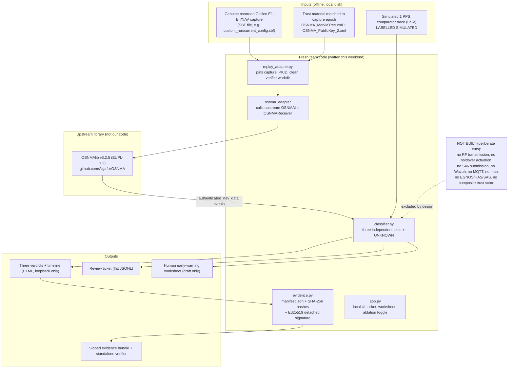

Building your OSNMA timing-integrity dossier — adjudicating the two reviews and fact-check claims into the strongest single build plan.## 1. **Summary card**

| Item | Definitive version |
|---|---|
| **Project name** | **ClockWitness** — merged version of ChronoShield, ClockWitness, ClockEvidence and CERTUS |
| **One-line pitch** | ClockWitness proves whether Galileo's navigation message was genuine, separately checks whether the clock delivered to a critical site still agreed with an independent local reference, and seals both findings into a signed incident-evidence bundle an operator can actually use. |
| **Challenge track** | **Challenge 1 — Cybersecurity for space-based strategic enablers** |
| **EU space assets used** | **Galileo Open Service Navigation Message Authentication (OSNMA) on the E1-B I/NAV signal** — the genuine European navigation signal whose Initial Service was declared operational on 24 July 2025. No Copernicus data are used, and none are needed. |
| **What the prototype consumes** | A genuine, recorded Galileo I/NAV capture replayed offline through the open-source OSNMAlib verifier, plus a **clearly labelled simulated** local-clock comparison trace. |
| **What the prototype produces** | Three separate verdicts — navigation-message authentication, clock agreement, reference health — a read-only holdover-review ticket, and a tamper-evident signed evidence bundle with a human-completed early-warning worksheet. |
| **Target buyer** | First: a Polish substation-timing / operational-technology integrator that already services a distribution or transmission system operator. End users: the utility timing engineer and the OT security operations centre. Expansion: telecom timing, ports, rail, data centres. |
| **Pricing hypothesis** | €12k–€25k fixed-fee read-only pilot, then a per-monitored-site annual licence. This is a hypothesis to test, **not** evidence of willingness to pay. |
| **Ranking context** | In the team's 29-idea ranking this concept scored **4.9 after penalties (base 7.4, −2.0 convergence, −0.5 past-winner adjacency)** and was ranked sixth. Per the wildcard instruction, those convergence/template/past-winner penalties are treated as context, not as binding. This project was then chosen as the wildcard by the Muse Wonder pick, named as runner-up by GPT Sol 6.2, and its underlying concept appears in all four source designs. The penalties still matter operationally — they warn that rivals may pitch something similar — but they do not change the physics or the buyer problem. |
| **Submission deadline** | Sunday 29 November 2026, 15:00 CET |
| **Go / no-go gate** | **Saturday 28 November, 11:30 CET:** a genuine Galileo capture must produce an authenticated-navigation result offline, on the team's own laptop, with matching trust material. If not, see the fallback in §5. |

**Bottom line:** Build ClockWitness, not ChronoShield's "PNT firewall" and not CERTUS's "compliance autopilot". The winning version is deliberately narrow: one substation timing workflow, one real recorded Galileo signal, one honestly simulated clock trace, one signed evidence package. Its hero moment is the sentence no rival's red dashboard can say honestly — **"the Galileo navigation message authenticated, but the delivered clock is still outside tolerance, and the cause is undetermined."** That distinction is technically true because OSNMA authenticates navigation data, not the physical arrival time of the radio signal. The product is the evidence handoff between the timing engineer and the security team, not a new receiver, not an automatic switch, and not an automatic regulatory filing.

---

## 2. **Plain-language description**

### The problem, in ordinary words

Many critical systems need to know the exact time, not just roughly what o'clock it is:

- Electricity substations compare electrical measurements taken at different places. If their clocks disagree by even a tiny amount, the comparison is wrong.
- Mobile phone networks need their transmitters synchronised so phones can hand over between masts.
- Financial trading systems must prove when an order happened.

Most of these sites get their time from satellite navigation signals — in Europe, increasingly from **Galileo**, the EU's own satellite navigation system. A *receiver* is the box with an antenna that listens to the satellites and outputs the time.

Two different things can go wrong:

1. **The message can be fake.** An attacker can broadcast a forged satellite message. Galileo now has a defence against this called **OSNMA** (Open Service Navigation Message Authentication). In plain terms: Galileo adds a kind of delayed digital signature to its navigation messages, so a receiver can check "did this message really come from Galileo, unchanged?" OSNMA lets users verify that navigation information comes from Galileo and has not been tampered with.
2. **The message can be genuine but late.** An attacker can record a real Galileo signal and rebroadcast it a moment later. The message still passes OSNMA's check, because the message itself is genuine — but the *time* it produces is now wrong. This is often called meaconing or replay. OSNMA increases the ability to detect some spoofing, but it does not prevent spoofing from occurring, and it does not protect against jamming.

Today, when a site's clock misbehaves, three different people hold three different scraps of evidence: the timing engineer has receiver logs, the clock equipment has its own alarms, and the security team has its own incident system. Nobody has a single, sealed record that answers three separate questions:

- Was the Galileo message itself genuine?
- Did the clock we actually delivered still agree with a trustworthy local clock?
- Was the local reference clock itself healthy enough to judge?

And if the answer is "something is wrong", staff must assemble that evidence by hand — under time pressure, because European rules can require a first incident report within 24 hours once an operator becomes aware of a *significant* incident. The staged reporting sequence is an early warning within 24 hours, a fuller notification within 72 hours, and a final report within one month.

This is not a hypothetical threat environment. Poland's National Institute of Telecommunications reported multi-hour, all-band GNSS disruptions on about 70% of days in May and June 2026 around Gdańsk, and full disruptions on 63% of days in the first 19 days of August. Those numbers describe one monitoring station and area, not the whole country — but they establish that the operating environment for satellite timing in northern Poland is genuinely hostile.

### What we build

ClockWitness is a small piece of software that sits **beside** the timing equipment a site already owns. It does not replace the receiver. It does three jobs:

1. **Check the message.** It takes Galileo navigation data and runs the official-style OSNMA check: did Galileo really send this, unchanged?
2. **Check the clock separately.** It compares the time the site actually delivered against an independent local reference — in a real deployment, a local high-quality clock (a holdover oscillator) or a local precision-time network. In our hackathon demo, this comparison trace is **simulated and labelled as simulated**.
3. **Seal the evidence.** It writes the findings, the raw inputs, the thresholds used, and a timeline into one bundle, then digitally signs it — like sealing an envelope with a wax stamp, so any later edit is detectable.

### What a user actually sees and does

The user is a timing engineer or a security analyst. They see one screen with three separate verdict boxes:

- **Navigation message:** `AUTHENTICATED` / `PENDING` / `UNAVAILABLE` / `VERIFICATION REJECTED` / `UNKNOWN`
- **Delivered clock:** `WITHIN TOLERANCE` / `OUTSIDE TOLERANCE` / `INDETERMINATE` / `UNKNOWN`
- **Reference clock:** `HEALTHY` / `UNHEALTHY` / `UNKNOWN`

They see a timeline, the measured clock offset with its uncertainty band, and a button: **"Open timing investigation"**. Clicking it produces:

- a review ticket saying *"timing engineer: inspect the reference and review the approved holdover procedure"* — it never switches anything itself;
- a signed evidence bundle they can download and hand to anyone;
- a draft worksheet with the technical facts pre-filled, which a named human uses — or doesn't — if they decide the incident must be reported.

The user never sees the words "attack detected". ClockWitness does not claim to know *why* something is wrong. It says what the evidence supports, and says `UNKNOWN` when it doesn't.

### Why it needs space data

Remove Galileo and the product loses its only unique verdict. A clock comparison alone can say "these two clocks disagree". Only Galileo's OSNMA can add "and the satellite message itself was genuine" — or "and the message itself failed authentication". OSNMA is carried in the Galileo E1-B I/NAV message, and it is the EU's own strategic signal. This is not a decorative badge; it is the load-bearing input, and §6 includes a live demonstration (turning OSNMA processing off) that proves it.

### Why now

- OSNMA only became operational on 24 July 2025. This is the first hackathon season where it is a real service rather than a test.
- Professional timing equipment is starting to ship with OSNMA built in — Oscilloquartz has integrated it into its OSA 5412, 5422 and 5430/40 timing platforms — which creates a fleet of receivers whose authentication output nobody yet joins into incident evidence.
- Poland's amended National Cybersecurity System Act (Dz.U. 2026 poz. 252) has been in force since 3 April 2026, with security-management obligations following and penalties applying only from 3 April 2028. So buyers are in the "get auditable" window now, not the "pay fines tomorrow" window. We say exactly that, because the honest version is still a good story.

---

## 3. **Technical description**

### 3.1 Architecture



### 3.2 The exact data / signal pipeline

| Stage | Exact artefact | Format / endpoint | Latency & semantics | Account / key needed |
|---|---|---|---|---|
| Galileo signal | Recorded Galileo **E1-B I/NAV** pages carrying OSNMA, as a Septentrio **SBF** file. Default candidate: OSNMAlib's bundled maintainer recording `custom_run/current_config.sbf` (per GPT Sol review). | Local file. No network. | Replay is retrospective. I/NAV subframes are 30 s; TESLA keys are disclosed late, so authentication is **inherently delayed** — this must be visible in the UI as a `PENDING` state, never backdated. | None to clone/run the upstream example (per Sol review). GSC trust-material downloads are registration-gated; do **not** put fresh GSC download on the critical path. |
| Trust material | `OSNMA_MerkleTree.xml`, `OSNMA_PublicKey_2.xml`, bundled with the matching fixture. | Local XML files, hashed (SHA-256) into the evidence manifest. | **Epoch-critical:** Public Key ID 2 became applicable on 2025-12-10T10:00:00 UTC. Capture date and PKID must match and be asserted at startup. Use a clean verifier working directory per scenario so a stored root key from one run cannot contaminate the next. | Bundled files for demo. A team member's existing GSC account may fetch fresh material Saturday as *provenance dressing only*. |
| OSNMA verification | Upstream **OSNMAlib** (`github.com/Algafix/OSNMA`), pinned at **v3.2.5, commit `25aa61d`** **[per Sol review; re-verify the tag on the demo machine Saturday]**, CPython **3.11**. Entry points: `custom_run/run.py`; classes `osnma.input_formats.input_sbf.SBF` and `osnma.receiver.receiver.OSNMAReceiver`. Upstream requirements (per Sol review of the pinned tag) include `bitstring<5`, `ecdsa>=0.18.0`, `pycryptodome>=3.19.0`, `pandas>=1.5.2`, `protobuf>=4.25.1`, `pyserial>=3.5,<4.0`, `reedsolo~=1.7.0`, `ntplib~=0.4.0`. | Output consumed: `authenticated_nav_data` events (the actual finding), `verified_OSNMA_material` (diagnostics only). | A valid TESLA key ≠ a valid tag ≠ authentication of specific navigation data. Only the third counts. **[UNVERIFIED until run Saturday — this is gate #1.]** | None. EUPL-1.2 licence: preserve notices, identify as upstream, keep our adapter in separate files. |
| Clock comparison | **Simulated** 1 PPS comparator trace. Columns: `sample_id, replay_s, offset_ns, uncertainty_ns, reference_state`. Generated by one team-written fixture generator so both streams share one synthetic clock. | Local CSV. The word **SIMULATED** appears in the file header, on screen, and in the bundle. | Samples are a replay axis (`replay_s`), **not** claimed to be measured at the capture site. Join navigation evidence and simulated trace only on this explicit relative axis. | None. |
| Independent reference (production claim only) | Local holdover oscillator or hardware-timestamped local PTP — **at the site**. | Not in the demo. | An internet NTP / e-CzasPL-over-internet reference is milliseconds-class and is **disqualified** as a microsecond reference. A second GNSS receiver is corroboration, never an independent reference (same sky, same jamming). PTP only counts if its grandmaster is not itself disciplined by the same compromised receiver. | N/A |
| Deliberately NOT used | Galmon live feed (`86.82.68.237:10000` raw TCP), KU Leuven `osnmalib.eu` live JSON, GSC IDD SFTP, Jammertest archives, IEEE DataPort dataset. | — | Sol review: the KU Leuven endpoints expose only the last 12 subframes and no service guarantee; Galmon is a P2P aggregate with known out-of-order packet issues. Both are optional corroboration at most. A paired I/NAV + PPS Jammertest artefact is **[UNVERIFIED]** — do not make it the first path. | — |

**Fallback capture path (only if the default fixture fails):** the upstream `tests/test_corner_cases.py` entry `test_real_eoc` with its scenario-specific SBF and trust files (per Sol review). Do not sweep all tests; do not write a new capture parser on Saturday. Official OSNMA test vectors are regression fixtures only — passing a test vector is **not** evidence of processing a real over-the-air recording, and judges may treat it accordingly.

### 3.3 Algorithms and decision logic

Three **independent** axes. There is no composite score.

**Axis 1 — Navigation evidence** (from OSNMAlib output only):
- `AUTHENTICATED_FOR_THESE_DATA` — `authenticated_nav_data` contains the satellite/data record, with ADKD, GST week/TOW, verifying subframe, trust-material IDs retained.
- `VERIFICATION_REJECTED` — only where the verifier explicitly rejects.
- `PENDING` — data received, key not yet disclosed / warm-up.
- `UNAVAILABLE` / `UNKNOWN` — insufficient data, stale, startup, missing trust state.
- **Rule:** missing authentication is never labelled jamming; a rejected verification is never, alone, labelled an attack. Absence of evidence maps to `UNKNOWN`.

**Axis 2 — Clock agreement** (from the comparator trace only). Let `d = |offset_ns|`, `u = uncertainty_ns`, `L` = site limit in ns:
- `OUTSIDE` only if `d − u > L` for **3 consecutive fresh samples**.
- `WITHIN` only if `d + u ≤ L`.
- Otherwise `INDETERMINATE`.
- Missing/stale samples, or Axis 3 unhealthy → `UNKNOWN`.
- Demo value: `L_demo = 5,000 ns`, labelled **illustrative — not a sector SLA**. Do not present 5G (±1.5 µs class), PMU (±1 µs class) or MiFID II (100 µs class) figures as interchangeable site limits, and do not claim the demo detects a 2 µs drift against an internet reference.

**Axis 3 — Reference health** (from `reference_state` plus declared uncertainty and holdover age):
- `HEALTHY` only if the reference declares itself locked/held-over within its documented holdover budget, uncertainty is present, and samples are fresh.
- Otherwise `DEGRADED` / `UNHEALTHY` / `UNKNOWN`.

**Ticket rule (the only "action"):**
- Open a **timing investigation ticket** if Axis 2 = `OUTSIDE` (whatever Axis 1 says), or Axis 1 = `VERIFICATION_REJECTED`.
- Ticket text is fixed: *"Cause undetermined. Service impact not assessed. Timing engineer: inspect reference and review the approved holdover procedure."*
- The ticket **never** commands holdover, never switches a clock, never sends anything externally.
- The worksheet records three distinct timestamps: observed anomaly, evidence availability, operator-recorded detection/assessment. Reportability is a human decision left blank for the operator.

**Ablation toggle:** a UI switch disables OSNMA processing. Expected honest behaviour: the clock-disagreement alert still fires, but the forged-message case degrades to `UNKNOWN` on Axis 1. This is the experiment that proves Galileo is load-bearing.

### 3.4 Components and tech stack

| Component | Implementation | Notes |
|---|---|---|
| Runtime | CPython **3.11** (upstream supports 3.10–3.12; pin one) | One laptop is the demo machine; freeze working dependency versions into `requirements.lock` Saturday and download wheels for offline reinstall. |
| OSNMA verification | **OSNMAlib v3.2.5** (upstream, EUPL-1.2) | Used as a library — the normal Fresh-Code-compliant pattern. |
| Our code | `replay_adapter.py`, `osnma_adapter.py`, `fixture_gen.py`, `classifier.py`, `evidence.py`, `worksheet.py`, `app.py`, `verify_bundle.py` | All written during the event; timestamped git history from Saturday morning. |
| Evidence signing | Python **`cryptography`** package, **Ed25519**, SHA-256. Sign the **exact bytes** of `manifest.json`; detached signature file; public key pinned **outside** the bundle. | Adjudication §4: Ed25519 (Sol) is adopted over ES256 (Wonder) for our own bundle signature. Hash every attachment: input capture, trust material, verifier output, config/policy, draft. Private key never in git. |
| SIEM interface | One flat JSONL event written locally + displayed. Optionally POST to a 30-line local mock receiver if the team already has FastAPI/Uvicorn running. | No arrays of objects in the event (Wazuh decoder limitation, per Sol review). Bundle referenced by digest. **No Wazuh deployment this weekend.** |
| UI | Single local HTML page served on loopback (Python stdlib or FastAPI if already working). | No React/Tailwind build chain, no map, no MQTT broker, no PDF toolchain. Print the HTML if a handout is wanted. |
| Explicitly cut | Wazuh live SIEM, MQTT/serial receiver adapters, SNMP, holdover actuation, S46 submission, Merkle-tree logging, EN 16605 "conformance score", EGNOS/HAS/SAS inputs, C/N₀-AGC causal labels, composite PNT Trust Score | Each cut is a jury-question avoided. Hash-chained JSONL inside the manifest gives tamper-evidence honestly without a Merkle tree. |

### 3.5 Suggested repo layout

```text
clockwitness/
  README.md                # what is upstream, what is data, what is fresh code; honest claims list
  requirements.lock        # frozen Saturday after first green run
  vendor/
    OSNMA/                 # upstream v3.2.5, unmodified, commit hash recorded
  data/
    capture/               # SBF fixture + SHA256SUMS + provenance note (retrieval instructions)
    trust/                 # Merkle XML + PublicKey_2 XML + provenance note
    fixtures/              # clean.csv, clock_bad.csv, nav_insufficient.csv, ref_unhealthy.csv
  src/
    replay_adapter.py      # pins capture<->PKID, clean workdir per scenario, startup asserts
    osnma_adapter.py       # wraps OSNMAReceiver; emits normalised nav-evidence JSON
    fixture_gen.py         # single generator writing all demo traces from one synthetic clock
    classifier.py          # three axes, UNKNOWN logic, ticket rule
    evidence.py            # manifest build, SHA-256, Ed25519 sign
    worksheet.py           # human early-warning draft fields (no auto-send)
    app.py                 # loopback UI: verdicts, timeline, ablation toggle, ticket
    verify_bundle.py       # STANDALONE verifier: pinned pubkey -> signature -> rehash attachments
  tests/
    test_classifier.py     # the three cases + unhealthy-reference control
    test_bundle_tamper.py  # edited bundle must fail verification
  demo/
    BACKUP_RECORDING.mp4   # 90-second offline screen capture (recorded Sunday ~12:00)
    sample_bundle/         # pre-generated, honestly labelled cached bundle
  keys/
    demo_pubkey.txt        # public key committed; private key NEVER committed
```

---

## 4. **Problems and solutions**

Severity: **BLOCKER** = kills the demo or the credibility if unfixed; **MAJOR** = loses significant marks; **MINOR** = polish/scope risk. "Raised by" uses: SOL = research-sol.md, WON = research-wonder.md, RK = ranking-section.md, DS = one of the four source designs.

| ID | Problem | Severity | Raised by | Solution (executable before Sun 15:00) | Residual risk |
|---|---|---|---|---|---|
| P01 | **"Auto-file NIS2/S46 report" is false.** Reporting attaches to a human-judged *significant* incident; the 24 h clock runs from awareness, not from a sensor alarm. No public S46 filing API/sandbox was verified. | BLOCKER | SOL, WON, RK (DS: ChronoShield, CERTUS) | Global purge: "auto-file / legally compliant report" → "pre-filled draft worksheet, human decides and submits". Nothing is sent anywhere. | Judge may still ask who submits; answer is rehearsed (the operator, via S46 portal). |
| P02 | **"Auto-switch to holdover" is an overclaim.** The site's own timing appliance does switching; our software writing to grid timing kit raises a safety-case question we cannot answer. | BLOCKER | SOL, WON (DS: ChronoShield) | Output is a **holdover recommendation ticket only**. Rename everywhere, including README and TAIKAI text. | Low, if vocabulary discipline holds on stage. |
| P03 | **Internet NTP / e-CzasPL as the microsecond reference.** Millisecond-class reference vs microsecond thresholds — three orders of magnitude too coarse. | BLOCKER | SOL, WON, RK | Demo reference = labelled simulated local 1PPS trace. Production claim = on-site oscillator / hardware-timestamped PTP with stated error budget, and a grandmaster not disciplined by the same receiver. | Pilot must prove the reference story with real hardware; stated openly in §8. |
| P04 | **OSNMA ≠ timing truth.** OSNMA authenticates the navigation message, not RF arrival time, pseudorange, PPS output or UTC accuracy. It also *assumes* loose time synchronisation, so it cannot certify microseconds. | BLOCKER | SOL, WON, RK, all DS concede | Three-axis design (§3.3); slide 2 states the distinction verbatim; no artefact is ever labelled "Galileo authenticated clock". | None if the wording holds; this is the product's core honesty. |
| P05 | **PKID 1 ↔ PKID 2 mismatch makes a clean trace show AUTH FAIL on stage.** PKID 2 applies from 2025-12-10T10:00:00 UTC. | BLOCKER | SOL, WON | Pin capture↔key, assert at startup, print `PKID=… capture=YYYY-MM-DD` on screen; rehearse only on the exact files to be submitted. | A mentor-supplied new capture on Sunday could break it — decline to swap fixtures after freeze. |
| P06 | **The bundled capture may not yield authenticated data** (incomplete subframes, missing key chain, wrong epoch). | BLOCKER | SOL (gate), WON (check #1) | **Saturday 11:30 gate:** run `custom_run/run.py` offline; require `authenticated_nav_data`, not merely a verified root key. First fallback: upstream `test_real_eoc` fixture. | If both fail → NO-GO pivot (§5). Do not substitute a synthetic green tick. |
| P07 | **Live RF spoofing/jamming demo at the venue.** Transmitting on Galileo E1 is an interference/legal non-starter regardless of shielding claims. | BLOCKER | SOL, WON (DS: CERTUS) | Replay-only. State proudly: "we never transmit". All "attacks" are file/trace replays. | None. |
| P08 | **EGNOS as a Galileo cross-check is technically wrong.** EGNOS augments GPS L1; it is not an independent Galileo timing reference. | BLOCKER if retained | SOL, WON, RK (DS: ChronoShield) | Deleted from detection logic, diagrams and slides. | None once deleted; high if anyone re-adds it in Q&A. |
| P09 | **Composite "PNT Trust Score 0–100".** Invented weights hide the exact distinction that differentiates the project. | MAJOR | SOL, WON (DS: ChronoShield) | Deleted. Three verdicts + `UNKNOWN` + visible thresholds. | Low. |
| P10 | **Causal labels from single observables** ("jamming", "meaconing detected", "spoofing attack") from OSNMA status, C/N₀ or AGC alone. | MAJOR | SOL, WON (DS: all) | Classifier emits evidence states only; ticket says "cause undetermined". Observables may be kept as context in a later pilot, never as labels. | Judges may push for a cause; the honest "we don't claim that" is the answer. |
| P11 | **Delayed authentication hidden.** TESLA key disclosure means verdicts arrive late and warm-up exists; presenting instant per-second verdicts is false. | MAJOR | SOL, WON | UI shows `PENDING` and authentication-delay semantics; the delay is demo content ("retrospective by design"), not dead air. | Low; actually strengthens the demo. |
| P12 | **Trust-material access.** GSC downloads are registration-gated; approval timing is **[UNVERIFIED]** and cannot be on the critical path. | MAJOR | SOL, WON | Demo runs on bundled material, hashed and provenanced. Fresh GSC download Saturday = optional screenshot only. | Provenance questions; answered by hashes + retrieval instructions. Note: redistributing the raw recording publicly is **[UNVERIFIED]** as permitted — if unsure, publish hashes and retrieval instructions, not the file. |
| P13 | **Live feeds as backbone** (Galmon P2P TCP, KU Leuven JSON). Out-of-order packets, 12-subframe window, no service guarantee. | MAJOR | SOL, WON | 100% offline replay. Live feeds, if shown at all, are an unprompted bonus tab. | None for the scored demo. |
| P14 | **Hardware on the critical path.** CERTUS names a "ZED-F10T"; the documented u-blox OSNMA timing part is the **NEO-F10T** (TIM 3.02), and Septentrio mosaic-T is the SBF alternative (both per reviews). No receiver should be bought Saturday. | MAJOR | SOL, WON (DS: CERTUS) | Replay only. Correct part names cited as *production integration targets*. A mentor-lent receiver is a table prop with its own pre-recorded SBF, only after the offline path passes. | Indoor sky view / cold-start risk eliminated by not depending on hardware. |
| P15 | **HAS and SAS presented as usable now.** HAS is a correction service, not authentication; SAS is in testing with an Initial Service targeted later **[per WON review; not independently re-verified here — treat timelines as UNVERIFIED]**. | MAJOR | SOL, WON (DS: CERTUS, ChronoShield) | HAS deleted entirely. SAS = one roadmap sentence and one reserved schema field. | Low. |
| P16 | **Wrong regulatory urgency.** Fines do not bite in April 2027: the KSC amendment is in force from 3 April 2026 and penalties can only be imposed from 3 April 2028. Entity counts (~38,000 vs ~100k) are unsourced in the designs and disagree with each other. | MAJOR | SOL, WON, fact-check | Slide wording: "obligations build through 2027; enforcement from April 2028 — operators buy auditability now". Drop entity counts and SAM arithmetic, or cite a primary source. | A Polish juror may still test the timeline; the corrected version is the defence. |
| P17 | **S46 "JSON format" is invented.** No supported public filing endpoint, sandbox or import contract was verified. | MAJOR | SOL, WON (DS: ChronoShield) | Export labelled "S46-ready worksheet (fields aligned to early-warning content)". Recipient/routing left to the operator. | Low. |
| P18 | **Incumbents already ship the sensor layer.** Oscilloquartz ships OSNMA in professional timing platforms; Microchip BlueSky/TimePictra, Safran, Meinberg offer timing protection/monitoring (per reviews). | MAJOR | SOL, WON, RK, design-pick-wonder | Position is **vendor-neutral evidence across a mixed fleet + SOC handoff**, never "we verify OSNMA better". The mentor test: does the incumbent stack already produce this evidence join with equal effort? If yes, no sale — say so. | This is the real business risk; mitigated by the integrator-pilot route, not eliminated. |
| P19 | **EN 16605 "conformance scorecard" overclaim.** EN 16605:2024 does specify Galileo timing-receiver requirements including OSNMA processing and anti-jamming/anti-spoofing tests — but a software replay cannot establish *receiver* conformance. | MAJOR | SOL (corrects WON's pick framing) | Rename to **"evidence coverage checklist, mapped to EN 16605 topics"**. Never claim conformance. Note EUSPA's STARGATE already targets receiver validation. | Low with renamed artefact. |
| P20 | **Evidence signature proves less than it sounds.** A signature proves integrity relative to a key — not sensor truth, completeness, event time, or legal admissibility. A Merkle log alone cannot prevent deletion/resigning by a compromised collector. | MAJOR | SOL, WON | Sign exact bytes; pin pubkey outside bundle; rehash attachments in the verifier; show an edited copy failing. Claim "tamper-evident", never "court-admissible" or "space-certified". | Compromised-collector scenario remains; disclosed in Q&A (§7). |
| P21 | **Wazuh / MQTT / serial / PTP-live scope creep.** Standing up a SIEM or brokers buys fragility, not marks. | MAJOR | SOL, WON (DS: CERTUS, ClockEvidence) | Mock local receiver / flat JSONL. Wazuh named in one production sentence only. | Low. |
| P22 | **Naming real operators as demo sites** (Energa, PSE, Orange). Implying a real operator's live feed is a falsifiable fabrication. | MAJOR | WON | "A mock substation timing profile" only. No real operator names on demo data. | Low. |
| P23 | **Demo looks like every rival's**: red SOC dashboard, maybe a map. Saturation is likely (not measured): 9 source variants converged on this concept, and the ranking records past-podium adjacency for GNSS-spoofing detection. | MAJOR | RK, SOL, WON | Differentiation kit: no map, no score, three verdicts, "authenticated but wrong" hero case, jury-runnable verifier, OSNMA-off ablation, evidence bundle as hero artefact. | Cannot be eliminated; polish + honesty are the tiebreakers. |
| P24 | **Fresh Code / replay eligibility ambiguity.** Public Warsaw materials did not settle every upload/reuse rule (per SOL). | MAJOR | SOL, WON | Saturday: get organiser confirmation on (a) recorded-Galileo replay eligibility, (b) upstream-library use, (c) exact TAIKAI submission requirements. Git history from Saturday; README separates library/data/fresh code. | Depends on organiser answer at check-in. |
| P25 | **Demo-data hygiene.** Customer telemetry, real identifiers, or unlabelled simulated data in the public submission. | MINOR | SOL | All demo data synthetic or public-fixture; simulated stream labelled everywhere; keys out of git. | Low. |
| P26 | **Signature canonicalisation bugs** (JSON key ordering/floats) making our own verifier fail live. | MINOR→MAJOR live | WON, SOL | Sign raw file bytes, not re-serialised JSON; verify the *submitted* artefact in rehearsal on a second laptop, Wi-Fi off. | Low after rehearsal. |
| P27 | **PDF-first build, Merkle tree, GNSS-SDR/Android inputs.** Time sinks with no jury payoff. | MINOR | SOL, WON | JSON first; HTML print for handouts; hash-chained manifest instead of Merkle tree. | Low. |

### Discussion of the blockers

The blockers cluster into three groups. **Legal-honesty blockers (P01, P02, P07):** the source designs' most exciting verbs — *auto-file, auto-switch, live attack* — are exactly the claims that are false, unauthorised, or illegal at a venue. Both reviewers independently converge here, and the merged design deletes all three verbs. What remains ("pre-filled draft, human submits; recommendation ticket; we never transmit") is less cinematic and much harder to attack. **Physics blockers (P03, P04, P08):** OSNMA's real guarantee is narrow, and the independent reference is where microsecond claims live or die. The merged design never lets OSNMA speak about time-of-arrival, and never lets an internet clock speak about microseconds. **Demo-execution blockers (P05, P06):** epoch-matched trust material and a genuinely authenticated result from a genuine capture. These are binary and testable by 11:30 Saturday — which is precisely why the verdict is *conditional* go rather than go.

### Reviewer disagreements — adjudicated

1. **Bundle signature algorithm.** WON specifies ES256-signed JSON; SOL specifies `cryptography` with **Ed25519** over exact bytes. **Verdict: SOL is right for this build.** Our own evidence signature has no interop requirement this weekend, so Ed25519's simplicity and exact-bytes signing minimise the canonicalisation failure mode both reviewers fear. ES256 remains a fine production choice; it is not a differentiator. (Caveat: SOL's pinned version string for `cryptography` is **[UNVERIFIED]** — pin whatever version actually installs and passes tests Saturday, and record it in `requirements.lock`.)
2. **EN 16605 scorecard.** The wildcard pick (design-pick-wonder) proposes an "EN 16605:2024 conformance scorecard"; SOL explicitly renames it to an evidence-coverage checklist. **Verdict: SOL is right.** The standard genuinely covers OSNMA processing and anti-jamming/anti-spoofing tests, but conformance is a property of a tested *receiver*, and EUSPA-funded work already occupies receiver validation. Claiming conformance from a software replay would be the fastest credibility loss available with this jury. The checklist keeps the citable mapping without the false claim.
3. **PDF export.** WON treats WeasyPrint/ReportLab as a minor, acceptable component; SOL cuts PDF entirely in favour of print-the-HTML. **Verdict: SOL is right for the weekend.** A PDF generated from the signed JSON is harmless in production, but on Saturday it is a toolchain risk bought with time needed for the verifier. Build JSON first; PDF only after the Sunday freeze if time genuinely remains.
4. **Trust-material acquisition risk.** WON warns GSC confirmation "may take around a week" **[UNVERIFIED, likely stale test-phase guidance]**; SOL verifies the bundled-files path in detail. **Verdict: SOL's operational conclusion wins** — bundled, hashed, epoch-matched material on local disk; a fresh GSC download is provenance decoration only. WON's underlying caution (never gate the demo on a registration flow) is adopted.
5. **Where the two reviews agree, treat it as settled:** three verdicts instead of a trust score; internet NTP disqualified; EGNOS deleted; HAS deleted; Wazuh cut; replay-only; incumbents ship the sensor layer; April 2028, not 2027, is the penalties date. On every one of these the merged design follows both.
6. **Points where SOL is more precise than WON (adopted):** pinned OSNMAlib tag/commit and exact entry points; signing exact bytes with a detached signature and an externally pinned key; the `d − u > L` uncertainty-aware threshold rule; keeping capture time, verifier time and simulated incident time as three separate clocks. **Points where WON adds value SOL underplays (adopted):** the OSNMA-off ablation toggle as an explicit demo step; hash-chained JSONL as the honest tamper-evidence structure inside the manifest; the "what does the incumbent stack already export?" mentor test as the business validation method.

---

## 5. **48-hour build plan**

It is Saturday 28 November, morning. Submission is Sunday 29 November 15:00 CET. Internal freeze: **Sunday 12:00**. Internal publish target: **Sunday 14:15**.

### Roles (3–6 people)

| Role | Owns | If only 3 people |
|---|---|---|
| **A — Galileo/OSNMA** | OSNMAlib run, trust material, replay adapter, nav-evidence JSON | A |
| **B — Correlation & tests** | Fixture generator, classifier, the three cases, unit tests | B |
| **C — Evidence & UI** | Manifest/signing, standalone verifier, HTML UI, ticket, worksheet | C |
| **D — Submission & buyer** | Organiser confirmation, TAIKAI entry, mentor/practitioner conversations, pitch script | Merged into C |
| **E — Demo captain** (optional 5th/6th) | Rehearsals, backup recording, second-laptop offline test, slide discipline | Merged into A |

### Hour-by-hour checkpoints

**Saturday 28 Nov**

| Time | Checkpoint | Owner | Done means |
|---|---|---|---|
| 09:00–09:30 | Team lock-in: read §4 blockers aloud; vocabulary purge agreed ("no auto-file, no auto-switch, no attack detected") | All | One workflow agreed: substation timing evidence |
| 09:30–10:00 | Organiser desk: confirm replay eligibility, Fresh Code/library position, exact TAIKAI deliverables | D | Written note of answers |
| 09:30–11:00 | Clone pinned OSNMAlib; `pip install` on the demo laptop; run `custom_run/run.py` **offline** | A | Verifier runs end-to-end |
| 11:00–11:30 | Inspect output for `authenticated_nav_data`; record PKID, capture date, TTFAF behaviour; hash capture + trust files | A | Evidence of a real authenticated result |
| **11:30** | **GO / NO-GO GATE #1** | All | See below |
| 11:30–13:00 | Freeze capture + trust material; write `replay_adapter.py` with startup asserts; clean workdir per scenario | A | Adapter reproduces the green result |
| 11:30–13:00 | `fixture_gen.py`: one generator, three traces (clean / clock-bad / nav-insufficient) + unhealthy-reference control; all on one relative replay axis | B | Four CSVs, header-marked SIMULATED |
| 13:00–14:00 | `classifier.py` three axes + ticket rule; unit tests for intended verdicts incl. `UNKNOWN` paths | B | Tests green |
| 14:00–15:30 | Practitioner hunt: timing/OT mentor or integrator — ask the three questions in §9 | D | One quotable sentence or honest "none found" |
| 14:00–16:00 | `evidence.py`: manifest + SHA-256 + Ed25519 detached signature; `verify_bundle.py` standalone | C | Bundle verifies; edited copy fails |
| 16:00–17:30 | `app.py` UI: three verdict boxes, timeline, uncertainty band, ablation toggle, ticket button | C (+B) | Three cases clickable end-to-end |
| 17:30–18:30 | **Checkpoint:** full offline run, all cases, Wi-Fi off | All | No network dependency anywhere |
| 18:30–20:00 | Worksheet fields (technical facts only; reportability blank); JSONL ticket; README claims audit against §4 | C, D | No banned verb survives anywhere |
| 20:00–21:00 | Buffer / second-laptop clone and offline rerun; `requirements.lock` frozen | A, E | Backup laptop reproduces green |
| 21:00 | **GO / NO-GO GATE #2:** if the three cases + verifier aren't green offline, cut UI polish, keep CLI + pre-generated bundle | All | Scope decision recorded |

**Sunday 29 Nov**

| Time | Checkpoint | Owner |
|---|---|---|
| 09:00–10:00 | Final integration only (no new features); tamper demo tested; ablation tested | All |
| 10:00–11:00 | Slides built around the evidence bundle (not a dashboard); regulatory slide uses the corrected 2027/2028 timeline | D, C |
| 11:00–12:00 | Two full pitch rehearsals, timed; record the 90-second backup screen capture | E |
| **12:00** | **FREEZE.** Only bugfixes that break the demo path. No fixture swaps, no key changes. | All |
| 12:00–13:30 | Offline rehearsal on both laptops; verifier run from a clean directory; phones in airplane mode test | E |
| 13:30–14:15 | TAIKAI publish (not draft): repo, description with honest claims, sample bundle, backup video link | D |
| 14:15–15:00 | Verify the published entry renders; demo machine charged, notifications off, files local | All |
| 15:00 | **Submission.** Pitches from 15:05. | — |

### Go / no-go decision points and fallbacks

- **GATE #1 (Sat 11:30) — the only true blocker.** GO if a genuine capture yields authenticated navigation data offline with matched PKID. **Fallback 1:** the upstream `test_real_eoc` fixture. **Fallback 2 (NO-GO for this project):** if neither produces a real authenticated result, do **not** ship a synthetic green tick, a test-vector-only claim, or a remote dashboard dressed as signal verification. Pivot the remaining time to the team's next-ranked project, or — only if the team judges a rescope viable — submit ClockWitness explicitly as a *decision-logic prototype with unverified navigation input*, accepting the Relevance/Execution hit. The dossier's recommendation is pivot, not fake.
- **GATE #2 (Sat 21:00):** if UI lags, fall back to: classifier CLI output + pre-generated (labelled cached) verifier JSON + signed bundle verification live. The signature check is the artefact; the chart is not.
- **Buyer gate (Sat evening):** if no practitioner validates the workflow, the prototype still submits, but the pitch presents the business as a hypothesis (see §8). Never invent a letter of intent or a pilot.

### What to cut first (in order)

1. PDF generation. 2. Any live feed tab (Galmon/KU Leuven). 3. Mock SIEM POST (keep JSONL file). 4. Worksheet auto-fill beyond technical fields. 5. UI styling beyond legibility. **Never cut:** the real replay, the three-axis classifier with `UNKNOWN`, the standalone verifier, the tamper-rejection demo, the ablation toggle.

---

## 6. **Demo script**

Total: 4 minutes. Rule for every step: the fallback is spoken, not hidden — labelling cached output as cached is a scoring asset, not an embarrassment.

**[0:00–0:35] The distinction (no clicks).**
"This is a substation timing site. Its clock comes from Galileo. Two different things can go wrong: the satellite *message* can be forged — or the message can be genuine but the *time* still wrong, because someone replayed a real signal late. Galileo's OSNMA, operational since July 2025, answers the first question: it lets users verify navigation data comes from Galileo and has not been tampered with. It cannot answer the second — it does not protect against jamming, and it does not authenticate arrival time. So we keep the answers separate. Three verdicts, and when evidence is missing, we say `UNKNOWN`."

**[0:35–1:20] Case 1 — nominal.**
Click *Replay nominal*. Show: real recorded Galileo capture, PKID and capture date on screen; verifier processing; navigation verdict becomes `AUTHENTICATED_FOR_THESE_DATA` (after a visible `PENDING` — "authentication is retrospective by design: the keys arrive at least a subframe late"). Clock axis: within tolerance. **No ticket.**
*Offline fallback:* precomputed verifier JSON, labelled "cached verifier output, capture hash …". Never call it live.

**[1:20–2:10] Case 2 — the hero case: "authenticated, but still wrong."**
Click *Clock disagreement*. **Same genuine Galileo result.** The simulated comparator trace (say the word "simulated") moves outside tolerance with its uncertainty band; after three consecutive samples the clock axis flips to `OUTSIDE`; a ticket opens: *"Cause undetermined. Service impact not assessed. Timing engineer: inspect the reference and review the approved holdover procedure."* Say: "We did not detect an attack. We detected that two trusted things disagree — and we preserved both findings before anyone touched anything."
*Fallback:* the trace is a local CSV; if the app fails, show the CSV + classifier CLI output.

**[2:10–2:45] Case 3 — insufficient evidence, honest `UNKNOWN`.**
Click *Insufficient navigation evidence* (warm-up/unavailable window). Navigation axis: `PENDING`/`UNKNOWN`; clock axis stays within tolerance. "We do not call this jamming. We call it what it is: we don't know yet." (If time: 15-second control — unhealthy reference with a large offset → clock verdict `UNKNOWN`, because the judge itself can't be trusted.)
*Fallback:* the fixture files and test output.

**[2:45–3:30] The artefact.**
Open the signed evidence bundle: manifest with capture hash, trust-material hash, verifier output, thresholds, timeline. Run the standalone verifier with the pinned public key — **verified**. Then open the deliberately edited copy — **rejected**. "Anyone we hand this to can check it without trusting us. The signature proves nobody edited the record after sealing. It does not prove the sensor told the truth — and we say so in the bundle."

**[3:30–4:00] Ablation + close.**
Toggle **OSNMA off**, rerun Case 2: the clock alert still fires, but the navigation verdict is now `UNKNOWN` — "remove Galileo and we lose the one verdict only Galileo can give." Close: "When the operator — a human — decides this is a significant incident, the technical facts are already assembled for the 24-hour early warning; the reporting sequence then runs 24 hours, 72 hours, one month. We pre-fill. We never file, we never switch, and we never transmit. First customer: the integrator who already keeps these clocks alive."
*Fallback for the whole demo:* the 90-second screen recording recorded Sunday ~12:00, plus the sample bundle on laptop two.

---

## 7. **Jury Q&A**

**GNSS chip engineers (ChipCraft)**
- *"Which Galileo bits did you authenticate, and what ties them to this PPS edge?"* — "We authenticated the navigation data records shown here — satellite, ADKD, GST week/TOW, verifying subframe. **Nothing in OSNMA ties them to the PPS edge**, and we never claim it does. The PPS comparison is a separate, simulated-here measurement. Conflating the two is the error this product exists to prevent."
- *"Receiver vendors already verify OSNMA internally — Oscilloquartz shipped it. Why software?"* — True: OSNMA is integrated into professional timing platforms. "Receivers verify signals; nobody joins that verdict, across a mixed fleet, to the delivered-clock evidence and the SOC's incident record. We sit beside the receiver and consume its status plus raw verification where available. If a single-vendor stack already produces this exact evidence handoff for a buyer, that buyer shouldn't buy us — that's our pilot's first test."
- *"Your part numbers?"* — The documented u-blox OSNMA timing module is the NEO-F10T (per reviews); Septentrio mosaic-T is the SBF alternative. Both are production integration targets, not demo hardware. We bought nothing.

**Remote-sensing academics (IGiK)**
- *"What is your reference, its uncertainty, and your ground truth?"* — "In the demo: a labelled simulated comparator trace with an explicit uncertainty column, and a classifier that returns `UNKNOWN` when the uncertainty swallows the threshold (`d − u > L` rule). The prototype validates the *decision logic*, not a physical timing measurement. A pilot requires a calibrated counter or hardware-timestamped PTP against a reference with documented independence and holdover age."
- *"Remove Galileo — your clock comparison still works against GPS."* — "The comparison works; the forged-message verdict disappears. Only Galileo offers open cryptographic navigation-message authentication: users can verify data comes from Galileo and has not been modified. Watch the ablation toggle: same trace, OSNMA off, verdict degrades to `UNKNOWN`."

**EO experts (Blue Dot Solutions)**
- *"We already monitor GNSS interference from Gdańsk. Why another event log?"* — "You document the RF environment; we produce the per-site, sealed, regulator-shaped record inside one operator's workflow, joining OSNMA state to *that site's* delivered clock. Different artefact, different buyer. We claim no interference-measurement novelty."
- *"Why no Copernicus?"* — Because the honest pipeline doesn't need it. Inventing an EO layer would be decoration, and this jury penalises decoration.

**Cyber-defence (Cyber Defence Forces / WAT)**
- *"Show me the authorisation model for switching critical timing infrastructure and auto-filing to S46."* — "There isn't one, because we do neither. We recommend; the site's own appliance and procedures act. We pre-fill a draft; a named human decides significance and submits — the 24-hour clock runs from awareness of a significant incident, which is a legal judgement, not a threshold crossing."
- *"Your agent is the compromised component — then what?"* — "The agent is read-only against the timing chain. The bundle hashes our own config and inputs, and verification uses a key pinned outside the bundle, so post-sealing edits are detectable. A compromised *collector* producing false inputs before sealing is a real residual risk — the bundle proves integrity of the record, not truth of the sensor. That's written in the bundle."

**Business / ESA BIC**
- *"Microchip, Meinberg, Safran, your SIEM integrator — why won't they ship this in a quarter?"* — "They may. Nothing in the cryptography is defensible. What's defensible is the vendor-neutral evidence format across mixed installed fleets, the EN 16605-mapped evidence checklist (the standard covers OSNMA processing and anti-jamming/anti-spoofing tests), and the Polish KSC-shaped reporting workflow. Our route to market is *through* integrators, and our pilot's success criterion is a baseline the buyer sets: time-to-assemble-evidence today vs with ClockWitness."
- *"Who signs the first cheque?"* — "A substation-timing/OT integrator serving a Polish DSO, for a fixed-fee read-only shadow pilot at one site. €12k–€25k is our asking hypothesis, untested. If mentor conversations say the incumbent stack already does this, we will say so on the slide rather than invent traction."
- *"Your market slide says 38,000 entities…"* — It doesn't. The designs contained two unsourced, mutually inconsistent entity counts; we dropped both. The regulatory timeline we do cite: the KSC amendment in force since 3 April 2026, penalties from 3 April 2028 — a compliance-build window, not a fines cliff.

---

## 8. **Business model and buyer**

**Who pays.** The economic buyer for the first sale is a **Polish substation-timing / OT integrator** already under contract to a distribution or transmission operator — because operators buy timing resilience from vendors and integrators on multi-year cycles, not from hackathon startups. The integrator's problem: every timing incident becomes a manual, multi-vendor evidence hunt (receiver log here, clock alarm there, SOC ticket somewhere else). ClockWitness is the module that ends that hunt. Secondary buyers later: telecom timing teams, ports, rail, data centres — all Galileo-OSNMA users as authenticated receivers roll out (OSNMA is being integrated into professional receivers, including timing platforms).

**Why now.** (1) OSNMA is newly operational (24 July 2025), so the authenticated-receiver fleet is being created *this year*. (2) The interference environment is documented and worsening: multi-hour all-band disruptions on ~70% of days in May–June 2026 at the Gdańsk station. (3) The Polish compliance build-out: KSC obligations phase in toward 2027 with enforcement from April 2028 — budgets for auditability open before penalties exist. None of this guarantees a cheque; it times the conversation.

**Pricing hypothesis (explicitly a hypothesis).**
- **Pilot:** €12k–€25k fixed fee. Read-only/shadow mode, one equipment model, one site. Buyer defines the success threshold in advance: e.g., median time to assemble a complete incident-evidence record, and the rate of incidents stuck at "unattributed" for lack of evidence.
- **Then:** per-monitored-site annual licence for monitoring + evidence export, sold via the integrator.
- **Deliberately deleted:** per-node €400/month platform arithmetic and the "1% of regulated entities = €4–8m ARR" slide. That was multiplication, not a market.

**Path after the hackathon.** (1) Sunday–December: take the signed-bundle artefact to two integrators and one operator timing team; ask for one redacted historical incident sequence and permission to replay it. (2) Before European Demo Day (2 Dec 2026, per team materials): secure one practitioner quote or letter of intent — past-winner analysis in the team files identifies practitioner involvement as the one explicitly stated differentiator of a winning project. (3) Productise only what the pilot validates: receiver-status adapters for the two named production targets (NEO-F10T-class, mosaic-T-class), the EN 16605-mapped evidence checklist, and — only when a real reference exists — hardware-timestamped comparator ingestion. (4) ESA BIC Poland route: position as a Galileo downstream application with an integrator channel, not as a receiver company.

**What would kill the business (stated honestly):** if an incumbent's existing export, assembled in a mentor test, already gives the SOC the same joined evidence with equal effort, there is no wedge and the project should stop at a strong hackathon artefact.

---

## 9. **Saturday-morning checklist**

In this order. Nothing else starts until items 1–4 are answered.

1. **Organiser confirmation (09:30).** Ask at the desk and write down: (a) is offline replay of a genuine recorded Galileo capture, processed with a public upstream library, acceptable as "active use" of EU space signals? (b) exact TAIKAI submission deliverables and where they are published; (c) any rule on including recorded data files in the repo. **[If (a) is "no", escalate to the Gate #1 decision immediately.]**
2. **OSNMAlib green run (by 11:30 — GATE #1).** On the actual demo laptop, Wi-Fi off: clone pinned OSNMAlib, install dependencies, run `custom_run/run.py`. Success = **`authenticated_nav_data` is non-empty**, not merely "the script ran". Record: exact versions installed (→ `requirements.lock`), capture filename + SHA-256, trust-file SHA-256s, PKID, capture date. PKID 2 applies from 2025-12-10T10:00:00 UTC — assert capture↔key match in code.
3. **Fallback check (only if #2 fails).** Try the upstream `test_real_eoc` fixture once. If that also yields no authenticated data, invoke the NO-GO/pivot branch in §5. Do not start writing a parser. Do not plan to fake the tick.
4. **Freeze the demo identity.** One capture, one trust set, one laptop designated demo machine, second laptop cloned and re-run offline before Saturday night. Anyone suggesting a "better capture" after the Sunday 12:00 freeze is declined.
5. **Vocabulary purge.** Search every slide, README and draft for: *auto-file, auto-switch, attack detected, spoof-proof, unspoofable, trust score, legally compliant report, S46 JSON, court-admissible, certified*. Replace per §4. (Search also: *ZED-F10T* → NEO-F10T-class target; *EGNOS cross-check* → deleted; *NTP reference* → deleted.)
6. **Claim-vs-source pass.** Every external number on slides must trace to fact-check.md or a cited primary source: OSNMA operational 24 July 2025; Gdańsk 70% May/June and 63% of 1–19 August (label: one station, Tri-City area); KSC in force 3 Apr 2026, penalties from 3 Apr 2028; reporting stages 24 h / 72 h / 1 month. Anything not traceable is deleted or marked **[UNVERIFIED]** — including GALMON/KU-Leuven availability claims, any Jammertest paired I/NAV+PPS artefact, SAS service dates, and all pricing.
7. **Practitioner hunt (by Sat 17:00).** One timing/OT/integrator human; three questions: *What reference does your site actually trust? What does your current stack already export when a clock alarm fires? Which manual assembly step would this ticket eliminate?* One quotable sentence, with permission, anonymised if needed. No quote → business pitched as hypothesis.
8. **Demo resilience.** Everything local: capture, keys, fixtures, wheels, built UI, sample bundle, backup video (recorded Sunday ~12:00). `verify_bundle.py` must run standalone from a clean directory. Private signing key is **not** in git — check `git log` before publishing.
9. **Submission mechanics.** TAIKAI entry **published, not drafted**, by Sunday 14:15; open the published page on the second laptop to confirm it renders; recording and sample bundle attached or linked per the organiser's answer to item 1.

---

## 10. **Final assessment**

### Strengths

- **The physics is right and the central claim is provable on stage.** OSNMA really does authenticate Galileo navigation data, and it really cannot authenticate arrival time — the "authenticated but still wrong" case is not a rhetorical trick, it is the protocol's documented boundary. A jury of GNSS engineers can verify every word of the core slide.
- **Clean Challenge 1 fit with a real 2026 context:** an operational EU authentication service, a documented regional interference surge (~70% of days in May–June 2026 at Gdańsk), and a phased Polish compliance regime whose dates we state correctly.
- **Anti-saturation by construction:** no map, no composite score, no red "attack!" screen. The hero artefact is an independently verifiable signed bundle plus an ablation experiment — both cheap to build, both hard for a rival dashboard to imitate in a Q&A.
- **Genuinely buildable in 48 hours**, *if* Gate #1 passes: the heaviest component (OSNMA verification) is a maintained upstream library; everything else is CSVs, a rules engine, JSON and one HTML page.
- **Honesty as a scoring strategy:** `UNKNOWN` states, labelled simulation, "we never transmit", "we pre-fill, a human files". With ChipCraft and cyber-defence jurors, this is the difference between being stress-tested and being dismantled.

### Weaknesses

- **Binary execution risk at Gate #1.** If the genuine capture does not authenticate offline by Saturday 11:30, the project's load-bearing claim evaporates and the correct move is to pivot, not to improvise. This is the single largest risk and it is front-loaded deliberately.
- **The demo's clock half is simulated.** Mitigated by relentless labelling, but a metrology-minded juror (IGiK) will correctly note the prototype validates decision logic, not a physical measurement. The pilot story must carry the hardware answer.
- **Incumbents own the sensor layer** — OSNMA already ships in professional timing platforms. The business rests on vendor-neutral evidence joining being a real, unpaid pain. That is plausible and testable, but as of Saturday morning it is **unvalidated**: no practitioner quote exists yet. Without one by Saturday evening, the business criterion scores on narrative alone.
- **Convergence is real even if the penalty is waived.** Nine source variants produced this concept; rival teams may pitch neighbours of it. Differentiation rests on execution details (ablation, verifier, three verdicts) rather than on the idea itself.
- **Regulatory pull is a window, not a cliff.** Penalties from April 2028 means urgency must be sold as auditability-in-advance, which is a softer story than the source designs claimed.

### Probability-of-winning reasoning

- **Relevance (33%): strong.** Direct Challenge 1 fit, real Galileo signal processed in the demo, current Polish threat and regulatory context. This is the criterion least at risk.
- **Execution (33%): conditional.** Binary on Gate #1, then favourable — the scope is small, offline and testable, with a rehearsed fallback ladder. A clean three-case run plus a live signature verification is a high-end Execution artefact.
- **Innovation & business viability (33%): the swing criterion.** The evidence-join positioning is genuinely differentiated from both rivals and incumbents, but the buyer proof is currently zero. One practitioner sentence moves this materially; none leaves it as the weakest third.

Overall: **a credible local-final contender, and a plausible European Demo Day project if — and only if — the team secures one practitioner/integrator validation before Demo Day.** It is unlikely to win on spectacle; it wins, if it wins, on being the team whose every claim survives the first two jury questions.

### Should the team pick this project?

**Yes, conditionally — pick it if Gate #1 passes by Saturday 11:30 and at least one team member is comfortable owning the vocabulary discipline in §4.** Pick it if the team is stronger in backend/security/systems than in EO image processing, because the build is a verifier pipeline, a rules engine and evidence tooling, not a geospatial pipeline. Do **not** pick it if the team wants a visual map demo, if anyone is attached to the "auto-file / trust score / live spoofing" version (that version is factually dismantlable), or if Gate #1 fails and the temptation is to simulate the authentication tick — that single shortcut converts the project's greatest strength, verifiable honesty, into its fatal flaw.
