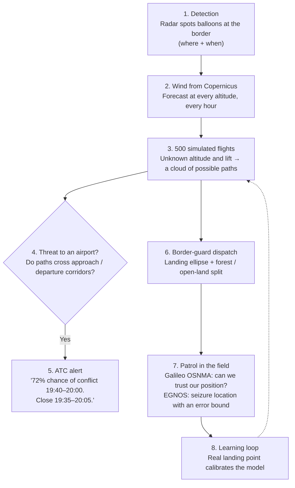

# Balloon Radar: how it works

A short walkthrough for the team. The full technical design is in [`balloon_radar.md`](balloon_radar.md).

**In one sentence:** you detect a balloon, and within a minute we tell you when it will cross the aircraft approach path and where it will come down.

---

## The flow at a glance

---

## Step by step: an evening at the Belarusian border

**1. Detection.** It's 19:00 and radar at the border detects several balloons. The system receives two things: where and when. In a real deployment this comes automatically from the operator's radar. At the hackathon we type it in or use a real radiosonde launch.

**2. Wind from Copernicus.** The system pulls the wind forecast at different altitudes. A balloon has no engine; it goes where the wind takes it. If you know how the wind blows at every altitude at every hour, you know where the balloon will fly.

**3. 500 versions of the flight instead of one.** We don't know the altitude this particular balloon flies at or how fast it climbs. So the system launches 500 virtual balloons, each with slightly different parameters, and lets each drift with the wind. The result is a cloud of possible paths: where many paths overlap, the balloon is most likely. It works like a weather forecast that says "70% chance of rain" rather than "it will rain".

**4. Is the airport at risk?** The system knows the corridors aircraft use to land and take off. It checks how many of the 500 paths cross a corridor, and when. Result: "72% chance the balloon enters the approach path between 19:40 and 20:00."

**5. Alert for air traffic control.** The controller gets a specific window: "close 19:35–20:05". The airport closes for half an hour instead of all night, because it knows when the threat will pass.

**6. Dispatch for the border guard.** From the same 500 paths the system calculates where the balloons will most likely land: an ellipse on the map, with how much of it is forest and how much is open land. The patrol receives it as a dispatch ticket with a time window.

**7. Patrol in the field: Galileo and EGNOS.** The patrol drives to the ellipse with the app. Near the border GPS is often spoofed, so the app checks the **Galileo OSNMA** signature and tells the patrol whether its position can be trusted. When the patrol finds the cargo, it records the spot with an **EGNOS** position and a stated accuracy. That's evidence for the case.

**8. Learning loop.** Every recovered balloon tells us where it really landed. The system compares that with the forecast and gets better over time at estimating how smuggling balloons fly.

---

## Who uses what

| User | What they get | EU Space system behind it |
|---|---|---|
| Air traffic control / airport | Conflict probability and a closure window | Copernicus (wind) |
| Border guard command | Landing ellipse with land-cover split | Copernicus (wind + land cover) |
| Patrol | Trustworthy navigation and a recorded seizure location | Galileo (OSNMA), EGNOS |

---

## What we show in the demo

| Steps | Demo | Real or simulated |
|---|---|---|
| 1–3 | A radiosonde launches from Legionowo at 13:00. We compute the cloud of paths. During the pitch the radiosonde's real live position is shown on top of our forecast. | Real, live |
| 4–6 | Replay of a real Vilnius incident on archived Copernicus wind data, with the alert arriving on a phone | Real archived data |
| 7 | A phone with real Galileo data: OSNMA status and EGNOS position | Real logs |

**The only thing we don't have is the radar feed.** In production it comes from the operator, and we say so in the pitch.

---

## The pitch line

> Copernicus tells you where the balloon will fly. Galileo tells the patrol its GPS isn't lying. EGNOS makes sure the seizure location holds up in court.
