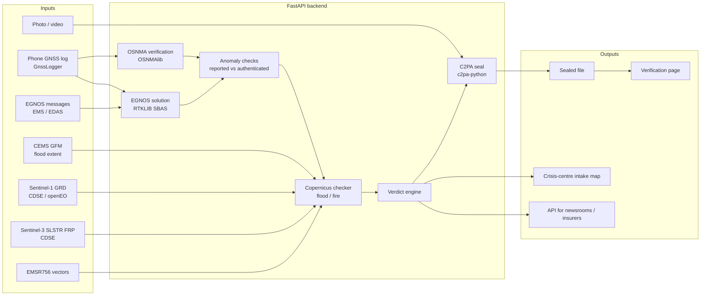

# Proof of Place

**12th CASSINI Hackathon — EU Space for Peace and Resilience, Warsaw, 27–29 November 2026**
**Track: Challenge 2 — Space-enabled crisis response and civil resilience** (secondary link: Challenge 1, "validate signals, identify anomalies using Earth observation data")

> Galileo signs where the photo was taken. EGNOS says how sure we are. Copernicus checks the scene really happened there.

This document follows the 6-section format from `12th_cassini_hackathon_idea_research_prompt_for_llms.md`, then adds the technical design, a 48-hour build plan, the demo script, a checklist and how it relates to Balloon Radar. Items marked **[VERIFY]** are assumptions we have not confirmed yet.

---

## Table of contents

1. [One-line pitch and challenge track](#1-one-line-pitch-and-challenge-track)
2. [EU Space data and signal pipeline](#2-eu-space-data-and-signal-pipeline)
3. [Why it's not a duplicate](#3-why-its-not-a-duplicate)
4. [Target buyer and business model](#4-target-buyer-and-business-model)
5. [48-hour prototype scope](#5-48-hour-prototype-scope)
6. [Biggest risks and likely jury pushback](#6-biggest-risks-and-likely-jury-pushback)
7. [Technical design](#7-technical-design)
8. [Build plan for three people](#8-build-plan-for-three-people)
9. [Demo and pitch script](#9-demo-and-pitch-script)
10. [Friday-night checklist](#10-friday-night-checklist)
11. [Relation to Balloon Radar](#11-relation-to-balloon-radar)
12. [Sources](#12-sources)

---

## 1. One-line pitch and challenge track

**Pitch:** During a disaster, every photo and video from the ground gets a cryptographic seal: a Galileo OSNMA authenticated position and time, an EGNOS error bound, and an automatic Copernicus check that the scene (flood, fire) was really observed there. Newsrooms, crisis centres and insurers get a verdict in seconds instead of hours of manual fact checking.

**Track:** Challenge 2. The challenge text says humanitarian actors, first responders and civil authorities "rely on real-time, trusted information to act effectively." That is the product. Secondary link to Challenge 1: we validate signals (OSNMA) and identify anomalies using Earth observation (the Copernicus consistency check).

### The problem

- **Poland, September 2024 floods:** disinformation attributed to Russian and Belarusian services rose by about **300%** in the first days of the floods (Polish digitalisation minister via Reuters).
- PAP recorded about **23,000 disinformation messages** between 13 and 25 September, reaching around **8 million users**. Documented tactics included **fake videos and footage from other countries** to exaggerate the disaster.
- The **Cyber Defence Forces** publicly called it an information and psychological operation attributed to Russia. (They are on the mentor list this weekend.)
- **It runs both ways:** six weeks later, Polish flood footage was recirculated as the Valencia floods in Spain. Full Fact traced four of five clips in a viral compilation back to Poland.
- Content credentials (C2PA) are now in mainstream phones: the **Pixel 10** signs every photo from its camera app. But the location in a credential is whatever the phone reports, and phone GNSS can be spoofed. **The "where" is the weakest link.**
- Since **2 August 2026**, Article 50 of the EU AI Act requires labelling of deepfakes and AI generated content. Platforms and newsrooms need a positive signal for authentic media, not only labels for fake.

### What we deliver

| User | Output | Value |
|---|---|---|
| Newsroom / fact checker | `VERIFIED: authenticated location 50.43N 16.66E ±4 m (EGNOS), time 2024-09-15 11:42 UTC, flood observed within 120 m by Sentinel-1 (CEMS), 5 h earlier` | Publish in minutes instead of hours; stop amplifying fakes |
| Crisis centre (RCB, State Fire Service, voivodeship crisis teams) | Incoming citizen reports ranked by trust level, on a map | Act first on reports that are physically consistent with satellite observation |
| Insurer | Sealed claim photo with authenticated place and time plus an independent Copernicus check | Faster flood claims, less fraud |
| Anyone | Public verification page: drop a file, see the seal | Trust that does not depend on trusting us |

---

## 2. EU Space data and signal pipeline

All three EU systems named by the organisers are used, each for a real job.

### 2.1 Galileo: OSNMA for the "where" and "when"

- **Capture:** Android phone records the photo or video while Google's **GnssLogger** logs raw measurements and Galileo I/NAV navigation messages (`GnssNavigationMessage`).
- **Verification:** the backend extracts the I/NAV pages and verifies the OSNMA signatures with **OSNMAlib** (`github.com/Algafix/OSNMA`, open source).
- **Authenticated fix:** we compute position using only satellites whose navigation data passed OSNMA, and compare it with the phone's reported position. A large gap is itself an anomaly flag.
- **Fallback (Path B):** if our phones don't expose Galileo navigation messages, we verify OSNMA on real recorded reference data and say so explicitly to the jury.
- **Note:** OSNMA needs the Galileo OSNMA public key and Merkle tree root from the European GNSS Service Centre. **[VERIFY]** how long access takes.
- **Output per capture:** `AUTHENTICATED` / `PARTIAL` / `NOT AUTHENTICATED`, number of authenticated satellites, authenticated Galileo System Time.

### 2.2 EGNOS: an error bound that holds up

- Same approach as Balloon Radar: phones don't apply EGNOS corrections, so we compute the SBAS solution **server-side** with **RTKLIB**, using EGNOS messages from ESA's **EGNOS Message Server** archive or **EDAS** (registration required).
- **MVP:** EGNOS-corrected position plus an accuracy estimate written into the seal.
- **Stretch:** horizontal protection level from the SBAS integrity parameters.
- **Why it matters:** the Copernicus check needs to know how big the search radius is. A ±4 m position and a ±40 m position deserve different verdicts.

### 2.3 Copernicus: did the satellites see it?

| Event type | Dataset | Access | What we compute |
|---|---|---|---|
| **Flood** (MVP) | **CEMS Global Flood Monitoring (GFM)** observed flood extent, derived automatically from **Sentinel-1** SAR | CEMS GFM portal / API **[VERIFY: API or WMS access and auth]** | Distance from authenticated position to nearest observed flooded pixel; time gap to the Sentinel-1 acquisition |
| **Flood** (independent check) | **Sentinel-1 GRD** (IW, VV) | CDSE / openEO | Our own water mask by backscatter threshold around the capture point, before vs. after |
| **Flood** (reference for the case study) | **CEMS Rapid Mapping EMSR756** delineation products, "Flood in South West Poland", September 2024 | Copernicus EMS download | Ground truth for the demo replay |
| **Fire** (second event type) | **Sentinel-3 SLSTR Level-2 FRP** (`SL_2_FRP`), active fire detections with Fire Radiative Power on a 1 km grid, NRT in 3-minute frames | CDSE | Nearest active-fire detection to the capture, its strength (MW) and time gap |
| **Context** | **Sentinel-2 L2A** | CDSE / Copernicus Browser | Before/after visual shown on the verification page when skies are clear |

**What the pipeline computes:**

1. **Input:** media file + GnssLogger log + claimed event type (flood / fire).
2. **Authenticate:** OSNMA status and authenticated time; EGNOS position and error bound.
3. **Cross-check:** query Copernicus products for that position (buffered by the error bound) and a time window around the capture.
4. **Verdict:** `CONSISTENT` (event observed nearby within the window), `INCONSISTENT` (satellite looked, saw nothing), or `NO OBSERVATION` (no pass or cloud cover; we never fake a verdict).
5. **Seal:** a **C2PA** manifest with a custom assertion holding all of the above plus the Copernicus product IDs used, signed and embedded in the file.

### 2.4 Two modes

- **Seal mode (forward):** capture with our app → full seal (Galileo + EGNOS + Copernicus).
- **Claim-check mode (backward):** for footage that is already viral and has no seal, a fact checker enters the claimed place and date. We run the Copernicus check only. This solves the adoption problem on day one: it is useful before anyone has our app.

---

## 3. Why it's not a duplicate

- **It avoids every saturated category in the brief:** not a jamming heatmap, not a Sentinel-2 change-detection dashboard, not a dark-vessel tracker, not a vague "AI crisis platform". It doesn't even use AI to judge images.
- **The output is a verdict and a cryptographic seal, not a map.** "Nobody is waiting for your map" doesn't apply: newsrooms are literally waiting for a yes/no on a video.
- **It fuses layers nobody fuses:** phone content credentials (C2PA), Galileo OSNMA, EGNOS integrity and Copernicus observation, all at the moment of capture.
- **Honest about prior art:**
  - C2PA tools prove a file wasn't edited, but not where it was taken. Google's Pixel implementation proves "captured with a camera", nothing about location trust.
  - Fact checkers (Full Fact, Demagog, Konkret24) do this manually with reverse image search and geolocation. We automate the physics part.
  - Satellite flood maps (GFM, EMS) show what happened from above but say nothing about a specific video.
  - Our value is the **join**: authenticated ground position + independent space observation + a portable seal.
- **Internal note:** `moa-raw/qwen3.8-max.md` (Veritrace) used C2PA + OSNMA for waste-crime evidence. Proof of Place applies the same spine to crisis media, where the buyer, the urgency and the Polish 2024 story are much stronger.

---

## 4. Target buyer and business model

### Buyers

| Buyer | Pays for | Why now |
|---|---|---|
| **Newsrooms and fact checkers** (PAP, TVN24 Konkret24, Demagog, EBU members) | API per verification; newsroom licence | AI Act Article 50 in force since August 2026; 2024 flood disinformation is fresh |
| **Crisis management** (RCB, State Fire Service, voivodeship crisis centres) | Trust-ranked intake of citizen reports during emergencies | Floods return; hostile states use them for information operations |
| **Insurers** (property and agricultural flood claims) | Per-claim verification of claim photos | Mass claims after floods; fraud and slow manual checks |
| **Platforms** (very large online platforms under the DSA) | Bulk claim-check API during crisis events | DSA crisis response obligations; Article 50 labelling **[VERIFY exact DSA articles before quoting]** |

### Revenue model (hypothesis)

- Usage-based API (per verification) for fact checkers and platforms.
- Annual licence for crisis centres and insurers.
- Free citizen capture app and free public verification page (the network effect).

### Go-to-market

1. **Pilot financed by non-dilutive funding:** CASSINI mentoring, ESA BIC Poland, EU funds for countering disinformation.
2. **First reference customer:** one Polish newsroom or fact-checking organisation, tested on the next flood season.
3. **Expand** to insurers (claims) and to EU crisis centres; integrate with phone makers as OSNMA support reaches consumer chipsets.

### Framing for a Polish jury

Open with the 2024 floods and the Cyber Defence Forces' own statement. This is Poland's story, and the information space is part of civil resilience.

---

## 5. 48-hour prototype scope

### Components

| # | Component | Status at demo |
|---|---|---|
| 1 | **GNSS backend:** GnssLogger ingest, OSNMAlib, RTKLIB with EGNOS | Working on real logs (Path A or B) |
| 2 | **Copernicus checker:** GFM / Sentinel-1 flood check, Sentinel-3 FRP fire check, verdict logic | Working on real data |
| 3 | **Seal service:** C2PA manifest with our custom assertion, signed with a test certificate | Working |
| 4 | **Verification page:** drop a file → verdict, map, satellite context | Working |
| 5 | **2024 flood replay:** EMSR756 area, real Sentinel-1 data, genuine vs. relocated vs. wrong-date footage | Working on real data |
| 6 | **Live capture:** a photo taken outside the venue on Sunday, sealed live | Working (flood/fire check returns `NO OBSERVATION`, honestly) |
| 7 | **Spoof demo:** the same photo with a faked position fails authentication | Working on recorded data |

### Fresh Code Rule

We use open libraries (OSNMAlib, RTKLIB, `c2pa-python`, `openeo`, `xarray`, mapping libraries), but the pipeline, verdict logic, custom assertion and verification page are written during the weekend.

### Explicitly out of scope

- OSNMA verification on the phone itself (we verify on the backend).
- A production signing certificate and C2PA conformance (we use test certificates).
- Damage detection from Sentinel-1 coherence (roadmap: third event type for conflict damage).
- Any judgement of whether an image is AI generated: we check physics and provenance, not pixels.

---

## 6. Biggest risks and likely jury pushback

### Jury questions and our answers

| Attack | Defense |
|---|---|
| "OSNMA authenticates navigation data, not the ranging signal. A meaconing (record-and-replay) attack still works." (GNSS engineers, e.g. ChipCraft) | Correct, and we say it first. OSNMA defeats data forgery; replay needs extra checks. We add consistency checks (authenticated time vs. clock, C/N0 and AGC anomalies, multi-constellation agreement) and, crucially, the **independent Copernicus check**, which a spoofer cannot fake. Galileo's upcoming Signal Authentication Service closes the gap further. |
| "Which phones support this?" | Android exposes raw GNSS measurements; Galileo navigation message access varies by device (EUSPA's own raw-measurements material and device list). The MVP runs on what we have; the product follows the hardware. |
| "Sentinel-1 passes every few days. Your check will often say nothing." | Yes, and we say `NO OBSERVATION` instead of pretending. Floods last days, and GFM processes every Sentinel-1 image automatically. The seal still carries authenticated place and time, which is the main value. **[VERIFY Sentinel-1 revisit over Poland with 1A + 1C]** |
| "Someone can stage a fake scene at the right place." | Then the place and time are real and the event really happened there, which is what a newsroom needs to know. We verify provenance, not intent. |
| "1 km fire pixels are too coarse." | For large wildfires and industrial fires, they're enough. Copernicus LSTM (50 m thermal, planned from 2028) makes the fire check much sharper. |
| "Isn't this surveillance?" | No. We only verify media people choose to submit. Location sealing is opt-in, and the public credential can show a coarser location. |
| "Who pays?" | Newsrooms and platforms under AI Act and DSA pressure, insurers with mass flood claims, crisis centres. Free app, paid verification. |

### Technical risks

1. **Phones may not expose Galileo navigation messages.** Fallback: OSNMA Path B (shared with Balloon Radar).
2. **EGNOS data access:** EDAS registration; check the EMS archive.
3. **No GNSS indoors.** Capture by a window or outside.
4. **GFM API access** may need registration. Fallback: our own Sentinel-1 threshold mask via openEO, plus EMSR756 vectors.
5. **C2PA custom assertion tooling:** test `c2pa-python` signing with a custom assertion on Friday night.

---

## 7. Technical design

### 7.1 Architecture



### 7.2 Authentication logic

- **Per satellite:** OSNMA status for navigation data (ephemeris, clock, time).
- **Capture status:**
  - `AUTHENTICATED`: at least 4 Galileo satellites authenticated and the authenticated fix agrees with the reported fix within the EGNOS error bound.
  - `PARTIAL`: some satellites authenticated, or agreement weaker than threshold.
  - `NOT AUTHENTICATED`: no authenticated satellites, or the reported fix disagrees with the authenticated fix.
- **Time:** authenticated Galileo System Time vs. the photo's capture timestamp; flag a gap above threshold.

### 7.3 Copernicus verdict logic

- **Search radius:** `r = max(EGNOS error bound × 3, product resolution)`, e.g. 60 m for Sentinel-1 based products, 1 km for SLSTR FRP.
- **Time window:** flood ±72 h, fire ±12 h (configurable; floods persist, fires move).
- **Flood:** flooded pixel within `r` in any GFM / own-mask product in the window → `CONSISTENT`; satellite acquisition exists in the window but no water within a wider radius → `INCONSISTENT`; no acquisition → `NO OBSERVATION`.
- **Fire:** active-fire detection within `r` in the window → `CONSISTENT` plus FRP (MW); night/day passes in the window with no detection → `INCONSISTENT`; cloud or no pass → `NO OBSERVATION`.
- **Never** output "true" or "fake". Output physical consistency.

### 7.4 Seal payload (custom C2PA assertion)

```json
{
  "label": "eu.space.proof-of-place.v1",
  "data": {
    "gnss": {
      "osnma_status": "AUTHENTICATED",
      "authenticated_sats": 7,
      "gst_utc": "2024-09-15T11:42:07Z",
      "position": {"lat": 50.4317, "lon": 16.6563},
      "egnos_error_bound_m": 4.1,
      "reported_vs_authenticated_m": 2.3
    },
    "copernicus_check": {
      "event_type": "FLOOD",
      "verdict": "CONSISTENT",
      "nearest_observation_m": 118,
      "observation_time_utc": "2024-09-15T05:01:00Z",
      "products": ["CEMS-GFM:...", "S1A_IW_GRDH_...", "EMSR756"]
    },
    "issued_utc": "2026-11-29T13:20:00Z"
  }
}
```

*(Coordinates and product IDs are placeholders.)*

### 7.5 Stack and repo layout

- **Backend:** Python 3.11, FastAPI, `c2pa-python`, `openeo`, `xarray`, `numpy`, `shapely`, `pyproj`, `rasterio`, OSNMAlib, RTKLIB (CLI).
- **Frontend:** a single page with MapLibre GL JS (or Leaflet); drag-and-drop verifier.

```
proof-of-place/
├── backend/
│   ├── gnss/          # GnssLogger ingest, OSNMA, EGNOS
│   ├── copernicus/    # GFM, Sentinel-1 mask, SLSTR FRP, EMSR756
│   ├── verdict/       # radius, windows, verdict rules
│   ├── seal/          # C2PA manifest + custom assertion
│   └── api.py         # FastAPI endpoints
├── frontend/          # verifier page, intake map
├── data/              # downloaded datasets (gitignored)
└── docs/
```

### 7.6 API sketch

| Endpoint | Purpose |
|---|---|
| `POST /seal` | Media + GNSS log + event type → sealed file + verdict |
| `POST /verify` | Sealed file → decoded seal, verdict, map |
| `POST /claim-check` | Claimed place + date + event type (no seal) → Copernicus verdict only |
| `GET /intake` | Crisis-centre feed of submitted reports ranked by trust |

### 7.7 Validation metrics

- **Flood replay:** for points sampled inside and outside EMSR756 delineations on given dates, share of correct `CONSISTENT` / `INCONSISTENT` verdicts.
- **Spoof test:** share of manipulated logs (shifted position, replayed time) caught as `NOT AUTHENTICATED` or anomalous.
- **Time to verdict:** seconds from upload to result (target: under 30 s).

---

## 8. Build plan for three people

| Person A: GNSS | Person B: Copernicus and verdict | Person C: seal, product and pitch |
|---|---|---|
| Phone tests and GnssLogger logs | GFM access, Sentinel-1 via openEO | `c2pa-python` seal with custom assertion |
| OSNMAlib verification | EMSR756 replay set | Verification page and intake map |
| RTKLIB with EGNOS | SLSTR FRP fire check | Slides, demo film, backup recording |
| Spoof test logs | Verdict rules and metrics | Submission page (2-page summary, team, tools list) |

With two people, B and C merge and the fire check moves to stretch.

### Timeline

- **Friday evening and night:** checklist from section 10, first GnssLogger logs by a window, CDSE and GFM access, C2PA signing test.
- **Saturday until 13:00:** OSNMA on real data, flood check on EMSR756, first sealed file.
- **Saturday afternoon and night:** EGNOS, verdict engine, verification page, fire check, spoof test.
- **Sunday until 12:00:** demo film, backup recording, submission text.
- **Sunday ~13:00:** live capture outside the venue, sealed on stage later.
- **Sunday 15:00:** submission deadline. **15:05:** pitch.

---

## 9. Demo and pitch script

**3 minutes:**

1. **Hook (15 s):** a viral "Valencia floods" video. "This isn't Spain. It's Poland, September 2024. Fact checkers had to trace it clip by clip."
2. **Problem (30 s):** 300% spike in hostile disinformation during the Polish floods; 23,000 messages; the Cyber Defence Forces called it an information operation. Content credentials exist, but the location can be spoofed.
3. **Live demo (75 s):**
   - drop a genuine sealed flood photo from the 2024 replay → `AUTHENTICATED`, `CONSISTENT`, map shows Sentinel-1 flood extent around it;
   - drop the same photo with a moved position → `NOT AUTHENTICATED`;
   - claim-check the viral clip "Valencia, 30 October" → `INCONSISTENT` there, `CONSISTENT` at the original Polish location in September 2024 **[VERIFY: pick a clip whose original location is confirmed]**;
   - a photo taken outside this building at 13:00 today, sealed: authenticated position, `NO OBSERVATION` for flood. "We never pretend."
4. **Three EU systems in one sentence (15 s):** the line at the top of this document.
5. **Business (30 s):** newsrooms, crisis centres, insurers, platforms; AI Act Article 50 since August; free app, paid verification.
6. **Close (15 s):** "In the next flood, the truth will be signed by Galileo and confirmed by Copernicus."

---

## 10. Friday-night checklist

- [ ] **GnssLogger:** do our phones log Galileo navigation messages? (Shared with Balloon Radar.)
- [ ] **OSNMA:** OSNMAlib installed; public key and Merkle tree root obtained.
- [ ] **EGNOS:** EMS archive or EDAS access; RTKLIB runs on sample data.
- [ ] **CDSE account** and openEO login; Sentinel-1 GRD query for Kłodzko Valley 12–20 Sep 2024 returns data.
- [ ] **CEMS GFM:** API or WMS access for observed flood extent; registration if needed.
- [ ] **EMSR756:** download delineation vectors for at least one area of interest.
- [ ] **SLSTR FRP:** find one recent European wildfire with detections on CDSE for the fire example.
- [ ] **C2PA:** `c2pa-python` signs a JPEG with a custom assertion using a test certificate, and the result opens in a C2PA verifier.
- [ ] **Hook material:** the Full Fact "Spain/Poland" compilation case, dates and original clip locations.

---

## 11. Relation to Balloon Radar

- **Shared GNSS backend:** Proof of Place uses the same GnssLogger → OSNMAlib → RTKLIB/EGNOS stack as Balloon Radar sections 2.2–2.3. Work done tonight on the phones counts for both ideas.
- **If we stay with Balloon Radar,** Proof of Place becomes its evidence module: when a patrol recovers a balloon or cargo, the photo is sealed with authenticated place, time and EGNOS error bound. That makes the Balloon Radar line "EGNOS makes sure the seizure location holds up in court" concrete and demoable.
- **If we switch,** Proof of Place sits in Challenge 2, which is likely less crowded with border ideas than Challenge 3, and it avoids the hardest Balloon Radar dependencies (live wind forecast, radiosonde timing, radar inputs).
- **Decision for the team:** pick one as the main pitch by Saturday morning.

---

## 12. Sources

- CASSINI Hackathon Poland: https://www.cassini.eu/hackathons/poland
- 300% spike in Russian/Belarusian disinformation during Polish floods (Reuters via The Star): https://thestar.com.my/news/world/2024/09/25/fake-news-from-russian-belarusian-services-spiked-during-floods-in-poland-minister-says
- 23,000 disinformation messages, fake videos from other countries (Detector Media citing PAP): https://disinfo.detector.media/en/post/kremlins-disinformation-campaign-on-flooding-in-poland-and-anti-ukrainian-fakes
- Government on Russian accounts spreading flood disinformation (Notes from Poland): https://notesfrompoland.com/2024/09/26/russian-accounts-spreading-flood-disinformation-in-poland-to-sow-panic-says-government/
- Cyber Defence Forces statement on the information operation (ERR, embedding the tweet): https://www.err.ee/1609468489/poola-venemaa-kasutab-uleujutusi-infosojaks
- Polish flood footage recirculated as Spain (Full Fact): https://fullfact.org/online/spain-flooding-compilation-poland-september/
- Copernicus EMS activation EMSR756, Flood in South West Poland: https://mapping.emergency.copernicus.eu/news/flood-in-south-west-poland/
- Copernicus EMS Information Bulletin 173 (EMSR756: 20 AoIs, ~60% of mapped flooding): https://mapping.emergency.copernicus.eu/news/information-bulletin-173-the-copernicus-emergency-management-service-monitors-floods-in-central-and-eastern-europe/
- Galileo OSNMA (EUSPA; Initial Service declared July 2025): https://www.euspa.europa.eu/galileo-osnma
- OSNMA Initial Service Declaration, 24 July 2025 (European Commission): https://defence-industry-space.ec.europa.eu/observer-how-galileo-osnma-helps-counter-gnss-spoofing-2025-09-08_en
- Sentinel-3 SLSTR Level-2 FRP product: https://sentiwiki.copernicus.eu/web/slstr-products
- Copernicus LSTM thermal mission (50 m, planned from 2028): https://sup.apex.esa.int/missions/lstm
- Pixel 10 C2PA Content Credentials (Google): https://blog.google/security/pixel-android-trusted-images-c2pa-content-credentials/
- Limits of C2PA for authenticity (arXiv): https://arxiv.org/pdf/2604.24890
- AI Act Article 50 applies from 2 August 2026 (European Commission): https://digital-strategy.ec.europa.eu/policies/guidelines-transparency-ai-generated-content
- Copernicus Data Space Ecosystem: https://dataspace.copernicus.eu
- European GNSS Service Centre: https://www.gsc-europa.eu
- OSNMAlib: https://github.com/Algafix/OSNMA
