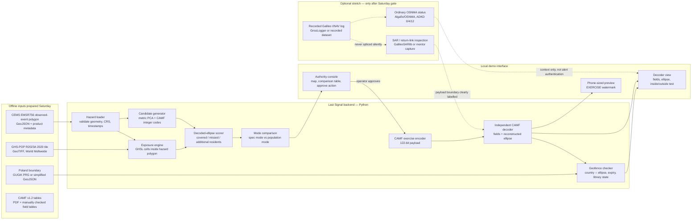

# Last Signal — technical notes (from the project dossier, unchanged)

## 3. Technical description

### 3.1 Corrected product definition

The executable hackathon product is:

> **An offline EWSS alert-targeting workbench that takes a reviewed hazard polygon, estimates resident exposure with GHSL, searches only the ellipse values actually encodable in CAMF, compares a spec-compliant full-containment baseline with explicitly approved population trade-offs, exports a CAMF exercise payload, and independently decodes that payload for visual and geographic verification.**

The following are **not** core deliverables:

- real Galileo uplink;
- live reception of an EWSS alert;
- a production Android EWSS receiver;
- ADKD=2 authentication verification;
- real-time EFAS ingestion;
- real-time flood forecasting;
- Sentinel-3 fire targeting;
- a base-station outage map;
- a production RCB integration;
- a citizen-facing warning application.

### 3.2 Architecture



### 3.3 Exact data pipeline

#### Stage 1 — CEMS observed flood geometry

**Primary dataset**

- Activation: **EMSR756 — Flood in South West Poland, 2024**
- Access route:
  - Public API specification/endpoint identified by research-sol:  
    `https://rapidmapping.emergency.copernicus.eu/backend/dashboard-api/public-activations/?code=EMSR756`
  - Or the activation viewer's **Details & Download** route.
- Follow the product metadata to the vector download ZIP.
- Use the **observed-event flood polygon layer**, not:
  - the area-of-interest rectangle;
  - permanent water;
  - damage-assessment points;
  - a screenshot or PDF map.
- Preferred initial AOI:
  - **AOI19 Stronie Śląskie**, if usable observed geometry and non-trivial population exposure exist.
- Fallback AOI:
  - **AOI03 Nysa**, explicitly distinguished from AOI16 Nysa city.
- Other AOIs mentioned in the bulletin, including Lądek-Zdrój and Kłodzko, must not be assumed to contain complete or timely geometry.

**Metadata that must be stored with the geometry**

```json
{
  "activation": "EMSR756",
  "aoi_id": "[VERIFY FROM PRODUCT]",
  "aoi_name": "[VERIFY FROM PRODUCT]",
  "product_id": "[VERIFY FROM PRODUCT]",
  "layer_name": "[VERIFY FROM PRODUCT]",
  "sensor": "[VERIFY FROM PRODUCT]",
  "acquisition_utc": "[VERIFY FROM PRODUCT]",
  "product_release_utc": "[VERIFY FROM PRODUCT]",
  "geometry_type": "observed_event_polygon",
  "source_url": "[RECORD EXACT URL]",
  "downloaded_at": "[RECORD TIME]",
  "file_hash_sha256": "[COMPUTE LOCALLY]"
}
```

**Chronology rule**

Activation, image acquisition, product release, flood peak, and street-level inundation are different events. The demo must call the polygon a **retrospective observed footprint** or **reference observation**, not:

- ground truth for every flooded street;
- the peak extent, unless the selected product specifically establishes that;
- information available before the Stronie Śląskie dam failure;
- a forecast.

Product versions, acquisition times, and release times must be shown in the console's data panel.

**Format conversion**

- Vector ingestion: `pyogrio==0.12.1` with GeoPandas-compatible workflows, QGIS, or `ogr2ogr`.
- Runtime format: local GeoJSON in WGS84 longitude/latitude for display.
- Analysis geometry: transform explicitly with `pyproj`; do not perform area or population logic in unprojected degrees.

#### Stage 2 — Population exposure

**Dataset**

- **GHS-POP R2023A**
- Epoch: **2020**, selected as a reproducible historical proxy for the 2024 case.
- Resolution: **100 m**
- Native CRS: World Mollweide, commonly represented as EPSG:54009/ESRI:54009; verify the exact CRS from the downloaded GeoTIFF metadata.
- Access: JRC GHSL download tiles; no API key identified.
- Licence/attribution: record the exact licence and attribution from the downloaded product page. The reviews identify it as an open attributed JRC product; do not republish the raster as if it were the team's data.

**Processing rules**

1. Download the tile or tiles covering the selected AOI before building the UI.
2. Crop locally to a bounding box around the hazard plus candidate-ellipse search area.
3. Keep GHSL values as estimated residents per cell.
4. Do not bilinearly interpolate population counts.
5. Do not resample people-per-cell values casually.
6. Mask NoData explicitly.
7. For the primary result, use a documented cell-inclusion rule.
8. Provide one sensitivity result, for example:
   - cell-centre inclusion; and
   - partial-area allocation or a clearly labelled 100 m hazard-polygon buffer.
9. Report rounded estimated residents, never individual people.
10. If a candidate ellipse extends beyond the population crop or beyond the observed EO coverage, mark that region as **unknown**, not zero population and not safe.

**Core counts**

Let:

- `H` = GHSL cells classified as inside the observed hazard polygon;
- `E` = GHSL cells classified as inside a decoded candidate ellipse;
- `P(cell)` = estimated residents in a cell.

Then:

- **Mapped exposed population**  
  `sum(P(cell) for cell in H)`

- **Covered mapped-exposed population**  
  `sum(P(cell) for cell in H ∩ E)`

- **Missed mapped-exposed population**  
  `sum(P(cell) for cell in H − E)`

- **Additional population inside ellipse**  
  `sum(P(cell) for cell in E − H)`

- **Additional-population ratio**  
  `additional / mapped exposed population`, shown alongside the raw counts.

“Additional” must not automatically be described as “safe” or “needlessly warned.” It means outside the selected mapped footprint. The footprint may be incomplete, later than the peak, or missing flooded areas.

#### Stage 3 — CAMF model

**Specification status**

- CAMF v1.2, March 2026, is listed by the Galileo Service Centre as in force.
- The team design was based mainly on v1.1.
- **The v1.1-to-v1.2 difference has not yet been verified from the full v1.2 document in the supplied material. [UNVERIFIED]**
- The design's broad structure is supported by v1.1:
  - 122-bit CAMF payload;
  - 105 mandatory bits plus 17 additional bits in the design/review account;
  - 49-bit primary target ellipse;
  - 17-bit settings field that can select one of several mutually exclusive uses.

**Ellipse fields to implement**

- centre latitude: 16 bits;
- centre longitude: 17 bits;
- semi-major axis: 5 bits;
- semi-minor axis: 5 bits;
- azimuth/orientation: 6 bits.

**Quantisation facts to encode from the specification**

- Latitude/longitude base step identified in the reviews: approximately **0.0027466°**.
- Near the Polish case area, this is approximately 306 m north–south and 200 m east–west; compute locally rather than hard-coding a conversion.
- Semi-axis values are logarithmically spaced; the reviewed range is approximately **0.216 km to 2,500 km**.
- Azimuth has 64 values with **2.8125°** steps.
- CAMF azimuth is measured from East toward North, not as a normal compass bearing from North clockwise.
- Required conversion, subject to final verification against v1.2:

```text
azimuth_camf = (90° - bearing_from_north_clockwise) modulo 180°
```

The inverse conversion must also be unit-tested.

**Do not confuse the layers**

- **122 bits** = CAMF payload.
- **160 bits** = long return-link message described in the CNES material.
- **22 bits per nominal E1-B page** = SAR data field framing described in the Galileo OS SIS ICD material reviewed by research-sol.
- **228 bits in 29 bytes** = Android's representation of a Galileo I/NAV navigation message, not a CAMF message.

A CAMF payload is therefore not “one Android callback,” and receiving ordinary navigation pages does not prove that EWSS content has been received.

**Initial CAMF subset**

Implement only:

- one flood hazard profile;
- one primary ellipse;
- one verified additional-bits setting, or no optional setting if the v1.2 tables cannot be verified;
- test message type;
- placeholder provider code;
- one verified instruction/library entry;
- explicit onset and duration values appropriate to the replay clock.

Do not initially implement:

- all B1/B2/B3/B4 settings combinations;
- secondary ellipse as a second corridor segment;
- all hazard types;
- all languages;
- CAP-to-CAMF production conversion;
- multi-message corridor alerts as an operational claim.

**Provider identity**

No published Polish provider-code assignment was verified. Therefore:

- encode `A1 = Test` if that is the correct v1.2 test designation after checking;
- use provider code `00000` only as a placeholder if consistent with the checked tables;
- display: **“Test message type; placeholder provider — production provider codes are assigned nationally.”**

Do not encode the payload as if RCB had issued it.

**Instruction language**

- Polish and English may be shown only after the exact library entries have been transcribed and checked from CAMF v1.2.
- The reviewed international library list does **not** include Ukrainian.
- Ukrainian may appear only as a clearly labelled proposed national-library or local user-interface translation. It must not be presented as decoded from the CAMF international library.
- A safer demo pair is Polish plus Czech or German, after verifying those exact entries.

**Alert identity and multi-ellipse restriction**

The Alert ID is derived from fields including country, provider, hazard, and onset. Two supposedly separate corridor messages with the same provider, hazard, and onset can therefore collide and be interpreted as versions of the same alert.

Hackathon rule:

- demo uses **one ellipse per alert**;
- a two-ellipse union may be shown only as an analytical sensitivity case;
- do not claim that operational multi-message corridor targeting works until EUSPA's operational rules resolve alert identity, update, replacement, and expiry behaviour.

### 3.4 Ellipse candidate generation and scoring

#### Inputs

- repaired hazard polygon;
- GHSL population grid;
- CAMF integer coding tables;
- Poland boundary for geofence tests;
- operator-selected mode.

#### Candidate generation

Do not search only around the polygon centroid. A bent river corridor can have a centroid outside the hazard.

Procedure:

1. Repair the hazard geometry with Shapely.
2. Transform the polygon to a local metric projection centred on the hazard.
3. Compute an initial oriented fit using principal-component analysis.
4. Generate seed centres from:
   - polygon centroid;
   - representative points from corridor segments;
   - a coarse grid over the hazard bounding area;
   - points along the polygon's medial or longest-axis approximation if simple to compute.
5. For each seed, generate nearby CAMF centre codes rather than continuous coordinates.
6. Enumerate plausible semi-major and semi-minor codes.
7. Enumerate nearby azimuth codes.
8. Encode each candidate to CAMF integer fields.
9. Decode those fields back to an ellipse.
10. Score **the decoded ellipse**, never the pre-quantisation continuous ellipse.

#### Modes

**Mode S — Spec/full-containment mode**

Objective:

1. Require the decoded ellipse to contain the entire hazard polygon, subject to a documented numerical tolerance.
2. Among containing candidates, minimise ellipse area or additional population.
3. This is the baseline and the default operational mode.

This mode reflects the CAMF/STELLAR behaviour identified by research-wonder: the system computes an ellipse that fits the target polygon, with the smallest containing ellipse as the reference behaviour.

**Mode P — Population trade-off mode**

Objective:

- maximise covered mapped-exposed population for a given additional-population cost; or
- maximise a transparent weighted score.

Example objective:

```text
score = covered_mapped_exposed
        - λ × additional_population
        - μ × ellipse_area_km2
```

Where:

- `λ` and `μ` are visible operator parameters;
- missed mapped-exposed population is always reported separately;
- the UI does not hide candidates that miss settlements;
- a human must explicitly approve Mode P.

Mode P is a decision-support experiment, not the specified automatic behaviour and not a recommendation to leave people unwarned.

**Fair comparison**

The baseline and alternative must be compared:

- at the same message count;
- after CAMF quantisation;
- using the same population denominator;
- using the same hazard polygon;
- with missed population displayed first.

The design's “96% coverage, 18% over-warning, 11,400 people” figures are **not results**. They must not appear in slides unless reproduced by the final data run.

#### Geometry and membership

- Population scoring should be performed in the GHSL native grid by transforming the candidate ellipse polygon into that CRS.
- Receiver membership tests should use:
  - a local azimuthal-equidistant projection centred on the ellipse; or
  - a geodesic method.
- Do not test ellipse membership in raw degrees.
- Do not use Web Mercator distances without correction.
- Console display must render the decoded quantised ellipse, not an idealised continuous ellipse.

#### Performance approach

- Precompute the hazard-cell mask once.
- Convert GHSL cells in the search region to arrays of coordinates and population values.
- Vectorise candidate scoring with NumPy.
- Cache candidate results by `(centre_lat_code, centre_lon_code, major_code, minor_code, azimuth_code)`.
- Use coarse-to-fine candidate generation.
- Report measured runtime on the demo laptop.
- Do not claim a global optimum unless the search actually proves it. Use **“best candidate found.”**

### 3.5 CAMF encoder and decoder

#### Encoder responsibilities

- Validate every field against the checked CAMF v1.2 ranges.
- Reject reserved or unknown values unless an explicit test mode is enabled.
- Pack fields in the documented order.
- Record:
  - total bit length;
  - padding convention;
  - hexadecimal representation;
  - field-by-field breakdown;
  - specification version used;
  - test-vector identifier.

#### Decoder responsibilities

The decoder should be written as a separate code path from the encoder. If the same helper generates and parses the expected result, a shared bug can produce a false round-trip pass.

Decoder outputs:

- message type;
- country/region code;
- provider code;
- hazard category/type;
- severity;
- onset;
- duration;
- instruction/library identifiers;
- primary ellipse fields;
- decoded ellipse geometry;
- additional-settings interpretation;
- warnings for reserved, malformed, expired, or unknown-library states.

#### Required tests

At minimum:

1. Encode → decode → field equality.
2. Independent hand-calculated field breakdown for one payload.
3. Bit-length test equals 122 before transport padding.
4. Padding convention documented separately from CAMF payload length.
5. North–south ellipse test.
6. East–west ellipse test.
7. Azimuth conversion test in both directions.
8. Semi-axis minimum and maximum tests.
9. Centre-grid edge test.
10. Inside-ellipse point.
11. Outside-ellipse point.
12. Inside ellipse but wrong country.
13. Expired alert.
14. Unknown library version.
15. Malformed/reserved field.
16. Week-boundary onset case.
17. Independent decode by a mentor, another team, or a second team member using only the field table.

If CAMF v1.2 cannot be obtained and checked by Saturday midday, the UI and submission must say:

> **CAMF geometry and experimental codec — not yet validated against CAMF v1.2.**

### 3.6 Optional CAP export

CAP is an interchange format, not proof of integration with RCB or a national gateway.

If implemented:

- Generate CAP 1.2 XML with Python's `xml.etree.ElementTree`.
- Validate against a locally stored OASIS CAP 1.2 XSD.
- Use `status=Test` for the exercise fixture.
- Keep the original hazard polygon and proposed target area as separate information elements.
- If an ellipse is approximated as a CAP polygon:
  - close the polygon;
  - verify coordinate order;
  - remember CAP uses latitude,longitude pairs while GeoJSON uses longitude,latitude;
  - label it as an approximation.
- Do not claim that the proposed ellipse survives a gateway's CAP-to-EWM reconversion.

If CAP validation is not complete by Saturday evening, cut CAP and export:

- human-readable JSON report;
- CAMF field breakdown;
- CAMF hexadecimal payload;
- comparison table.

### 3.7 Receiver pipeline — optional and gated

#### Payload-boundary decoder — mandatory

This component accepts CAMF bits produced by the team's encoder or supplied as a test fixture. It proves:

- field decoding;
- ellipse reconstruction;
- country-and-ellipse geofence logic;
- expiry behaviour;
- instruction lookup;
- unknown-library behaviour.

It does not prove radio reception.

#### Recorded Galileo navigation — stretch only

Android facts to respect:

- `android.location.GnssNavigationMessage` is available from API 24+.
- Its Galileo I/NAV representation is 228 bits in 29 bytes, MSB first, with four trailing padding bits.
- Fine-location permission, enabled GNSS, and a foreground client are required.
- A normal position fix or a `Raw` record does not prove navigation-page availability.
- Device and chipset support vary.
- GnssLogger may produce no usable Galileo `Nav` records on a given phone.
- The E1-B/E5b ambiguity documented for some logger workflows must be checked before claiming signal identity.

**Saturday capture protocol — maximum 20–30 minutes**

For each available phone, record:

- handset model;
- Android build;
- GnssLogger version;
- start and end time;
- indoor/outdoor conditions;
- constellations observed;
- number of Galileo records;
- SVIDs;
- `Nav` record count;
- page/message lengths;
- continuity and gaps;
- whether the raw log is complete and unmodified.

Save the unmodified log. Do not edit it to insert a successful result.

**Go condition for any radio claim**

Proceed only if the team can identify, from a genuine capture or a mentor-supplied capture:

- the relevant E1-B pages;
- the SAR/return-link framing;
- a long return-link message;
- the CAMF payload boundary;
- the expected decoded fields.

Otherwise, the demo starts explicitly at the CAMF payload boundary.

**Prohibited presentation**

Do not splice generated CAMF bits into a recorded navigation log and describe the result as “received from Galileo.” If an injection exercise is shown, label every stage:

> Real recorded navigation log; synthetic CAMF payload inserted locally for decoder testing; no EWSS reception claimed.

A cleaner approach is to keep the two demonstrations separate:

1. real recorded Galileo navigation pages exist and can be inspected;
2. the CAMF payload decoder works on a local exercise payload.

#### GalileoSARlib

Research-wonder identifies GalileoSARlib as an existing open-source tool for parsing the SAR field from Septentrio Binary Format data. It may be used as a library or reference for recorded-data inspection.

Do not write a new SDR receiver this weekend. Do not buy or integrate new radio hardware unless a mentor supplies a complete capture and its expected decoded output.

#### OSNMA and ADKD=2

Fact-checked position:

- Galileo Service Notice #28 confirms sporadic real EWSS test transmissions from 23 July to 30 November 2026.
- EWSS test messages are authenticated using a new OSNMA ADKD value, **ADKD=2**.
- Initial Service is planned for 2027.

Technical limitation:

- ADKD=2 is treated as reserved in the published OSNMA SIS ICD material reviewed by the reviewers.
- Existing receivers may discard tags associated with reserved ADKDs.
- The inspected public OSNMA implementation's active ADKD set is `{0, 4, 12}`.
- Observing an ADKD=2 tag, authenticating ordinary navigation data, or displaying “OSNMA OK” does **not** prove that the EWSS alert was authenticated.
- Ordinary OSNMA authenticates relevant navigation data; it does not prove:
  - the receiver's position;
  - that the hazard exists;
  - that jamming is absent;
  - that the alert content is correct;
  - that a locally generated payload came from Galileo.

Integrity UI states must therefore be separate:

| State | Meaning |
|---|---|
| `LOCAL_EXERCISE` | Payload created locally by the team. |
| `RECORDED_NAV_ONLY` | Real navigation data recorded; no EWSS payload identified. |
| `RECORDED_TEST_EWM_UNVERIFIED` | A genuine test EWM is believed to have been captured, but ADKD=2 authentication was not verified. |
| `EWM_AUTH_VERIFIED` | Use only if ADKD=2 verification is actually implemented and demonstrated with suitable trust material and time reference. This is not expected during the hackathon. |

No green “authenticated alert” badge is allowed in the first three states.

Also note the delayed-authentication issue: OSNMA's TESLA-style mechanism can mean that authentication material becomes available after the message. A receiver may therefore be unable to authenticate an urgent alert at first reception. The prototype should name this limitation rather than claim real-time authentication.

### 3.8 Datasets and access summary

| Dataset/source | Access | Account/key | Latency/status | Hackathon use |
|---|---|---:|---|---|
| CEMS EMSR756 | Public activation API or viewer download | No key identified | Retrospective products; acquisition/release vary by AOI | Primary hazard polygon |
| GHS-POP R2023A 2020 | JRC tile download | No API key identified | Static modelled residential population | Exposure denominator |
| Poland boundary | GUGiK PRG preferred; Natural Earth/GADM fallback | Verify download terms | Static | Country geofence test |
| CAMF v1.2 | Galileo Service Centre electronic library | **[UNVERIFIED: account/download behaviour]** | In force March 2026; body still to be checked | Codec tables |
| Galileo Service Notice #28 | GSC PDF | No key identified | Test window 23 Jul–30 Nov 2026 | Service/authentication status |
| EFAS archived forecast | EWDS/ECMWF; `cdsapi`; dataset `efas-forecast` for as-issued replay | ECMWF account and licence acceptance likely/required per review | Real-time restricted to partners; archive after embargo | Optional context only |
| CEMS GFM | Portal, STAC at `https://stac.eodc.eu/api/v1`, or authenticated API `https://api.gfm.eodc.eu/v2/` | Portal/API conditions to verify | Target roughly within 8 hours of Sentinel-1 acquisition; not onset detection | Backup only |
| Sentinel-3 SLSTR FRP | CDSE OData catalogue | Authenticated download/quota | Active-fire product, not an evacuation perimeter | Cut from prototype |
| GnssLogger logs | Team phones | Android permissions | Device-dependent | Optional capture |
| Local basemap | Pre-rendered SVG/PNG or local tiles | None at runtime | Fully offline | Demo reliability |

### 3.9 Tech stack

#### Backend

Use Python 3.11 with a pinned, smoke-tested environment.

Candidate pins identified by research-sol:

```text
numpy==2.2.6
shapely==2.2.0
pyproj==3.7.2
rasterio==1.4.3
pyogrio==0.12.1
fastapi==0.115.12
uvicorn==0.34.3
```

These are available releases identified during review, not a guaranteed tested combination on the team's laptops. Install from binary wheels, run the smoke tests, then freeze the resolved environment.

Important environment note:

- The design says Python 3.11.
- Current Rasterio metadata may require Python 3.12.
- Therefore the pinned Rasterio 1.4.3 route is safer for Python 3.11 than an unpinned install.
- Test an actual GeoTIFF and the World Mollweide transform on both demo machines.

#### Frontend

- `maplibre-gl` version 5.6.0 was identified by research-sol as an available option.
- Do not depend on CDN files, online fonts, sprites, or tile servers.
- Preferred demo rendering:
  1. local MapLibre with inline style and local GeoJSON; or
  2. static SVG/PNG map fallback.
- A single-page interface is sufficient.
- The phone preview can be a responsive view of the same local application, but it must have been loaded and cached before any airplane-mode demonstration.

#### Optional libraries

- `Algafix/OSNMA` — ordinary OSNMA research and recorded-log experiments.
- GalileoSARlib — SAR-field parsing from suitable recorded data.
- Do not make either library a dependency of the core targeting demo.

#### Repository layout

```text
last-signal/
├── README.md
├── LICENSES.md
├── requirements.txt
├── backend/
│   ├── camf/
│   │   ├── tables.py
│   │   ├── encoder.py
│   │   ├── decoder.py
│   │   ├── geometry.py
│   │   └── tests/
│   │       ├── test_roundtrip.py
│   │       ├── test_golden_vectors.py
│   │       ├── test_azimuth.py
│   │       └── test_geofence.py
│   ├── hazard/
│   │   ├── load_emsr756.py
│   │   ├── validate_polygon.py
│   │   └── metadata.py
│   ├── population/
│   │   ├── load_ghsl.py
│   │   ├── exposure.py
│   │   └── sensitivity.py
│   ├── optimiser/
│   │   ├── candidates.py
│   │   ├── scoring.py
│   │   └── compare_modes.py
│   ├── receiver/
│   │   ├── payload_decoder.py
│   │   ├── geofence.py
│   │   └── provenance.py
│   └── api.py
├── frontend/
│   ├── index.html
│   ├── app.js
│   ├── styles.css
│   └── assets/
├── data/
│   ├── README.md
│   ├── demo_bundle/
│   └── .gitignore
├── scripts/
│   ├── prepare_demo_bundle.py
│   ├── run_offline_demo.py
│   └── record_fallback.py
├── submission/
│   ├── slides.pdf
│   ├── demo-recording.mp4
│   └── description.md
└── docs/
    ├── data-manifest.md
    ├── camf-verification.md
    ├── demo-script.md
    └── limitations.md
```

Large source datasets should not be committed if repository rules or size limits prevent it. The repository must nevertheless contain:

- exact source identifiers;
- download URLs;
- product and layer names;
- acquisition and release metadata;
- file hashes;
- processing scripts;
- a small reproducible demo bundle or clear instructions for reconstructing it.

### 3.10 Local API

A full backend API is optional. A command-line pipeline that generates a checked demo bundle is better than four unfinished endpoints.

If FastAPI is used, keep these routes:

| Endpoint | Purpose | Required behaviour |
|---|---|---|
| `POST /alerts/propose` | Load a prepared hazard case and return decoded candidate ellipses with counts | Local only; no external calls; returns metadata and unknowns |
| `POST /alerts/encode` | Encode an operator-approved exercise alert | Rejects unapproved Mode P payloads unless approval flag and operator name/initials are supplied |
| `POST /receiver/decode` | Decode a CAMF payload and run geofence tests | Accepts payload bytes/hex, not a claim of radio reception |
| `GET /cases/emsr756` | Return the static retrospective case | Includes product metadata, not a fabricated warning timeline |

Drop the earlier proposed GNSS-log upload route unless the receiver gate succeeds.

### 3.11 Validation metrics

The final slide may report only measured values:

| Metric | Definition |
|---|---|
| Mapped exposed residents | GHSL-estimated residents inside the selected observed footprint |
| Covered | Mapped exposed residents inside the decoded ellipse |
| Missed | Mapped exposed residents outside the decoded ellipse |
| Additional | Estimated residents inside the ellipse but outside the mapped footprint |
| Additional ratio | Additional divided by mapped exposed residents |
| Runtime | Measured candidate-search time on the demo laptop |
| Codec result | Number of golden and property tests passed |
| Sensitivity | Difference between cell-centre and sensitivity exposure treatment |

Do not report:

- lead time from EMSR756;
- percentage of “people warned” as if population equals phone owners;
- mobile-outage population unless independently sourced;
- delivery success;
- lives saved;
- a global optimum unless the search method proves it.

---
