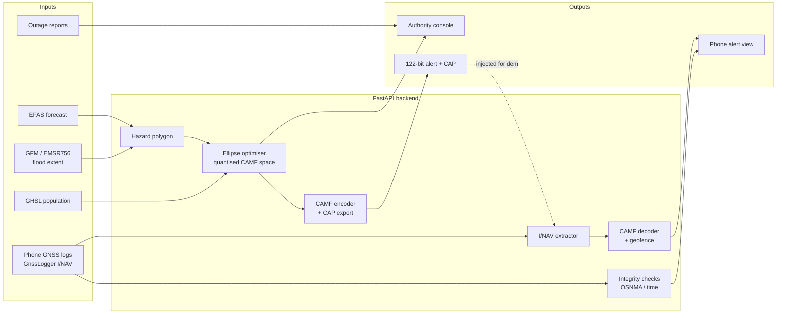

# Last Signal

**12th CASSINI Hackathon — EU Space for Peace and Resilience, Warsaw, 27–29 November 2026**
**Track: Challenge 2 — Space-enabled crisis response and civil resilience** (secondary link: Challenge 1, integrity of alerts against spoofing)

> When the towers go down, the warning still comes from the sky. Copernicus says who is in danger. Galileo tells them.

This document follows the 6-section format from `12th_cassini_hackathon_idea_research_prompt_for_llms.md`, then adds the technical design, a 48-hour build plan, the demo script and a checklist. Items marked **[VERIFY]** are assumptions we have not confirmed yet.

---

## Table of contents

1. [One-line pitch and challenge track](#1-one-line-pitch-and-challenge-track)
2. [EU Space data and signal pipeline](#2-eu-space-data-and-signal-pipeline)
3. [Why it's not a duplicate](#3-why-its-not-a-duplicate)
4. [Target buyer and business model](#4-target-buyer-and-business-model)
5. [48-hour prototype scope](#5-48-hour-prototype-scope)
6. [Biggest risks and likely jury pushback](#6-biggest-risks-and-likely-jury-pushback)
7. [Technical design](#7-technical-design)
8. [Build plan for three people](#8-build-plan-for-three-people)
9. [Demo and pitch script](#9-demo-and-pitch-script)
10. [Friday-night checklist](#10-friday-night-checklist)
11. [Sources](#11-sources)

---

## 1. One-line pitch and challenge track

**Pitch:** Galileo is about to broadcast emergency alerts straight to phones, with no mobile network needed (the Emergency Warning Satellite Service, EWSS). But every alert must fit in **122 bits**, and its target area is a single coarse ellipse. We build the missing piece for civil protection: a tool that turns Copernicus flood and fire data plus population data into the **optimal EWSS alert** (who to warn, which ellipse, when), encodes it to the official format, and an open reference receiver that decodes it from real Galileo navigation messages on an Android phone.

**Track:** Challenge 2. Civil resilience when terrestrial networks fail. Secondary link to Challenge 1: a satellite alert channel is a spoofing target, and we address alert integrity.

### The problem

- **September 2024, Kłodzko Valley.** Operators told PAP that some base stations were down because of flooding or power loss. Orange's spokesperson said **nearly half the base stations** in the valley weren't working **[VERIFY: confirm this quote is from September 2024]**.
- On the evening the Stronie Śląskie dam broke (15 September), reporters in Lądek-Zdrój found no water, power in only some districts, and **no mobile coverage**.
- A **parliamentary interpellation** (Sejm, no. 5430) says telecom failures in Stronie Śląskie, Bystrzyca Kłodzka and Lądek-Zdrój **prevented effective crisis management**.
- **Mobile alerts need mobile networks.** Poland's Alert RCB reaches people through operators **[VERIFY: SMS vs. cell broadcast in 2026]**. When the tower is underwater, the warning doesn't arrive.
- **Galileo EWSS fixes the channel, not the decision.** It lets civil protection authorities send alerts to Galileo-enabled phones without radio networks, free of charge. But the authority must decide, under time pressure, **which ellipse** to warn, and the format is brutal: an ellipse with 32 possible axis lengths and 2.8° rotation steps. A river valley flood is a long thin corridor. A bad ellipse warns tens of thousands of people who aren't at risk, which breeds alert fatigue, or misses the people who are.

### What we deliver

| User | Output | Value |
|---|---|---|
| Civil protection (RCB, voivodeship crisis centres, State Fire Service) | "Flood alert, Biała Lądecka valley: 2 EWSS messages. Coverage of at-risk population 96%, over-warning 18%. Ready to send. Areas with reported tower outages: 3, population 11,400." | A send-ready alert in minutes, optimised for a format nobody in Poland has used yet |
| Same, as CAP | The alert as a standard CAP message plus the 122-bit EWSS encoding | Drops into the existing CAP-based alert chain |
| Chipset / app makers (e.g. ChipCraft, phone OEMs, navigation apps) | Open reference decoder: Galileo I/NAV pages → EWSS alert → geofence → instructions in the user's language | Fastest path to EWSS support in devices |
| Citizens | Alert on the phone with no signal bars | People in the valley get the warning |

---

## 2. EU Space data and signal pipeline

### 2.1 Galileo EWSS: the channel

- **Status:** EWSS has been in its testing phase, with Initial Service as the next step on EUSPA's roadmap **[VERIFY current status and any declaration date before the pitch]**. The **Common Alert Message Format (CAMF)** is public; v1.2 (March 2026) is in force **[VERIFY: we read v1.1, check field changes in v1.2]**.
- **Format (CAMF, 122 bits):** message type (2), country (9), provider (5), hazard category/type (7), severity (2), onset week and time (1 + 14), duration (2), instruction library and lists (1 + 3 + 10), **target ellipse (49): centre lat (16), centre lon (17), semi-major (5), semi-minor (5), azimuth (6)**, plus 17 bits for one optional setting (refined ellipse, hazard centre, secondary ellipse or hazard details).
- **Carriage:** inside the Galileo E1-B I/NAV navigation message, reusing the Search and Rescue return link (CNES). That is exactly what Android exposes through `GnssNavigationMessage`, the same stack the team already uses for OSNMA in Balloon Radar.
- **Receiver rules from the spec:** show the alert only inside both the ellipse and the issuing country; handle library version mismatch; clear the alert after its duration; 25 languages in the Galileo library.

### 2.2 Copernicus: who is in danger

| Dataset | Access | Purpose |
|---|---|---|
| **EFAS** (European Flood Awareness System, Copernicus EMS) forecasts | EFAS portal / data access **[VERIFY access terms for a hackathon]** | Where a flood is expected, and when: drives onset time and lead time |
| **CEMS Global Flood Monitoring (GFM)**, observed extent from Sentinel-1 | GFM portal / API **[VERIFY]** | Where it is flooding now: drives Update messages |
| **CEMS Rapid Mapping EMSR756**, Flood in South West Poland, 2024 | Copernicus EMS download | Ground truth for the replay |
| **GHSL population grid** (JRC, used in Copernicus EMS) | Download **[VERIFY licence and resolution]** | How many people each candidate ellipse covers, inside and outside the hazard |
| **Sentinel-3 SLSTR FRP** / **EFFIS** fire products | CDSE / EFFIS | Second hazard type: wildfire alerts |

### 2.3 What the pipeline computes

1. **Hazard polygon:** from EFAS forecast (warning) or GFM / Rapid Mapping (update), buffered by a safety margin.
2. **Population at risk:** GHSL inside the polygon.
3. **Ellipse optimisation:** search the **quantised** CAMF parameter space (centre grid ~0.0027°, 32 log-spaced axis lengths, 64 azimuths, plus B1 refinement bits) for the ellipse, or the smallest set of ellipses (1–3 messages), that maximises at-risk coverage and minimises over-warned population.
4. **Network-outage layer:** areas with reported base-station outages (operator reports, or simulated in the demo) highlighted as "EWSS is the only channel here".
5. **Encode:** CAP alert → CAMF 122-bit message per the spec, with hazard type, severity, onset, duration and instructions (e.g. List A: evacuate to higher ground).
6. **Decode and geofence:** the reference receiver reads I/NAV pages, extracts the alert, checks "am I inside the ellipse and the country?", and shows instructions.

### 2.4 Integrity (Challenge 1 link)

- A satellite alert channel invites a nightmare scenario: a spoofed "evacuate now" message during a crisis, as a hybrid attack.
- EC material describes EWSS alerts as authenticated, but the CAMF spec itself doesn't say how **[VERIFY: which mechanism, and whether OSNMA covers the I/NAV words carrying EWSS]**.
- **Our receiver** checks OSNMA status on the navigation stream the alert arrives on, flags inconsistencies (alert from a satellite whose navigation data fails authentication, onset times that don't match authenticated Galileo time), and logs every alert for audit.

---

## 3. Why it's not a duplicate

- **It avoids every saturated category in the brief:** not a jamming heatmap, not a change-detection dashboard, not a vessel tracker, not a vague crisis platform.
- **The output is an action, not a map:** a send-ready 122-bit alert and a CAP message.
- **It uses the newest EU space service almost nobody has built for yet.** The format was published for exactly this: authorities and receiver makers are told to prepare now.
- **The core is a real, hard problem:** fitting irregular hazard shapes into a quantised ellipse format while trading coverage against over-warning, with real population data. GNSS and EO judges will recognise that this is non-trivial.
- **Honest about prior art:** EUSPA and its contractors build the EWSS infrastructure (the ground segment). Projects such as SUNSHINE run capacity building for authorities. We don't replace either. We build the **decision tool on the authority side** and an **open receiver on the device side**, the two ends that each country and each chipset maker must solve for itself.
- **Not in the team's 40 ideas** (`moa-raw/`): no idea uses EWSS.

---

## 4. Target buyer and business model

### Buyers

| Buyer | Pays for | Why now |
|---|---|---|
| **National and regional civil protection** (RCB, voivodeship crisis centres, State Fire Service; equivalents across the EU) | Alert-authoring tool: hazard to optimised EWSS + CAP, integrated with existing warning chains | EWSS is free for authorities, but nobody hands them the targeting tool; 2024 flood lessons; NIK and Sejm scrutiny |
| **Chipset and device makers, navigation and safety apps** | Licence and integration of the reference receiver SDK; conformance test vectors | Devices must support EWSS to make the service useful |
| **Critical sites** (dams, chemical plants under Seveso rules) **[VERIFY regulatory hook]** | Pre-computed alert ellipses for their emergency plans | Seconds matter on dam failure |

### Revenue model (hypothesis)

- Annual licence per authority (national or regional), plus integration.
- SDK licence per device maker or app; open-source core decoder to drive adoption, paid support and test vectors.

### Go-to-market

1. **Pilot financed by non-dilutive funding:** CASSINI mentoring, ESA BIC Poland, EU civil protection funds.
2. **First reference customer:** one voivodeship crisis centre in flood country (Lower Silesia or Opole).
3. **Expand** across EU member states as EWSS goes live; the format is shared with Japan's QZSS, so the receiver work travels.

### Framing for a Polish jury

Open with Lądek-Zdrój on 15 September 2024: no water, no power, no signal. Then: "Galileo can now reach that phone. Who decides what it says?"

---

## 5. 48-hour prototype scope

### Components

| # | Component | Status at demo |
|---|---|---|
| 1 | **CAMF encoder/decoder** (Python), round-trip tested against the spec's examples | Working |
| 2 | **Ellipse optimiser** over the quantised parameter space, with GHSL population | Working on real data |
| 3 | **2024 replay:** EFAS / EMSR756 for Biała Lądecka and Nysa Kłodzka; alerts generated at the times they could have been sent | Working on real data |
| 4 | **Outage layer:** base-station outage areas from 2024 press reports (approximate) or simulated | Working (labelled as approximate) |
| 5 | **Reference receiver:** GnssLogger I/NAV pages → extract EWSS field → decode → geofence → instructions | Working on injected alerts in real logs; live only if test alerts are being broadcast **[VERIFY]** |
| 6 | **Authority console:** map, candidate ellipses, coverage vs. over-warning, "send" | Working |
| 7 | **Phone view:** a phone in flight mode showing the decoded alert | Working |

### Fresh Code Rule

We use open libraries (`shapely`, `pyproj`, `rasterio`, `numpy`, mapping libraries, OSNMAlib), but the encoder/decoder, optimiser, receiver logic and console are written during the weekend.

### Explicitly out of scope

- Sending a real alert through the Galileo ground segment (only authorised authorities can).
- Certified receiver firmware.
- A full CAP gateway integration with RCB systems.

---

## 6. Biggest risks and likely jury pushback

### Jury questions and our answers

| Attack | Defense |
|---|---|
| "EWSS isn't live yet." | That's the point. Authorities and device makers are told to prepare now, and our tool is what they prepare with. We decode real I/NAV logs and inject spec-compliant alerts; if test broadcasts are on, we show one live. |
| "Doesn't EUSPA already build this?" | EUSPA builds the infrastructure that broadcasts the alert. Choosing the ellipse from hazard and population data is the authority's job, and so is device support. We build those two ends. |
| "Why not just draw one big ellipse?" | Because over-warning kills trust. In the replay we show the numbers: a naive ellipse vs. ours, people at risk covered and people needlessly warned. |
| "Can a phone even read this?" | Android exposes Galileo I/NAV pages via `GnssNavigationMessage`, the stack this team already uses for OSNMA. Support varies by device; we test ours tonight. |
| "What stops a spoofed alert?" (Cyber Defence Forces) | We raise it ourselves: we check OSNMA status and Galileo time consistency on the stream carrying the alert and flag anomalies. The official authentication mechanism is something we verify with EUSPA. |
| "Who pays if EWSS is free?" | The channel is free. The targeting tool, integration and device SDK are not. Same as GPS is free and navigation software isn't. |
| "How good are your outage data?" | Approximate for 2024, from operator statements. In production, operators feed outage status, and Poland already has a crisis-management reporting chain for that. |

### Technical risks

1. **Phones may not expose all I/NAV pages, or the EWSS field.** Fallback: injected alerts into recorded logs, shown honestly.
2. **CAMF v1.2 changes** vs. the v1.1 we read: check on Friday night.
3. **EFAS data access** may need registration; fallback: EMSR756 delineations plus GFM.
4. **GHSL resolution** vs. small valley towns: test on Lądek-Zdrój and Stronie Śląskie.
5. **Where EWSS sits inside I/NAV** (exact words/pages): needs the Galileo OS SIS ICD and EWSS receiver guidance **[VERIFY]**.

---

## 7. Technical design

### 7.1 Architecture



### 7.2 Ellipse optimiser

- **Search space:** centre on the CAMF lat/lon grid near the hazard centroid; semi-major and semi-minor from the 32-value table; azimuth in 64 steps; optional B1 refinements.
- **Objective:** maximise `covered_at_risk / total_at_risk` subject to `over_warned / covered ≤ threshold`, or minimise a weighted cost. Weight people in outage areas higher (EWSS is their only channel).
- **Multi-message:** greedy cover with 1–3 ellipses for long corridors (river valleys), each as its own message.
- **Speed:** coarse grid search then local refinement; target under 10 s per alert.
- **Baselines for the demo:** (a) one ellipse around the polygon's bounding box, (b) the optimiser.

### 7.3 CAMF codec

- Pure Python bit packing per the spec tables (A1–A18, B1–B4).
- Round-trip tests: encode → decode → identical fields; decode the spec's own examples **[VERIFY examples exist in v1.2]**.
- Ellipse membership test on WGS84, as receivers must do.

### 7.4 Receiver

1. **Ingest:** GnssLogger `Nav` records for Galileo I/NAV.
2. **Extract:** the words carrying the return link / EWSS bits **[VERIFY location in I/NAV]**.
3. **Decode** to fields; **geofence** against the phone's position and country; pick the language; show List A/B instructions.
4. **Integrity:** OSNMA status of the same satellite's navigation data; Galileo time vs. onset; log.

### 7.5 Stack and repo layout

- **Backend:** Python 3.11, FastAPI, `numpy`, `shapely`, `pyproj`, `rasterio`, OSNMAlib.
- **Frontend:** single page with MapLibre GL JS; a phone-sized alert view.

```
last-signal/
├── backend/
│   ├── camf/          # encoder, decoder, tables, tests
│   ├── hazard/        # EFAS, GFM, EMSR756 polygons
│   ├── optimiser/     # quantised ellipse search, multi-message cover
│   ├── population/    # GHSL
│   ├── receiver/      # I/NAV extraction, geofence, integrity
│   └── api.py
├── frontend/          # authority console, phone view
├── data/              # gitignored
└── docs/
```

### 7.6 API sketch

| Endpoint | Purpose |
|---|---|
| `POST /alerts/propose` | Hazard + time → candidate ellipses with coverage and over-warning |
| `POST /alerts/encode` | Chosen alert → 122-bit CAMF + CAP XML |
| `POST /receiver/decode` | GnssLogger log (+ injected alert) → decoded alert, geofence result, integrity flags |
| `GET /replay/2024` | Timeline of alerts we would have issued in September 2024 |

### 7.7 Validation metrics

- **Coverage:** share of at-risk population (GHSL inside EMSR756 flood extent) inside the alert ellipses.
- **Over-warning:** population inside ellipses but outside the hazard.
- **Lead time:** alert time vs. the time water arrived (replay).
- **Codec:** 100% round-trip on test vectors.

---

## 8. Build plan for three people

| Person A: GNSS and receiver | Person B: Copernicus and optimiser | Person C: console, product and pitch |
|---|---|---|
| CAMF encoder/decoder and tests | EFAS / GFM / EMSR756 polygons | Authority console |
| I/NAV extraction from GnssLogger | GHSL population | Phone alert view |
| Geofence, integrity checks | Ellipse optimiser and baselines | Slides, demo film, backup recording |
| Phone tests (shared with Balloon Radar) | 2024 replay timeline | Submission page |

With two people, B and C merge and the outage layer becomes a static overlay.

### Timeline

- **Friday night:** read CAMF v1.2, codec skeleton, GnssLogger test by a window, download EMSR756 and GHSL.
- **Saturday until 13:00:** codec round-trip done, first optimised ellipse on Biała Lądecka.
- **Saturday afternoon and night:** multi-message cover, replay timeline, receiver decode on real logs with injected alerts, console.
- **Sunday until 12:00:** polish, backup recording, submission text.
- **Sunday 15:00:** submission. **15:05:** pitch.

---

## 9. Demo and pitch script

**3 minutes:**

1. **Hook (15 s):** "Lądek-Zdrój, 15 September 2024, evening. No water. No power. No signal. How do you warn someone whose phone has no bars?"
2. **Problem (30 s):** half the base stations in the valley down; the Sejm interpellation; mobile alerts need mobile networks.
3. **Live demo (75 s):**
   - EFAS and Copernicus flood data for the Biała Lądecka valley;
   - naive ellipse: warns X people, Y% outside danger; our two-message alert: 96% coverage, a fraction of the over-warning **[VERIFY numbers from the replay]**;
   - "send": 122 bits appear, encoded to the official Galileo format;
   - a phone in flight mode decodes it from Galileo navigation data and shows "Evacuate to higher ground" in Polish, then the same in Ukrainian.
4. **EU space in one sentence (15 s):** the line at the top of this document.
5. **Business (30 s):** civil protection tool licence, device SDK; EWSS is free, the targeting isn't.
6. **Close (15 s):** "Next time the towers go down, the warning won't."

---

## 10. Friday-night checklist

> Web-research verification added Saturday 28 Nov 2026 (Muse Ember, primary sources; full notes in `finalists/research/last-signal/check-3/5/6/7/8.md`).

- [ ] **CAMF v1.2** downloaded from the GSC; list the changes from v1.1. — **DO THIS TONIGHT.** Verified: v1.2 (Issue 1.2, March 2026) is the in-force version at `https://www.gsc-europa.eu/sites/default/files/sites/all/files/EWSS-CAMF_in_force.pdf` (note `_in_force`, not `_v1.2`). Payload 122 bits = 105 mandatory + 17 optional, fields A1→A18 with bit widths A1=2, A2=9, A3=5, A4=7, A5=2, A6=1, A7=14, A8=2, A9=1, A10=3, A11=5+5, A12=16, A13=17, A14=5, A15=5, A16=6, A17=2, A18=15. **Trap:** v1.1 "00000 = empty" became "reserved" in v1.2, and v1.1→v1.2 differences are not fully documented in the change-record — encode from the v1.2 tables directly. No expiry field; expiry = onset + duration.
- [ ] **EWSS status:** is Galileo broadcasting test alerts now? Any EUSPA receiver guidelines published? — **VERIFIED: yes, and our submission is inside the window.** Service Notice #28 (SNGU 2026006): test transmissions 23 Jul–30 Nov 2026 carrying real Alert messages, authenticated via OSNMA ADKD=2. No receiver guidelines published — the EWSS SIS ICD exists only as proprietary `[AD-2]` under NDU in EUSPA grant EUSPA-GSA-GA-G-04-2022 (manufacturers receive `[RD-1]` at kick-off). Initial Service is 2027.
- [ ] **I/NAV location** of the EWSS / return-link bits (Galileo OS SIS ICD). — **Only partially public.** The grant states the 122-bit EWM is encoded in the I/NAV SAR (long return-link) bits, but the 122→160-bit packing, repetition pattern and any worked decode are not published. No recorded EWSS capture or test vector exists publicly; the demo starts at the CAMF payload boundary unless a mentor provides a capture.
- [ ] **GnssLogger:** do our phones log Galileo I/NAV pages? (Shared with Balloon Radar.) — **VERIFIED, with a catch.** `Nav` rows log Galileo I/NAV (29 bytes / 228 bits, `TYPE_GAL_I = 1537`); the 22-bit SAR field is at bits 172–193 (0-indexed, MSB-first) of the 29-byte payload — implement and CRC-validate, it's in neither source spelled out. **Critical:** a log alone cannot prove E1-B — `TYPE_GAL_I` covers E1-B and E5b-I and the API exposes no carrier field; E1-B identity must be inferred from `Raw`/`Status` rows (CarrierFrequencyHz, `CODE_TYPE_B` vs `CODE_TYPE_I`). Nav support is optional per chipset and many chipsets stop sending Nav after ephemeris decode.
- [ ] **EMSR756** delineations for Stronie Śląskie, Lądek-Zdrój and Kłodzko areas. — **VERIFIED, with a correction: use Nysa, not Stronie.** EMSR756 is public via the CEMS Rapid Mapping API (`https://rapidmapping.emergency.copernicus.eu/backend/dashboard-api/public-activations/?code=EMSR756`; direct ZIP per product). AOI19 Stronie Śląskie is the wrong demo case: observed event 15.6 ha shrinking to 3.6 ha in MONIT01, fragmented sub-hectare polygons (grading grade) — an ellipse covering it covers the town, not a flood trade-off. **AOI03 Nysa instead:** product id:1043, DEL_MONIT01, Sentinel-2 2024-09-18, flooded 3,463 ha, max extent 5,433 ha, ZIP `https://rapidmapping.emergency.copernicus.eu/backend/EMSR756/AOI03/DEL_MONIT01/EMSR756_AOI03_DEL_MONIT01_v1.zip`. Do not confuse with AOI16 Nysa city (9.7 ha). Quote only API JSON, not portal/bulletin counts (20 vs 32 products).
- [ ] **EFAS** access for September 2024 forecasts, or fallback plan. — not web-checked; treat as open.
- [ ] **GHSL** population grid for Lower Silesia. — **VERIFIED: use GHS-POP R2023A (V1_0), DOI `10.2905/2FF68A52-5B5B-4A22-8F40-C41DA8332CFE`.** R2025A items are long-range projections, not a 2020 replacement. Spec: World Mollweide (ESRI:54009), 100 m, float64, NoData −200. Confirm the tile and embedded NoData with `gdalinfo` after download — do not trust documentation alone.
- [ ] **Alert RCB:** how it works in 2026 (SMS vs. cell broadcast) so we describe it accurately. — not web-checked; treat as open.
- [ ] **Authentication:** what EUSPA says about EWSS message authentication. — **VERIFIED: 2026 test messages carry OSNMA ADKD=2** (Service Notice #28; previously a Reserved value in the OSNMA SIS ICD). Any other authentication claim needs a source.

---

## 11. Sources

- CASSINI Hackathon Poland: https://www.cassini.eu/hackathons/poland
- Galileo EWSS (EUSPA): https://www.euspa.europa.eu/galileo-ewss
- EWSS in-force reference documents, CAMF v1.2 (GSC): https://www.gsc-europa.eu/node/7779
- EWSS Common Alert Message Format v1.1 (GSC): https://www.gsc-europa.eu/sites/default/files/sites/all/files/EWSS-CAMF_v1.1.pdf
- EUSPA Industry Days 2026, Galileo services roadmap: https://www.euspa.europa.eu/sites/default/files/documents/01_Galileo.pdf
- EWSS carried in E1-B I/NAV via the SAR return link (CNES poster): https://cnes.fr/sites/default/files/2025-12/RTN-2025_Poster_61_Emergency_Warning_Satellite_Service.pdf
- EWSS concept, 122-bit message, ellipse targeting (ICG): https://www.unoosa.org/documents/pdf/icg/2021/ICG15/WGB/icg15_wgb_07.pdf
- EWSS described as authenticated (ICG-17, European Commission): https://www.unoosa.org/documents/pdf/icg/2023/ICG-17/icg17_wgb_20.pdf
- SUNSHINE capacity building for EWSS: https://civil-protection-knowledge-network.europa.eu/news/sunshine-eena-conference-2026
- Base stations down in Kłodzko Valley (PAP): https://www.pap.pl/aktualnosci/operatorzy-telefonii-komorkowej-czesc-stacji-bazowych-w-kotlinie-klodzkiej-nie-dziala-0
- Nearly half of base stations down, Orange (GSMManiak): https://www.gsmmaniak.pl/1518370/problemy-z-lacznoscia-w-kotlinie-klodzkiej-jest-komunikat-operatorow-telekomunikacyjnych/amp/
- Lądek-Zdrój without water, power or coverage (Forsal/PAP): https://forsal.pl/kraj/bezpieczenstwo/artykuly/9605808,kataklizm-w-kotlinie-klodzkiej-stronie-slaskie-i-ladekzdroj-odciete.html
- Sejm interpellation 5430 on telecom failures during the floods: https://api.sejm.gov.pl/sejm/term10/interpellations/5430/body
- Copernicus EMS activation EMSR756: https://mapping.emergency.copernicus.eu/news/flood-in-south-west-poland/
- Copernicus EMS Information Bulletin 173: https://mapping.emergency.copernicus.eu/news/information-bulletin-173-the-copernicus-emergency-management-service-monitors-floods-in-central-and-eastern-europe/
