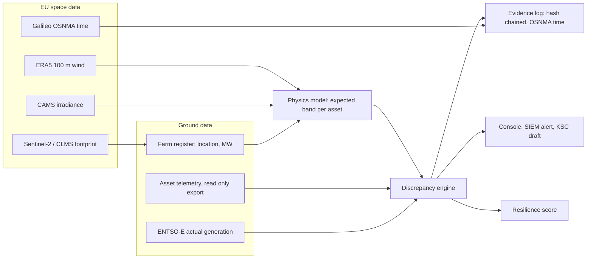

# Second Sight

**12th CASSINI Hackathon: EU Space for Peace and Resilience, Warsaw, 27 to 29 November 2026**
**Track: Challenge 1, Cybersecurity for space based strategic enablers** ("validate signals, identify anomalies using Earth observation data"), with a resilience assessment mode that also serves Challenge 2.

> When attackers blind the operator and wipe the logs, space still sees the plant, and Galileo still keeps the time.

Status, closed gaps and the Saturday task list: [`power_plant_status.md`](power_plant_status.md).

This builds on the team's power plant strategy guide (`moa-raw/cassini_power_plant_hackathon_strategy.md`). It keeps the guide's best parts (two timescales, a deterministic engine, a KSC incident report as the output, read only and out of band) and replaces the simulated attack with the real Polish attack of 29 December 2025, replayed on real data. Items marked **[VERIFY]** are not confirmed yet.

---

## Table of contents

1. [One-line pitch and challenge track](#1-one-line-pitch-and-challenge-track)
2. [EU Space data and signal pipeline](#2-eu-space-data-and-signal-pipeline)
3. [Why it's not a duplicate](#3-why-its-not-a-duplicate)
4. [Target buyer and business model](#4-target-buyer-and-business-model)
5. [48-hour prototype scope](#5-48-hour-prototype-scope)
6. [Biggest risks and likely jury pushback](#6-biggest-risks-and-likely-jury-pushback)
7. [Technical design](#7-technical-design)
8. [Resilience assessment mode](#8-resilience-assessment-mode)
9. [Build plan](#9-build-plan)
10. [Demo and pitch script](#10-demo-and-pitch-script)
11. [Saturday checklist](#11-saturday-checklist)
12. [Relation to the other ideas](#12-relation-to-the-other-ideas)
13. [Sources](#13-sources)

---

## 1. One-line pitch and challenge track

**An independent witness for the power grid: Copernicus tells operators what their wind and solar farms are physically producing when their own telemetry goes dark or lies, Galileo OSNMA seals an evidence timeline the attacker can't wipe, and the result is a ready to file KSC incident report.**

### The problem: this already happened in Poland

On 29 December 2025, during snowstorms just before New Year, a coordinated attack hit Polish energy infrastructure (CERT Polska, January and August 2026):

- **More than 30 wind and PV farms.** Attackers damaged RTU firmware and deleted files. The farms lost communication with the distribution system operator and could not be controlled remotely. Production itself was not affected, but the operator could not see that.
- **A large CHP plant** heating nearly 500,000 people. Wiper malware was blocked by EDR.
- **A second, smaller CHP plant** heating about 50,000 people. The attacker switched Siemens PLCs to STOP and locked them with a password, stopping a steam turbine and a water treatment station. **The operator first assumed a contractor engineer's mistake and reported it as informational.** Resetting the PLCs and the firewall wiped their logs, and Siemens confirmed the PLC logs were unrecoverable.
- **Attribution differs by source.** CERT Polska: infrastructure overlapping with Static Tundra / Berserk Bear / Ghost Blizzard / Dragonfly. Dragos: ELECTRUM (moderate confidence), the group behind the 2015 and 2016 Ukraine grid attacks. Both agree it was Russia-linked and destructive. Dragos calls it the first major coordinated attack on distributed energy resources anywhere.

Three failures, one pattern: **the operator lost sight, misread what it saw, and lost the evidence.** Every one of those failures happened inside the plant's own systems. Nothing outside the plant was watching.

### Why today's tools can't close this gap

| Today's layer | What it does well | Where December broke it |
|---|---|---|
| DSO SCADA via RTUs | Live telemetry and remote control | The RTUs were the target. No RTU, no telemetry |
| OT network monitoring (Dragos, Nozomi, Claroty, Radiflow) | Sees traffic, detects intrusions | Sees nothing once routers, Moxa servers and RTUs are bricked. Same network path as the attacker |
| On-site logs (PLCs, firewalls, routers) | Forensics after the fact | Wiped by factory resets. Siemens: unrecoverable |
| Hardening (MFA, APN isolation, CERT recommendations) | Prevents the next entry | Necessary, but says nothing about what is happening during an attack |

Dragos puts the trend in one line: attackers increasingly target the systems operators rely on to see, understand and manage the grid. **Second Sight's advantage is structural: it has no network path into the plant.** It looks from orbit and keeps its evidence elsewhere, so the attacker can't brick it, spoof it through the same router, or wipe it. We complement the tools above; we don't replace them.

### What we deliver

1. **Physical truth.** For every wind and PV farm, the output it should be producing right now, computed from Copernicus weather and radiation data, compared with what the telemetry reports.
2. **Evidence that survives.** Every check, telemetry gap and verdict is written to a log outside the plant, each entry sealed with OSNMA authenticated Galileo time and hash chained. Wiping the plant's PLCs doesn't touch it.
3. **A decision, not a map.** A verdict per asset, a SIEM alert, and a pre-filled KSC early warning draft for the CSIRT.
4. **A resilience score** (section 8): how much of a region's generation the operator could still see and verify if its telemetry were cut tomorrow.

---

## 2. EU Space data and signal pipeline

| Data | What it gives us | Access | Latency |
|---|---|---|---|
| **Copernicus CAMS solar radiation time series** | Irradiance (GHI, DNI, DHI) at each PV farm, 1 or 15 min steps, 2004 to present | ADS, or `pvlib.iotools.get_cams` (free SoDa account) | about 2 days |
| **Copernicus ERA5** (C3S) | Hourly 100 m wind at each wind farm | CDS API (free key) | about 5 days (ERA5T) |
| **ESA APEx algorithms on Sentinel-2** (official contest resource): *Photovoltaic farms mapping* (`eurac_pv_farm_detection`) and *Wind Turbine Detection* | Finds every PV farm and wind turbine in a region, with footprints. Builds our asset register for the small farms JRC-PPDB-OPEN misses | CDSE openEO, free tier | days |
| **Galileo OSNMA** | Authenticated time for each entry in the evidence log | Receiver at the monitoring site, OSNMAlib | real time |
| **JRC-PPDB-OPEN** (JRC, official contest resource) | European power plants at unit level: location, capacity, fuel, matched to ENTSO-E unit codes (EIC) | Zenodo, 1.3 MB zip | static (v1.0, 2019) |
| **ENTSO-E Transparency Platform** (not space data) | Actual generation per production type in Poland, and per unit for large plants | REST API (free token), `entsoe-py` | about 1 hour |

**Live use** needs data more recent than ERA5 and CAMS provide. The roadmap uses ECMWF open forecast data and Meteosat (MTG) nowcasts. We say this openly; the demo is a replay on real historical data.

**Galileo's role is narrow and real.** OSNMA doesn't detect this attack. It makes the evidence trustworthy: a timeline stamped with time the attacker can't forge, kept outside the network he controls. The CERT supplement says timelines had to be rebuilt from operator and network logs, some of which were destroyed. That's the gap this fills.

---

## 3. Why it's not a duplicate

| Existing work | What it does | Why we're different |
|---|---|---|
| Climate TRACE, WattTime | Infer power plant activity and emissions from satellites, for climate reporting | Annual and monthly, for emissions. Not for operators, not for incidents |
| TROPOMI NO2 vs ENTSO-E studies (2026 paper, 18 plants) | Check emissions of large fossil plants | Research. Slow. Fossil only |
| PV and wind forecasting (Solcast and others) | Predict output for trading | Nobody uses it as a security control to verify telemetry |
| OT security platforms (Nozomi, Claroty, Dragos) | Monitor the OT network | They see what the network sees. When RTUs are wiped, they're blind too |
| GNSS spoofing detection | Past CASSINI winner (3rd, 2024) | We don't pitch spoofing detection. Galileo seals evidence |

The new thing is the combination: physics from space used as an independent security control, plus an evidence trail outside the attacker's reach, tied to a real, documented attack.

---

## 4. Target buyer and business model

### Buyers
- **Distribution system operators** (PGE Dystrybucja, Tauron Dystrybucja, Enea Operator, Energa Operator). In the attack they lost contact with the farms.
- **PSE**, the transmission system operator.
- **Renewable fleet owners** (PGE Energia Odnawialna and others).
- **Sector CSIRTs and CERT Polska**, as users of the evidence trail.

### Why they would pay: the next 18 months
- **KSC (Poland's NIS2 law):** in force since 3 April 2026; registration closed 3 October 2026; **implementation deadline 3 April 2027**. Managers face personal fines up to 300% of monthly pay. Honest caveat: penalties generally can't be imposed until two years after entry into force (CMS), so the pull is the April 2027 deadline and the December attack, not fines.
- **Network Code on Cybersecurity (EU 2024/1366):** EU-wide electricity cyber risk report in 2026, controls proposal early 2027, entity designation mid 2027, first entity reports 2028. ACER asks for operational reliability performance indicators, first submission window 2027 covering 2026. Section 8's metrics are built to feed this. **[VERIFY exact indicator definitions in the ACER guidance of 27 January 2026]**
- **Cybersecurity Act revision (draft, January 2026):** lets the Commission mandate measures, including limiting remote access to EU solar systems via inverters. In May 2026 the Commission began phasing high-risk inverters out of EU-funded projects.
- **European Grids Package (December 2025):** explicitly aims to boost grid resilience against cyber and physical risks.
- **CER Directive:** critical entities must assess risk and show resilience. **[VERIFY article and dates]**
- **Scale:** Poland has about 12 GW of wind and 28 GW of PV (PSE, autumn 2026). Thousands of farms sit behind the same kind of remote access that was abused in December.
- **Scale:** Poland has about 12 GW of wind and 28 GW of PV (PSE, autumn 2026). Thousands of farms sit behind the same kind of remote access that was abused in December.

### Revenue model (hypothesis)
Per MW monitored per year for operators; a resilience assessment as a paid annual report per region. **[VERIFY with a practitioner before quoting numbers]**

### Framing for a Polish jury
Civilian and defensive. Uses only public data. Doesn't touch control systems. The only attack data in the pitch is from CERT Polska's own public reports.

### The big vision: where the EU is going
- **European Space Shield**, launching 2026 with delivery as early as 2027, built on Galileo (including PRS), Copernicus, the planned EOGS and IRIS². ESA's European Resilience from Space programme is funded at €1.35 billion. Europe is turning its space assets into a security layer; Second Sight is a civilian application of exactly that idea for the energy grid.
- **Roadmap, in order:**
  1. **Now:** replay on ERA5 and CAMS (this hackathon).
  2. **Next:** live operation on ECMWF open forecasts and MTG nowcasts.
  3. **Inverter "kill switch" check:** when a region's PV output drops by gigawatts, Copernicus clouds tell the operator in minutes whether it's weather or a remote shutdown. This is the scenario behind the Cybersecurity Act revision.
  4. **Galileo PRS and Signal Authentication** for the evidence clock, plus Grid Time Guard for the grid's own GNSS time.
  5. **IRIS² or GOVSATCOM** as a backup path for alerts when terrestrial comms are down.
  6. **EU-wide resilience scores** feeding the NCCS cycle.

---

## 5. 48-hour prototype scope

### Components
1. **Data loader:** ENTSO-E actual wind and solar generation for Poland, 1 November to 31 December 2025; ERA5 100 m wind over Poland; CAMS irradiance at PV sites (`scripts/fetch_dec29.py`).
2. **Asset register:** **JRC-PPDB-OPEN** for the large units (Bełchatów, CHP plants), which links each unit's EIC code to its ENTSO-E per-unit generation and its coordinates for the satellite checks. It's mainly built from ENTSO-E's unit lists, so small wind and PV farms are likely missing. For those we run the **APEx PV farm mapping and wind turbine detection** algorithms on Sentinel-2 over the demo region, cross-checked against OpenStreetMap. PV capacity is estimated from footprint area, turbine capacity from a typical rating. **[VERIFY: MW per hectare factor; the APEx wind algorithm's ID and free-tier run time]** **[VERIFY Polish coverage in JRC-PPDB-OPEN, and that 2019 data still matches 2025 units]**
3. **Physics model:** wind uses a standard power curve on 100 m wind speed; PV uses irradiance times capacity times a performance ratio. Each gives an expected band, not a single number.
4. **Calibration and backtest:** fit on November and early December 2025 at national level against ENTSO-E, then test on 29 December. Report the error.
5. **Discrepancy engine:** rules from section 7.2.
6. **Evidence log:** append only, hash chained, each entry with OSNMA authenticated time (live receiver at the venue, recorded data as fallback).
7. **Outputs:** an operator console (verdicts, timeline, bands); a KSC early warning draft as JSON and PDF.

### Out of scope
- Real SCADA or RTU connections. We have none, and we say so.
- Detecting the attack itself. We classify what the operator sees and preserve evidence.
- Seeing the small CHP turbine stop from orbit. It's too small, too short, and it was cloudy. For the CHP we show classification and evidence only.

---

## 6. Biggest risks and likely jury pushback

| Question | Answer |
|---|---|
| "ERA5 and CAMS are days late. This isn't real time." | Correct. The demo is a replay on real data. Live use runs on ECMWF open forecasts and MTG nowcasts; the method doesn't change. |
| "Single farm wind estimates are noisy." | That's why we output a band and calibrate it on months of real data. We report the error on screen. |
| "On 29 December production wasn't affected, so what did you detect?" | The verdict: telemetry lost while physics says production continues, so it's a cyber or comms incident and not an outage. That's what the operator needed to know, and it matches what CERT found later. |
| "Where's Galileo?" | Authenticated time on an evidence log outside the plant. The CERT supplement shows why: the PLC and firewall logs were wiped. |
| "Isn't this an AI platform?" | No model is trained on attacks. Physics plus transparent rules, all printed on screen. |
| "Which 30 farms were hit?" | Not public. We use a sample of public farms and say so. |
| "Dragos or Nozomi already do OT security." | They watch the network. In December the network was the target. We add a source with no network path, and we feed their SIEM. |
| "Isn't hardening enough?" | Hardening stops entry. It doesn't tell you, mid-attack, whether 30 farms are still running. Both are needed. |
| "Can't attackers fake telemetry to match the physics?" | Only if they know the weather model and the farm, in real time. And telemetry loss, the December pattern, is caught regardless. |

### Technical risks
- **ENTSO-E data gaps for Poland** around 29 December. **[VERIFY Saturday morning]**
- **API keys:** ENTSO-E token, CDS key, SoDa account. Register first thing; ENTSO-E can take time to issue.
- **OSNMA on our phones:** same test as Proof of Place.

---

## 7. Technical design

### 7.1 Architecture



### 7.2 Verdict rules

| Telemetry | Physics (expected band) | Verdict |
|---|---|---|
| Present, inside band | any | `NORMAL` |
| **Lost** | Says producing | **`BLIND: suspected cyber or comms incident, asset likely still running`** |
| Present, far from band, steady | Disagrees | `SUSPECT TELEMETRY: possible falsified readings` |
| Drops | Also drops | `WEATHER` |
| Drops | Says producing, no weather cause | `NON-WEATHER TRIP: investigate` (covers the CHP case: not "contractor error" by default) |
| Many assets in one region at once | any | Escalates one level: coordinated event |

### 7.3 Evidence log entry

```json
{
  "seq": 1842,
  "asset": "PL-WF-0173",
  "verdict": "BLIND",
  "expected_mw": [11.2, 16.8],
  "telemetry": null,
  "inputs": {"era5": "2025-12-29T07:00Z", "cams": null},
  "time_gst": "2025-12-29T07:15:02Z",
  "osnma": "AUTHENTICATED",
  "prev_hash": "9f3c...",
  "hash": "a71e..."
}
```

### 7.4 Stack
Python (pandas, xarray, pvlib, entsoe-py, cdsapi), FastAPI, a small web console, OSNMAlib for the time source, ReportLab for the KSC PDF.

---

## 8. Resilience assessment mode

**Why:** the CRS report on Ukraine's grid notes the electricity sector "still lacks consensus resilience metrics". The IEA defines cyber resilience as the ability to anticipate, withstand, adapt to and recover. Second Sight turns that into numbers an operator can report under CER.

| Metric | Question | How we compute it |
|---|---|---|
| **Register gap** | How many farms exist on the ground (APEx on Sentinel-2) that aren't in the operator's or JRC's register? | Detected assets not matched to a register entry |
| **Observability under blackout** | If telemetry from every farm in a region went dark, how many MW could we still estimate, and how well? | Share of regional capacity covered by the physics model, with the backtest error |
| **Verification error** | How close is space based physics to reality? | Error of expected vs actual, ENTSO-E, over the backtest months |
| **Evidence survival** | If every on-site log were wiped, how much of the timeline survives? | Share of incident events present in the external log (100% by design; 0% for PLC logs in the December CHP case) |
| **Classification delay** | How fast does a non-weather trip get flagged as suspicious? | Minutes from first anomaly to verdict in a replay |

**Two real replays:**
1. **29 December 2025:** telemetry loss scenario (renewables) and non-weather trip (CHP).
2. **Rogowiec, 17 May 2021:** ten Bełchatów units tripped, about 3,322 MW lost, caused by human error (ENTSO-E expert panel). Unit level ENTSO-E data shows the drop. The engine should say `NON-WEATHER TRIP: investigate`, not "cyber". That proves it doesn't cry wolf.

**Ukraine lesson:** in 2016 operators had to close breakers by hand without full visibility (CRS). Observability under blackout measures exactly that risk before it happens.

---

## 9. Build plan

| Person | Saturday | Sunday morning |
|---|---|---|
| **Data / EO** | Register keys; run `fetch_dec29.py`; asset sample | Backtest numbers, final plots |
| **Engine / GNSS** | Physics model, verdict rules, evidence log | OSNMA time source live or recorded |
| **Front end** | Console: map secondary, timeline and verdicts first | KSC PDF, polish |
| **Pitch** | Verify KSC/CER facts; mentor sessions: find a DSO or CERT practitioner | Deck, rehearsal, backup video |

**Hard rule:** no number goes on a slide until the backtest produces it.

**Decision point Saturday 12:00:** if ERA5 at national level can't track ENTSO-E wind within a usable band, switch the headline to PV only and the CHP evidence story.

---

## 10. Demo and pitch script

1. **Hook (20 s):** "On 29 December 2025, attackers cut Polish operators off from 30 renewable farms and stopped a turbine at a heating plant. The operator wrote it down as a contractor's mistake. The logs that would have proved otherwise were wiped."
2. **Gap (20 s):** every system that failed was inside the plant. Nothing outside was watching.
3. **Replay (90 s):** 29 December on real data. Telemetry goes dark; the bands from ERA5 and CAMS say the farms are still producing; ENTSO-E confirms it; verdict `BLIND`. The CHP trip gets `NON-WEATHER TRIP`, not "informational". Evidence entries tick by, each with OSNMA time. The KSC draft downloads.
4. **Resilience (30 s):** the regional score, then the Rogowiec replay that doesn't cry wolf.
5. **Business (30 s):** DSOs, PSE, fleet owners; KSC and CER; per MW pricing.
6. **Live moment:** an evidence entry sealed with Galileo time on stage, right now.

---

## 11. Saturday checklist

- [ ] ENTSO-E token, CDS key, SoDa account registered
- [ ] `fetch_dec29.py` runs and saves data
- [ ] ENTSO-E Poland wind and solar for 29 December has no gaps
- [ ] Asset register: JRC-PPDB-OPEN loaded, Polish units checked
- [ ] APEx PV farm mapping and wind turbine detection run on one Polish region (CDSE free tier)
- [ ] Backtest error computed
- [ ] OSNMA time source: phone or recorded data
- [x] KSC dates verified (see sources); CER still to verify
- [ ] At least one practitioner quote (DSO, CERT, mentor)
- [ ] Read the full CERT PDFs for any visibility or telemetry details

---

## 12. Relation to the other ideas

- **Proof of Place** shares the OSNMA code. Its seal and this evidence log are the same primitive.
- **Grid Time Guard** (protecting the grid's GNSS time) becomes a roadmap line here, not the headline, because GNSS spoofing detection already placed in 2024 and the CERT reports never mention timing.
- **The strategy guide** stays the background document; this file is the sharpened version.

---

## 13. Sources

- CERT Polska, energy sector incident report (January 2026): https://cert.pl/posts/2026/01/raport-incydent-sektor-energii-2025/
- CERT Polska, supplement (August 2026): https://cert.pl/posts/2026/08/uzupelnienie-raportu-incydent-sektor-energii-2025/ and the PDF https://cert.pl/uploads/docs/CERT_Polska_Uzupelnienie_Raportu_Incydent_Sektor_Energii_2025.pdf
- Polish Prime Minister's office on the December attacks: https://www.gov.pl/web/primeminister/poland-stops-cyberattacks-on-energy-infrastructure
- IEA/OECD, Enhancing Cyber Resilience in Electricity Systems (2021): https://doi.org/10.1787/e00ae407-en
- CRS R48067, Attacks on Ukraine's Electric Grid (May 2024): https://www.everycrsreport.com/reports/R48067.html
- ENTSO-E system operations reports (Rogowiec 2021 expert panel): https://www.entsoe.eu/publications/system-operations-reports/
- START SMICI database: https://smici.umd.edu/ (licence unclear, context only)
- CAMS solar radiation time series: https://ads.atmosphere.copernicus.eu/datasets/cams-solar-radiation-timeseries
- ESA on OSNMA: https://www.esa.int/Applications/Satellite_navigation/Galileo_vs._spoofing_ESA_tests_in_real-world_environments
- TROPOMI NO2 vs ENTSO-E for 18 plants (ACP 2026): https://acp.copernicus.org/articles/26/4405/2026/
- ESA APEx algorithm catalogue, PV farm mapping: https://algorithm-catalogue.apex.esa.int/apps/eurac_pv_farm_detection
- JRC-PPDB-OPEN: https://zenodo.org/records/3574566 (background report JRC106289: https://publications.jrc.ec.europa.eu/repository/handle/JRC106289)
- Climate TRACE on Bełchatów: https://climatetrace.org/news/views-from-above-belchatow-power-station-poland
- Dragos, ELECTRUM and the Poland attack: https://www.dragos.com/blog/poland-power-grid-attack-electrum-targets-distributed-energy-2025
- Dragos 2026 grid threat insights: https://dragos.com/blog/electric-grid-cybersecurity-threats
- KSC timeline: https://www.addleshawgoddard.com/en/insights/insights-briefings/2026/technology/nis2-directive-finally-implemented-Poland-what-businesses-need-know/ and penalties caveat https://cms.law/en/pol/legal-updates/cybersecurity-in-the-supply-chain-what-nis2-changes-in-poland
- NCCS roadmap: https://www.innobu.com/en/articles/nccs-network-code-cybersecurity-obligations-2026.html and ACER indicators https://www.acer.europa.eu/news/acer-launches-guidance-track-cybersecurity-performance-eu-electricity-networks
- Cybersecurity Act revision and PV remote access: https://www.solarpowereurope.org/press-releases/statement-european-commission-publish-draft-revision-of-the-cybersecurity-act
- Inverter phase-out in EU-funded projects: https://www.euronews.com/my-europe/2026/05/04/eu-moves-to-ban-high-risk-inverters-from-china-over-cybersecurity-threats
- European Grids Package: https://www.eesc.europa.eu/en/news-media/press-summaries/european-grids-package
- European Space Shield: https://europeanspaceflight.com/?p=5367 and https://www.brusselstimes.com/1993061/eu-launches-secure-satellite-network-pooling-military-capacities-for-shared-use
